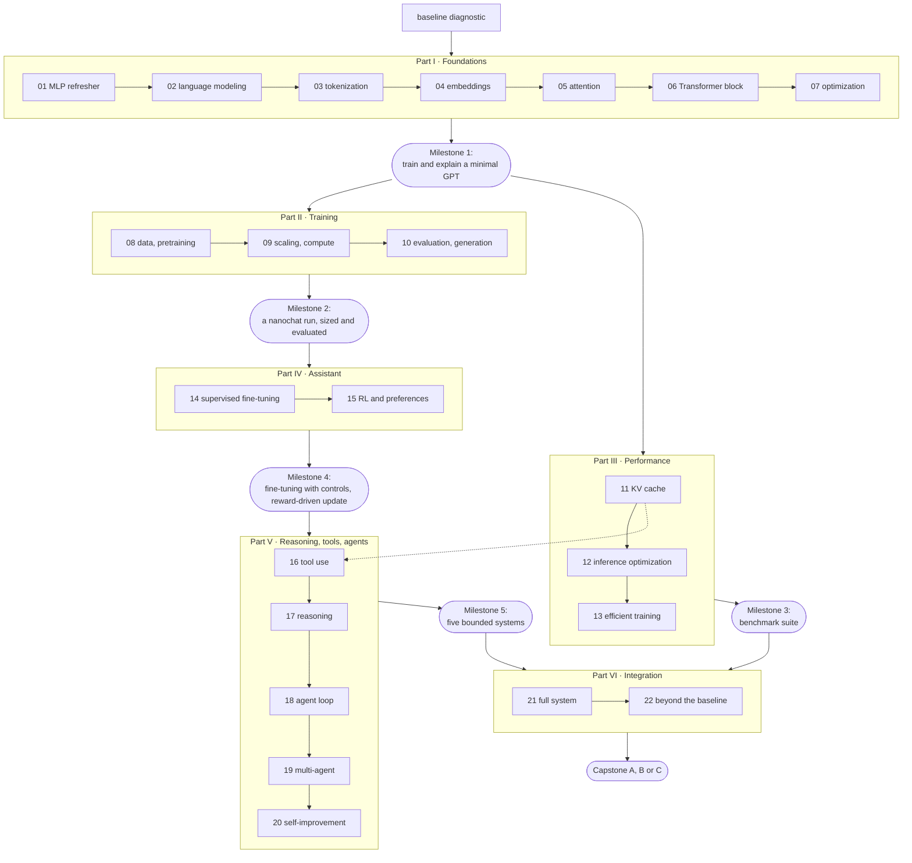

# Course map

One page to find anything. The [syllabus](SYLLABUS.md) says what each module teaches;
this map says where everything is and how the pieces depend on each other.

## The whole course

Solid arrows are the recommended order. Part III depends only on Part I and can be taken
before or after Part II. The dashed arrow marks the one cross-part dependency worth
knowing in advance: tool use (Module 16) builds on the cached generation loop of
Module 11. The three tracks in [LEARNING_PATHS.md](LEARNING_PATHS.md) are paths through
this graph.

## Every module

Each module has five documents: the **lesson** (sections A–F and M), the **lab** sheet
(exercises, experimental procedure, results template: sections G–I), the **quiz** with
mastery criteria (J), annotated **references** (L), and **solutions** in a separate
directory (K). "Course code" is the minimal implementation the lesson explains;
"nanochat" is where the same thing lives upstream at the pinned revision.

### Part I · Foundations

| # | Module | Documents | Lab scripts | Course code | nanochat |
|---:|---|---|---|---|---|
| 01 | From the 1990s perceptron to the language model | [lesson](modules/01-neural-network-refresher/lesson.md) · [lab](modules/01-neural-network-refresher/lab.md) · [quiz](modules/01-neural-network-refresher/quiz.md) · [refs](modules/01-neural-network-refresher/references.md) · [solutions](solutions/01-neural-network-refresher.md) | [`01_digits_mlp.py`](labs/foundations/01_digits_mlp.py) · [`01b_mlp_next_char.py`](labs/foundations/01b_mlp_next_char.py) | `mlle/foundations/mlp.py` | — |
| 02 | Language modeling and autoregressive generation | [lesson](modules/02-language-modeling/lesson.md) · [lab](modules/02-language-modeling/lab.md) · [quiz](modules/02-language-modeling/quiz.md) · [refs](modules/02-language-modeling/references.md) · [solutions](solutions/02-language-modeling.md) | [`02_ngrams_and_entropy.py`](labs/foundations/02_ngrams_and_entropy.py) | `mlle/foundations/ngram.py`, `mlle/data/pocket.py` | `gpt.py` (loss), `loss_eval.py` |
| 03 | Tokenization | [lesson](modules/03-tokenization/lesson.md) · [lab](modules/03-tokenization/lab.md) · [quiz](modules/03-tokenization/quiz.md) · [refs](modules/03-tokenization/references.md) · [solutions](solutions/03-tokenization.md) | [`03_bpe.py`](labs/foundations/03_bpe.py) · [`03_nanochat_tokenizer.py`](labs/foundations/03_nanochat_tokenizer.py) | `mlle/foundations/bpe.py` | `tokenizer.py`, `scripts/tok_train.py` |
| 04 | Embeddings, representation spaces and position | [lesson](modules/04-embeddings/lesson.md) · [lab](modules/04-embeddings/lab.md) · [quiz](modules/04-embeddings/quiz.md) · [refs](modules/04-embeddings/references.md) · [solutions](solutions/04-embeddings.md) | [`04_positions.py`](labs/foundations/04_positions.py) · [`04_representations.py`](labs/foundations/04_representations.py) | `mlle/foundations/positional.py` | `gpt.py` (wte, rotary) |
| 05 | Attention from first principles | [lesson](modules/05-attention/lesson.md) · [lab](modules/05-attention/lab.md) · [quiz](modules/05-attention/quiz.md) · [refs](modules/05-attention/references.md) · [solutions](solutions/05-attention.md) | [`05_attention.py`](labs/foundations/05_attention.py) · [`05_attention_in_a_model.py`](labs/foundations/05_attention_in_a_model.py) | `mlle/foundations/attention.py` | `gpt.py` (attention), `flash_attention.py` |
| 06 | The complete Transformer block | [lesson](modules/06-transformer-block/lesson.md) · [lab](modules/06-transformer-block/lab.md) · [quiz](modules/06-transformer-block/quiz.md) · [refs](modules/06-transformer-block/references.md) · [solutions](solutions/06-transformer-block.md) | [`06_nanochat_parity.py`](labs/foundations/06_nanochat_parity.py) · [`06_transformer_trace.py`](labs/foundations/06_transformer_trace.py) | `mlle/foundations/minigpt.py`, `mlle/nanochat_bridge.py` | `gpt.py` (Block, GPT.forward) |
| 07 | Learning and optimization | [lesson](modules/07-optimization/lesson.md) · [lab](modules/07-optimization/lab.md) · [quiz](modules/07-optimization/quiz.md) · [refs](modules/07-optimization/references.md) · [solutions](solutions/07-optimization.md) | [`07_train_minigpt.py`](labs/foundations/07_train_minigpt.py) | `mlle/foundations/optim.py`, `mlle/foundations/train.py` | `optim.py`, `gpt.py` (init, setup_optimizer) |

Milestone: [instructor/assessments.md#milestone-1](instructor/assessments.md#milestone-1).

### Part II · Training language models

| # | Module | Documents | Lab scripts | Course code | nanochat |
|---:|---|---|---|---|---|
| 08 | Data preparation and pretraining | [lesson](modules/08-data-and-pretraining/lesson.md) · [lab](modules/08-data-and-pretraining/lab.md) · [quiz](modules/08-data-and-pretraining/quiz.md) · [refs](modules/08-data-and-pretraining/references.md) · [solutions](solutions/08-data-and-pretraining.md) | [`08_data_quality.py`](labs/pretraining/08_data_quality.py) · [`08_packing.py`](labs/pretraining/08_packing.py) | `mlle/data/packing.py`, `mlle/data/quality.py` | `dataset.py`, `dataloader.py`, `scripts/base_train.py` |
| 09 | Model size, scaling laws and compute budgets | [lesson](modules/09-scaling-and-compute/lesson.md) · [lab](modules/09-scaling-and-compute/lab.md) · [quiz](modules/09-scaling-and-compute/quiz.md) · [refs](modules/09-scaling-and-compute/references.md) · [solutions](solutions/09-scaling-and-compute.md) | [`09_param_flops.py`](labs/pretraining/09_param_flops.py) · [`09_scaling_sweep.py`](labs/pretraining/09_scaling_sweep.py) | `scripts/experiments/estimate_run.py` | `scripts/base_train.py` (sizing), `runs/scaling_laws.sh` |
| 10 | Evaluation and generation | [lesson](modules/10-evaluation-and-generation/lesson.md) · [lab](modules/10-evaluation-and-generation/lab.md) · [quiz](modules/10-evaluation-and-generation/quiz.md) · [refs](modules/10-evaluation-and-generation/references.md) · [solutions](solutions/10-evaluation-and-generation.md) | [`10_decoding.py`](labs/pretraining/10_decoding.py) · [`10_eval_methodology.py`](labs/pretraining/10_eval_methodology.py) | `mlle/inference/sampling.py`, `mlle/evaluation.py` | `scripts/base_eval.py`, `core_eval.py`, `scripts/chat_eval.py` |

Milestone: [instructor/assessments.md#milestone-2](instructor/assessments.md#milestone-2).

### Part III · Performance engineering

| # | Module | Documents | Lab scripts | Course code | nanochat |
|---:|---|---|---|---|---|
| 11 | Efficient autoregressive inference: the KV cache | [lesson](modules/11-kv-cache/lesson.md) · [lab](modules/11-kv-cache/lab.md) · [quiz](modules/11-kv-cache/quiz.md) · [refs](modules/11-kv-cache/references.md) · [solutions](solutions/11-kv-cache.md) | [`11_kv_cache.py`](labs/optimization/11_kv_cache.py) · [`11_nanochat_engine.py`](labs/optimization/11_nanochat_engine.py) | `mlle/inference/kvcache.py` | `engine.py` (KVCache, Engine) |
| 12 | Attention and inference optimization | [lesson](modules/12-inference-optimization/lesson.md) · [lab](modules/12-inference-optimization/lab.md) · [quiz](modules/12-inference-optimization/quiz.md) · [refs](modules/12-inference-optimization/references.md) · [solutions](solutions/12-inference-optimization.md) | [`12_flash_sim.py`](labs/optimization/12_flash_sim.py) · [`12_gqa_window.py`](labs/optimization/12_gqa_window.py) · [`12_quantize.py`](labs/optimization/12_quantize.py) | `mlle/inference/flash_sim.py`, `mlle/inference/quantize.py` | `flash_attention.py`, `scripts/infer_bench.py` |
| 13 | Efficient training | [lesson](modules/13-efficient-training/lesson.md) · [lab](modules/13-efficient-training/lab.md) · [quiz](modules/13-efficient-training/quiz.md) · [refs](modules/13-efficient-training/references.md) · [solutions](solutions/13-efficient-training.md) | [`13_grad_accum.py`](labs/optimization/13_grad_accum.py) · [`13_master_weights.py`](labs/optimization/13_master_weights.py) · [`13_precision.py`](labs/optimization/13_precision.py) | `mlle/bench/harness.py`, `scripts/benchmarks/run_all.py` | `common.py` (dtype), `fp8.py`, `optim.py` (distributed) |

Milestone: [instructor/assessments.md#milestone-3](instructor/assessments.md#milestone-3).

### Part IV · From base model to assistant

| # | Module | Documents | Lab scripts | Course code | nanochat |
|---:|---|---|---|---|---|
| 14 | Instruction tuning and supervised fine-tuning | [lesson](modules/14-supervised-finetuning/lesson.md) · [lab](modules/14-supervised-finetuning/lab.md) · [quiz](modules/14-supervised-finetuning/quiz.md) · [refs](modules/14-supervised-finetuning/references.md) · [solutions](solutions/14-supervised-finetuning.md) | [`14_chat_sft.py`](labs/finetuning/14_chat_sft.py) · [`14_lora.py`](labs/finetuning/14_lora.py) | `mlle/finetune/chat.py`, `mlle/finetune/sft.py`, `mlle/finetune/lora.py` | `tokenizer.py` (render), `scripts/chat_sft.py` |
| 15 | Preference optimization and reinforcement learning | [lesson](modules/15-rl-and-preferences/lesson.md) · [lab](modules/15-rl-and-preferences/lab.md) · [quiz](modules/15-rl-and-preferences/quiz.md) · [refs](modules/15-rl-and-preferences/references.md) · [solutions](solutions/15-rl-and-preferences.md) | [`15_dpo.py`](labs/finetuning/15_dpo.py) · [`15_reinforce.py`](labs/finetuning/15_reinforce.py) | `mlle/finetune/rl.py`, `mlle/finetune/dpo.py` | `scripts/chat_rl.py`, `tasks/gsm8k.py` |

Milestone: [instructor/assessments.md#milestone-4](instructor/assessments.md#milestone-4).

### Part V · Reasoning, tools and agents

| # | Module | Documents | Lab scripts | Course code | nanochat |
|---:|---|---|---|---|---|
| 16 | Teaching LLMs to use tools | [lesson](modules/16-tool-use/lesson.md) · [lab](modules/16-tool-use/lab.md) · [quiz](modules/16-tool-use/quiz.md) · [refs](modules/16-tool-use/references.md) · [solutions](solutions/16-tool-use.md) | [`16_tool_assistant.py`](labs/agents/16_tool_assistant.py) | `mlle/agents/tool_engine.py`, `mlle/agents/tools.py`, `mlle/agents/assistant.py` | `engine.py` (calculator, state machine), `execution.py` |
| 17 | Reasoning and inference-time computation | [lesson](modules/17-reasoning/lesson.md) · [lab](modules/17-reasoning/lab.md) · [quiz](modules/17-reasoning/quiz.md) · [refs](modules/17-reasoning/references.md) · [solutions](solutions/17-reasoning.md) | [`17_reasoning_benchmark.py`](labs/agents/17_reasoning_benchmark.py) | `mlle/agents/reasoning.py`, `mlle/agents/llm.py` | `tasks/gsm8k.py`, `Engine.generate_batch` |
| 18 | The agentic loop | [lesson](modules/18-agentic-loop/lesson.md) · [lab](modules/18-agentic-loop/lab.md) · [quiz](modules/18-agentic-loop/quiz.md) · [refs](modules/18-agentic-loop/references.md) · [solutions](solutions/18-agentic-loop.md) | [`18_agent_loop.py`](labs/agents/18_agent_loop.py) | `mlle/agents/loop.py`, `mlle/agents/envs.py`, `mlle/agents/policies.py` | `scripts/chat_cli.py` (conversation loop) |
| 19 | Multi-agent collaboration | [lesson](modules/19-multi-agent/lesson.md) · [lab](modules/19-multi-agent/lab.md) · [quiz](modules/19-multi-agent/quiz.md) · [refs](modules/19-multi-agent/references.md) · [solutions](solutions/19-multi-agent.md) | [`19_multi_agent.py`](labs/agents/19_multi_agent.py) | `mlle/agents/multi.py` | — (course extension) |
| 20 | Self-improvement and autonomous experimentation | [lesson](modules/20-self-improvement/lesson.md) · [lab](modules/20-self-improvement/lab.md) · [quiz](modules/20-self-improvement/quiz.md) · [refs](modules/20-self-improvement/references.md) · [solutions](solutions/20-self-improvement.md) | [`20_experiment_loop.py`](labs/agents/20_experiment_loop.py) | `mlle/agents/experiment.py` | commits `6ed7d1d`, `a825e63`; `dev/LOG.md` |

Milestone: [instructor/assessments.md#milestone-5](instructor/assessments.md#milestone-5).

### Part VI · Integration and frontier

| # | Module | Documents | Lab scripts | Course code | nanochat |
|---:|---|---|---|---|---|
| 21 | Putting the full system together | [lesson](modules/21-full-system/lesson.md) · [lab](modules/21-full-system/lab.md) · [quiz](modules/21-full-system/quiz.md) · [refs](modules/21-full-system/references.md) · [solutions](solutions/21-full-system.md) | [`21_end_to_end.py`](labs/integration/21_end_to_end.py) | `labs/integration/21_end_to_end.py` | `runs/speedrun.sh`, `checkpoint_manager.py` |
| 22 | Beyond the baseline Transformer | [lesson](modules/22-beyond-the-baseline/lesson.md) · [lab](modules/22-beyond-the-baseline/lab.md) · [quiz](modules/22-beyond-the-baseline/quiz.md) · [refs](modules/22-beyond-the-baseline/references.md) · [solutions](solutions/22-beyond-the-baseline.md) | [`22_retrieval.py`](labs/integration/22_retrieval.py) | `labs/integration/22_retrieval.py` | `dev/LOG.md` (negative results) |

## Everything else

| You want | Go to |
|---|---|
| to install and check your environment | [docs/getting-started.md](docs/getting-started.md) · `make install` · `make doctor` |
| to know what you need beforehand | [docs/prerequisites.md](docs/prerequisites.md) · [docs/mathematics-primer.md](docs/mathematics-primer.md) · [baseline diagnostic](instructor/assessments.md#baseline-diagnostic) |
| a term defined | [docs/glossary.md](docs/glossary.md) |
| the big picture in diagrams | [docs/architecture-overview.md](docs/architecture-overview.md) |
| to know exactly which nanochat the course describes | [docs/upstream-version.md](docs/upstream-version.md) (pinned revision, source map, capability matrix) |
| to set up a DGX Spark | [docs/dgx-spark-setup.md](docs/dgx-spark-setup.md) (every claim labelled: source, reported, or to validate) |
| to size a run or decide whether to rent a GPU | [docs/hardware-and-costs.md](docs/hardware-and-costs.md) · `scripts/experiments/estimate_run.py` |
| help with an error | [docs/troubleshooting.md](docs/troubleshooting.md) |
| a schedule | [LEARNING_PATHS.md](LEARNING_PATHS.md) · [instructor/teaching-guide.md](instructor/teaching-guide.md) |
| to be assessed | [instructor/assessments.md](instructor/assessments.md) · [instructor/grading-rubrics.md](instructor/grading-rubrics.md) |
| a final project | [projects/README.md](projects/README.md) |
| further reading | [resources/README.md](resources/README.md) |
| the author's measured results | [results/reference/](results/reference/) |
| templates for your own results | [results/templates/experiment-record.md](results/templates/experiment-record.md) · [results/templates/spark-validation.md](results/templates/spark-validation.md) |
| to know what has been verified, and on what hardware | [PROGRESS.md](PROGRESS.md) |
| to contribute or update the course | [CONTRIBUTING.md](CONTRIBUTING.md) |

## Experiment tiers

| Tier | Meaning | Typical duration | Where |
|---|---|---|---|
| A | micro-experiment on CPU | seconds to a few minutes | every lab script in `labs/` |
| B | small GPU experiment, or the miniature nanochat pipeline on CPU | minutes to an hour | Modules 08–15, marked exercises |
| C | extended run on a DGX Spark or comparable GPU | hours to days | Milestone 2 (GPU version), optional fine-tuning and RL |
| D | optional research-scale run | beyond one machine | described, never required |

Every lab runs on a CPU. Every GPU exercise states that the author has not validated it
and gives no reference values.
