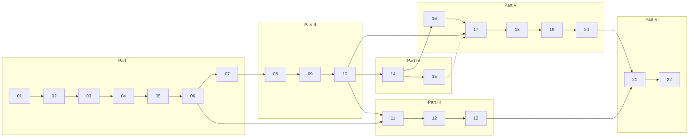

# Learning paths

Three routes through the same material. Pick by goal, not by ambition: the tracks nest,
so you can extend later without repeating anything.

Solid arrows are prerequisites; the dotted arrow is "helpful, not required".
Part V depends on Part I and on Modules 10 and 14 only, so it can be taken before Part III.

## Track 1 — Conceptual Foundations (≈ 35–45 hours)

**For:** understanding the mathematics, architecture and data flow, with light experimentation.
**Hardware:** any laptop. No GPU, no nanochat environment required (reading the nanochat walkthroughs is enough).

| Order | Modules | What to do | What to skip |
|---|---|---|---|
| 1 | 01–07 | lessons, the "predict then run" lab script of each module, quizzes | optional challenges; multi-seed studies |
| 2 | 10 (sections on metrics and decoding) | lesson, decoding lab | CORE details |
| 3 | 11 | lesson and the correctness lab | benchmarks |
| 4 | 14, 16, 17 (lessons only) | read; run the smallest lab of each | training runs |
| 5 | 21 | lesson | — |

**Prerequisites:** [docs/prerequisites.md](docs/prerequisites.md).
**Competencies at the end:** trace a forward pass from token ids to probabilities with
shapes; compute attention by hand; explain training vs. generation; explain what a KV
cache stores; say what SFT changes and what a tool call is; distinguish model from
orchestration.

## Track 2 — Hands-on LLM Engineer (≈ 110–140 hours) — recommended

**For:** being able to inspect, modify, train, benchmark and fine-tune a real implementation.
**Hardware:** DGX Spark (or any CUDA GPU with ≥ 24 GB, with smaller depths); CPU for Parts I and V.

| Order | Modules | Milestone |
|---|---|---|
| 1 | 01–07, all labs | Milestone 1: your own minimal Transformer, trained and mapped to nanochat |
| 2 | 08–10, all labs | Milestone 2: a trained and evaluated nanochat model + one controlled experiment |
| 3 | 11–13, all labs | Milestone 3: reproducible benchmark suite |
| 4 | 14–15, all labs | Milestone 4: SFT run + reward-driven improvement |
| 5 | 16–18, projects | tool-using assistant; reasoning comparison; bounded agent |
| 6 | 21 | integration |
| 7 | Capstone A or B | |

Modules 19, 20 and 22 are optional on this track.

**Competencies at the end:** everything in Track 1, plus: read and modify nanochat's
model, optimizer, data loader and engine; plan a training run from a compute budget;
measure throughput, memory and quality correctly; verify an optimization for
correctness; fine-tune with masked loss; explain and run a policy-gradient update; build
a sandboxed tool loop with explicit limits.

## Track 3 — Advanced Research and Agentic Systems (≈ 140–170 hours)

**For:** extending the engineer track into deeper experiments, RL, reasoning, agent
orchestration and evaluation-driven improvement.
**Hardware:** as Track 2; some Tier D experiments benefit from rented multi-GPU time
([when it is worth it](docs/hardware-and-costs.md#when-is-renting-a-gpu-worth-it)).

Everything in Track 2, plus:

| Addition | What |
|---|---|
| Optional challenges in every lab | including multi-seed studies and the ablations marked "research" |
| 15 in depth | reward design experiments, DPO vs. policy gradient, reward-hacking demonstration |
| 19, 20 | multi-agent comparison; bounded experiment loop with a held-out test set |
| 22 | read two primary sources per topic and write a one-page evidence assessment each |
| Tier D | a scaling miniseries (≥ 3 depths) with fitted trend, or an architectural ablation in nanochat |
| Capstone C | with the multi-agent extension, or a second capstone |

**Competencies at the end:** everything in Track 2, plus: design experiments whose
conclusions survive seed variance; implement and evaluate test-time-compute strategies;
build and instrument agent loops and multi-agent protocols and show whether they beat a
baseline; run an automated experiment loop without leaking evaluation data; assess a new
paper's claims against its evidence.

## Mixing and matching

| Constraint | Suggestion |
|---|---|
| One weekend | 01, 02, 05, 06 lessons + their main labs |
| "I only care about agents" | 01–02 (skim), 05–06 lessons, 10, 14 lesson, then 16–20 in full |
| "I only care about performance" | 05–06, then 11–13, then Capstone B |
| No GPU at all | Track 1, then Part V in full, then the CPU-scale versions of 08, 11, 12, 14, 15 |
| Teaching a group | [instructor/teaching-guide.md](instructor/teaching-guide.md) has a 12-week schedule |

## How progress is judged

Each module ends with mastery criteria. End-of-part assessments and the final checklist
of abilities you should be able to demonstrate without assistance are in
[instructor/assessments.md](instructor/assessments.md). Take the
[baseline diagnostic](instructor/assessments.md#baseline-diagnostic) before you start: its
score suggests where to begin and which track fits.
