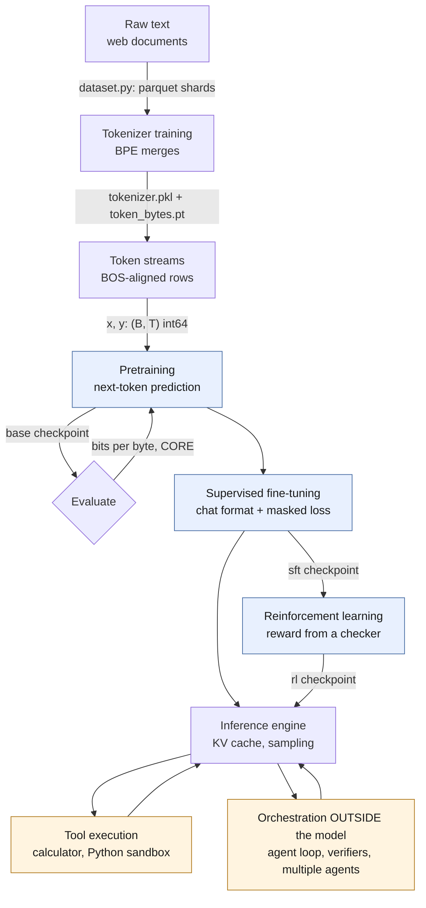
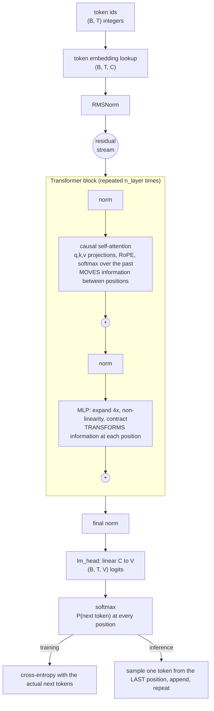
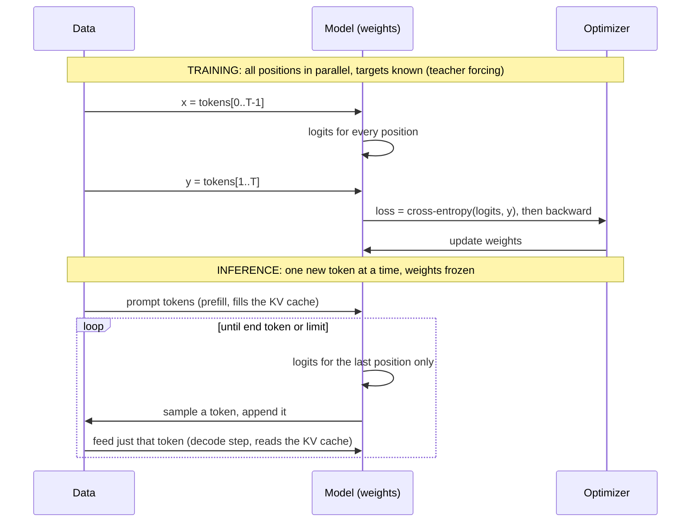

# Architecture overview: the whole system on two pages

Keep this page open while you study. Every box is a module of the course, and every arrow
is a file format or tensor you will have inspected by the end.

## 1. The life of a language model

Blue boxes change the model's **weights**. Orange boxes are ordinary software *around*
the model: they change what text the model sees and what is done with the text it
produces, but not the model itself. Keeping that distinction sharp is one of the main
goals of Parts IV–V.

| Stage | Modules | What changes | nanochat entry point |
|---|---|---|---|
| Tokenizer | 03 | vocabulary (merge table) | `scripts/tok_train.py` |
| Pretraining | 02, 04–09 | all weights, from random | `scripts/base_train.py` |
| Evaluation | 10 | nothing | `scripts/base_eval.py`, `scripts/chat_eval.py` |
| SFT | 14 | all weights, from the base checkpoint | `scripts/chat_sft.py` |
| RL | 15 | all weights, from the SFT checkpoint | `scripts/chat_rl.py` |
| Inference | 10–12 | nothing (weights frozen) | `nanochat/engine.py`, `scripts/chat_cli.py` |
| Tools | 16 | nothing; text is injected into the context | `nanochat/engine.py` (calculator), `nanochat/execution.py` |
| Reasoning strategies, agents | 17–20 | nothing; more model calls per answer | course code (`mlle/agents/`) |

## 2. Inside the model: token ids to next-token probabilities

Shape legend used in every lesson: `B` batch size, `T` sequence length, `C = n_embd`
(width of the residual stream), `H = n_head`, `D = C / H` (head dimension), `V` vocabulary size.

Two sentences that summarise the architecture:

- **Attention is the only place where positions exchange information.** Everything else
  (embedding, norms, MLP, output head) processes each position independently.
- **Every block only adds to the residual stream.** The stream is the model's working
  memory, shared by all layers; the output head reads the final state of it.

nanochat adds five refinements to this picture (per-layer residual scalars, value
embeddings, "smear", "backout", logit soft-capping) and replaces the attention kernel
with Flash Attention 3 where available. Module 06 covers each, and a test proves that
with those refinements neutralised the picture above is *exactly* what nanochat computes.

## 3. Training and inference are the same function used differently

## 4. Where the time and memory go

| Phase | Dominant cost | Bound by | Module |
|---|---|---|---|
| Training step | matmuls in the block matrices, forward + backward (≈ 6 FLOPs per matmul parameter per token) | compute (FLOPs) | 09, 13 |
| Training memory | activations kept for backward (∝ B × T × C × layers), weights, optimizer state | memory capacity | 13 |
| Prefill (prompt) | same matmuls, forward only, all prompt tokens in parallel | compute | 11 |
| Decode (per token) | re-reading every weight and the KV cache to produce one token | memory bandwidth | 11, 12 |
| KV cache | `n_layer × 2 × n_kv_head × head_dim` values per token per sequence | memory capacity | 11 |

## 5. What is and is not "in the model"

| Capability | Lives in the weights? | Lives in surrounding code? |
|---|---|---|
| Predicting the next token | yes | — |
| Following the chat format, stopping at `<\|assistant_end\|>` | yes (learned in SFT) | the engine checks for the end token |
| *Requesting* a calculation by emitting `<\|python_start\|>…<\|python_end\|>` | yes (learned in SFT) | — |
| *Performing* the calculation | no | yes: the engine evaluates the expression and forces the result tokens into the context |
| Remembering earlier turns | no (no state between calls) | yes: the whole conversation is re-sent as tokens; the KV cache is an optimisation of that |
| Trying several answers and voting | no | yes |
| An agent loop with a goal, step budget and stop condition | no | yes |

When someone says "the model reasons", "the model uses tools" or "the model remembers",
ask which row of this table they mean. Module 16 onward builds each right-hand entry
explicitly so the boundary stays visible.
