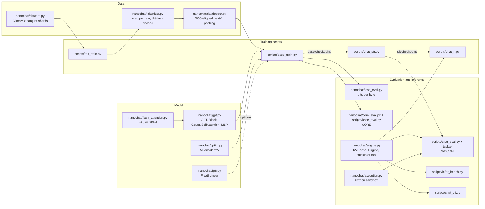

# Upstream version, audit and capability matrix

This course is written against one exact revision of nanochat. Everything the lessons say
about "what nanochat does" was checked against this revision's source, not against older
blog posts, videos or memory.

| | |
|---|---|
| Repository | <https://github.com/karpathy/nanochat> |
| Pinned commit | [`92d63d4e8bb4df75c3b71618f31ddde2378b2bcd`](https://github.com/karpathy/nanochat/tree/92d63d4e8bb4df75c3b71618f31ddde2378b2bcd) ("clean up fragile code") |
| Commit date | 2026-07-03 |
| Audit date | 2026-11-11 |
| License | MIT, © Andrej Karpathy (see [NOTICE.md](../NOTICE.md)) |
| Python | `>=3.10` (`.python-version`: 3.10) |
| Key dependencies | `torch==2.9.1` (CPU or CUDA 12.8 wheels), `rustbpe>=0.1.0`, `tiktoken>=0.11.0`, `pyarrow>=21`, `kernels>=0.11.7`, `wandb`, `filelock`, `psutil`, `numpy` |
| Secondary reference | [nanoGPT](https://github.com/karpathy/nanoGPT), optional, for the classic GPT-2 layout only |

Get exactly this revision with `make nanochat` (runs
[`scripts/setup/fetch_nanochat.sh`](../scripts/setup/fetch_nanochat.sh)). The checkout
lives in `external/nanochat/`, is git-ignored, and is never modified by the course.
`mlle.nanochat_bridge.require_nanochat()` warns when a lab runs against any other commit.

> **nanochat changes quickly.** Between the first public version (October 2025) and this
> pin, the project replaced its dataset, removed the web UI and the "midtraining" stage,
> dropped `torch.amp.autocast`, added FP8 training, sliding-window attention, value
> embeddings, and a unified optimizer. Many tutorials on the internet describe the 2025
> code. When they disagree with this page, trust the pinned source.

## What was verified, and how

| Claim | Evidence |
|---|---|
| The architecture description in Module 06 is correct | `tests/test_nanochat_parity.py`: a 250-line independent re-implementation (`mlle/foundations/minigpt.py`) reproduces nanochat's logits to 4e-6 after copying weights and neutralising the five extras listed below. Re-enabling any one extra breaks parity, so the list of extras is complete for the forward pass. |
| Upstream's own tests pass on CPU at the pin | `python -m pytest tests` in the checkout: 44 passed, 14 skipped (the skipped ones need CUDA or Flash Attention 3). Measured 2026-11-11, x86-64, torch 2.9.1+cpu. |
| Tokenizer training, pretraining, evaluation and the checkpoint format work on CPU with a local dataset | [`results/reference/nanochat-local-cpu.md`](../results/reference/nanochat-local-cpu.md) |
| GPU, DGX Spark, FP8, Flash Attention 3, multi-GPU behaviour | **Not verified by the course author** (no GPU was available). Described from source code and cited reports; each such statement is marked *awaiting validation*. See [dgx-spark-setup.md](dgx-spark-setup.md). |

## Architectural map

### Source map (line numbers are for the pinned commit)

| File | Lines | What it contains | Course module |
|---|---:|---|---|
| [`nanochat/tokenizer.py`][tok] | 279 | `SPECIAL_TOKENS` (9 tokens), `SPLIT_PATTERN`, `RustBPETokenizer` (train with rustbpe, encode with tiktoken), `render_conversation` (chat format + loss mask), `render_for_completion` | 03, 14, 16 |
| [`nanochat/dataset.py`][dataset] | 160 | ClimbMix-400B shard download, `list_parquet_files`, `parquets_iter_batched`; last shard = validation | 08 |
| [`nanochat/dataloader.py`][dataloader] | 166 | `_document_batches`, BOS-aligned best-fit-crop packing, pinned-memory single host-to-device copy | 08 |
| [`nanochat/gpt.py`][gpt] | 555 | `GPTConfig`, `norm` (parameter-free RMSNorm), `Linear` (casts weights to the activation dtype), `apply_rotary_emb`, `CausalSelfAttention`, `MLP`, `Block`, `GPT` (init, RoPE tables, window sizes, FLOP and KV-byte estimators, `setup_optimizer`, `forward`, naive `generate`) | 04–07, 09, 11, 12 |
| [`nanochat/flash_attention.py`][fa] | 195 | Loads Flash Attention 3 through the `kernels` package when the GPU supports it; otherwise PyTorch `scaled_dot_product_attention` with explicit masks for sliding windows and cached decoding | 05, 11, 12 |
| [`nanochat/optim.py`][optim] | 459 | `adamw_step_fused`, `muon_step_fused` (Polar Express orthogonalization, NorMuon variance reduction, MuonEq, Muon+, cautious weight decay), `MuonAdamW` (single-GPU and ZeRO-2-style distributed) | 07, 13 |
| [`nanochat/fp8.py`][fp8] | 266 | `Float8Linear`: FP8 matmuls through `torch._scaled_mm` with tensor-wise dynamic scaling | 13 |
| [`nanochat/common.py`][common] | 328 | `COMPUTE_DTYPE` detection, `compute_init`, DDP helpers, peak-FLOPS and peak-bandwidth tables | 13 |
| [`nanochat/engine.py`][engine] | 352 | Calculator tool (`use_calculator`), `KVCache`, `sample_next_token`, `Engine.generate` (prefill, cache replication, tool-use state machine), `generate_batch` | 10, 11, 16 |
| [`nanochat/execution.py`][execution] | 134 | `execute_code`: subprocess sandbox with timeout, memory limit and disabled destructive functions (explicitly "not a true security sandbox") | 16 |
| [`nanochat/loss_eval.py`][losseval] | 65 | `evaluate_bpb`: bits per byte, tokenizer-independent | 10 |
| [`nanochat/core_eval.py`][coreeval] | 262 | CORE (DCLM) in-context-learning tasks: multiple choice, schema, language modeling | 10 |
| [`nanochat/checkpoint_manager.py`][ckpt] | 193 | Save/load model, per-rank optimizer state and JSON metadata; `load_model("base"\|"sft"\|"rl")` | 08, 21 |
| [`scripts/tok_train.py`][toktrain] / [`tok_eval.py`][tokeval] | 91 / 243 | Train the tokenizer, cache `token_bytes.pt`, compare compression against GPT-2/GPT-4 tokenizers | 03 |
| [`scripts/base_train.py`][basetrain] | 604 | Pretraining: depth-driven sizing, automatic horizon / batch size / LR / weight-decay scaling, schedules, gradient accumulation, evaluation, checkpointing | 07–09, 13 |
| [`scripts/base_eval.py`][baseeval] | 243 | CORE, bits per byte, samples for a base model | 10 |
| [`scripts/chat_sft.py`][sft] | 499 | Supervised fine-tuning on SmolTalk + MMLU + GSM8K with masked loss and best-fit *padding* | 14 |
| [`scripts/chat_rl.py`][rl] | 326 | REINFORCE-style policy gradient on GSM8K with a mean baseline ("GRPO" in quotes) | 15 |
| [`scripts/chat_eval.py`][chateval] | 240 | Generative and categorical evaluation loops, ChatCORE | 10, 14 |
| [`scripts/infer_bench.py`][inferbench] | 246 | Inference benchmark: TTFT, time per output token, tokens/s, MBU, MFU, VRAM over batch sizes | 11, 12 |
| [`scripts/chat_cli.py`][cli] | 100 | Terminal chat | 14 |
| [`tasks/`][tasks] | — | `Task`, `TaskMixture`, `TaskSequence`, `HubDataset`; GSM8K, MMLU, ARC, HumanEval, SmolTalk | 14, 15 |
| [`runs/`][runs] | — | `speedrun.sh` (8×H100 reference), `runcpu.sh`, `miniseries.sh`, `scaling_laws.sh` | 08, 09 |
| [`dev/LOG.md`][devlog] | 1089 | Dated engineering log with positive **and negative** results; used as a primary source throughout | all |

## The model at the pinned revision, in one table

Verified by reading [`nanochat/gpt.py`][gpt] and by the parity test.

| Component | nanochat at `92d63d4` | Classic GPT-2 |
|---|---|---|
| Token embedding | `wte`, std 0.8, followed by RMSNorm | `wte`, std 0.02 |
| Position information | RoPE on queries and keys, base 100000, half-split pairing | learned absolute `wpe`, added |
| Normalization | parameter-free RMSNorm (`F.rms_norm`), pre-norm, also after embedding and before the head | LayerNorm with learned gain and bias, pre-norm |
| Attention | QK-norm, then q and k each × 1.2; causal; optional sliding window per layer (`window_pattern`, default `SSSL`); optional GQA (`n_kv_head`) | plain scaled dot-product, full causal |
| Attention kernel | Flash Attention 3 when available (Hopper/Ada/Ampere), else PyTorch SDPA | n/a |
| MLP | 4× expansion, `relu(x)²`, no bias | 4× expansion, GELU, bias |
| Linear layers | no bias anywhere; weights fp32, cast to compute dtype in `forward` | bias |
| Output head | untied `lm_head`, std 0.001; logits soft-capped `15·tanh(logits/15)` | tied to `wte` |
| Residual scalars | per-layer `resid_lambdas` (init 1.15→1.05) and `x0_lambdas` (init 0.20→0.05) | none |
| Value embeddings | token-indexed embedding added to attention values on alternating layers through a learned gate (ResFormer-style) | none |
| "Smear" | gated mix of the previous token's embedding into the current one | none |
| "Backout" | subtract `backout_lambda` × the mid-depth residual before the final norm | none |
| Sizing | one dial: `--depth`; `n_embd = depth × 64` rounded up to a multiple of `head_dim = 128` | fixed presets |
| Optimizer | Muon for block matrices, AdamW for embeddings, head and scalars; no gradient clipping | AdamW (Adam in the original) |
| Precision | explicit global `COMPUTE_DTYPE` (bf16 on SM ≥ 8.0 GPUs), optional FP8 linears | fp32 |

## Capability matrix

How each course topic relates to the pinned code. **Native** = implemented in nanochat as
is. **Extended** = needs a small modification or wrapper, which the course provides or
describes. **Course code** = implemented in this repository's `mlle` package as a minimal
educational version. **Conceptual** = explained from the literature, with no claim that
nanochat does it.

| # | Topic | Native in nanochat | Extended | Course code (`mlle`) | Conceptual |
|---:|---|---|---|---|---|
| 01 | MLP, backprop, cross-entropy | — | — | `foundations/mlp.py` | |
| 02 | Language modeling, n-grams, entropy | loss in `gpt.py` | — | `foundations/ngram.py`, `data/pocket.py` | |
| 03 | BPE tokenization, special tokens | `tokenizer.py`, `tok_train.py`, `tok_eval.py` | local-text training (lab) | `foundations/bpe.py` | SentencePiece, WordPiece |
| 04 | Embeddings, positions | RoPE, value embeddings | — | `foundations/positional.py` (learned, sinusoidal, RoPE) | ALiBi, relative bias |
| 05 | Attention | `CausalSelfAttention`, `flash_attention.py` | — | `foundations/attention.py` | cross-attention |
| 06 | Transformer block | `Block`, `GPT.forward` | parity lab | `foundations/minigpt.py` | post-norm, encoder–decoder |
| 07 | Optimization | `optim.py`, schedules in `base_train.py` | — | `foundations/optim.py`, `foundations/train.py` | second-order methods |
| 08 | Data and pretraining | `dataset.py`, `dataloader.py`, `base_train.py` | local parquet dataset (`scripts/experiments/make_local_dataset.py`) | — | deduplication pipelines, data mixing at scale |
| 09 | Scaling and compute budgets | depth dial, FLOP estimator, `runs/scaling_laws.sh`, `runs/miniseries.sh` | `scripts/experiments/estimate_run.py` | small sweeps with MiniGPT | Chinchilla/Kaplan fits at scale |
| 10 | Evaluation and generation | bpb, CORE, ChatCORE, temperature + top-k | — | `inference/sampling.py` (adds top-p, repetition penalty) | beam search, contrastive decoding |
| 11 | KV cache | `engine.py`, `flash_attn_with_kvcache` | — | `inference/kvcache.py` | paged caches |
| 12 | Attention/inference optimization | FA3/SDPA switch, GQA support, sliding windows, `infer_bench.py` | GQA and window experiments | `inference/flash_sim.py`, `inference/quantize.py` | speculative decoding, continuous batching, PagedAttention |
| 13 | Efficient training | bf16/fp16/fp8, grad accumulation, `torch.compile`, ZeRO-2-style optimizer, MFU | precision comparisons | `bench/` harness | activation checkpointing, FSDP |
| 14 | SFT | `chat_sft.py`, `render_conversation`, tasks | small custom datasets | `finetune/chat.py`, `finetune/sft.py`, `finetune/lora.py` | QLoRA |
| 15 | RL and preference optimization | `chat_rl.py` (REINFORCE with baseline) | — | `finetune/rl.py`, `finetune/dpo.py` | PPO, RLHF reward models, GRPO in full |
| 16 | Tool use | calculator state machine in `engine.py`, `execution.py`, GSM8K tool-call data | — | `agents/tools.py`, `agents/assistant.py` | JSON-schema function calling as deployed by API providers |
| 17 | Reasoning, test-time compute | sampling `num_samples` (pass@k) | — | `agents/reasoning.py` | reasoning-trained models, tree search |
| 18 | Agent loop | — | — | `agents/loop.py` | |
| 19 | Multi-agent | — | — | `agents/multi.py` | |
| 20 | Bounded self-improvement | — (upstream's leaderboard used "autoresearch" rounds; that tool is not part of nanochat) | — | `agents/experiment.py` | autonomous research agents |
| 21 | Integration | all of the above | — | capstones | deployment at scale |
| 22 | Beyond the baseline | sliding window, GQA; MoE tried and reverted (`dev/LOG.md`, 2026-02-19) | — | — | RAG, MoE, SSMs, multimodal, distillation |

## Things that are *not* in nanochat at the pinned revision

Stated explicitly because older material mentions them:

- No web UI (`chat_web.py`, `ui.html` were removed in `da32e1d`).
- No "midtraining" stage and no `scripts/mid_train.py`; the pipeline is base → SFT → (optional) RL.
- No Hugging Face `datasets`/`transformers` dependency; task data is fetched as parquet through `tasks/common.py::load_hub_dataset`.
- No learned positional embedding, no LayerNorm parameters, no biases, no weight tying, no gradient clipping, no dropout.
- No LoRA, no quantization, no speculative decoding, no retrieval, no agent loop.
- RL does not support fp16 (`README.md`, "Precision / dtype").

## Updating the pin

1. Change `PIN` in `scripts/setup/fetch_nanochat.sh` and `PINNED_SHA`/`PINNED_DATE` in `mlle/nanochat_bridge.py`.
2. Run `make test-nanochat`. A parity failure means the architecture changed: update `mlle/foundations/minigpt.py` or `neutralize_extras` and Module 06.
3. Run `python scripts/diagnostics/check_links.py`. It reports every source link whose file or line range no longer exists.
4. Re-read the diff of `gpt.py`, `engine.py`, `optim.py`, `base_train.py`, `chat_sft.py`, `chat_rl.py` and update this page.

[tok]: https://github.com/karpathy/nanochat/blob/92d63d4e8bb4df75c3b71618f31ddde2378b2bcd/nanochat/tokenizer.py
[dataset]: https://github.com/karpathy/nanochat/blob/92d63d4e8bb4df75c3b71618f31ddde2378b2bcd/nanochat/dataset.py
[dataloader]: https://github.com/karpathy/nanochat/blob/92d63d4e8bb4df75c3b71618f31ddde2378b2bcd/nanochat/dataloader.py
[gpt]: https://github.com/karpathy/nanochat/blob/92d63d4e8bb4df75c3b71618f31ddde2378b2bcd/nanochat/gpt.py
[fa]: https://github.com/karpathy/nanochat/blob/92d63d4e8bb4df75c3b71618f31ddde2378b2bcd/nanochat/flash_attention.py
[optim]: https://github.com/karpathy/nanochat/blob/92d63d4e8bb4df75c3b71618f31ddde2378b2bcd/nanochat/optim.py
[fp8]: https://github.com/karpathy/nanochat/blob/92d63d4e8bb4df75c3b71618f31ddde2378b2bcd/nanochat/fp8.py
[common]: https://github.com/karpathy/nanochat/blob/92d63d4e8bb4df75c3b71618f31ddde2378b2bcd/nanochat/common.py
[engine]: https://github.com/karpathy/nanochat/blob/92d63d4e8bb4df75c3b71618f31ddde2378b2bcd/nanochat/engine.py
[execution]: https://github.com/karpathy/nanochat/blob/92d63d4e8bb4df75c3b71618f31ddde2378b2bcd/nanochat/execution.py
[losseval]: https://github.com/karpathy/nanochat/blob/92d63d4e8bb4df75c3b71618f31ddde2378b2bcd/nanochat/loss_eval.py
[coreeval]: https://github.com/karpathy/nanochat/blob/92d63d4e8bb4df75c3b71618f31ddde2378b2bcd/nanochat/core_eval.py
[ckpt]: https://github.com/karpathy/nanochat/blob/92d63d4e8bb4df75c3b71618f31ddde2378b2bcd/nanochat/checkpoint_manager.py
[toktrain]: https://github.com/karpathy/nanochat/blob/92d63d4e8bb4df75c3b71618f31ddde2378b2bcd/scripts/tok_train.py
[tokeval]: https://github.com/karpathy/nanochat/blob/92d63d4e8bb4df75c3b71618f31ddde2378b2bcd/scripts/tok_eval.py
[basetrain]: https://github.com/karpathy/nanochat/blob/92d63d4e8bb4df75c3b71618f31ddde2378b2bcd/scripts/base_train.py
[baseeval]: https://github.com/karpathy/nanochat/blob/92d63d4e8bb4df75c3b71618f31ddde2378b2bcd/scripts/base_eval.py
[sft]: https://github.com/karpathy/nanochat/blob/92d63d4e8bb4df75c3b71618f31ddde2378b2bcd/scripts/chat_sft.py
[rl]: https://github.com/karpathy/nanochat/blob/92d63d4e8bb4df75c3b71618f31ddde2378b2bcd/scripts/chat_rl.py
[chateval]: https://github.com/karpathy/nanochat/blob/92d63d4e8bb4df75c3b71618f31ddde2378b2bcd/scripts/chat_eval.py
[inferbench]: https://github.com/karpathy/nanochat/blob/92d63d4e8bb4df75c3b71618f31ddde2378b2bcd/scripts/infer_bench.py
[cli]: https://github.com/karpathy/nanochat/blob/92d63d4e8bb4df75c3b71618f31ddde2378b2bcd/scripts/chat_cli.py
[tasks]: https://github.com/karpathy/nanochat/tree/92d63d4e8bb4df75c3b71618f31ddde2378b2bcd/tasks
[runs]: https://github.com/karpathy/nanochat/tree/92d63d4e8bb4df75c3b71618f31ddde2378b2bcd/runs
[devlog]: https://github.com/karpathy/nanochat/blob/92d63d4e8bb4df75c3b71618f31ddde2378b2bcd/dev/LOG.md
