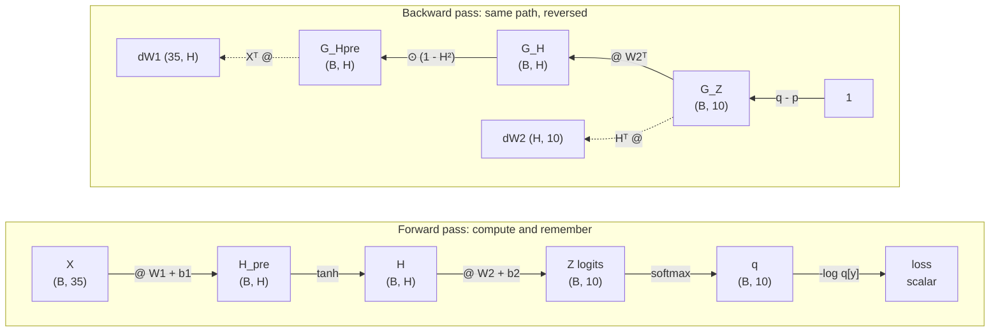

# Module 01 — From the 1990s perceptron to the language model

**Part I · Rebuilding the Foundations** | Tier A (CPU, seconds) | Study time: 4–5 hours

> You trained a multilayer perceptron to recognise handwritten digits. This module shows
> that you already own most of a language model: the last layer, the loss, the gradient
> and the training loop of a modern LLM are the ones you used then. We rebuild them by
> hand, verify every gradient, and then point the same network at text.

## A. Learning objectives

After this module you can, without notes:

1. Write the forward pass of a two-layer MLP with tensor shapes at every step.
2. Derive the gradient of softmax + cross-entropy with respect to the logits, and backpropagate it through a linear layer and a non-linearity.
3. Verify a hand-written backward pass with finite differences and against autograd.
4. Explain why "predict the next token" is the same supervised classification problem as "recognise the digit", and say precisely what differs.
5. Name the five developments that separate a 1995 MLP from a 2026 Transformer, and locate the surviving MLP inside nanochat's source code.

## B. Prerequisites

- [Mathematics primer](../../docs/mathematics-primer.md) §1–3 and §5–6 (dot products, chain rule, softmax, cross-entropy).
- [Getting started](../../docs/getting-started.md), Level 1. No GPU and no nanochat checkout needed yet.

## C. Motivation and intuition

### What you built thirty years ago

A digit recogniser is a function from 35 numbers (the pixels of a 5×7 bitmap; real
systems used 256 or 784) to 10 numbers (one score per digit). Training adjusts weights so
that the score of the correct digit is the largest.

```text
label 3:        the network must output: "3"
.###.
#...#           35 pixels --> [ hidden layer ] --> 10 scores --> highest score wins
....#
..##.
....#
#...#
.###.
```

Three ingredients did all the work:

1. **A parameterised function**: linear maps with non-linearities in between.
2. **A loss**: one number that says how wrong the outputs are.
3. **Gradient descent with backpropagation**: compute how the loss changes with each weight, and nudge every weight downhill.

### What a language model is, in the same words

A language model is a function from a sequence of tokens (the text so far) to $V$ numbers
(one score per possible next token, where $V$ is the vocabulary size: 25 in our toy
language, 32 768 in nanochat). Training adjusts weights so that the score of the token
that actually came next is large.

| | Digit recogniser (1995) | Language model (2026) |
|---|---|---|
| Input | 35 pixels | the previous tokens |
| Output | 10 scores (logits) | $V$ scores (logits) |
| Target | the digit, labelled by a person | the next token, **already present in the text** |
| Loss | cross-entropy | cross-entropy |
| Training | backpropagation + gradient descent | backpropagation + gradient descent (fancier step rule) |
| Use | take the arg-max | sample a token, append it, repeat |

The row in bold is the conceptual leap, and it has nothing to do with architecture. Nobody
labels the data. Every position of every document is a free training example whose
"label" is simply the next token. This is called **self-supervision**, and it is why
language models can be trained on hundreds of billions of tokens: the internet is the
labelled dataset.

> **Misconception: "LLMs are a fundamentally different kind of system from the old neural networks."**
> The learning principle is unchanged. What changed is what sits *between* the input and
> the final linear layer, how much data and compute are used, and a set of engineering
> techniques that make very deep networks trainable. A modern LLM would be recognisable
> to a 1990s practitioner as "a very large network trained by backprop on a
> classification loss".

### What actually changed in thirty years

| Development | Then | Now | Why it mattered | Module |
|---|---|---|---|---|
| **Objective** | human-labelled classes | next-token prediction on raw text | unlimited training signal; forces the model to absorb grammar, facts and reasoning patterns because all of them help prediction | 02 |
| **Input handling** | fixed-size vector | variable-length sequence of learned token embeddings, with **attention** letting each position read from any earlier one | text has no fixed size, and the relevant context can be anywhere | 03–05 |
| **Depth** | 1–2 hidden layers; deeper nets did not train | tens to hundreds of layers, made trainable by **residual connections** and **normalization** | depth composes simple operations into complex ones | 06 |
| **Scale** | 10³–10⁵ weights, 10⁴ examples, a CPU | 10⁸–10¹² weights, 10⁹–10¹³ tokens, GPUs | capability grows smoothly and predictably with scale | 09, 13 |
| **Tooling** | hand-derived gradients | automatic differentiation; adaptive optimizers (Adam, Muon); careful initialisation | removes the human bottleneck in trying new architectures | 07 |

Everything in the right-hand column is covered in this course. None of it replaces the
three ingredients above.

## D. Rigorous technical explanation

### D.1 The forward pass, with shapes

A batch of $B$ examples, each a row vector of $D_\text{in}$ numbers, passes through:

$$
\begin{aligned}
H_\text{pre} &= X W_1 + \mathbf{b}_1 & (B, D_\text{in}) \cdot (D_\text{in}, H) &\to (B, H)\\
H &= \tanh(H_\text{pre}) & &\phantom{\to}\ (B, H)\\
Z &= H W_2 + \mathbf{b}_2 & (B, H)\cdot(H, C) &\to (B, C)
\end{aligned}
$$

$Z$ holds the **logits**: one unnormalised score per class, per example. For digits,
$D_\text{in}=35$ and $C=10$. Each column of $W_1$ is one hidden unit's weight vector: a
template it compares with the input by a dot product. The hidden layer is a learned
re-description of the input (a *representation*) in which the classes are easier to
separate. In a language model the re-description is the whole Transformer, and the final
step $Z = HW_2$ survives unchanged as the output head.

### D.2 From logits to a loss

Softmax converts each row of logits into a probability distribution:

$$q_i = \frac{e^{z_i}}{\sum_{j} e^{z_j}}$$

The loss for one example with correct class $y$ is its **surprise**, the negative
log-probability assigned to the truth; the batch loss is the mean:

$$L = -\frac{1}{B}\sum_{b=1}^{B} \log q^{(b)}_{y_b}$$

Two sanity anchors, both worth memorising:

- A model that knows nothing outputs equal logits, so $q_i = 1/C$ and $L = \ln C$.
  For 10 digits: $\ln 10 = 2.303$. For nanochat's vocabulary: $\ln 32768 = 10.397$.
  **A freshly initialised model should start near this value.** If it starts far above,
  the initialisation is producing confident wrong answers.
- A perfect, fully confident model has $L = 0$. For text this is unreachable, because
  language is genuinely unpredictable (Module 02 quantifies the floor).

Why this loss and not squared error, as in many 1990s implementations? Cross-entropy is
the negative log-likelihood of the data under the model: minimising it is maximum-
likelihood estimation. It also has a better-behaved gradient, which we derive next.

### D.3 The gradient of softmax + cross-entropy

Take one example, logits $\mathbf{z}$, probabilities $\mathbf{q}$, correct class $y$, loss
$L = -\log q_y = -z_y + \log\sum_j e^{z_j}$. Differentiate with respect to logit $z_i$:

$$\frac{\partial L}{\partial z_i} = -\mathbb{1}[i = y] + \frac{e^{z_i}}{\sum_j e^{z_j}} = q_i - \mathbb{1}[i=y]$$

In vector form, with $\mathbf{p}$ the one-hot target:

$$\boxed{\;\frac{\partial L}{\partial \mathbf{z}} = \mathbf{q} - \mathbf{p}\;}$$

Prediction minus target. Read it as an instruction to the logits: *lower every score in
proportion to the probability you gave it, and raise the correct one by what was
missing*. The gradient vanishes only when the prediction equals the target, and it never
saturates the way a squared error behind a sigmoid does. This identical expression is the
start of the backward pass of every language model in this course.

**Worked numbers.** Logits $\mathbf{z} = [2, 1, 0]$, correct class 0:

| | class 0 | class 1 | class 2 |
|---|---:|---:|---:|
| $e^{z_i}$ | 7.389 | 2.718 | 1.000 |
| $q_i$ (divide by 11.107) | 0.665 | 0.245 | 0.090 |
| $p_i$ | 1 | 0 | 0 |
| $\partial L/\partial z_i = q_i - p_i$ | −0.335 | +0.245 | +0.090 |

Loss: $-\ln 0.665 = 0.408$. Gradient descent *subtracts* the gradient, so logit 0 goes
up and the others go down, each in proportion to its error. The entries sum to zero:
total score is only redistributed.

### D.4 Backpropagation through the rest

Let $G_Z = \partial L/\partial Z$ (shape `(B, C)`, each row is $(\mathbf{q}-\mathbf{p})/B$).
Apply the two rules from the [primer §3](../../docs/mathematics-primer.md#3-derivatives-gradients-the-chain-rule),
walking the forward pass in reverse:

$$
\begin{aligned}
\frac{\partial L}{\partial W_2} &= H^\top G_Z & (H, B)\cdot(B, C) &\to (H, C) \\
\frac{\partial L}{\partial \mathbf{b}_2} &= \textstyle\sum_b G_Z & &\to (C,)\\
G_H &= G_Z W_2^\top & (B, C)\cdot(C, H) &\to (B, H)\\
G_{H_\text{pre}} &= G_H \odot (1 - H^2) & &\phantom{\to}\ (B, H) \quad \text{since } \tanh' = 1-\tanh^2\\
\frac{\partial L}{\partial W_1} &= X^\top G_{H_\text{pre}} & (D_\text{in}, B)\cdot(B, H) &\to (D_\text{in}, H)\\
\frac{\partial L}{\partial \mathbf{b}_1} &= \textstyle\sum_b G_{H_\text{pre}} & &\to (H,)
\end{aligned}
$$

Every gradient has exactly the shape of the thing it is a gradient of. That is the first
check to make on any backward pass.



Two observations that carry over to every network in this course:

- The backward pass needs the values computed in the forward pass ($H$, $X$, $\mathbf{q}$).
  **Training memory is dominated by these stored activations**, not by the weights
  (Module 13).
- The cost of the backward pass is about twice that of the forward pass: for every
  forward matmul there are two backward matmuls (one for the weight gradient, one to pass
  the error down). nanochat's FLOP estimate counts exactly this: 2 forward + 4 backward =
  6 per weight per token (Module 09).

### D.5 How do you know a backward pass is right?

Never trust a derivation; test it. The definition of a derivative gives an independent
numerical estimate for any single weight $\theta$:

$$\frac{\partial L}{\partial \theta} \approx \frac{L(\theta + \epsilon) - L(\theta - \epsilon)}{2\epsilon}$$

It needs two forward passes per weight, so it is useless for training but ideal as an
oracle. The error of this centred difference shrinks as $\epsilon^2$; in float64 with
$\epsilon = 10^{-5}$, agreement to about 10 digits is normal. In float32 the subtraction
loses too much precision for small $\epsilon$, which is why the check below switches to
float64. Automatic differentiation (PyTorch's autograd) is a third, independent
implementation of the same chain rule, applied mechanically to the recorded operations.

### D.6 The update

Plain stochastic gradient descent, exactly as in the 1990s:

$$\theta \leftarrow \theta - \eta\,\frac{\partial L}{\partial \theta}$$

computed on a random mini-batch each step. The learning rate $\eta$ must be small enough
not to overshoot and large enough to make progress; Module 07 replaces this rule with
AdamW and Muon and explains what they fix.

### D.7 The bridge: the same network predicts text

Take a text over an alphabet of $V$ characters. Build a dataset in which each example is
"the previous $K$ characters" and its label is "the character that came next":

```text
text:    t h e _ c a t _ s l e e p s
K = 3:   [t h e] -> _      [h e _] -> c      [e _ c] -> a      [_ c a] -> t   ...
```

Encode each context character as a one-hot vector of length $V$ and concatenate: the
input has $KV$ numbers, the output has $V$ classes. Feed this to the unchanged MLP:

$$\underbrace{(B, KV)}_{\text{one-hot context}} \xrightarrow{W_1} (B, H) \xrightarrow{\tanh} (B, H) \xrightarrow{W_2} \underbrace{(B, V)}_{\text{logits over next characters}}$$

This is, in essence, the neural probabilistic language model of Bengio et al. (2003).
Notice what $XW_1$ does with a one-hot input: multiplying a one-hot row by a matrix just
*selects a row of the matrix*. The first layer has silently become a table with one
learned vector per (position, character). That table is an **embedding**, and Module 04
starts from this observation.

To generate text: compute the probabilities, **sample** a character from them, append
it, slide the window by one, repeat. That loop is autoregressive generation (Module 02).

What is wrong with this model, and therefore what the rest of Part I must fix:

| Limitation of the window-MLP | Fix | Module |
|---|---|---|
| Context is a fixed $K$; anything further back is invisible | attention over the whole context | 05 |
| The same word at different window positions uses different weights; nothing learned at one position transfers to another | shared token embeddings + explicit position information | 04 |
| Input size, and parameter count of the first layer, grow with $K$ | attention's parameter count is independent of sequence length | 05 |
| Characters are too fine-grained; words are too many | subword tokens | 03 |
| One hidden layer limits what can be computed | deep stacks made trainable by residuals and normalization | 06 |

## E. Minimal implementation

All code for this module is in [`mlle/foundations/mlp.py`](../../mlle/foundations/mlp.py)
(about 150 lines, no autograd). The backward pass is a line-by-line transcription of D.4:

```python
def backward(self, targets):
    x, h, logits = self._cache["x"], self._cache["h"], self._cache["logits"]
    B = x.shape[0]

    dlogits = softmax(logits)                    # (B, C)   q
    dlogits[torch.arange(B), targets] -= 1.0     #          q - p
    dlogits /= B                                 #          mean over the batch

    dW2 = h.T @ dlogits                          # (H, C)
    db2 = dlogits.sum(dim=0)                     # (C,)
    dh = dlogits @ self.W2.T                     # (B, H)
    dh_pre = dh * (1.0 - h**2)                   # (B, H)   tanh'
    dW1 = x.T @ dh_pre                           # (D_in, H)
    db1 = dh_pre.sum(dim=0)                      # (H,)
```

**Run it.** `python labs/foundations/01_digits_mlp.py` (measured on CPU, 2026-11-11):

```text
gradient check (analytic vs finite differences):
  d loss / d W1[3, 2]: analytic +0.11442404  numeric +0.11442404  diff 1.6e-11
  d loss / d W2[1, 7]: analytic -0.06819739  numeric -0.06819739  diff 6.4e-12
  largest difference from PyTorch autograd over ALL parameters: 3.5e-17

step    0 | train loss 2.5316 | test loss 2.5273 | test acc 0.031
step   50 | train loss 0.1351 | test loss 0.1448 | test acc 0.981
step  300 | train loss 0.0398 | test loss 0.0570 | test acc 0.986
final test accuracy on 2000 fresh digits: 0.9925
```

Three implementations of the gradient (by hand, numerical, autograd) agree to machine
precision. The initial loss, 2.53, is close to $\ln 10 = 2.30$ and slightly above it:
random weights make the initial guesses a little confident and wrong.

> **Predict before you run** `python labs/foundations/01b_mlp_next_char.py`:
> the same class is trained to predict the next character of the Pocket language from the
> previous 3 characters (25 possible characters). (a) What will the loss be at step 0?
> (b) Will it end above or below 0.31 nats, the entropy of the language?
> (c) Will the generated text be made of real words?

Measured result:

```text
270,774 examples | input = 3 characters x 25 one-hot = 75 numbers | classes = 25 possible next characters
step     0 | train loss 3.2554 | val loss 3.2569
step  3000 | train loss 0.4509 | val loss 0.4597
uniform guess ln(25) = 3.2189
count-based model with the same 3-character context: 0.4381
entropy of the source (unbeatable): 0.3139
sample: he robots helps the bird . / the quiet bird the quiet birds like the foxes the robot
```

(a) $\ln 25 = 3.22$. (b) Above: 0.46, close to what simply *counting* 3-character
contexts achieves (0.44), and well above the floor (0.31). Three characters of context
are not enough to know, for example, whether the subject was singular or plural.
(c) Mostly real words, but "the robots helps" shows the limit: the verb's number was
decided more than three characters after the noun left the window.

## F. nanochat code walkthrough

Nothing in this module is nanochat-specific, yet every piece of it is present in
nanochat at the pinned commit. Open the file and find them:

**The MLP.** Each Transformer block contains a two-layer perceptron
([`nanochat/gpt.py` L131–L141](https://github.com/karpathy/nanochat/blob/92d63d4e8bb4df75c3b71618f31ddde2378b2bcd/nanochat/gpt.py#L131-L141)):

```python
class MLP(nn.Module):
    def __init__(self, config):
        super().__init__()
        self.c_fc = Linear(config.n_embd, 4 * config.n_embd, bias=False)
        self.c_proj = Linear(4 * config.n_embd, config.n_embd, bias=False)

    def forward(self, x):
        x = self.c_fc(x)
        x = F.relu(x).square()
        x = self.c_proj(x)
        return x
```

Compare with `ManualMLP.forward`: a linear map, a non-linearity, a linear map. The
differences are choices, not principles: the hidden layer is 4× wider than its input,
there are no bias terms, and the non-linearity is $\mathrm{relu}(x)^2$ instead of
$\tanh$ (Module 06 discusses why). In a depth-12 nanochat model about two thirds of the
block parameters are in these MLPs.

**The output head and the loss.** The last lines of `GPT.forward`
([`gpt.py` L510–L524](https://github.com/karpathy/nanochat/blob/92d63d4e8bb4df75c3b71618f31ddde2378b2bcd/nanochat/gpt.py#L510-L524)):

```python
logits = self.lm_head(x)                       # (B, T, padded_vocab_size)
logits = logits[..., :self.config.vocab_size]  # slice to remove padding
logits = logits.float()                        # switch to fp32 for logit softcap and loss computation
logits = softcap * torch.tanh(logits / softcap)
if targets is not None:
    loss = F.cross_entropy(logits.view(-1, logits.size(-1)), targets.view(-1), ignore_index=-1, reduction=loss_reduction)
    return loss
```

`lm_head` is our $W_2$ (without bias): a linear map from the hidden representation to
one logit per class. `F.cross_entropy` is our `cross_entropy`: softmax followed by the
mean negative log-probability of the targets. `.view(-1, V)` flattens the `(B, T)` grid
of positions into `B·T` independent classification examples, which is the precise sense
in which language modelling "is" classification.

**The training step.** In
[`scripts/base_train.py` L510–L540](https://github.com/karpathy/nanochat/blob/92d63d4e8bb4df75c3b71618f31ddde2378b2bcd/scripts/base_train.py#L510-L540):

```python
loss = model(x, y)
...
loss.backward()
...
optimizer.step()
model.zero_grad(set_to_none=True)
```

Forward, loss, backward, update: the loop from `train_digits`. `loss.backward()` is
autograd performing the derivation of D.4 mechanically for a network with hundreds of
millions of weights.

| | `ManualMLP` (this module) | nanochat |
|---|---|---|
| Gradients | hand-written `backward` | autograd (`loss.backward()`) |
| Non-linearity | `tanh` | `relu(x)²` |
| Biases | yes | none |
| Classes | 10 (or 25 characters) | 32 768 tokens |
| What feeds the output layer | one hidden layer | a deep stack of attention + MLP blocks |
| Update rule | SGD | Muon + AdamW |
| Initial loss | ≈ ln 10 | ≈ ln 32768 ≈ 10.4 |

## M. Key takeaways

1. A language model's output layer, loss and gradient are those of a 1990s classifier with $V$ classes: logits → softmax → cross-entropy, with gradient **prediction minus target**.
2. Next-token prediction turns raw text into supervised data with no human labels. That, not any architectural trick, is what made the scale possible.
3. A backward pass is a mechanical application of two rules (linear map; element-wise function). Check it with finite differences; trust autograd afterwards.
4. Expect the initial loss to be $\ln(\text{number of classes})$. It is the cheapest and most useful sanity check in the field.
5. A fixed-window MLP already *is* a language model. Its limits (fixed context, no sharing across positions, shallow) are the agenda for Modules 03–06.

**Where this sits in the full system:** you have built the *last millimetre* of the
model (the head and the loss) and the *learning rule*. Everything else in Part I
constructs a better function to put in front of that head.

Next: [lab](lab.md) · [quiz](quiz.md) · [references](references.md) · then [Module 02 — Language modeling](../02-language-modeling/lesson.md)
