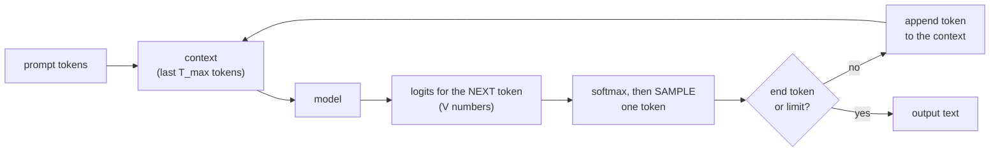

# Module 02 — Language modeling and autoregressive generation

**Part I · Rebuilding the Foundations** | Tier A (CPU, under a minute) | Study time: 4–5 hours

> A language model does one thing: given the text so far, it outputs a probability for
> every possible next token. This module makes that statement exact, shows how one model
> call per token turns into generated text, defines what a "good" loss is by comparing
> with a language whose true probabilities we know, and finds the precise point at which
> counting-based models fail. That failure is what attention exists to fix.

## A. Learning objectives

After this module you can:

1. Factor the probability of a sequence into next-token conditionals and compute it for a concrete sentence.
2. Explain teacher forcing, why one sequence of length $T$ yields $T$ training examples, and how training differs from generation.
3. Relate cross-entropy, entropy, perplexity and bits per character, and state what the lowest achievable loss is and why.
4. Build and evaluate n-gram models, and explain the two reasons they cannot scale: sparsity and fixed context.
5. Point to the lines in nanochat where inputs and targets are created, the loss is computed, and tokens are generated.

## B. Prerequisites

- [Module 01](../01-neural-network-refresher/lesson.md): softmax, cross-entropy, the expected initial loss.
- [Mathematics primer](../../docs/mathematics-primer.md) §4 and §6 (probability chain rule; entropy, cross-entropy, KL).

## C. Motivation and intuition

### A model of language is a probability distribution over strings

"Modelling language" sounds vague. The precise version: assign a probability $P(x_1,
\dots, x_T)$ to every sequence of tokens, high for sequences that occur and low for
those that do not. "the cat sleeps" should be more probable than "the cat sleep", which
should be more probable than "cat the sleeps". Nothing in that definition mentions
meaning, grammar or knowledge, yet to assign good probabilities a model is forced to
capture all three, because all three make text predictable.

A distribution over whole strings is unmanageable directly: there are $V^T$ strings of
length $T$. The chain rule of probability breaks it into pieces that are manageable.

### One prediction at a time

$$P(x_1, \dots, x_T) = P(x_1)\,P(x_2\mid x_1)\,P(x_3\mid x_1,x_2)\cdots = \prod_{t=1}^{T} P(x_t \mid x_{<t})$$

This is an identity, not an approximation. It says: to model sequences it is enough to
model the **next token given everything before it**. That conditional is a distribution
over only $V$ outcomes: exactly the classification problem of Module 01, with the
context as input. A model that factors the distribution this way, left to right, is
called **autoregressive** (it regresses on its own previous outputs) or **causal** (a
prediction depends only on the past).

### A language with a known answer

For real text nobody knows the true conditionals, so nobody can say whether a loss of
3.2 is good. To be able to reason exactly, Parts I–II use a tiny synthetic language,
**Pocket** ([`mlle/data/pocket.py`](../../mlle/data/pocket.py)):

```text
the fox that helps the bird runs .
the small robot likes the children .
the quick child sees the bird that likes the dogs .
```

Sentences are produced by a small probabilistic grammar: choose singular or plural
(50/50), maybe an adjective (30 %), a noun (one of 6), maybe a relative clause "that …"
(25 %), then an intransitive verb (40 %) or a transitive verb and an object (60 %).
Verbs agree in number with their subject, even across a relative clause:
"the fox**es** that help the bird **run**". Because we wrote the grammar, we know the
probability of every sentence, and that gives us a ruler for every model in this course.

## D. Rigorous technical explanation

### D.1 The chain rule on a real sentence

Take `the cat sleeps .` followed by a newline (17 characters). Under the grammar its
probability is the product of the choices that produce it:

| Choice | Probability |
|---|---:|
| singular subject | 0.5 |
| no adjective | 0.7 |
| noun "cat" (1 of 6) | 1/6 |
| no relative clause | 0.75 |
| intransitive verb | 0.4 |
| verb "sleeps" (1 of 4) | 1/4 |
| **product** | **0.004375** |

So $-\ln P = 5.432$ nats for the sentence. Now compute the same number character by
character, the way a character-level language model must:

| Next character | Given | Why | $P$ | surprise $-\ln P$ |
|---|---|---|---:|---:|
| `t`,`h`,`e`,`␣` | start of sentence | every sentence starts with "the " | 1 | 0 |
| `c` | `the␣` | noun now (0.7) and it starts with c: cat/child, 2 of 6 → $0.7 \cdot 2/6$ | 0.2333 | 1.455 |
| `a` | `the␣c` | cat(s) or child(ren) | 0.5 | 0.693 |
| `t` | `the␣ca` | forced | 1 | 0 |
| `␣` | `the␣cat` | singular (space) or plural (`s`) | 0.5 | 0.693 |
| `s` | `the␣cat␣` | no relative clause (0.75) × verb starting with s: sleeps, sings ($0.4\cdot 2/4$) or sees ($0.6\cdot 1/4$) | 0.2625 | 1.338 |
| `l` | `the␣cat␣s` | sleeps among {sleeps, sings, sees}: $0.075 / 0.2625$ | 0.2857 | 1.253 |
| `e`,`e`,`p`,`s`,`␣`,`.`,`\n` | … | forced | 1 | 0 |
| | | **sum** | | **5.432** |

The two computations agree, as the chain rule guarantees. Three things to take from the table:

- **Information is concentrated at decision points.** Twelve of seventeen characters are
  free (surprise 0); five carry everything. Real text behaves the same way, less
  extremely: the end of a word is easier than its beginning.
- **To predict well, the model must track the grammar's state.** $P(\texttt{s} \mid
  \texttt{the cat␣})$ depends on knowing a verb is due. The best next-token predictor
  *is* an implicit model of the process that generated the text. This is the entire
  argument for why next-token prediction can teach a model anything at all.
- **Averaged over the language, the surprise per character is a fixed number.** For this
  sentence $5.432/17 = 0.320$ nats/char. Averaged over all sentences it is the
  **entropy rate** of Pocket: **0.3139 nats/char = 0.4528 bits/char**
  (`pocket.entropy_rate()`, a Monte-Carlo average of exact sentence probabilities).

### D.2 The training objective

A model with parameters $\theta$ defines conditionals $q_\theta(x_t \mid x_{<t})$. We want
them close to the truth. Maximising the probability of the training text is the same as
minimising its average negative log-probability:

$$L(\theta) = -\frac{1}{T}\sum_{t=1}^{T} \log q_\theta(x_t \mid x_{<t})$$

This is the cross-entropy of Module 01, applied at every position. In expectation,

$$L = H(p, q) = \underbrace{H(p)}_{\text{entropy of the language}} + \underbrace{D_\mathrm{KL}(p\,\Vert\,q)}_{\ge\, 0,\ \text{the model's fault}}$$

so **the loss has a floor that no model can go below: the entropy of the source.** A
language model is "done" when its loss approaches that floor, not when it approaches
zero. For Pocket the floor is 0.3139 nats/char; for English text it is unknown
(estimates are of the order of 1 bit per character).

Three equivalent ways to quote the same quantity:

| Unit | Formula | Pocket's floor | Reading |
|---|---|---:|---|
| nats per token | $L$ | 0.3139 | what PyTorch's `cross_entropy` returns |
| bits per token | $L/\ln 2$ | 0.4528 | average code length: an ideal compressor needs this many bits per character |
| perplexity | $e^{L}$ | 1.369 | "as uncertain as a fair choice among 1.37 options" |

The compression reading is literal: any model that predicts the next symbol can drive an
arithmetic coder that stores text in $L/\ln 2$ bits per symbol. Predicting well and
compressing well are the same skill. nanochat reports **bits per byte**, which divides by
the number of UTF-8 bytes instead of tokens so that models with different tokenizers
can be compared (Module 10).

### D.3 Teacher forcing: T examples from one sequence

During training the model is always given the **true** previous tokens, never its own
guesses. This is called teacher forcing. Since all the true tokens are known in advance,
the $T$ prediction problems of one sequence can be laid side by side:

```text
tokens:        t   h   e   _   c   a   t   _   s   l
               |   |   |   |   |   |   |   |   |
input  x:      t   h   e   _   c   a   t   _   s          = tokens[0 : T]
target y:      h   e   _   c   a   t   _   s   l          = tokens[1 : T+1]

position 0 sees "t"          and must predict "h"
position 1 sees "th"         and must predict "e"
position 4 sees "the_c"      and must predict "a"
position 8 sees "the_cat_s"  and must predict "l"
```

Inputs and targets are the same sequence shifted by one. A model that can produce all
$T$ outputs in one pass, each using only the tokens to its left, gets $T$ gradient
signals for the price of one forward pass. Making that possible is the job of the
**causal mask** in Module 05. Recurrent networks could also be trained with teacher
forcing, but had to process positions one after another; the Transformer's ability to
process them in parallel is a large part of why it scaled.

In code this is the whole data pipeline of a language model
([`mlle/foundations/train.py`](../../mlle/foundations/train.py)):

```python
x = torch.stack([tokens[i     : i + block_size]     for i in ix])   # (B, T)
y = torch.stack([tokens[i + 1 : i + block_size + 1] for i in ix])   # (B, T)  shifted by one
```

### D.4 The context window

No real model conditions on *everything* before. It sees at most the last $T_\text{max}$
tokens: its **context window** (`sequence_len = 2048` in nanochat's default
configuration, `block_size` in MiniGPT). The approximation is

$$P(x_t \mid x_{<t}) \approx q_\theta(x_t \mid x_{t-T_\text{max}}, \dots, x_{t-1})$$

Anything that fell out of the window does not exist for the model. A chat assistant
"remembers" a conversation only because the application sends the whole conversation
back in as tokens each turn (Module 14). There is no other memory.

### D.5 Generation: the loop around the model

Training evaluates given text. Generation produces new text by running the same function
in a loop:



1. Run the model on the context; keep only the prediction at the **last** position.
2. Turn logits into probabilities and **sample** one token (Module 10 covers how).
3. Append it; repeat until an end token is sampled or a limit is reached.

| | Training | Generation |
|---|---|---|
| Previous tokens come from | the data (teacher forcing) | the model's own samples |
| Positions used per forward pass | all $T$ | only the last |
| Parallel over positions | yes | no: token $t+1$ needs token $t$ |
| Weights | updated | frozen |
| Randomness | batch selection | sampling |

Two consequences recur throughout the course:

- **Generation is inherently sequential.** This is why inference has its own engineering
  (the KV cache, Module 11): naively, each new token re-processes the entire context.
- **The model is never trained on its own mistakes.** In training, every context is
  correct text. In generation, one unlucky sample puts the model in a context it may
  never have seen, and errors can compound. This mismatch is known as *exposure bias*;
  it is one root of repetition loops and of confident nonsense (Module 10), and one
  motivation for reinforcement learning on the model's own outputs (Module 15).

> **Misconception: "the model generates text."** The model maps a context to a
> probability distribution. The *loop* generates text, and the loop is ordinary code
> that makes choices the model does not: how to sample, when to stop, what to do with
> the output. Parts IV–V are mostly about putting more interesting code in that loop.

### D.6 The simplest language models: counting

Before neural networks, language models were tables of counts. An **n-gram model**
approximates the context by its last $n-1$ tokens and estimates the conditional by
relative frequency:

$$q(x_t \mid x_{t-n+1},\dots,x_{t-1}) = \frac{\mathrm{count}(x_{t-n+1},\dots,x_{t-1},x_t) + \alpha}{\mathrm{count}(x_{t-n+1},\dots,x_{t-1}) + \alpha V}$$

($\alpha$ is a small smoothing constant so that unseen continuations do not get
probability zero and an infinite loss.) With ample data this is the *optimal* predictor
for that context length. Measured on Pocket
(`python labs/foundations/02_ngrams_and_entropy.py`, 20 000 training sentences, CPU):

| context (characters) | val nats/char | perplexity | distinct contexts seen | sample |
|---:|---:|---:|---:|---|
| 0 (unigram) | 2.7491 | 15.63 | 1 | `the sof nase s c ht .icede le. xhaieh` |
| 1 (bigram) | 1.2478 | 3.48 | 25 | `the se thas ts che rdothathathe haie` |
| 2 | 0.5966 | 1.82 | 86 | |
| 3 | 0.4400 | 1.55 | 179 | `the dogs helps the foxes that sees that .` |
| 4 | 0.3938 | 1.48 | 320 | |
| 6 | 0.3711 | 1.45 | 673 | `the dogs helps the robots run .` |
| 10 | 0.3627 | 1.44 | 3 374 | |
| 14 | 0.3595 | 1.43 | 13 457 | |
| **entropy floor** | **0.3139** | **1.369** | | |

Loss falls quickly at first, then crawls: quadrupling the context from 3 to 14
characters removes less loss than going from 2 to 3 did. Yet the samples are still
ungrammatical ("the dogs **helps**"). The remaining gap to the floor is small in nats
and large in meaning: it is the long-range structure.

### D.7 Where counting breaks: a controlled failure

Pocket contains a dependency of adjustable length: the verb must agree with its subject.
Test it with minimal pairs, comparing the model's probability for the correct and the
wrong verb form:

```text
simple:          the cats | sleep (correct)  vs  sleeps (wrong)
with attractor:  the cats that chase the dog | sleep (correct)  vs  sleeps (wrong)
```

In the second kind, a noun of the *opposite* number (the "attractor") sits between
subject and verb. Accuracy on 200 pairs of each kind (chance is 0.5):

| context (characters) | simple | with attractor |
|---:|---:|---:|
| 0–4 | 0.42–0.47 | 0.47–0.53 |
| 6 | 0.90 | 0.13 |
| 10 | 1.00 | **0.00** |
| 14 | 1.00 | 0.46 |

With 10 characters of context the model is perfect on simple sentences and **wrong every
single time** when an attractor is present. It has learned "the verb agrees with the
nearest noun", the best rule available to something that can only see 10 characters back
("␣the␣dog␣" is all that is left of the context). It is not confused; it is confidently
applying the wrong rule because the right evidence is outside its window.

Why not just make the window bigger? The table's "distinct contexts" column answers:

- **Sparsity.** The number of possible contexts grows as $V^{n-1}$. Longer contexts are
  each seen fewer times, so their counts are unreliable, and most are never seen at all.
  With only 200 training sentences the 10-character model is *worse* (0.62 nats) than
  the 4-character model (0.45): it has memorised its training set and meets mostly
  unseen contexts.
- **No generalisation.** A count table treats `the cats that chase the dog` and `the cats
  that chase the fox` as unrelated entries. Nothing learned about one transfers to the
  other. Real language never repeats long contexts exactly, so a model that cannot share
  knowledge across *similar* contexts cannot use long contexts at all.

What is needed is a model that (1) can look arbitrarily far back for the relevant token,
and (2) shares what it learns across similar contexts. Shared, learned vector
representations give (2) (Module 04); attention gives (1) (Module 05). For reference,
the small Transformer you train in Module 07 scores 1.00 on *both* columns with a loss
of about 0.348.

## E. Minimal implementation

[`mlle/foundations/ngram.py`](../../mlle/foundations/ngram.py) contains a character
tokenizer and the n-gram model (count, smooth, back off to shorter contexts when a
context was never seen). The essential lines:

```python
def fit(self, tokens):
    for t in range(len(tokens)):
        for n in range(0, min(self.order, t) + 1):          # every context length up to `order`
            self.counts[tuple(tokens[t - n : t])][tokens[t]] += 1

def probs(self, context):                                    # distribution over the next token
    context = tuple(context[-self.order:]) if self.order > 0 else ()
    while context and context not in self.counts:
        context = context[1:]                                # back off to a shorter context
    p = torch.full((self.vocab_size,), self.alpha, dtype=torch.float64)
    for tok, c in self.counts.get(context, {}).items():
        p[tok] += c
    return p / p.sum()
```

`generate` is the loop of D.5 in four lines: `probs`, `torch.multinomial`, `append`,
repeat. [`mlle/data/pocket.py`](../../mlle/data/pocket.py) is worth reading in full
(about 150 lines): `sample_sentence` returns each sentence together with its exact
log-probability, which is what makes the entropy computable.

> **Predict before you run** the lab script: with a context of 6 characters, will the
> agreement accuracy *with attractors* be above, at, or below chance? (Most people say
> "at chance". Look at the table in D.7 again after running.)

## F. nanochat code walkthrough

Every concept of this module appears in nanochat with the same meaning.

**Inputs and targets are one row shifted by one.** The data loader fills a buffer of
`T + 1` tokens per row and slices it twice
([`nanochat/dataloader.py` L153–L155](https://github.com/karpathy/nanochat/blob/92d63d4e8bb4df75c3b71618f31ddde2378b2bcd/nanochat/dataloader.py#L153-L155)):

```python
cpu_inputs.copy_(row_buffer[:, :-1])
cpu_targets.copy_(row_buffer[:, 1:])
```

That is `x = tokens[0:T]`, `y = tokens[1:T+1]`: teacher forcing.

**The loss is the mean cross-entropy over all positions**
([`nanochat/gpt.py` L517–L521](https://github.com/karpathy/nanochat/blob/92d63d4e8bb4df75c3b71618f31ddde2378b2bcd/nanochat/gpt.py#L517-L521)),
exactly $L(\theta)$ of D.2, in nats per token.

**Documents are delimited by a special token.** Every document begins with `<|bos|>`
([`nanochat/tokenizer.py` L9–L21](https://github.com/karpathy/nanochat/blob/92d63d4e8bb4df75c3b71618f31ddde2378b2bcd/nanochat/tokenizer.py#L9-L21)),
so the model can learn "a new, unrelated text starts here" and is not asked to predict
the first words of a document from the last words of the previous one. Pocket's newline
plays the same role between sentences.

**The context window** is `GPTConfig.sequence_len`, 2048 by default
([`gpt.py` L28–L39](https://github.com/karpathy/nanochat/blob/92d63d4e8bb4df75c3b71618f31ddde2378b2bcd/nanochat/gpt.py#L28-L39)).

**Generation is the loop of D.5.** nanochat keeps a deliberately naive version next to
the optimized engine
([`gpt.py` L526–L555](https://github.com/karpathy/nanochat/blob/92d63d4e8bb4df75c3b71618f31ddde2378b2bcd/nanochat/gpt.py#L526-L555)):

```python
for _ in range(max_tokens):
    logits = self.forward(ids)            # (B, T, vocab_size)   re-runs the WHOLE sequence
    logits = logits[:, -1, :]             # (B, vocab_size)      keep only the last position
    ...
    probs = F.softmax(logits, dim=-1)
    next_ids = torch.multinomial(probs, num_samples=1, generator=rng)
    ids = torch.cat((ids, next_ids), dim=1)
    yield token
```

Run the model, take the last position, sample, append, repeat. Note the comment you
would write next to `self.forward(ids)`: each step recomputes everything for all earlier
tokens. Module 11 removes that waste; nanochat's own test compares this naive loop with
the cached engine and requires identical tokens.

**The floor, measured with nanochat.** When the unmodified nanochat pretraining script is
run on Pocket ([reference result](../../results/reference/nanochat-local-cpu.md)), its
validation loss goes from 1.84 to **0.466 bits per byte** in 300 steps. The floor is
0.4528 bits per character, and a character is a byte here. A real model, a real
training script, and a loss within 3 % of the theoretical optimum: that is what
"converged" looks like when you know the answer.

## M. Key takeaways

1. A language model is a next-token classifier applied at every position; the chain rule makes this an exact decomposition of the probability of a text.
2. Training text supplies its own labels (shift by one). Teacher forcing gives $T$ training signals per sequence, in parallel.
3. Cross-entropy cannot go below the entropy of the source. Loss, bits and perplexity are the same quantity in different units. Good prediction is good compression.
4. The model outputs a distribution; a loop outside the model samples, appends and decides when to stop. Training and generation use the model differently, and the difference has consequences (sequential cost, exposure bias).
5. Counting models are optimal for short contexts and hopeless for long ones: contexts become too many to observe, and nothing is shared between similar contexts. A 10-character model scores 0 % on agreement across an attractor.

**Where this sits in the full system:** this module defines the *task* and the *loss*
that every later component serves. Modules 03–06 build the function that computes
$q_\theta(x_t \mid x_{<t})$; Module 07 fits it.

Next: [lab](lab.md) · [quiz](quiz.md) · [references](references.md) · then [Module 03 — Tokenization](../03-tokenization/lesson.md)
