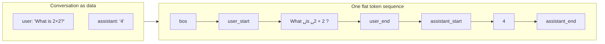
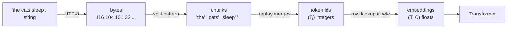

# Module 03 — Tokenization

**Part I · Rebuilding the Foundations** | Tier A (CPU, seconds) | Study time: 4–5 hours

> A neural network computes with numbers; text is a string of characters. The tokenizer is
> the fixed, non-neural translation layer between the two. It decides what the model's
> "alphabet" is, how long sequences are, what the model can and cannot see inside a word,
> and how control signals such as "the user's turn ends here" are represented. It is
> trained once, before the model, and never changes afterwards.

## A. Learning objectives

After this module you can:

1. Explain the trade-off between character, word and subword vocabularies in terms of sequence length, vocabulary size and generalisation.
2. Run the byte-pair-encoding algorithm by hand, and implement training, encoding and decoding.
3. Explain why byte-level BPE can encode any string, and what a split pattern is for.
4. Explain what special tokens are, why user text can never produce them, and how a conversation becomes a token sequence.
5. Evaluate a tokenizer (bytes per token) and predict where it will be inefficient.
6. Train and inspect nanochat's tokenizer and locate each of these ideas in `nanochat/tokenizer.py`.

## B. Prerequisites

- [Module 02](../02-language-modeling/lesson.md): tokens, vocabulary size $V$, cross-entropy per token.
- Basic familiarity with bytes and UTF-8 is helpful; the lesson reviews what is needed.

## C. Motivation and intuition

### Three candidate alphabets

| Unit | Vocabulary size | Sequence length for the same text | Unknown words? | Problem |
|---|---|---|---|---|
| Characters (or bytes) | tiny (256 bytes) | long: ~4–5× more positions than subwords | never | each position carries little information; attention cost grows with the *square* of length; the model must spend capacity re-learning spelling |
| Words | huge and open-ended (hundreds of thousands, plus names, typos, code, other languages) | short | constantly ("out of vocabulary") | most words are rare, so most rows of the embedding table are barely trained; `run`, `runs`, `running` share nothing |
| **Subwords** | chosen by you (nanochat: 32 768) | in between | never (falls back to smaller pieces, ultimately bytes) | boundaries are statistical, not linguistic, which has side effects |

Subword tokenization is a compression scheme: frequent strings (" the", "ing", " model")
get their own token, rare strings are spelled out from smaller pieces. Common words cost
one token; a rare name costs several; nothing is ever unrepresentable.

### The algorithm in one sentence

**Byte-pair encoding (BPE):** start with single bytes as tokens, then repeatedly find the
most frequent adjacent pair of tokens in the training text and merge it into a new token,
until the vocabulary has the desired size.

A classic toy example. Text: `aaabdaaabac`

| Step | Most frequent pair | New token | Text becomes | Length |
|---:|---|---|---|---:|
| 0 | | | `a a a b d a a a b a c` | 11 |
| 1 | `a a` (4 occurrences, overlapping) | `Z = aa` | `Z a b d Z a b a c` | 9 |
| 2 | `a b` (2) or `Z a` (2): tie | `Y = ab` | `Z Y d Z Y a c` | 7 |
| 3 | `Z Y` (2) | `X = ZY = aaab` | `X d X a c` | 5 |

Three merges shortened the text from 11 to 5 tokens. The list of merges *in order* is
the tokenizer. To encode new text you replay the merges in the same order.

## D. Rigorous technical explanation

### D.1 Bytes first: why nothing is ever "unknown"

Text is stored as bytes. UTF-8 encodes each Unicode character as 1–4 bytes: ASCII
characters are one byte, `é` is two (`0xC3 0xA9`), `你` is three, `🌍` is four. If the
256 possible byte values are the base vocabulary, then **every** string, in any
language, including strings never seen in training, can be encoded: in the worst case
one token per byte. This is "byte-level" BPE, used by GPT-2, GPT-4 and nanochat.

A side effect to remember: a single token can be a *fragment* of a multi-byte character.
Decoding one such token alone yields an invalid byte sequence (shown as `�`). Only the
concatenated bytes of a whole sequence are guaranteed to decode. nanochat's code handles
this in one place we will meet below (`token_bytes`).

### D.2 Training

Input: a text corpus, a target vocabulary size $V$, a list of $S$ special tokens.
Number of merges to learn: $M = V - 256 - S$.

1. **Pre-split** the text into chunks with a regular expression (D.4). Merges never cross chunk boundaries.
2. Represent each chunk as a list of byte values (ids 0–255).
3. Repeat $M$ times:
   1. Count every adjacent pair of ids across all chunks (weighted by how often each chunk occurs).
   2. Pick the most frequent pair $(a, b)$.
   3. Create a new id $n = 256 + i$ whose byte string is `bytes(a) + bytes(b)`.
   4. Replace every occurrence of $(a, b)$ by $n$.
4. Append the special tokens with ids $256 + M, \dots, V - 1$.

Because a merge can combine earlier merges, tokens grow: `t`+`h` → `th`, `th`+`e` →
`the`, `␣`+`the` → `␣the`. On Pocket, the first merges found by the course's
implementation (`python labs/foundations/03_bpe.py`, measured):

```text
256: b't' + b'h'    -> b'th'
257: b'th' + b'e'   -> b'the'
258: b' ' + b'the'  -> b' the'
259: b' ' + b'.'    -> b' .'
260: b' ' + b'c'    -> b' c'
261: b'a' + b't'    -> b'at'
```

The algorithm has no notion of words or morphemes. It discovers "the" because those
bytes co-occur, and for no other reason.

### D.3 Encoding and decoding

**Encoding** a chunk: start from its bytes; among all adjacent pairs present, apply the
one with the **lowest merge index** (the earliest learned); repeat until no learned pair
remains. Replaying merges in training order guarantees the same segmentation the
training text had.

**Decoding**: concatenate the byte strings of the ids and decode as UTF-8.

Encoding is deterministic and lossless: `decode(encode(s)) == s` for every string `s`.
(This is a property of byte-level BPE. Tokenizers that normalise text first, e.g. by
lower-casing or collapsing whitespace, are *not* lossless. nanochat's is.)

### D.4 The split pattern

Without pre-splitting, BPE would happily merge across word boundaries ("e␣t" from
"the␣top") and across categories (letters with digits or punctuation), producing many
tokens that mean nothing. A regular expression first cuts the text into chunks, and
merges stay inside chunks. nanochat's pattern
([`tokenizer.py` L23–L26](https://github.com/karpathy/nanochat/blob/92d63d4e8bb4df75c3b71618f31ddde2378b2bcd/nanochat/tokenizer.py#L23-L26)):

```python
SPLIT_PATTERN = r"""'(?i:[sdmt]|ll|ve|re)|[^\r\n\p{L}\p{N}]?+\p{L}+|\p{N}{1,2}| ?[^\s\p{L}\p{N}]++[\r\n]*|\s*[\r\n]|\s+(?!\S)|\s+"""
```

Read as alternatives, left to right:

| Alternative | Matches | Consequence |
|---|---|---|
| `'(?i:[sdmt]\|ll\|ve\|re)` | contractions: `'s`, `'t`, `'ll`, `'re` | "don't" → `don` + `'t` |
| `[^\r\n\p{L}\p{N}]?+\p{L}+` | an optional single non-letter (usually a space) followed by letters | **the space belongs to the following word**: `␣cat` is one chunk |
| `\p{N}{1,2}` | **one or two** digits | numbers are cut into pieces of at most 2 digits |
| `␣?[^\s\p{L}\p{N}]++[\r\n]*` | punctuation runs | |
| the rest | whitespace and newlines | |

Two design choices are worth understanding because they shape model behaviour:

- **Leading-space tokens.** `cat` at the start of a line and `␣cat` inside a sentence
  are different tokens with different embeddings. This is why prompt formatting details
  (a trailing space, a missing space) can change model outputs, and why nanochat's
  multiple-choice prompts are written with care about spaces
  ([`tasks/common.py` L187–L206](https://github.com/karpathy/nanochat/blob/92d63d4e8bb4df75c3b71618f31ddde2378b2bcd/tasks/common.py#L187-L206)).
- **At most two digits per chunk.** GPT-4's pattern allows three. The comment in
  nanochat's source explains the change: fewer of a small vocabulary's tokens are spent
  on numbers, and two was measured to be the best value for a 32K vocabulary. The price
  is that a number such as 12345 becomes three tokens (`12`, `34`, `5`) whose alignment
  with place value depends on the number's length. This is one concrete reason small
  language models are unreliable at arithmetic, and a motivation for giving them a
  calculator tool (Module 16).

### D.5 Choosing the vocabulary size

Let $C$ be the model width. Increasing $V$:

| Effect | Direction | Why |
|---|---|---|
| Sequence length for a given text | shorter | more text per token |
| Compute per character of text | lower | fewer positions to process; attention is quadratic in length |
| Embedding and output-head parameters | larger | each is a $V \times C$ table (nanochat also has $V \times C$ value-embedding tables in half the layers) |
| Cost of the output softmax | higher | $V$ logits per position |
| Data per token | less | rare tokens are seen rarely and learned poorly |
| Loss per token | higher | each token carries more information, so it is harder to predict. Per-token losses are **not comparable across tokenizers** |

The last row is why nanochat reports **bits per byte**: total loss divided by total
UTF-8 bytes is the same quantity whatever the tokenizer (Module 10).

nanochat uses $V = 2^{15} = 32\,768$; GPT-2 used 50 257; GPT-4's tokenizer has about
100 000. The measure of a tokenizer's efficiency is the **compression ratio**: UTF-8
bytes per token. Measured with nanochat's own evaluation script on the Pocket tokenizer
you will train in the lab (353 tokens), next to OpenAI tokenizers on the same text
([reference result](../../results/reference/nanochat-local-cpu.md)):

| Text | Pocket tokenizer (353 tokens) | GPT-2 tokenizer | GPT-4 tokenizer |
|---|---:|---:|---:|
| Pocket validation text | **4.59** | 3.91 | 4.42 |
| news article | 1.20 | — | 4.70 |
| Python code | 1.11 | — | 4.07 |
| Korean text | 1.00 | — | 2.45 |

A 353-token vocabulary beats GPT-4's 100 000 tokens on the text it was trained on, and
collapses to one token per byte on anything else. **A tokenizer is a compressed model of
its training distribution.** Train it on data that looks like what the model will see.

### D.6 What tokenization hides from the model

The model receives integer ids. It never sees letters.

```text
'Hello world, tokenization is fun!'   33 bytes ->  8 tokens: Hello | ␣world | , | ␣token | ization | ␣is | ␣fun | !
'unbelievably'                         12 bytes ->  4 tokens: un | bel | iev | ably
'␣12345 3.14159'                       14 bytes ->  6 tokens: ␣123 | 45 | ␣3 | . | 14 | 159
'naïve café 你好 🌍'                    24 bytes -> 11 tokens: na | ïve | ␣café | ␣ | � | � | � | � | ␣� | � | �
```

(GPT-2 tokenizer, measured through nanochat's wrapper.) Consequences:

- **Spelling is not visible.** `␣world` is one id; that it contains the letter "r" is
  something the model can only learn indirectly from contexts that talk about spelling.
  Counting letters in a word is a hard task for a token-level model for this reason, not
  because it is "bad at counting". (nanochat's README links a guide on teaching exactly
  this ability with synthetic data.)
- **Boundaries are arbitrary.** `un|bel|iev|ably` does not follow morphemes
  (`un|believ|ably`).
- **Languages are treated unequally.** Text unlike the training data falls back towards
  bytes: the two Chinese characters above cost 6 tokens, the emoji 4. Such text uses more
  context and more compute per unit of meaning.
- **The context window is measured in tokens**, not characters or words.

> **Misconception: "tokens are words."** Sometimes. A token can be a word with its
> leading space, a piece of a word, a punctuation mark, two digits, or a third of a
> Chinese character. Always look at the actual segmentation before reasoning about what
> a model "sees".

### D.7 Special tokens and the control channel

Besides text, the model needs out-of-band signals: *a new document starts*, *the user is
speaking*, *the assistant's turn ends*, *a tool call begins*. These are **special
tokens**: extra vocabulary entries that no sequence of ordinary characters can ever
produce. nanochat defines nine
([`tokenizer.py` L9–L21](https://github.com/karpathy/nanochat/blob/92d63d4e8bb4df75c3b71618f31ddde2378b2bcd/nanochat/tokenizer.py#L9-L21)):

```python
SPECIAL_TOKENS = [
    "<|bos|>",                                    # every document begins with it
    "<|user_start|>", "<|user_end|>",             # user messages
    "<|assistant_start|>", "<|assistant_end|>",   # assistant messages
    "<|python_start|>", "<|python_end|>",         # assistant invokes the python tool
    "<|output_start|>", "<|output_end|>",         # tool output, fed back to the assistant
]
```

Only `<|bos|>` appears during pretraining; the other eight are first seen during
fine-tuning (Module 14), where a conversation is rendered into one flat sequence:



**The safety property.** Ordinary text is encoded with a function that does not
recognise special-token strings. If a user types the nine characters `<|bos|>`, they are
encoded as ordinary punctuation and letters:

```text
<|bos|> as a control token:              one id (316 in the lab's tokenizer)
the STRING '<|bos|>' typed by a user:    6 ordinary tokens   < | | | bo | s | | | >
```

Control tokens can only be inserted by the program that assembles the sequence. This
separation between *data* (what users and documents say) and *control* (what the
application says) is the tokenizer-level defence against a user forging, for example, a
fake `<|assistant_start|>`. It protects the format, not the content: text that merely
*asks* the model to misbehave is still text (prompt injection, Module 16).

### D.8 From ids to vectors (preview)



Everything left of the last arrow is deterministic string processing fixed before
training. The last arrow, the embedding lookup, is where learning begins (Module 04).

## E. Minimal implementation

[`mlle/foundations/bpe.py`](../../mlle/foundations/bpe.py) is a complete byte-level BPE
tokenizer in about 150 lines: train, encode, decode, special tokens, save/load. Core of
training and encoding:

```python
for i in range(num_merges):
    pair_counts = Counter()
    for chunk, ids in chunks.items():                 # chunks: unique pre-split pieces
        for pair in zip(ids, ids[1:]):
            pair_counts[pair] += chunk_counts[chunk]  # weighted by chunk frequency
    pair = min(pair_counts, key=lambda p: (-pair_counts[p], p))   # most frequent; ties -> smallest pair
    new_id = 256 + i
    self.merges[pair] = new_id
    self.vocab[new_id] = self.vocab[pair[0]] + self.vocab[pair[1]]
    for chunk in chunks:
        chunks[chunk] = _merge(chunks[chunk], pair, new_id)

def _encode_chunk(self, chunk):
    ids = list(chunk.encode("utf-8"))
    while len(ids) >= 2:
        pair = min(zip(ids, ids[1:]), key=lambda p: self.merges.get(p, float("inf")))  # earliest-learned merge present
        if pair not in self.merges:
            break
        ids = _merge(ids, pair, self.merges[pair])
    return ids
```

Its split pattern is a simplified, standard-library version of nanochat's (Python's
built-in `re` lacks `\p{L}`; the `regex` package or Rust is needed for the real one).

Lab output (measured, Pocket corpus, 60 merges):

```text
'the small cats chase the dog .'    30 bytes -> 11 tokens: the | ␣s | m | al | l | ␣cats | ␣chas | e | ␣the | ␣dog | ␣.
'the unicorns chase the dog .'      28 bytes -> 15 tokens: the | ␣ | u | n | i | c | o | r | n | s | ␣chas | e | ␣the | ␣dog | ␣.
'12345 + 678'                       11 bytes -> 11 tokens: 1 | 2 | 3 | 4 | 5 | ␣ | + | ␣ | 6 | 7 | 8

vocab size -> bytes per token on in-domain text
    265 (  0 merges) -> 1.00
    295 ( 30 merges) -> 2.00
    325 ( 60 merges) -> 3.07
    352 ( 87 merges) -> 4.04
```

"unicorns" was never seen, so it is spelled out byte by byte, and still round-trips
exactly. After 87 merges every Pocket word is a single token and training stops early:
there is nothing left to merge.

> **Predict before you run** `labs/foundations/03_bpe.py`: the corpus contains the words
> `cat`, `cats`, `chase`, `chases`, `child`, `children`. Will `␣c` become a token before
> `␣cat`? Why would a *prefix* shared by several words be merged before any whole word?

## F. nanochat code walkthrough

nanochat separates **training** the tokenizer from **using** it, and uses a different
library for each ([`nanochat/tokenizer.py`](https://github.com/karpathy/nanochat/blob/92d63d4e8bb4df75c3b71618f31ddde2378b2bcd/nanochat/tokenizer.py)).

**Training: `rustbpe`** (L41–L61). `train_from_iterator` hands an iterator of documents
to a Rust implementation of the algorithm in D.2, asking for `vocab_size −
len(SPECIAL_TOKENS)` tokens, then converts the result into a `tiktoken.Encoding`:

```python
tokenizer.train_from_iterator(text_iterator, vocab_size_no_special, pattern=SPLIT_PATTERN)
mergeable_ranks = {bytes(k): v for k, v in tokenizer.get_mergeable_ranks()}
tokens_offset = len(mergeable_ranks)
special_tokens = {name: tokens_offset + i for i, name in enumerate(SPECIAL_TOKENS)}
enc = tiktoken.Encoding(name="rustbpe", pat_str=pattern, mergeable_ranks=mergeable_ranks, special_tokens=special_tokens)
```

`mergeable_ranks` maps each token's bytes to its rank, which is both its id and its merge
priority: precisely our `merges` table in another form. Special tokens are appended after
the last merge, as in D.2 step 4.

**Encoding: `tiktoken`** (L96–L121). The method that turns text into ids calls
`self.enc.encode_ordinary(text)`. "Ordinary" is the safety property of D.7: special-token
strings in the text are not interpreted. Special ids are obtained only through
`encode_special` (L89–L91) and added by code, e.g. `prepend=bos`.

**The training script** ([`scripts/tok_train.py`](https://github.com/karpathy/nanochat/blob/92d63d4e8bb4df75c3b71618f31ddde2378b2bcd/scripts/tok_train.py)).
Defaults: 2 billion characters of the pretraining data, each document capped at 10 000
characters (so a few giant documents cannot dominate the statistics), vocabulary 32 768
(L16–L19). After training it writes one extra artefact (L72–L90): `token_bytes.pt`, a
tensor giving the number of UTF-8 bytes of every token, with 0 for special tokens. That
tensor is what turns a per-token loss into bits per byte. Note the comment there about
using the raw bytes of each token: decoding a token to a string first would corrupt
tokens that are fragments of multi-byte characters (D.1). An earlier version did exactly
that and mis-measured 193 of 32 768 tokens (commit `2ce972a` in the upstream history).

**Rendering conversations** (L140–L224). `render_conversation` produces the flat sequence
of D.7 *and* a parallel mask saying which tokens the model should be trained to produce.
Output of `python labs/foundations/03_nanochat_tokenizer.py` (measured, abbreviated):

```text
'<|bos|>'              mask=0
'<|user_start|>'       mask=0
'the' ' cat' ...       mask=0      <- user text: context only
'<|user_end|>'         mask=0
'<|assistant_start|>'  mask=0
'the' ' dog' ' '       mask=1      <- assistant text: trained
'<|python_start|>'     mask=1      <- the assistant learns to REQUEST the tool ...
'1' '+' '1'            mask=1
'<|python_end|>'       mask=1
'<|output_start|>'     mask=0      <- ... but not to produce its output:
'2'                    mask=0         at run time this comes from the tool
'<|output_end|>'       mask=0
' r' 'u' 'n' 's' ' .'  mask=1
'<|assistant_end|>'    mask=1      <- the assistant learns to stop
```

Module 14 builds supervised fine-tuning on this mask, and Module 16 on the tool tokens.

**Model and tokenizer are inseparable.** A checkpoint's embedding rows are meaningful
only with the tokenizer it was trained with. nanochat asserts that the vocabulary sizes
match when loading a model
([`checkpoint_manager.py` L110–L113](https://github.com/karpathy/nanochat/blob/92d63d4e8bb4df75c3b71618f31ddde2378b2bcd/nanochat/checkpoint_manager.py#L110-L113)),
which catches gross mismatches; two different tokenizers of the same size would pass the
assertion and produce garbage. Keep one `NANOCHAT_BASE_DIR` per tokenizer.

| | Course BPE (`mlle/foundations/bpe.py`) | nanochat |
|---|---|---|
| Training | pure Python, seconds for megabytes | `rustbpe`, Rust, 2 B characters in about a minute |
| Encoding | pure Python | `tiktoken` (multi-threaded batch encoding) |
| Split pattern | simplified, standard-library `re` | GPT-4 style with `\p{N}{1,2}` |
| Tie-breaking between equally frequent pairs | smallest pair | implementation-defined; vocabularies can differ in detail |
| Special tokens | same nine, same order | same |

## M. Key takeaways

1. Tokenization fixes the model's alphabet before learning starts. Subword vocabularies trade sequence length against vocabulary size and never produce unknown tokens.
2. BPE = repeatedly merge the most frequent adjacent pair. The ordered merge list is the tokenizer; encoding replays it.
3. Byte-level BPE is lossless and universal; its efficiency depends entirely on how similar the text is to the tokenizer's training data.
4. The model sees ids, not letters. Leading spaces, digit grouping and arbitrary word pieces explain a family of otherwise puzzling model behaviours.
5. Special tokens are a control channel that text cannot forge; conversations, tool calls and document boundaries are all expressed with them.
6. Per-token loss depends on the tokenizer; bits per byte does not.

**Where this sits in the full system:** the tokenizer is the first and last component of
every interaction: text → ids before the model, ids → text after it. Its output, a
sequence of integers, is the input of Module 04.

Next: [lab](lab.md) · [quiz](quiz.md) · [references](references.md) · then [Module 04 — Embeddings and position](../04-embeddings/lesson.md)
