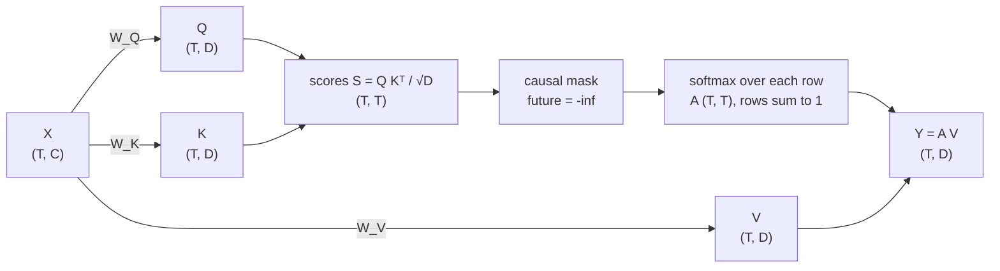
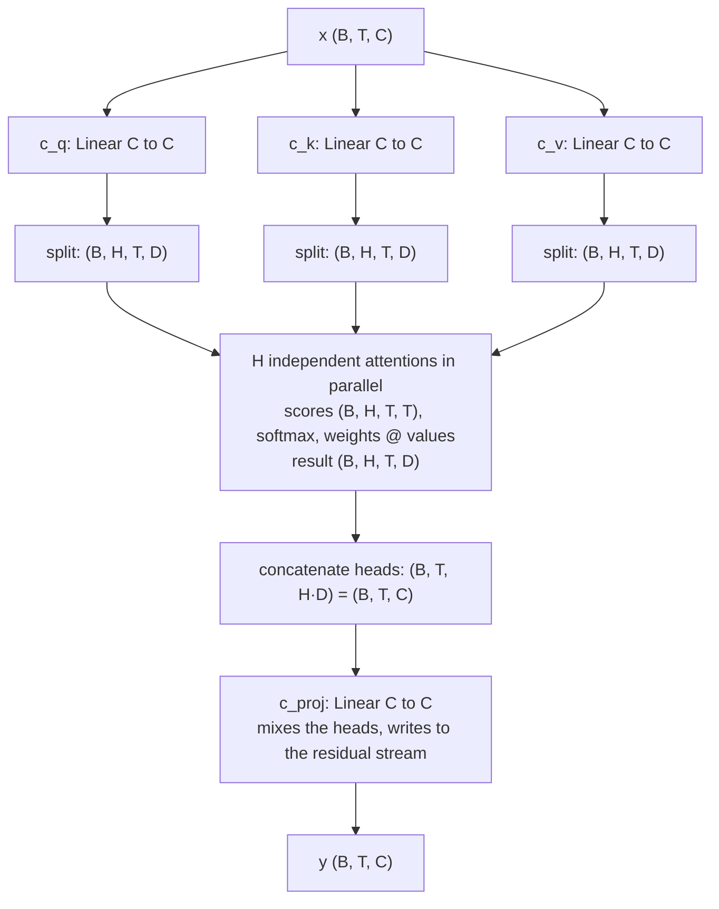

# Module 05 — Attention from first principles

**Part I · Rebuilding the Foundations** | Tier A (CPU, 1–2 minutes) | Study time: 8–9 hours

> Attention is the one operation in a Transformer through which positions exchange
> information. Everything else works on each position separately. This module builds it
> from the problem it solves, computes it by hand with explicit matrices, implements it
> three ways and proves they agree, trains a single head and watches it learn where to
> look, and then shows with an intervention experiment why a picture of attention
> weights is a hypothesis about a model and not an explanation of it.

## A. Learning objectives

After this module you can:

1. State the problem attention solves and why fixed windows and recurrence solve it worse.
2. Write scaled dot-product attention with every tensor shape, and compute it by hand for a small example.
3. Explain the roles of queries, keys and values, the $1/\sqrt{D}$ scaling, the causal mask and the softmax.
4. Explain multi-head attention, its parameter count and its cost in time and memory as a function of sequence length.
5. Describe how attention is trained, how it connects to the residual stream, and how to test an attention implementation and a modification of it.
6. Read nanochat's `CausalSelfAttention.forward` line by line and say which lines are mathematics and which are engineering.
7. Explain what attention weights do and do not tell you, and design an intervention to test a claim about them.

## B. Prerequisites

- [Module 02](../02-language-modeling/lesson.md) (the agreement test; teacher forcing).
- [Module 04](../04-embeddings/lesson.md) (the residual stream; RoPE).
- [Mathematics primer](../../docs/mathematics-primer.md) §1–2 (dot products, batched matmul) and §5 (softmax).

## C. Motivation and intuition

### C.1 The problem

After the embedding layer, the vector at each position describes *one token in
isolation*. But the right continuation depends on other tokens, and on which ones is not
known in advance:

```text
the cats that chase the dog ___        needs "cats" (6 positions back), not "dog" (1 back)
the cat sleeps ___                     needs only the fact that the sentence is complete
```

Module 02 showed what happens without a mechanism for this: a 10-character counting
model scores 0 % on agreement across an attractor. What is required is an operation that
lets each position **pull in information from other positions, chosen by content**.

### C.2 Three ways to give a position access to its past

| | Fixed window (Module 01) | Recurrence (RNN/LSTM) | Attention |
|---|---|---|---|
| How the past reaches position $t$ | the last $K$ tokens are concatenated | a state vector is updated token by token | position $t$ reads directly from any earlier position |
| Reach | $K$ tokens, hard limit | unlimited in principle; in practice old information is overwritten | the whole context window |
| Path length between positions $i$ and $t$ | 1 if inside the window | $t - i$ steps (signal and gradient pass through every step between) | **1 step** |
| Parallel over positions in training | yes | **no** (step $t$ needs step $t-1$) | **yes** |
| Parameters depend on context length | yes | no | no |
| Cost per layer | $O(T \cdot K)$ | $O(T)$ sequential steps | $O(T^2)$, parallel |

Attention pays a quadratic cost in exchange for direct, parallel, content-based access.
Short paths make long-range dependencies easy to learn (gradients do not have to survive
hundreds of steps), and parallelism makes training on GPUs efficient. Those two
properties are why the Transformer displaced recurrent networks.

### C.3 The intuition: a soft dictionary lookup

A Python dictionary answers a query by finding the **key** that equals it and returning
the stored **value**:

```python
store = {"subject_number": "plural", "last_noun": "dog"}
store["subject_number"]     # exact match -> "plural"
```

Attention is a differentiable version. Every position publishes a *key* ("what I
contain") and a *value* ("what I will hand over if selected"). The position that is
reading issues a *query* ("what I am looking for"). Instead of one exact match, the query
is compared with **all** keys, the comparisons are turned into weights that sum to 1, and
the result is the **weighted average of the values**.

Now the precise version of each part of the analogy:

| Analogy | Precisely |
|---|---|
| "what I am looking for" | a query vector $\mathbf{q}_i = \mathbf{x}_i W_Q$, a learned linear function of the reader's own vector |
| "what I contain" | a key vector $\mathbf{k}_j = \mathbf{x}_j W_K$ |
| "how well they match" | the dot product $\mathbf{q}_i\cdot\mathbf{k}_j$ (large when the vectors point the same way) |
| "pick the best match" | softmax over $j$: a *soft* choice; all positions contribute, most with tiny weight |
| "what gets handed over" | a value vector $\mathbf{v}_j = \mathbf{x}_j W_V$, generally *different* from the key |
| "the answer" | $\sum_j a_{ij}\mathbf{v}_j$, a blend of values |

Nothing "looks" or "focuses". There are three linear maps, a table of dot products, a
softmax and a weighted average. What makes it powerful is that $W_Q, W_K, W_V$ are
learned so that useful matches score high.

## D. Rigorous technical explanation

### D.1 Definition and shapes (one head)

Input: $X$ of shape `(T, C)`, one row per position (the batch dimension is omitted).
Parameters: $W_Q, W_K \in \mathbb{R}^{C\times D}$ and $W_V\in\mathbb{R}^{C\times D}$.

$$
\begin{aligned}
Q &= XW_Q,\quad K = XW_K,\quad V = XW_V && (T, D)\ \text{each}\\
S &= \frac{QK^\top}{\sqrt{D}} && (T, T)\quad S_{ij} = \tfrac{1}{\sqrt D}\,\mathbf{q}_i\cdot\mathbf{k}_j\\
S_{ij} &\leftarrow -\infty\ \text{ for } j > i && \text{causal mask: no reading from the future}\\
A &= \mathrm{softmax}_\text{rows}(S) && (T, T)\quad \textstyle A_{ij}\ge 0,\ \sum_j A_{ij} = 1\\
Y &= AV && (T, D)\quad \mathbf{y}_i = \textstyle\sum_{j\le i} A_{ij}\,\mathbf{v}_j
\end{aligned}
$$

Row $i$ of $A$ is position $i$'s distribution over where to read from. Row $i$ of $Y$ is
what it read.



### D.2 A complete numerical example

Three positions, $D = 2$. To keep the arithmetic visible, take $Q$, $K$, $V$ as given
(they would come from $XW_Q$ etc.):

$$Q = K = \begin{pmatrix}1&0\\0&1\\1&1\end{pmatrix},\qquad V = \begin{pmatrix}1&2\\3&4\\5&6\end{pmatrix}$$

**Step 1: scores.** $QK^\top$, every query dotted with every key, then divided by $\sqrt2 = 1.4142$:

$$QK^\top = \begin{pmatrix}1&0&1\\0&1&1\\1&1&2\end{pmatrix}\quad\Rightarrow\quad S = \begin{pmatrix}0.7071&0&0.7071\\0&0.7071&0.7071\\0.7071&0.7071&1.4142\end{pmatrix}$$

**Step 2: causal mask.** Entries above the diagonal become $-\infty$:

$$S = \begin{pmatrix}0.7071&-\infty&-\infty\\0&0.7071&-\infty\\0.7071&0.7071&1.4142\end{pmatrix}$$

**Step 3: softmax, row by row.**

- Row 0: only one finite entry → $(1, 0, 0)$. The first position can only read from itself.
- Row 1: $e^{0} = 1$, $e^{0.7071} = 2.0281$; sum $3.0281$ → $(0.3302,\ 0.6698,\ 0)$.
- Row 2: $e^{0.7071} = 2.0281$ (twice), $e^{1.4142} = 4.1133$; sum $8.1695$ → $(0.2483,\ 0.2483,\ 0.5035)$.

$$A = \begin{pmatrix}1&0&0\\0.3302&0.6698&0\\0.2483&0.2483&0.5035\end{pmatrix}$$

**Step 4: weighted average of values.**

- $\mathbf{y}_0 = 1\cdot(1,2) = (1,\ 2)$
- $\mathbf{y}_1 = 0.3302\,(1,2) + 0.6698\,(3,4) = (2.3395,\ 3.3395)$
- $\mathbf{y}_2 = 0.2483\,(1,2) + 0.2483\,(3,4) + 0.5035\,(5,6) = (3.5105,\ 4.5105)$

Read row 2: position 2's query $(1,1)$ matches its own key $(1,1)$ best (score 1.41) and
the other two equally (0.71), so its output is half its own value and a quarter of each
of the others. `labs/foundations/05_attention.py` prints exactly these matrices, and
`tests/test_part1_foundations.py::test_worked_example_from_lesson_05` asserts them, so
this page cannot drift from the code.

### D.3 Why divide by $\sqrt{D}$

If the entries of $\mathbf{q}$ and $\mathbf{k}$ have variance about 1, their dot product
is a sum of $D$ terms and has standard deviation about $\sqrt{D}$
([primer §1](../../docs/mathematics-primer.md#1-vectors-dot-products-and-what-similar-means)).
For $D = 64$ that is 8: typical scores differ by many units, the softmax puts almost all
weight on one position, and (because the softmax gradient is $a(1-a)$-like) almost no
gradient flows. Dividing by $\sqrt{D}$ brings the scores back to unit scale. Measured
with random vectors and 16 keys:

| $D$ | scaling | score std | mean largest weight | $\sum_j a_j(1-a_j)$ (gradient signal) |
|---:|---|---:|---:|---:|
| 4 | none | 2.0 | 0.43 | 0.71 |
| 64 | none | 8.0 | 0.84 | 0.22 |
| 512 | none | 22.6 | 0.95 | 0.08 |
| any | $1/\sqrt{D}$ | 1.0 | 0.25 | 0.87 |

Without the scaling, a wider head would start out more saturated and harder to train.
With it, initial sharpness is independent of width. The factor is about *trainability at
initialisation*; a trained model sets its own sharpness through the learned projections.
(nanochat fixes the scale in a different way, by normalising $\mathbf{q}$ and $\mathbf{k}$; see F.)

### D.4 The causal mask

Recall teacher forcing (Module 02): all $T$ positions of a training sequence are
predicted in one pass, and position $i$ must predict token $i+1$ from tokens $0..i$
only. If position $i$ could attend to position $i+1$, it would read the answer.
The mask enforces $A_{ij} = 0$ for $j > i$ by setting those scores to $-\infty$ *before*
the softmax, so the remaining weights still sum to 1.

Two consequences:

- **Training/inference consistency.** At generation time the future does not exist. The
  mask makes training compute exactly what generation will compute.
- **Earlier positions are unaffected by later tokens.** The output at position $i$ is the
  same whether or not tokens after $i$ are present. This is the property that makes the
  KV cache valid (Module 11) and it is directly testable (D.11).

The mask is a boolean lower-triangular matrix; `causal_mask(4)` is

```text
[[1 0 0 0]
 [1 1 0 0]
 [1 1 1 0]
 [1 1 1 1]]        row = reading position, column = position read from
```

### D.5 What the transformation does to the data

- **It moves information between positions.** $\mathbf{y}_i$ is a convex combination of
  value vectors from positions $\le i$. Nothing else in the network mixes positions.
- **Given the weights, it is linear.** $Y = AV = AXW_V$. All the non-linearity is in
  computing $A$ from $Q$ and $K$.
- **It separates "where" from "what".** $W_Q$ and $W_K$ only influence *which* positions
  are read (through $A$); $W_V$ (and the output projection below) only influence *what is
  copied* from them. These are sometimes called the QK circuit and the OV circuit. A
  head can attend to the subject noun (QK) and copy just its number (OV).
- **It is a weighted average, so it cannot amplify.** $\lVert\mathbf{y}_i\rVert \le \max_j\lVert\mathbf{v}_j\rVert$.
  Averaging over many positions with near-uniform weights washes information out; useful
  heads are sharp or deliberately pooling.
- **It has no notion of order on its own** (Module 04, D.5): position enters through
  RoPE's rotation of $Q$ and $K$ or through position vectors added to $X$.

### D.6 Multi-head attention

One softmax per position can concentrate on one kind of thing at a time. To read several
things at once (the subject's number *and* the previous word *and* whether a clause is
open), the layer runs $H$ independent attention computations in parallel, each in a
smaller subspace of dimension $D = C/H$, and concatenates the results:



| Step | Operation | Shape |
|---|---|---|
| input | | `(B, T, C)` |
| project | `c_q(x)`, `c_k(x)`, `c_v(x)` | `(B, T, C)` each |
| split heads | `.view(B, T, H, D).transpose(1, 2)` | `(B, H, T, D)` |
| scores | `q @ k.transpose(-2, -1) / sqrt(D)` | `(B, H, T, T)` |
| mask, softmax | | `(B, H, T, T)` |
| read | `weights @ v` | `(B, H, T, D)` |
| merge heads | `.transpose(1, 2).reshape(B, T, C)` | `(B, T, C)` |
| output projection | `c_proj(y)` | `(B, T, C)` |

Splitting into heads is a *reshape*: one big projection to $C$ dimensions is cut into $H$
slices of $D$. Heads are a batch-like dimension; the GPU computes them all at once.

**Parameters:** four $C\times C$ matrices: $4C^2$ (no biases), independent of $H$ and of
$T$. More heads do not add parameters; they trade the width of each head against the
number of independent patterns. nanochat fixes the head width at $D = 128$ and lets the
number of heads grow with model width.

**Why the output projection?** After concatenation, head $h$'s result occupies its own
slice of the vector. `c_proj` lets every output dimension draw on every head, and is the
map through which the attention layer *writes* into the residual stream.

### D.7 How attention sits in the network

In a Transformer block (Module 06) attention is used as

$$\mathbf{x} \leftarrow \mathbf{x} + \mathrm{Attention}(\mathrm{norm}(\mathbf{x}))$$

- It **reads** a normalised copy of the residual stream (so the scale of $Q$, $K$, $V$ is controlled).
- It **adds** its result to the stream. Position $i$ keeps everything it had and gains
  what it read. The MLP that follows can then compute on the combination.
- Layers **compose**: what layer 1 moved to a position is part of what layer 2's queries,
  keys and values are computed from. A later head can attend to "the position that holds
  the subject's number" only because an earlier layer put something recognisable there.

### D.8 How it is trained

There is no supervision of attention weights anywhere. The only training signal is the
next-token loss. Gradients reach an attention layer along two routes:

- **Through the values (what is carried):** $\partial L/\partial V = A^\top (\partial L/\partial Y)$:
  each value receives the gradient of the outputs that read it, weighted by how much they read.
- **Through the weights (where to read):** $\partial L/\partial A_{ij} = (\partial L/\partial \mathbf{y}_i)\cdot\mathbf{v}_j$:
  "would the loss go down if position $i$ read more from position $j$?". This passes
  back through the softmax to the scores, and then to $Q$ and $K$.

Useful patterns emerge because they reduce the loss. A direct demonstration: the
**lookup task** ([`mlle/data/tasks.py`](../../mlle/data/tasks.py)). Each sequence holds
five (key, value) pairs in random order, then a query naming one key; the target is that
key's value. The model is one attention head and an output map: no MLP, no residual, no
positions ([`LookupAttention`](../../mlle/foundations/experiments.py)). Measured:

```text
step     0 | loss 2.0774 | accuracy 0.117 | attention on the answer pair 0.203     <- 1/5: uniform
step   250 | loss 0.1790 | accuracy 0.961 | attention on the answer pair 0.898
step   500 | loss 0.0018 | accuracy 1.000 | attention on the answer pair 0.975

attention of the query over the 5 pairs ('*' marks the pair holding the answer):
  0.00   0.00   0.98*  0.02   0.00    predicted 1 / true 1
  1.00*  0.00   0.00   0.00   0.00    predicted 4 / true 4
  0.00   0.99*  0.00   0.00   0.00    predicted 0 / true 0
```

Nobody told the head where to look. Minimising cross-entropy on the answer made $W_Q$
and $W_K$ align so that a query for key $k$ matches pairs containing key $k$, and made
$W_V$ carry the value. This is the dictionary of C.3, learned.

### D.9 Cost

Per layer, for sequence length $T$, width $C$, $H$ heads of width $D = C/H$:

| Quantity | Order | Notes |
|---|---|---|
| Projections ($Q$, $K$, $V$, output) | $O(T\,C^2)$ time | four matmuls with $C\times C$ matrices, per position |
| Scores and read ($QK^\top$, $AV$) | $O(T^2\,C)$ time | $H$ tables of $T\times T$, each entry a $D$-dim dot product |
| Attention weights, if stored | $O(H\,T^2)$ memory | the only part that is quadratic in memory |
| Parameters | $4C^2$ | independent of $T$ |

For typical sizes ($C = 768$, $T = 2048$) the two time terms are comparable; for long
contexts the $T^2$ term dominates. nanochat's FLOP estimate has both: 6 FLOPs per matmul
parameter per token, plus $12\,H\,D\,T$ per token per layer for the attention tables
([`gpt.py` L319–L339](https://github.com/karpathy/nanochat/blob/92d63d4e8bb4df75c3b71618f31ddde2378b2bcd/nanochat/gpt.py#L319-L339)).

Measured, naive implementation, one head, $D = 64$, CPU:

| $T$ | time per call | weight matrix (fp32) |
|---:|---:|---:|
| 256 | 0.33 ms | 0.25 MiB |
| 512 | 0.84 ms | 1.00 MiB |
| 1024 | 4.50 ms | 4.00 MiB |
| 2048 | 18.1 ms | 16.0 MiB |

Doubling $T$ multiplies both by about four. With 12 layers, 6 heads and a batch of 32,
the $T = 2048$ weight matrices alone would occupy $12\cdot 6\cdot 32\cdot 16\ \text{MiB}
\approx 36$ GiB if all were stored, which is why production kernels never store them.

### D.10 The mathematics versus what a GPU kernel computes

The formula $A = \mathrm{softmax}(QK^\top/\sqrt D)$, $Y = AV$ *specifies the result*. It
does not prescribe materialising the $T\times T$ matrix. Three implementations compute
the same $Y$:

| Implementation | Materialises $A$? | Where |
|---|---|---|
| Nested loops | entry by entry | `attention_loops`, for understanding |
| Matrix form | yes, `(B, H, T, T)` | `attention`, MiniGPT: lets us inspect weights |
| Fused kernel | no: processes tiles of keys, keeps a running softmax normaliser | `F.scaled_dot_product_attention`, Flash Attention (Module 12) |

Measured agreement (`labs/foundations/05_attention.py`): loops vs. matrices 1.2e-7,
matrices vs. PyTorch's fused kernel 2.4e-7: the differences are floating-point rounding
from a different order of additions. Same mathematics, different memory behaviour. Keep
this distinction; Part III is built on it.

### D.11 How to test attention, and how to test a change to it

Properties any correct causal attention must satisfy, each a few lines of test
(all in [`tests/`](../../tests/)):

| Property | Test idea |
|---|---|
| Rows of $A$ sum to 1; no weight above the diagonal | direct assertions on recorded weights |
| Equals a trusted reference | compare with `F.scaled_dot_product_attention` on random inputs |
| **Causality** | change tokens at positions $> i$; outputs at positions $\le i$ must not change |
| Permutation equivariance without positions and without the mask | permute inputs, compare permuted outputs |
| Gradients are right | autograd makes this automatic; for a hand-written backward pass use finite differences (Module 01) |

To verify that a **modification changed the intended behaviour and nothing else**, write
three assertions: the new behaviour is present, the old behaviour is preserved where it
should be, and the two differ exactly where they should. Example for a sliding window of
size $w$ (`causal_mask(T, window=w)`): (1) weights are zero for distance $> w$; (2) for
sequences with $T \le w+1$ the output equals full attention; (3) for longer sequences it
differs. A change that passes (1) but not (2) has altered more than intended.

### D.12 What attention weights do and do not explain

It is tempting to read a heat-map of $A$ as "what the model was thinking about". The
weights are real and often informative. They are also easy to over-interpret:

1. **Weights say where a head read from, not what it read or what it did with it.** The
   value and output projections decide what is copied; a large weight can carry a small
   or irrelevant vector.
2. **Information is relocated by earlier layers.** A head attending to position $j$ reads
   position $j$'s *residual stream*, which may contain information that originated
   elsewhere.
3. **There are many paths.** Several heads, several layers and the residual connection
   offer redundant routes. Removing one bright edge may change nothing.
4. **Different weight patterns can give the same output.** Shown for classifiers by Jain
   & Wallace (2019); nuanced by Wiegreffe & Pinter (2019).

A measured example (`python labs/foundations/05_attention_in_a_model.py`): a 2-layer,
2-head word-level model trained on Pocket, given `the cats that chase the dog ___`. It
predicts a plural verb with probability 0.999 (correct). Attention from the last position:

```text
                      \n     the    cats    that   chase     the     dog
layer 0 head 0:     0.00    0.12    0.01    0.80    0.00    0.00    0.07
layer 0 head 1:     0.90    0.00    0.00    0.00    0.04    0.00    0.05
layer 1 head 0:     0.02    0.04    0.76    0.04    0.00    0.11    0.03     <- "attends to the subject"
layer 1 head 1:     0.00    0.00    0.00    0.52    0.47    0.00    0.01
```

The picture suggests a clean story: *layer 1 head 0 looks at the subject "cats" to get
its number.* Now intervene: forbid specific attention edges (set their scores to
$-\infty$) and measure the prediction again.

| Intervention (edges removed in all layers) | P(plural verb) |
|---|---:|
| none | 0.999 |
| last position → `cats` | 0.970 |
| last position → `chase` | 0.826 |
| last position → `cats` **and** → `chase` | **0.008** |
| control: last position → first `the` | 0.999 |

Removing the bright edge to the subject barely matters. The model has a second source:
the verb inside the relative clause, `chase`, is itself plural because it agrees with the
same subject. Either source suffices; only removing both flips the prediction (to the
attractor's number). The heat-map showed a true fact (the head reads from "cats") and
invited a false conclusion (that this edge is what the prediction depends on).

> **Rule for the rest of the course:** an attention pattern is a *hypothesis* about a
> mechanism. An *intervention* that removes or alters the supposed mechanism and changes
> the output as predicted is evidence. The lookup model of D.8 is the rare case where
> the picture is the whole story, because that model has exactly one path.

## E. Minimal implementation

[`mlle/foundations/attention.py`](../../mlle/foundations/attention.py), about 110 lines.
The definition, with nothing vectorised:

```python
def attention_loops(q, k, v, causal=True):          # q, k: (T, D)   v: (T, Dv)
    T, D = q.shape
    weights = torch.zeros(T, T); out = torch.zeros(T, v.shape[1])
    for i in range(T):                               # every position that is reading
        visible = range(i + 1) if causal else range(T)
        scores = torch.stack([(q[i] * k[j]).sum() / math.sqrt(D) for j in visible])
        probs = torch.softmax(scores, dim=0)
        for slot, j in enumerate(visible):
            weights[i, j] = probs[slot]
            out[i] += probs[slot] * v[j]             # weighted average of value vectors
    return out, weights
```

The same computation as matrix algebra, batched over any leading dimensions:

```python
def attention(q, k, v, mask=None, scale=None):       # q: (..., Tq, D)  k: (..., Tk, D)  v: (..., Tk, Dv)
    scale = 1.0 / math.sqrt(q.shape[-1]) if scale is None else scale
    scores = (q @ k.transpose(-2, -1)) * scale       # (..., Tq, Tk)
    if mask is not None:
        scores = scores.masked_fill(~mask, float("-inf"))
    weights = torch.softmax(scores, dim=-1)
    return weights @ v, weights
```

and the multi-head module, whose `forward` is the table of D.6:

```python
q = self.split_heads(self.q_proj(x))                 # (B, H, T, D)
k = self.split_heads(self.k_proj(x))
v = self.split_heads(self.v_proj(x))
y, weights = attention(q, k, v, causal_mask(T))      # (B, H, T, D), (B, H, T, T)
y = y.transpose(1, 2).contiguous().view(B, T, C)     # heads side by side again
y = self.out_proj(y)
```

> **Predict before you run** `python labs/foundations/05_attention.py`: in the lookup
> task the model starts with attention 0.20 on the answer pair (uniform over 5). After
> training to 100 % accuracy, will that number be close to 1.0, around 0.5, or still
> near 0.2? Could a model reach 100 % accuracy with attention stuck at 0.2?

## F. nanochat code walkthrough

`CausalSelfAttention.forward`
([`nanochat/gpt.py` L84–L128](https://github.com/karpathy/nanochat/blob/92d63d4e8bb4df75c3b71618f31ddde2378b2bcd/nanochat/gpt.py#L84-L128)),
in order, with what each part is:

```python
B, T, C = x.size()
q = self.c_q(x).view(B, T, self.n_head, self.head_dim)        # (B, T, H, D)
k = self.c_k(x).view(B, T, self.n_kv_head, self.head_dim)     # (B, T, Hkv, D)
v = self.c_v(x).view(B, T, self.n_kv_head, self.head_dim)
```

**Mathematics:** the three projections of D.1 and the head split of D.6. **Engineering:**
the layout is `(B, T, H, D)`, not `(B, H, T, D)`: that is Flash Attention 3's native
layout, so no transpose is needed on that path. `n_kv_head` may be smaller than `n_head`
(grouped-query attention, Module 12); by default they are equal.

```python
if ve is not None:
    ve = ve.view(B, T, self.n_kv_head, self.head_dim)
    gate = 3 * torch.sigmoid(self.ve_gate(x[..., :self.ve_gate_channels]))  # (B, T, n_kv_head), range (0, 3)
    v = v + gate.unsqueeze(-1) * ve
```

**nanochat refinement:** on alternating layers a token-indexed *value embedding* is added
to the values through a learned per-head gate (Module 04 F, Module 06). It changes *what
is carried*, not where attention looks.

```python
cos, sin = cos_sin
q, k = apply_rotary_emb(q, cos, sin), apply_rotary_emb(k, cos, sin)
q, k = norm(q), norm(k) # QK norm
q = q * 1.2
k = k * 1.2
```

**Position** (RoPE, Module 04), then **QK-norm**: queries and keys are RMS-normalised, so
each has length $\sqrt{D}$, and scaled by 1.2. The score becomes

$$S_{ij} = \frac{(1.2\,\hat{\mathbf q}_i)\cdot(1.2\,\hat{\mathbf k}_j)}{\sqrt D} = 1.44\,\sqrt{D}\,\cos\angle(\mathbf q_i,\mathbf k_j)$$

For $D = 128$: scores lie in $[-16.3, +16.3]$ and depend only on the *angle* between
query and key. Compare D.3: plain attention controls the initial scale by $1/\sqrt D$ and
lets the model grow it freely; QK-norm bounds the scale permanently, which prevents
attention from saturating during training. The 1.2 sets how sharp attention can become.

```python
if kv_cache is None:
    y = flash_attn.flash_attn_func(q, k, v, causal=True, window_size=window_size)
else:
    ...   # cached inference path, Module 11
```

**The attention itself is one call.** `flash_attn` is nanochat's own thin module
([`nanochat/flash_attention.py`](https://github.com/karpathy/nanochat/blob/92d63d4e8bb4df75c3b71618f31ddde2378b2bcd/nanochat/flash_attention.py)) that exposes
Flash Attention 3's interface and chooses the implementation at import time: real FA3
kernels on GPUs that have them, otherwise PyTorch's
`F.scaled_dot_product_attention` ([L115–L136](https://github.com/karpathy/nanochat/blob/92d63d4e8bb4df75c3b71618f31ddde2378b2bcd/nanochat/flash_attention.py#L115-L136)):

```python
q = q.transpose(1, 2); k = k.transpose(1, 2); v = v.transpose(1, 2)   # (B, T, H, D) -> (B, H, T, D)
enable_gqa = q.size(1) != k.size(1)
y = _sdpa_attention(q, k, v, window_size, enable_gqa)
return y.transpose(1, 2)
```

In the fallback, `_sdpa_attention`
([L77–L110](https://github.com/karpathy/nanochat/blob/92d63d4e8bb4df75c3b71618f31ddde2378b2bcd/nanochat/flash_attention.py#L77-L110))
uses `is_causal=True` when every layer has full context, and builds an explicit boolean
mask (exactly our `causal_mask(Tq, Tk, window)`) for sliding windows and cached decoding.
`causal=True` is the mask of D.4; `window_size` restricts some layers to the most recent
quarter of the context (Module 12). Neither path materialises $A$ (D.10), which is why
nanochat cannot hand you attention weights and MiniGPT's explicit version exists.

```python
y = y.contiguous().view(B, T, -1)
y = self.c_proj(y)
return y
```

**Merge heads and write** (D.6). `c_proj` is initialised to **zero**
([L230](https://github.com/karpathy/nanochat/blob/92d63d4e8bb4df75c3b71618f31ddde2378b2bcd/nanochat/gpt.py#L226-L232)):
at the start of training every attention layer outputs exactly zero and the block is the
identity (Module 07 explains why this helps).

**How nanochat tests it.** [`tests/test_attention_fallback.py`](https://github.com/karpathy/nanochat/blob/92d63d4e8bb4df75c3b71618f31ddde2378b2bcd/tests/test_attention_fallback.py)
compares the FA3 path with the SDPA path on the same inputs (causal, full context,
sliding window, GQA, with and without a KV cache, and gradients). That is the
"equals a trusted reference" row of D.11, applied to two production kernels.

| | Course (`MultiHeadSelfAttention`, MiniGPT) | nanochat |
|---|---|---|
| Layout | `(B, H, T, D)` | `(B, T, H, D)` (FA3 native) |
| Scores and weights | explicit matrices, inspectable | fused kernel (FA3 or SDPA), never materialised |
| Score scale | $1/\sqrt D$ (plus optional QK-norm) | QK-norm, ×1.2 each, then the kernel's $1/\sqrt D$ |
| Position | switchable | RoPE |
| Extras | intervention hook (`blocked_edges`) | value embeddings, GQA, sliding windows, KV cache |
| Output projection init | per style | zero |

## M. Key takeaways

1. Attention is content-based, direct, parallel access to earlier positions: three linear maps, a table of dot products, a softmax, a weighted average.
2. Queries and keys decide *where* to read; values (and the output projection) decide *what* is carried. The result is added to the residual stream.
3. $1/\sqrt D$ (or QK-norm) keeps the softmax trainable; the causal mask makes parallel training equal to left-to-right generation.
4. Heads are a reshape: $H$ independent patterns for $4C^2$ parameters regardless of $H$ and $T$. Time and naive memory grow as $T^2$.
5. The formula specifies the result, not the algorithm: loops, matrices and fused kernels agree to rounding error while using very different amounts of memory.
6. Attention is trained only through the prediction loss; useful patterns emerge because they reduce it.
7. Attention weights are evidence about where a head reads, not an explanation of the model. Test claims by intervention.

**Where this sits in the full system:** attention is the communication layer of the
model. Module 06 wraps it with normalization, an MLP and residual connections into a
block, and stacks blocks into the complete network.

Next: [lab](lab.md) · [quiz](quiz.md) · [references](references.md) · then [Module 06 — The complete Transformer block](../06-transformer-block/lesson.md)
