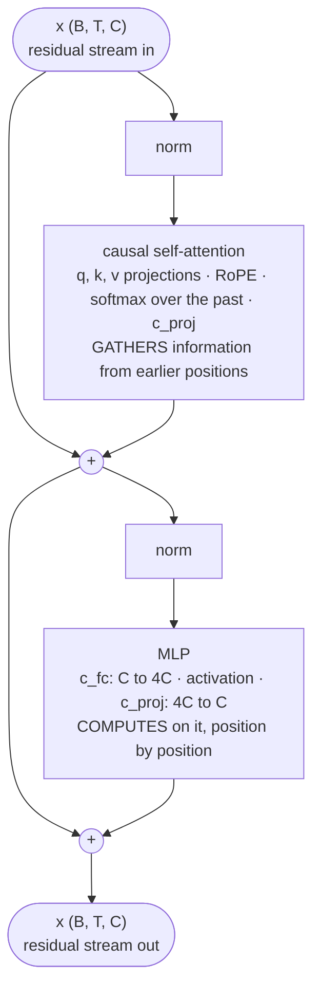
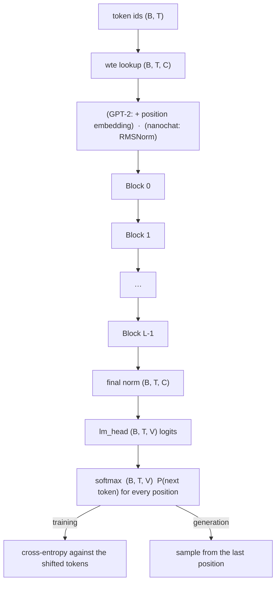

# Module 06 — The complete Transformer block

**Part I · Rebuilding the Foundations** | Tier A (CPU, seconds) | Study time: 8–9 hours

> You now have every part: embeddings turn ids into vectors, attention moves information
> between positions, an MLP transforms it, an output head scores the next token. This
> module assembles them into a network that can be stacked dozens of layers deep and
> still train, traces every tensor from token ids to next-token probabilities, and then
> does something most courses cannot: it proves, numerically, that the small model you
> understand is the model inside nanochat, and lists exactly what nanochat adds.

## A. Learning objectives

After this module you can:

1. Explain what residual connections and normalization each contribute, and why pre-norm is used.
2. Write the equations of a Transformer block and of the complete forward pass with every tensor shape.
3. Count the parameters of a model from its configuration, by component.
4. Explain the role of the MLP and compare activation functions.
5. List every difference between the classic GPT-2 architecture and nanochat at the pinned revision, and describe each of nanochat's refinements precisely.
6. Reproduce nanochat's logits with an independent implementation, and use that as a test.

## B. Prerequisites

- [Module 01](../01-neural-network-refresher/lesson.md) (MLP, backprop), [Module 04](../04-embeddings/lesson.md) (residual stream, RoPE), [Module 05](../05-attention/lesson.md) (attention).
- For the parity lab: [Getting started](../../docs/getting-started.md), Level 2 (`make env-cpu`).

## C. Motivation and intuition

A single attention layer lets each position read from others once. Understanding text
needs many rounds: find the subject; find what the subject's verb is; decide whether a
clause has closed; and so on, each round building on the previous. So we want to
**stack** layers. Two problems appear immediately, both familiar from the 1990s:

- **Deep networks did not train.** With each layer the signal and the gradient are
  multiplied by another matrix; after many layers they explode or vanish. Two-layer
  MLPs were the practical limit for most of that decade.
- **Attention only moves and averages.** It is linear in the values. Something must
  *compute* on the gathered information.

The Transformer block answers both with three ingredients:

| Ingredient | Role | One-line intuition |
|---|---|---|
| **Residual connection** | makes depth trainable | each layer proposes an *edit* to a shared state instead of replacing it |
| **Normalization** | keeps scales under control | every sub-layer sees inputs of a standard size, whatever happened before |
| **MLP after attention** | computes | attention *gathers* information at a position; the MLP *processes* it there |

The mental picture: a **residual stream** of shape `(B, T, C)` runs from the embedding to
the output head. Each block reads the stream, and adds two things to it: what attention
gathered, and what the MLP computed. Communication, then computation, repeated $L$ times.

## D. Rigorous technical explanation

### D.1 Residual connections

A residual layer computes $\mathbf{x} \leftarrow \mathbf{x} + F(\mathbf{x})$.

**Forward view.** The layer does not have to re-represent everything it wants to keep; it
only adds a correction. If $F$ outputs zero, the layer is the identity. After $L$ layers,

$$\mathbf{x}_L = \mathbf{x}_0 + F_1(\mathbf{x}_0) + F_2(\mathbf{x}_1) + \dots + F_L(\mathbf{x}_{L-1})$$

the final state is the embedding plus the sum of all contributions. This is why the
stream can be read as a shared working memory, and why the logit lens of Module 04 made
sense: intermediate states live in the same space as the final one.

**Backward view.** By the chain rule,

$$\frac{\partial L}{\partial \mathbf{x}_{l}} = \frac{\partial L}{\partial \mathbf{x}_{l+1}}\Big(I + \frac{\partial F_{l+1}}{\partial \mathbf{x}_l}\Big)$$

The identity term carries the gradient to every earlier layer unchanged, however deep
the network; the second term adds each layer's local contribution. Without the identity,
the gradient at layer 1 would be a product of $L$ Jacobians, which is what made deep
plain networks untrainable.

Both views matter, and the lab separates them: in a small pre-norm model, removing the
residual connections does *not* make gradients vanish at initialisation (normalization
keeps their scale), yet training collapses at a learning rate the residual model handles
easily and is several times slower at smaller rates. With normalization present, the
forward property (each block edits a state that already works) is doing most of the work.

### D.2 Normalization

Activations drift in scale as layers add to the stream and as weights change during
training. Normalization rescales the input of each sub-layer to a standard size, so that
a layer's behaviour does not depend on the absolute magnitude of what came before.

**LayerNorm** (GPT-2), applied to each position's vector $\mathbf{x}\in\mathbb{R}^C$ separately:

$$\mathrm{LN}(\mathbf{x}) = \boldsymbol{\gamma}\odot\frac{\mathbf{x} - \mu}{\sqrt{\sigma^2+\epsilon}} + \boldsymbol{\beta},\qquad \mu = \tfrac1C\sum_i x_i,\quad \sigma^2 = \tfrac1C\sum_i (x_i-\mu)^2$$

with learned gain $\boldsymbol\gamma$ and bias $\boldsymbol\beta$ ($2C$ parameters).

**RMSNorm** drops the mean subtraction:

$$\mathrm{RMSNorm}(\mathbf{x}) = \frac{\mathbf{x}}{\sqrt{\tfrac1C\sum_i x_i^2 + \epsilon}}$$

and nanochat's version has **no learnable parameters at all**
([`gpt.py` L42–L43](https://github.com/karpathy/nanochat/blob/92d63d4e8bb4df75c3b71618f31ddde2378b2bcd/nanochat/gpt.py#L42-L43)):

```python
def norm(x):
    return F.rms_norm(x, (x.size(-1),))
```

Worked example: $\mathbf{x} = (3, -4, 0, 0)$. Mean square $= (9+16)/4 = 6.25$, RMS $= 2.5$,
output $(1.2, -1.6, 0, 0)$, whose RMS is 1. The direction is kept; the length is set to
$\sqrt{C}$. A normalised vector therefore carries information only in its *direction*.

**Where to put it: pre-norm.** The original Transformer normalised *after* the addition,
$\mathbf{x}\leftarrow\mathrm{norm}(\mathbf{x}+F(\mathbf{x}))$ (post-norm), which puts a
normalization on the residual path itself and makes deep stacks hard to train without
careful warm-up. GPT-2 and everything since use **pre-norm**:

$$\mathbf{x}\leftarrow\mathbf{x}+F(\mathrm{norm}(\mathbf{x}))$$

The stream itself is never normalised between blocks; each sub-layer normalises its own
*copy* of the input. The identity path of D.1 stays perfectly clean. One final
normalization is applied before the output head, because the un-normalised stream can
have any scale by then.

### D.3 The MLP

The same two-layer perceptron as Module 01, applied **independently at every position**
to a `(C,)` vector:

$$\mathrm{MLP}(\mathbf{x}) = W_\text{proj}\;\phi(W_\text{fc}\,\mathbf{x}),\qquad W_\text{fc}:\ C\to 4C,\quad W_\text{proj}:\ 4C\to C$$

- **Role.** Attention brought information *to* this position; the MLP computes *with*
  it. It is the only non-linear transformation of the stream's content. A useful
  description: each of the $4C$ hidden units detects a pattern in the stream (a row of
  $W_\text{fc}$) and, when active, writes a fixed vector back (a column of
  $W_\text{proj}$).
- **Why expand to $4C$?** A wider hidden layer gives more detectors. The factor 4 is a
  convention from the original paper that has survived many attempts at replacement.
- **Cost.** $8C^2$ parameters against attention's $4C^2$: two thirds of every block.

Activation functions $\phi$ you will meet:

| Activation | Formula | Used by |
|---|---|---|
| tanh | $\tanh x$ | 1990s MLPs; saturates on both sides |
| ReLU | $\max(0,x)$ | 2012 onwards; no saturation for $x>0$ |
| GELU | $x\,\Phi(x)$ (a smooth ReLU) | GPT-2, BERT |
| **ReLU²** | $\max(0,x)^2$ | nanochat ([`gpt.py` L137–L141](https://github.com/karpathy/nanochat/blob/92d63d4e8bb4df75c3b71618f31ddde2378b2bcd/nanochat/gpt.py#L137-L141)) |

nanochat's log records head-to-head tests rather than a theory: replacing ReLU² by
SwiGLU at matched parameters was "worse on all measures" at depth 12 and 24
([`dev/LOG.md`, 2026-02-05](https://github.com/karpathy/nanochat/blob/92d63d4e8bb4df75c3b71618f31ddde2378b2bcd/dev/LOG.md#L273-L297)).
Treat activation choice as an empirical question, settled per code base.

### D.4 The block



$$\begin{aligned}\mathbf{x} &\leftarrow \mathbf{x} + \mathrm{Attn}(\mathrm{norm}(\mathbf{x}))\\ \mathbf{x} &\leftarrow \mathbf{x} + \mathrm{MLP}(\mathrm{norm}(\mathbf{x}))\end{aligned}$$

This is nanochat's `Block.forward` verbatim
([`gpt.py` L150–L153](https://github.com/karpathy/nanochat/blob/92d63d4e8bb4df75c3b71618f31ddde2378b2bcd/nanochat/gpt.py#L150-L153)),
apart from extra arguments passed through to attention:

```python
def forward(self, x, ve, cos_sin, window_size, kv_cache):
    x = x + self.attn(norm(x), ve, cos_sin, window_size, kv_cache)
    x = x + self.mlp(norm(x))
    return x
```

Input and output have the same shape, so blocks stack without any glue.

### D.5 The whole model: ids to probabilities



The trace printed by `python labs/foundations/06_transformer_trace.py` for the
16-character input `the cat sleeps .` and a 3-layer model with `C=48, H=4` (measured):

```text
text 'the cat sleeps .' -> token ids (1, 16) = (B=1, T=16)
wte lookup                    -> (1, 16, 48) = (B, T, C=48)
norm -> c_q -> split heads    -> (1, 4, 16, 12) = (B, H=4, T, D=12)
scores q @ k^T                -> (1, 4, 16, 16) = (B, H, T, T)   one T x T table per head
weights @ v, merge heads      -> (1, 16, 48)
MLP c_fc (expand)             -> (1, 16, 192) = (B, T, 4C)
MLP c_proj (contract)         -> (1, 16, 48)
after 3 blocks + final norm   -> (1, 16, 48)
lm_head                       -> (1, 16, 29) = (B, T, V=29)
softmax of the LAST position  -> (29,) = (V,), sums to 1.0000
```

Three structural facts to notice:

- **Only attention has a `T × T` shape.** Every other step treats positions independently.
- **The width `C` never changes** between the embedding and the head.
- **Every position produces a prediction.** Position $t$'s output row is
  $P(x_{t+1}\mid x_{\le t})$. Training uses all rows; generation uses the last.

### D.6 Counting parameters

For the GPT-2 style (biases, LayerNorm, learned positions, tied head):

| Component | Parameters |
|---|---|
| token embedding | $VC$ |
| position embedding | $T_\text{max}C$ |
| per block: attention | $4C^2 + 4C$ |
| per block: MLP | $8C^2 + 5C$ |
| per block: two LayerNorms | $4C$ |
| final LayerNorm | $2C$ |
| output head | 0 (tied) |
| **total** | $VC + T_\text{max}C + L(12C^2 + 13C) + 2C$ |

`tests/test_minigpt.py::test_parameter_count_formula_gpt2_style` asserts this formula
against the model. For nanochat (no biases, no norm parameters, no position table,
untied head) a block is essentially $12C^2$ and the embeddings dominate differently:

| Component (nanochat depth 12, $C=768$, $V=32768$) | Parameters | Share |
|---|---:|---:|
| token embedding `wte` | 25,165,824 | 8.8 % |
| value embeddings (6 tables of $V\times C$) | 150,994,944 | 52.7 % |
| output head `lm_head` | 25,165,824 | 8.8 % |
| 12 blocks × $12C^2$ (+ 432 gate weights) | 84,935,088 | 29.7 % |
| scalars (residual lambdas, smear, backout) | 50 | |
| **total** | **286,261,730** | |

(From `num_scaling_params()` via [`scripts/experiments/estimate_run.py`](../../scripts/experiments/estimate_run.py).)
Check the block term yourself: $12\times12\times768^2 = 84{,}934{,}656$, plus $6$ layers
$\times\ 12\times 6$ gate weights. About 62 % of this model's parameters (the token
embedding and the value embeddings) are lookup tables that cost no matmul FLOPs:
parameter count and compute are different things (Module 09).

How the parameter count moves as GPT-2 components are replaced one at a time
(measured, toy size $V=29$, $C=48$, $L=3$):

```text
GPT-2 style                                         87,840
+ no biases                                         86,208
+ RMSNorm without parameters                        85,872
+ RoPE instead of learned positions                 84,336
+ untied output head                                85,728
+ relu^2, QK-norm, logit softcap (no parameters)    85,728
```

### D.7 From GPT-2 to nanochat: every difference

Verified against the pinned source and by the parity test.

**Replacements** (each is a switch on `MiniGPTConfig`):

| | GPT-2 (2019) | nanochat `92d63d4` | Reason / evidence |
|---|---|---|---|
| Position | learned absolute table, added | RoPE on $q$, $k$ in every layer | relative, parameter-free (Module 04) |
| Normalization | LayerNorm with $\gamma,\beta$ | RMSNorm, no parameters | simpler; learnable scales tried and found worse in upstream experiments (`dev/LOG.md`, 2026-01-29) |
| Norm after embedding | no | yes | first block sees unit-scale input |
| Activation | GELU | ReLU² | empirical; SwiGLU tested and rejected |
| Biases | everywhere | none | fewer parameters, no measurable loss |
| Output head | tied to `wte` | untied, init std 0.001 | separate roles (Module 04 D.2); near-uniform initial predictions |
| Attention scores | $\mathbf{q}\cdot\mathbf{k}/\sqrt D$ | QK-norm, ×1.2 each, then $/\sqrt D$ | bounded scores (Module 05 F) |
| Logits | unbounded | $15\tanh(z/15)$ | prevents extreme logits; see below |
| Residual-writing projections at init | small random | exactly zero | every block starts as the identity (Module 07) |
| Dropout | 0.1 | none | large data, single pass: little overfitting to regularise |

**Additions** (not in MiniGPT; switched off in the parity test). Each is a few lines of
`GPT.forward` ([`gpt.py` L459–L524](https://github.com/karpathy/nanochat/blob/92d63d4e8bb4df75c3b71618f31ddde2378b2bcd/nanochat/gpt.py#L459-L524)):

1. **Per-layer residual scalars** ([L499–L500](https://github.com/karpathy/nanochat/blob/92d63d4e8bb4df75c3b71618f31ddde2378b2bcd/nanochat/gpt.py#L499-L500)).
   Before each block: `x = resid_lambdas[i] * x + x0_lambdas[i] * x0`, where `x0` is the
   normalised embedding. One learned scalar per layer rescales the stream, another
   re-injects the original token identity. Initialised to 1.15→1.05 and 0.20→0.05 across
   depth. Upstream measured a consistent validation improvement (−0.004 to −0.010 bpb
   for depths 8–20) "with essentially no compute overhead"
   ([`dev/LOG.md`, 2026-01-11](https://github.com/karpathy/nanochat/blob/92d63d4e8bb4df75c3b71618f31ddde2378b2bcd/dev/LOG.md#L960-L1012)).

2. **Value embeddings** ([L501](https://github.com/karpathy/nanochat/blob/92d63d4e8bb4df75c3b71618f31ddde2378b2bcd/nanochat/gpt.py#L499-L502), [L93–L97](https://github.com/karpathy/nanochat/blob/92d63d4e8bb4df75c3b71618f31ddde2378b2bcd/nanochat/gpt.py#L93-L97)).
   On alternating layers (always including the last), a token-indexed vector `ve` is
   added to the attention values: `v = v + gate * ve` with
   `gate = 3 * sigmoid(ve_gate(x[..., :12]))`, one gate per head computed from the first
   12 channels of the stream. Anything that attends to a position can thus read "which
   token is here" directly. The log's summary: "the models *love* Value Embeddings … a
   way to add a huge amount of capacity (parameters) to the model at almost zero cost of
   FLOPs" ([`dev/LOG.md`, 2026-01-17](https://github.com/karpathy/nanochat/blob/92d63d4e8bb4df75c3b71618f31ddde2378b2bcd/dev/LOG.md#L612-L622)).

3. **Smear** ([L475–L492](https://github.com/karpathy/nanochat/blob/92d63d4e8bb4df75c3b71618f31ddde2378b2bcd/nanochat/gpt.py#L475-L492)).
   Right after the embedding: `x[t] += gate * x[t-1]` with
   `gate = smear_lambda * sigmoid(smear_gate(x[t, :24]))`. The code comment calls it
   "cheap bigram-like info": each position starts with a little of its predecessor mixed
   in, before any attention has run. `smear_lambda` starts at 0 (off).

4. **Backout** ([L494–L507](https://github.com/karpathy/nanochat/blob/92d63d4e8bb4df75c3b71618f31ddde2378b2bcd/nanochat/gpt.py#L494-L507)).
   The stream after the middle layer is remembered and, before the final norm,
   `x = x - backout_lambda * x_backout` (initial value 0.2). Code comment: "subtract
   mid-layer residual to remove low-level features before logit projection".

5. **Logit soft-cap** ([L511–L515](https://github.com/karpathy/nanochat/blob/92d63d4e8bb4df75c3b71618f31ddde2378b2bcd/nanochat/gpt.py#L511-L515)):
   `logits = 15 * tanh(logits / 15)`, computed in fp32. For small logits it is the
   identity; it smoothly prevents any logit from exceeding ±15, which bounds how
   confident (and how catastrophically wrong) a prediction can be. (MiniGPT implements
   this one, as `logit_softcap`.)

Plus two attention-pattern options covered in Module 12: **sliding windows**
(`window_pattern`, default `SSSL`) and **grouped-query attention** (`n_kv_head`).

> **A note on evidence.** Items 3 and 4 entered nanochat in commit `a825e63`
> ("Autoresearch round 2: smear, backout, and hyperparameter tuning", 2026-03-14). An
> earlier human-run sweep in the log (2026-01-16) had rated both ideas "negligible" and
> "no improvement". The only rationale in the pinned source is the code comments quoted
> above. This course therefore describes *what they compute* precisely and makes no
> claim about *why they help*. Module 20 returns to this commit as a real example of
> automated experimentation changing a code base.

### D.8 Proof by reproduction

How do you know the tables above are complete and correct? By building the model again
from the description and comparing numbers.

`python labs/foundations/06_nanochat_parity.py` (needs `make env-cpu`):

1. builds a real nanochat `GPT` from the pinned checkout (4 layers, width 32);
2. fills its matrices with random values (they are zero-initialised in places, which would make any comparison trivially pass);
3. neutralises the five additions: `resid_lambdas=1`, `x0_lambdas=0`, `smear_lambda=0`, `backout_lambda=0`, value-embedding tables zero;
4. copies the weights into a `MiniGPT` configured with `MiniGPTConfig.nanochat_style`;
5. compares logits on random tokens.

Measured (CPU, torch 2.9.1, 2026-11-11):

```text
largest |logit|: 5.753   largest difference nanochat vs MiniGPT: 4.05e-06
parity: ok

re-enable one extra at a time:
  resid_lambdas  -> max logit change 1.372
  x0_lambdas     -> max logit change 1.438
  smear          -> max logit change 4.093
  backout        -> max logit change 0.744
  value_embeds   -> max logit change 0.470
```

Agreement to six decimal places between two independently written models means the
description in this module is not approximately right; it is the computation. And since
each addition visibly moves the logits when re-enabled, none was neutralised by
accident. The same check runs in CI (`tests/test_nanochat_parity.py`), so if the pin is
ever moved to a revision with a changed architecture, the test fails and names the day
this lesson became outdated.

## E. Minimal implementation

[`mlle/foundations/minigpt.py`](../../mlle/foundations/minigpt.py) (about 270 lines). The
block and the forward pass, condensed:

```python
class Block(nn.Module):
    """Pre-norm residual block:  x = x + attn(norm(x));  x = x + mlp(norm(x))."""
    def forward(self, x, cache=None, record=False):
        x = x + self.attn(self.norm1(x), cache, record)
        x = x + self.mlp(self.norm2(x))
        return x

class MiniGPT(nn.Module):
    def forward(self, idx, targets=None, cache=None, record=False, loss_reduction="mean"):
        B, T = idx.shape
        x = self.wte(idx)                                    # (B, T, C)
        if self.wpe is not None:                             # GPT-2 style positions
            x = x + self.wpe(torch.arange(pos0, pos0 + T, device=idx.device))
        if self.config.norm_after_embed:                     # nanochat style
            x = rms_norm(x)
        for block in self.h:
            x = block(x, cache, record)                      # (B, T, C)
        x = self.norm_f(x)
        logits = self.lm_head(x)                             # (B, T, V)
        if self.config.logit_softcap is not None:
            logits = cap * torch.tanh(logits / cap)
        if targets is None:
            return logits
        return F.cross_entropy(logits.view(-1, logits.size(-1)), targets.view(-1), ignore_index=-1)
```

One class, two personalities: `MiniGPTConfig.gpt2_style(V)` and
`MiniGPTConfig.nanochat_style(V)` set the switches of D.7's first table. Because each is
a separate flag, any single replacement can be ablated on its own.

> **Predict before you run** `python labs/foundations/06_transformer_trace.py`: for an
> *untrained* nanochat-style model, how much does each block change the residual stream?
> Then run it with `--style gpt2` and explain the difference from the two
> initialisation schemes.

## F. nanochat code walkthrough

Read [`nanochat/gpt.py`](https://github.com/karpathy/nanochat/blob/92d63d4e8bb4df75c3b71618f31ddde2378b2bcd/nanochat/gpt.py) top to bottom once with this map:

| Lines | What | This course |
|---|---|---|
| L28–L39 | `GPTConfig`: `sequence_len`, `vocab_size`, `n_layer`, `n_head`, `n_kv_head`, `n_embd`, `window_pattern` | D.5; Module 12 |
| L42–L43 | `norm`: parameter-free RMSNorm | D.2 |
| L45–L50 | `Linear`: bias-free, casts fp32 weights to the activation dtype | Module 13 |
| L53–L55 | `has_ve`: which layers get value embeddings | D.7 item 2 |
| L57–L65 | `apply_rotary_emb` | Module 04 |
| L67–L128 | `CausalSelfAttention` | Module 05 |
| L131–L141 | `MLP` | D.3 |
| L144–L153 | `Block` | D.4 |
| L156–L201 | `GPT.__init__`: modules, scalars, value-embedding tables, RoPE buffers | D.5–D.7 |
| L203–L268 | `init_weights` | Module 07 |
| L287–L314 | per-layer window sizes | Module 12 |
| L319–L388 | FLOP and KV-cache estimators | Modules 09, 11 |
| L390–L417 | `num_scaling_params` | D.6; Module 09 |
| L419–L457 | `setup_optimizer` | Module 07 |
| L459–L524 | `forward` | D.5, D.7 |
| L526–L555 | naive `generate` | Module 02 |

Now `forward` itself, in five movements:

```python
# 1. positions for RoPE (offset by the cache position at inference)
T0 = 0 if kv_cache is None else kv_cache.get_pos()
cos_sin = self.cos[:, T0:T0+T], self.sin[:, T0:T0+T]

# 2. embed, normalise, smear
x = self.transformer.wte(idx)
x = x.to(COMPUTE_DTYPE)
x = norm(x)
gate = self.smear_lambda.to(x.dtype) * torch.sigmoid(self.smear_gate(x[:, 1:, :24]))
x = torch.cat([x[:, :1], x[:, 1:] + gate * x[:, :-1]], dim=1)

# 3. the trunk
x0 = x
for i, block in enumerate(self.transformer.h):
    x = self.resid_lambdas[i] * x + self.x0_lambdas[i] * x0
    ve = self.value_embeds[str(i)](idx).to(x.dtype) if str(i) in self.value_embeds else None
    x = block(x, ve, cos_sin, self.window_sizes[i], kv_cache)
    if i == backout_layer:
        x_backout = x

# 4. backout, final norm
x = x - self.backout_lambda.to(x.dtype) * x_backout
x = norm(x)

# 5. head, soft-cap, loss
logits = self.lm_head(x)
logits = logits[..., :self.config.vocab_size]
logits = logits.float()
logits = softcap * torch.tanh(logits / softcap)
```

(Abridged: the cached-inference branch of smear and some assertions are omitted.)
Delete the lines belonging to the five additions and what remains is MiniGPT's forward.

**A structural detail worth noticing: the "meta device" construction.** `GPT.__init__`
only declares shapes; real values are assigned later by `init_weights()`
([L156–L162](https://github.com/karpathy/nanochat/blob/92d63d4e8bb4df75c3b71618f31ddde2378b2bcd/nanochat/gpt.py#L156-L162)).
The training script builds the model on PyTorch's `meta` device (no memory), moves the
empty shell to the GPU, then initialises
([`base_train.py` L145–L151](https://github.com/karpathy/nanochat/blob/92d63d4e8bb4df75c3b71618f31ddde2378b2bcd/scripts/base_train.py#L145-L151)).
This avoids ever holding two copies of a large model, and is what lets the course's
[`estimate_run.py`](../../scripts/experiments/estimate_run.py) "build" a 1.7-billion-parameter
model on a laptop to count its parameters.

## M. Key takeaways

1. A Transformer is a residual stream plus $L$ blocks. Each block adds what attention gathered and what an MLP computed. Communication, computation, repeat.
2. Residual connections give gradients an identity path through any depth; pre-norm keeps that path clean; normalization standardises what each sub-layer sees.
3. Attention is the only step with a $T\times T$ shape; the MLP holds two thirds of each block's parameters and all of its non-linear computation on content.
4. Parameters and compute are different: in nanochat d12, about 62 % of parameters are lookup tables.
5. nanochat = a modern but plain decoder (RoPE, parameter-free RMSNorm, ReLU², no biases, untied head, QK-norm, soft-capped logits) + five additions (residual scalars, value embeddings, smear, backout, plus window/GQA options). A parity test proves the list is complete.
6. The strongest way to check an architectural description is to rebuild the model from it and compare numbers.

**Where this sits in the full system:** this is the function $q_\theta(x_t\mid x_{<t})$ of
Module 02, complete. Module 07 is about choosing its parameters $\theta$.

Next: [lab](lab.md) · [quiz](quiz.md) · [references](references.md) · then [Module 07 — Learning and optimization](../07-optimization/lesson.md)
