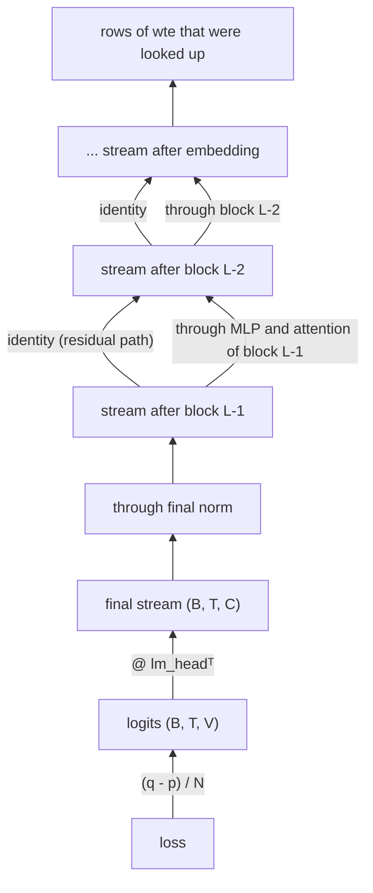

# Module 07 — Learning and optimization

**Part I · Rebuilding the Foundations** | Tier A (CPU, 1–5 minutes) | Study time: 7–8 hours

> The model of Module 06 is a function with a hundred thousand (or a billion) free
> numbers. This module is about finding good values for them: how the error signal travels
> backwards through attention and the residual stream, why plain gradient descent was
> replaced by AdamW and, for weight matrices, by Muon, what learning-rate schedules,
> weight decay, clipping and initialisation each fix, and how numerical stability is
> engineered rather than hoped for. At the end you train a complete small Transformer to
> within 0.03 nats of the best loss any model could achieve.

## A. Learning objectives

After this module you can:

1. Follow the gradient of the loss backwards through the output head, the residual stream and an attention layer, and explain where it can vanish.
2. Derive and implement SGD, momentum, Adam and AdamW, and say what problem each addition solves.
3. Explain what Muon does to a weight-matrix update and why nanochat uses it for some parameters and AdamW for others.
4. Explain warm-up, decay schedules, weight decay, gradient clipping and initialisation, each in terms of the failure it prevents.
5. Read nanochat's optimizer setup and schedules, including the automatic scaling of learning rates with width and batch size.
6. Train a small causal Transformer, diagnose its learning curve, and judge the result against a known optimum.

## B. Prerequisites

- [Module 01](../01-neural-network-refresher/lesson.md) (backprop, SGD), [Module 05](../05-attention/lesson.md), [Module 06](../06-transformer-block/lesson.md).
- [Mathematics primer](../../docs/mathematics-primer.md) §3 (chain rule), §7 (variance and initialisation), §9 (SVD, for Muon).

## C. Motivation and intuition

Training is a search in a space with one dimension per parameter. The loss assigns a
height to every point; the gradient points uphill; we step downhill. In the 1990s that
was the whole story, and the practical problems were already visible: a learning rate
too large diverges, one too small crawls, and different weights "want" very different
step sizes.

Modern optimization for LLMs is the accumulated set of answers to four questions:

| Question | 1995 answer | Today's answer |
|---|---|---|
| Which direction? | the gradient of the current mini-batch | a running average of recent gradients (momentum) |
| How far, per parameter? | one global learning rate | normalise by the typical gradient size of each parameter (Adam); or equalise all directions of a whole matrix (Muon) |
| How far, over time? | constant, or decay by hand | warm up, hold, decay on a schedule |
| How do we keep it stable? | small networks, luck | residual paths, normalization, careful initialisation, bounded attention scores and logits, weight decay, sometimes clipping |

## D. Rigorous technical explanation

### D.1 The loss, once more

For a batch of $B$ sequences of length $T$, with logits $Z\in\mathbb{R}^{B\times T\times V}$
and targets $y_{b,t}$:

$$L = -\frac{1}{N}\sum_{b,t\,:\,y_{b,t}\ne -1} \log\,\mathrm{softmax}(Z_{b,t})_{y_{b,t}}$$

where $N$ counts the non-ignored positions (target −1 means "do not train on this
position", used for masking in fine-tuning, Module 14). From Module 01:
$\partial L/\partial Z_{b,t} = (\mathbf{q}_{b,t} - \mathbf{p}_{b,t})/N$. Every position
of every sequence sends back its own "prediction minus target".

### D.2 The gradient's path through the Transformer



**Through the head.** `logits = x @ lm_headᵀ`, so the stream receives
$G_X = G_Z\,U$ and the head receives $U$'s gradient $G_Z^\top X$: the two rules of
Module 01, unchanged.

**Through the residual stream.** Each block is $\mathbf{x}\leftarrow\mathbf{x}+F(\mathrm{norm}(\mathbf{x}))$.
The gradient arriving at a block's output goes two ways: straight down the identity
path, and into $F$ (to update that block's weights and to add $F$'s own contribution to
what flows further down). The identity path means the embedding layer receives a
gradient that has not been multiplied by any block's Jacobian: the sum of "what every
layer would like the stream to have been".

**Through attention.** With $Y = AV$ and $A = \mathrm{softmax}(S)$ row-wise
(Module 05 D.8), given $G_Y = \partial L/\partial Y$:

$$
\begin{aligned}
G_V &= A^\top G_Y && \text{values: each value gets the error of whoever read it, weighted by how much}\\
G_A &= G_Y V^\top && \text{weights: would reading more from } j \text{ help position } i\,?\\
G_{S,ij} &= A_{ij}\big(G_{A,ij} - \textstyle\sum_k A_{ik}G_{A,ik}\big) && \text{through the softmax (row } i)\\
G_Q &= G_S K/\sqrt{D},\qquad G_K = G_S^\top Q/\sqrt{D} && \text{to queries and keys}
\end{aligned}
$$

The third line is the softmax Jacobian applied to a row: the gradient on a score is the
weight $A_{ij}$ times how much better than the row's average that edge is. Two
consequences worth remembering:

- **Where attention is saturated, queries and keys stop learning.** If a row of $A$ is
  nearly one-hot, then for the selected $j$, $G_{A,ij}\approx\sum_k A_{ik}G_{A,ik}$ and for
  all others $A_{ij}\approx 0$: every entry of $G_S$ is near zero. This is the practical
  reason for the $1/\sqrt D$ scaling and for QK-norm: they keep the scores in a range
  where the softmax still passes gradient.
- **The mask is respected automatically.** Masked entries have $A_{ij}=0$, so no gradient
  flows to "the future".

You will never write this backward pass (autograd does), but it tells you what can go
wrong and why specific architectural details exist.

### D.3 From SGD to AdamW

Let $g_t$ be the gradient at step $t$ for one parameter tensor.

**SGD:** $\theta \leftarrow \theta - \eta\,g_t$. One learning rate for everything. In a
Transformer the gradient scale differs by orders of magnitude between, say, an embedding
row that appears once per batch and a matrix every position passes through; no single
$\eta$ suits both.

**Momentum:** keep a running average $m_t = \beta_1 m_{t-1} + (1-\beta_1)g_t$ and step
along $m_t$. Mini-batch noise averages out; consistent directions accumulate.

**Adam:** additionally track the running average of squared gradients and divide by its
root:

$$
\begin{aligned}
m_t &= \beta_1 m_{t-1} + (1-\beta_1)\,g_t, & v_t &= \beta_2 v_{t-1} + (1-\beta_2)\,g_t^2\\
\hat m_t &= m_t/(1-\beta_1^t), & \hat v_t &= v_t/(1-\beta_2^t)\\
\theta &\leftarrow \theta - \eta\,\frac{\hat m_t}{\sqrt{\hat v_t}+\epsilon}
\end{aligned}
$$

- $\hat m/\sqrt{\hat v}$ is roughly "average gradient ÷ typical gradient magnitude", a
  number of order 1 for each coordinate **whatever the raw scale**. Every coordinate
  moves by about $\eta$ per step when its gradients agree in sign, and less when they
  are noisy. The learning rate becomes a statement about *step size*, not about
  gradient size.
- The hats undo the bias from starting $m$ and $v$ at zero. At $t=1$:
  $\hat m_1=g_1$, $\hat v_1=g_1^2$, so the first step is exactly $\pm\eta$ per coordinate.

**Worked example.** One parameter, gradients $g = 0.1, 0.1, 0.1$, $\beta_1=0.9$,
$\beta_2=0.999$, $\eta=0.01$. Step 1: $m=0.01$, $v=10^{-5}$; $\hat m = 0.1$, $\hat v=0.01$;
update $-0.01\cdot 0.1/0.1 = -0.01$. Steps 2 and 3 give the same $-0.01$. Now multiply
all gradients by 1000: the updates are *still* $-0.01$. Adam is invariant to the scale
of the gradient; SGD's step would have grown 1000-fold.

**AdamW:** *decoupled* weight decay. Shrink the parameter directly,
$\theta\leftarrow\theta(1-\eta\lambda)$, in addition to the Adam step, rather than adding
$\lambda\theta$ to the gradient (where Adam's normalisation would distort it). Weight
decay pulls unused weights towards zero and limits the growth of weight norms.

[`mlle/foundations/optim.py`](../../mlle/foundations/optim.py) implements exactly these
lines; `test_adamw_matches_torch` checks 20 steps against `torch.optim.AdamW` to 1e-5.

### D.4 Muon: equalising the directions of a matrix

Adam treats a weight matrix as a bag of independent numbers. But a matrix
$W\in\mathbb{R}^{m\times n}$ *acts* on vectors, and its gradient $G$ has structure: by
the SVD, $G = USV^\top$, a set of input directions (columns of $V$), output directions
(columns of $U$) and strengths $S$. In practice a few singular values dominate: most of
a raw update goes into a handful of directions, and the rest of the matrix barely moves.

**Muon** (MomentUm Orthogonalized by Newton–Schulz) replaces the update by the nearest
semi-orthogonal matrix:

$$G = USV^\top \quad\longrightarrow\quad \mathrm{update} = UV^\top$$

Same directions, **all singular values set to 1**: every direction of the layer is
updated with equal strength. This is to a matrix what Adam's normalisation is to a
coordinate. The full step (as in the course implementation):

$$
\begin{aligned}
\text{buf} &\leftarrow \mu\,\text{buf} + (1-\mu)\,G && \text{momentum}\\
\tilde G &= (1-\mu)\,G + \mu\,\text{buf} && \text{Nesterov look-ahead}\\
O &= \mathrm{orthogonalize}(\tilde G)\approx UV^\top\\
W &\leftarrow W - \eta\,\sqrt{\max(1,\,m/n)}\;O
\end{aligned}
$$

**Orthogonalising without an SVD.** An SVD per matrix per step would be far too slow.
Newton–Schulz iteration uses only matrix products. After normalising so that all
singular values are at most 1, repeat a few times

$$X \leftarrow aX + b\,(XX^\top)X + c\,(XX^\top)^2X$$

Since $X=USV^\top$ gives $(XX^\top)X = US^3V^\top$, each step applies the scalar
polynomial $s\mapsto as+bs^3+cs^5$ to every singular value and leaves $U$, $V$
untouched. The coefficients are chosen so that repeated application drives every
$s\in(0,1]$ towards 1. Five steps suffice
(`test_newton_schulz_orthogonalizes`: singular values land in $[0.5, 1.3]$, singular
vectors unchanged to 1e-3).

**Why not for everything?** Muon's premise is "a matrix that transforms vectors".
Embedding tables are collections of independent rows (most of which get no gradient in a
given step), the output head has its own dynamics, and scalars are not matrices.
nanochat therefore splits the parameters: **Muon for the matrices inside the blocks,
AdamW for embeddings, output head and scalars**.

### D.5 The learning rate over time

**Warm-up.** At step 0 the model is random and Adam's statistics are empty; the first
gradients are large and not representative. Starting with a small learning rate and
increasing it linearly over the first steps avoids committing to them.

**Decay.** Late in training the remaining error is fine detail; a large step size makes
the parameters jitter around a good solution instead of settling into it. Reducing the
rate towards the end lowers the final loss.

nanochat's schedule is three straight lines
([`base_train.py` L359–L369](https://github.com/karpathy/nanochat/blob/92d63d4e8bb4df75c3b71618f31ddde2378b2bcd/scripts/base_train.py#L359-L369)),
reproduced in `mlle.foundations.optim.lr_multiplier`:

```text
multiplier
 1.0 |    ______________
     |   /              \
     |  /                \___
0.05 | /                     \_   <- final_lr_frac
     +-+-------------+---------+--> step
       40 steps       35 %      100 %
       warm-up        of run    of run
                      (warm-down over the last 65 %)
```

Two more schedules run alongside it for the Muon groups: momentum rises from 0.85 to
0.97 over the first 400 steps and falls to 0.90 during warm-down, and weight decay
follows a cosine from its initial value to zero
([`base_train.py` L371–L386](https://github.com/karpathy/nanochat/blob/92d63d4e8bb4df75c3b71618f31ddde2378b2bcd/scripts/base_train.py#L371-L386)).

### D.6 Measured: how sensitive is training to the learning rate?

MiniGPT (2 layers, 64 wide), Pocket, 600 steps, AdamW, validation loss in nats/char.
Entropy floor 0.3139. (CPU, seed 0, 2026-11-12.)

| lr | nanochat style: step 100 | step 600 | GPT-2 style: step 600 |
|---:|---:|---:|---:|
| 1e-4 | 2.852 | 1.672 | |
| 3e-4 | 2.128 | 0.537 | |
| 1e-3 | 0.949 | 0.373 | |
| 3e-3 | 0.474 | 0.357 | 0.366 |
| 1e-2 | 0.407 | **0.350** | 0.354 |
| 3e-2 | 0.419 | 0.355 | |
| 1e-1 | 0.668 | 0.358 | |
| 3e-1 | 1.053 | 0.392 | **2.751** (collapsed) |
| 1.0 | 2.478 | 0.787 | 2.755 after spiking to 107 |

Reading the table:

- **Too small is a slow failure:** at 1e-4 the model is still at 1.67 after 600 steps.
- **There is a wide basin:** from 1e-3 to 1e-1 the final losses are within 0.02 of each other.
- **Too large fails differently in the two architectures.** The GPT-2-style model at 0.3
  collapses to 2.75 and stays there. That number is the *unigram* loss of Module 02: the
  model has lost the ability to use context and predicts character frequencies only. The
  nanochat-style model at the same rate still reaches 0.39, and even at 1.0 it degrades
  rather than collapses.

Why is the second model so much more forgiving? Its normalizations have no learnable
scale, its attention scores are bounded by QK-norm and its logits by the soft-cap, so no
single oversized step can push activations into a regime from which gradients cannot
bring them back. Robustness to the learning rate is a designed property of the
architecture. It is also why nanochat can drop gradient clipping (D.8).

### D.7 Measured: AdamW versus Muon, and how to compare optimizers honestly

Same model and data; "Muon" means Muon (lr 0.02) on the block matrices plus AdamW
(lr 3e-3) on the rest, as in nanochat.

| | seed 0 | seed 1 | seed 2 |
|---|---:|---:|---:|
| AdamW, lr 3e-3 | 0.3574 | 0.3553 | 0.3542 |
| Muon 0.02 + AdamW 3e-3 | 0.3499 | 0.3487 | 0.3525 |
| AdamW, lr 1e-2 (tuned, seed 0) | 0.3501 | | |

Against AdamW at lr 3e-3, Muon wins on all three seeds by about 0.005. Against AdamW at
its *best* learning rate from the sweep above (1e-2), the difference disappears.

> **An optimizer comparison is only meaningful when each optimizer is at its own tuned
> learning rate.** "A beats B" at a shared or default setting mostly measures which one
> the setting happened to suit. On this toy problem the tuned optimizers tie; nanochat's
> preference for Muon rests on experiments at depth 12–26 on real text (its
> `dev/LOG.md`), which this toy cannot confirm or refute.

### D.8 Weight decay, clipping, initialisation

**Weight decay.** In nanochat it is applied only to the Muon groups, in a "cautious"
form: the decay is applied only to entries where update and weight have the same sign
([`optim.py` L176–L180](https://github.com/karpathy/nanochat/blob/92d63d4e8bb4df75c3b71618f31ddde2378b2bcd/nanochat/optim.py#L176-L180)),
so decay never fights the direction the gradient wants. Its strength is scaled with
batch size and training length and annealed to zero by the end of training.

**Gradient clipping.** If the global gradient norm exceeds a threshold, rescale it.
Protects against rare huge gradients. MiniGPT's training loop clips at 1.0 by default
because it also has to support the less robust GPT-2 style. nanochat at the pinned
revision does **not** clip. Upstream tested clipping at several thresholds at depth 12
and 20 and recorded: "No benefit at any scale tested … Grad norm never exceeds 1.0
naturally, so clipping is always inactive … Deleted all grad-clip code paths"
([`dev/LOG.md`, 2026-01-08](https://github.com/karpathy/nanochat/blob/92d63d4e8bb4df75c3b71618f31ddde2378b2bcd/dev/LOG.md#L1075-L1089)).

**Initialisation.** Three principles, all visible in nanochat's `init_weights`
([`gpt.py` L203–L268](https://github.com/karpathy/nanochat/blob/92d63d4e8bb4df75c3b71618f31ddde2378b2bcd/nanochat/gpt.py#L203-L268)):

1. *Preserve variance.* Weights of a layer with fan-in $n$ get standard deviation
   $1/\sqrt{n}$ so signals neither grow nor shrink through it
   ([primer §7](../../docs/mathematics-primer.md#7-expectation-variance-and-why-initialisation-scales-by-1sqrtn)).
   nanochat draws $c_q, c_k, c_v$ uniformly from $[-s, s]$ with $s=\sqrt3/\sqrt{C}$,
   which has exactly that standard deviation (uniform "to avoid outliers").
2. *Start each block as the identity.* The projections that write into the residual
   stream (`attn.c_proj`, `mlp.c_proj`) are **zero**. At step 0 the network is
   `embedding → norm → head`; blocks switch themselves on as their projections learn.
   (GPT-2 achieved a milder version by scaling those projections by $1/\sqrt{2L}$.)
3. *Start with uniform predictions.* `lm_head` has standard deviation 0.001, so the
   initial logits are ≈ 0 and the initial loss ≈ $\ln V$.

Measured effect of violating principle 3 (replace the head's initial weights by
standard deviation 1.0; untrained model, Pocket, $\ln 25 = 3.219$):

| | initial loss |
|---|---:|
| nanochat style, as designed | 3.220 |
| GPT-2 style, as designed | 3.252 |
| nanochat style, head std 1.0 | 12.4 |
| GPT-2 style, head std 1.0 | 63.0 |

A loss of 63 nats means the model assigns probability $e^{-63}$ to the truth: it is
enormously confident and wrong, and the first hundreds of steps would be spent undoing
that. (The nanochat-style model is protected by its logit soft-cap: ±15 bounds the
damage at about 12.)

### D.9 Numerical stability is engineered

| Risk | Where | Guard in nanochat |
|---|---|---|
| Attention softmax saturates → no gradient | scores | QK-norm bounds scores to $\pm1.44\sqrt{D}$ |
| Extreme logits → huge loss, overflow in half precision | output | soft-cap $15\tanh(z/15)$, computed in fp32 (`logits.float()`) |
| Residual stream grows with depth | stream | every sub-layer reads a normalised copy; final norm before the head |
| Division by ~0 in Adam | optimizer | $\epsilon$ (nanochat: 1e-10), bias correction |
| Precision loss in low-precision arithmetic | optimizer | AdamW math in fp32 even for bf16-stored embeddings ([`optim.py` L41–L47](https://github.com/karpathy/nanochat/blob/92d63d4e8bb4df75c3b71618f31ddde2378b2bcd/nanochat/optim.py#L41-L47)) |
| Oversized first steps | schedule | warm-up; zero-initialised projections |

## E. Minimal implementation

Optimizers: [`mlle/foundations/optim.py`](../../mlle/foundations/optim.py). AdamW's step:

```python
p.mul_(1 - self.lr * self.weight_decay)                    # decoupled weight decay
m.mul_(b1).add_(g, alpha=1 - b1)                           # first moment
v.mul_(b2).addcmul_(g, g, value=1 - b2)                    # second moment
m_hat = m / (1 - b1**self.t); v_hat = v / (1 - b2**self.t) # bias correction
p.addcdiv_(m_hat, v_hat.sqrt().add_(self.eps), value=-self.lr)
```

Muon's step and the orthogonalisation:

```python
buf.lerp_(g, 1 - self.momentum)
update = g.lerp(buf, self.momentum)                        # Nesterov
update = newton_schulz(update, self.ns_steps)              # singular values -> ~1
p.add_(update, alpha=-self.lr * max(1.0, p.shape[0] / p.shape[1]) ** 0.5)

def newton_schulz(G, steps=5):
    a, b, c = 3.4445, -4.7750, 2.0315
    X = G / (G.norm() + 1e-7)
    ...
    for _ in range(steps):
        A = X @ X.mT
        X = a * X + (b * A + c * (A @ A)) @ X
```

The training loop: [`mlle/foundations/train.py`](../../mlle/foundations/train.py). Its
core is five lines, the same five as for the 1990s digit classifier:

```python
x, y = get_batch(train_tokens, cfg.batch_size, block, g, device)
loss = model(x, y)
loss.backward()
for opt in optimizers: opt.step()
for opt in optimizers: opt.zero_grad()
```

Everything else in that file is what makes a run trustworthy: a held-out split taken
from the *end* of the token stream, evaluation on a fixed set of batches so that curves
are comparable, the learning-rate schedule, seeds, throughput measurement, and a
structured record of configuration and results.

**The Part I milestone run.** `python labs/foundations/07_train_minigpt.py` (measured,
CPU, 2026-11-12):

```text
step     0 | train 3.2203 | val 3.2203
step   500 | train 0.3652 | val 0.3640
step  1000 | train 0.3533 | val 0.3523
step  1500 | train 0.3495 | val 0.3481

101,504 parameters | 30.9 s of training | 99,452 tokens/s
validation loss 0.3481 nats/char | entropy floor 0.3139 | gap 0.0342
agreement accuracy: 1.00 (simple), 1.00 (with an attractor of the opposite number)

--- sample (temperature 1.0) ---
the dogs help the bird .
the fox that chases the child helps the robots .
the dogs that chase the old robot like the foxes .
the small bird helps the birds .
```

Compare with Module 02: the best counting model reached 0.3595 with 14 characters of
context and scored 0–46 % on agreement with attractors. A 100 k-parameter Transformer
trained for 31 seconds reaches 0.348 and 100 %. The sample's second and third sentences
get agreement right across a relative clause.

> **Predict before you run** `python labs/foundations/07_train_minigpt.py --style gpt2 --lr 0.3`:
> the loss will not go to infinity. At what value will it get stuck, and what does that
> value correspond to? (Hint: Module 02's first table.)

## F. nanochat code walkthrough

### F.1 Parameter groups

`GPT.setup_optimizer`
([`gpt.py` L419–L457](https://github.com/karpathy/nanochat/blob/92d63d4e8bb4df75c3b71618f31ddde2378b2bcd/nanochat/gpt.py#L419-L457))
sorts every parameter into a group and asserts that none is forgotten:

| Group | Optimizer | Learning rate (script defaults) | Betas | Weight decay |
|---|---|---|---|---|
| `lm_head` | AdamW | 0.008 × width scale | (0.8, 0.96) | 0.01 |
| `wte` | AdamW | 0.3 × width scale | (0.8, 0.995) | 0.001 |
| value embeddings | AdamW | 0.15 × width scale | (0.8, 0.995) | 0.01 |
| `resid_lambdas` | AdamW | 0.005 | (0.8, 0.95) | 0.05 |
| `x0_lambdas` | AdamW | 0.5 | (0.96, 0.95) | 0 |
| smear gate, smear/backout scalars | AdamW | 0.2 | (0.8, 0.95) | 0 |
| block matrices, one group per shape | Muon | 0.02 | momentum 0.95, `ns_steps` 5, `beta2` 0.9 | scheduled |

(The "script defaults" are those of `scripts/base_train.py` L60–L70, which override the
smaller defaults in the method signature.) Things to notice:

- **Learning rates span three orders of magnitude.** An embedding row is touched rarely
  and can take big steps (0.3); the output head is touched at every position by every
  example and takes small ones (0.008). This is the per-group version of what Adam does
  per coordinate.
- **Width scaling.** AdamW learning rates are multiplied by $(C/768)^{-0.5}$: wider
  models take smaller steps
  ([L432–L434](https://github.com/karpathy/nanochat/blob/92d63d4e8bb4df75c3b71618f31ddde2378b2bcd/nanochat/gpt.py#L432-L434)). In
  the miniature CPU run of this course ($C=64$) the log shows that factor as 3.46.
- **Muon groups are formed by shape** so that all matrices of one shape can be stacked
  into a single tensor and orthogonalised in one batched operation.

### F.2 The fused optimizer kernels

[`nanochat/optim.py`](https://github.com/karpathy/nanochat/blob/92d63d4e8bb4df75c3b71618f31ddde2378b2bcd/nanochat/optim.py):

- `adamw_step_fused` (L23–L63) is D.3 in one compiled function. Hyperparameters are
  passed as 0-dimensional tensors so that changing the learning rate each step does not
  trigger recompilation.
- `muon_step_fused` (L111–L180) is D.4 with refinements, in order: Nesterov momentum;
  optional cast to bf16; **MuonEq** row equilibration; orthogonalisation by the **Polar
  Express** iteration (L143–L154: the same odd-polynomial idea as Newton–Schulz, with a
  different coefficient triple for each of the five steps, taken from the cited paper);
  **Muon+** renormalisation to the Frobenius norm an exactly orthogonal matrix would
  have; **NorMuon** variance reduction (a per-row or per-column adaptive scale from a
  running second moment, L163–L174); and the cautious weight decay with the update.
- `MuonAdamW.step` (L428–L459) runs the groups. On one GPU "all communication is
  skipped"; with several, gradients are averaged and optimizer state is sharded across
  ranks inside the optimizer (Module 13).
- The per-matrix learning-rate factor $\sqrt{\max(1, m/n)}$ of D.4 is at
  [L393](https://github.com/karpathy/nanochat/blob/92d63d4e8bb4df75c3b71618f31ddde2378b2bcd/nanochat/optim.py#L390-L394).

The course's `Muon` implements the core (momentum → orthogonalise → step); it omits the
four refinements, which is the honest reason not to expect nanochat-level optimizer
behaviour from it.

### F.3 Schedules and automatic scaling in the training script

[`scripts/base_train.py`](https://github.com/karpathy/nanochat/blob/92d63d4e8bb4df75c3b71618f31ddde2378b2bcd/scripts/base_train.py):

- **Batch-size scaling of learning rates** (L286–L294): all rates are multiplied by
  $\sqrt{B/B_\text{ref}}$ with $B_\text{ref}=2^{19}$ tokens. The source labels the Muon
  part of this "not studied carefully, assumption!". In the miniature run (2 048-token
  batches) the log line reads `Scaling LRs by 0.0625`.
- **Weight-decay scaling** (L296–L304): $\lambda = \lambda_\text{ref}\sqrt{B/B_\text{ref}}\,(D_\text{ref}/D)$, where $D$ is the training horizon in tokens.
- **The step** (L506–L540): accumulate gradients over micro-batches, set each group's
  learning rate to `initial_lr × multiplier`, set Muon momentum and weight decay from
  their schedules, `optimizer.step()`, `model.zero_grad(set_to_none=True)`.

```python
lrm = get_lr_multiplier(step)
muon_momentum = get_muon_momentum(step)
muon_weight_decay = get_weight_decay(step)
for group in optimizer.param_groups:
    group["lr"] = group["initial_lr"] * lrm
    if group['kind'] == 'muon':
        group["momentum"] = muon_momentum
        group["weight_decay"] = muon_weight_decay
```

| | Course (`train.py`, `optim.py`) | nanochat |
|---|---|---|
| Optimizers | `torch.optim.AdamW`; hand-written AdamW and core Muon for study | fused, compiled AdamW and Muon with four refinements; distributed |
| Parameter groups | decay / no-decay, or matrices / rest | seven kinds, separate rates and betas |
| Schedule | same three-line multiplier | plus momentum and weight-decay schedules, width and batch scaling |
| Clipping | global norm 1.0 by default | none |
| Initialisation | GPT-2 or nanochat scheme (switch) | nanochat scheme |

## M. Key takeaways

1. The error signal starts as "prediction minus target" at every position and reaches every layer through the residual stream's identity path; inside attention it reaches values directly and queries/keys through the softmax, where saturation blocks it.
2. Adam turns the learning rate into a per-coordinate step size, independent of gradient scale; AdamW adds decoupled weight decay.
3. Muon does for a matrix's singular directions what Adam does for coordinates. nanochat uses Muon for block matrices and AdamW for tables, head and scalars, with learning rates spanning three orders of magnitude.
4. Warm-up protects the first steps, decay refines the last, zero-initialised projections make every block start as the identity, and a tiny head makes the initial loss $\ln V$.
5. Architectural bounds (parameter-free norms, QK-norm, soft-capped logits) buy robustness: the same oversized learning rate that collapses a GPT-2-style model to the unigram solution merely slows the nanochat-style one.
6. Compare optimizers only at their own tuned settings, and over several seeds.

**Where this sits in the full system:** with this module the core loop is complete:
text → tokens → vectors → blocks → logits → loss → gradients → update. Part II scales
exactly this loop up: real data, real model sizes, real budgets.

## Milestone 1

You have reached the Part I milestone: *build a minimal causal Transformer, explain
every important tensor transformation, train it on a small corpus, generate text, and
map each component to nanochat.* The checklist and rubric are in
[instructor/assessments.md](../../instructor/assessments.md#milestone-1).

Next: [lab](lab.md) · [quiz](quiz.md) · [references](references.md) · then [Module 08 — Data preparation and pretraining](../08-data-and-pretraining/lesson.md)
