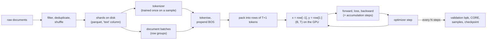

# Module 08 — Data preparation and pretraining

**Part II · Training a Modern LLM** | Tier A–C | Study time: 6–7 hours

> Part I built the function and the learning rule. Part II is about running them for
> real. This module follows a document from a file on disk to a gradient step: what data
> is chosen and why it matters more than almost any modelling decision, how documents
> are packed into fixed-size rows, what a training script actually does around the
> five-line loop, and how to read a training log well enough to know when something is
> wrong. You will run nanochat's unmodified pretraining script end to end.

## A. Learning objectives

After this module you can:

1. Explain why data quality dominates, and how to detect duplicates and train/evaluation contamination.
2. Describe three ways of packing documents into rows and the trade-off each makes.
3. Trace nanochat's data path: shards → row groups → tokens → BOS-aligned rows → GPU.
4. Describe every phase of `scripts/base_train.py` and the contents of a checkpoint.
5. Read a training log line by line and diagnose common failures from loss values and throughput.
6. Run nanochat's tokenizer training, pretraining and evaluation on a local dataset, and interpret the result.

## B. Prerequisites

- Part I, in particular [Module 02](../02-language-modeling/lesson.md) (teacher forcing, entropy floor), [Module 03](../03-tokenization/lesson.md), [Module 07](../07-optimization/lesson.md).
- [Getting started](../../docs/getting-started.md), Level 2 (`make env-cpu`).
- Before any GPU run: [hardware and costs](../../docs/hardware-and-costs.md).

## C. Motivation and intuition

A language model is a compressed description of its training data. Architecture and
optimizer decide how efficiently the compression is learned; the data decides *what*
there is to learn. Three facts from nanochat's own history make the point better than
any principle:

- Switching the pretraining dataset (FineWeb-EDU → ClimbMix) was "by far the single
  biggest improvement to nanochat's GPT-2 speedrun time", cutting it by 27 %, more than
  any architectural change on the leaderboard
  ([`dev/LOG.md`, 2026-03-04](https://github.com/karpathy/nanochat/blob/92d63d4e8bb4df75c3b71618f31ddde2378b2bcd/dev/LOG.md#L107-L128)).
- It was the *sixth* attempt to find better data. The previous five datasets and
  mixtures, all plausible, were worse; unfiltered FineWeb was "significantly, shockingly
  worse" (CORE 0.260 → 0.224)
  ([same log, 2026-02-17](https://github.com/karpathy/nanochat/blob/92d63d4e8bb4df75c3b71618f31ddde2378b2bcd/dev/LOG.md#L181-L200)).
- Changing only *how documents are laid into rows* changed the validation loss enough
  that earlier experiments were no longer comparable in absolute terms (D.4).

So: which data, how it is cleaned, how it is split, and how it is batched are
first-class engineering decisions.



## D. Rigorous technical explanation

### D.1 What pretraining data is, and what "quality" means

Pretraining text is whatever teaches general language and knowledge: web pages, books,
code, reference material, at the scale of billions to trillions of tokens. "Quality" has
no single definition; operationally it is *whatever raises downstream evaluation scores
per training token*. Typical filters, applied before a dataset like ClimbMix reaches you:

| Filter | Removes | Why it helps |
|---|---|---|
| Language identification, encoding repair | mojibake, wrong-language pages | tokens the tokenizer and model cannot use |
| Boilerplate removal | navigation menus, cookie banners | pure repetition |
| Quality classifiers | spam, keyword stuffing, machine-generated filler | low information per token |
| Deduplication (exact and near) | mirrored pages, templates, licences | repeated text is memorised instead of generalised from, and inflates apparent data size |
| Safety and privacy filters | personal data, toxic content | legal and behavioural reasons |

**Mixing.** Real corpora blend sources (web, code, maths, …) in chosen proportions. The
proportions matter and cannot be derived from first principles: nanochat's log records
several mixtures that looked reasonable and scored worse than a single good source.
Treat a data mixture like a hyperparameter: change it only with an evaluation in hand.

nanochat's dataset at the pin
([`nanochat/dataset.py`](https://github.com/karpathy/nanochat/blob/92d63d4e8bb4df75c3b71618f31ddde2378b2bcd/nanochat/dataset.py)):
`karpathy/climbmix-400b-shuffle`, a pre-shuffled repackaging of NVIDIA's ClimbMix,
stored as 6 543 parquet shards of about 100 MB (≈ 250 M characters) each, with one
document per row in a `text` column. The log states about 150 shards (~7 B tokens)
suffice for a GPT-2-grade model. You never need the whole dataset.

### D.2 Splits, and the three ways to fool yourself

A model is judged on data it has not trained on. The discipline:

| Split | Used for | In nanochat |
|---|---|---|
| train | gradient steps | all shards but the last |
| validation | monitoring, comparing runs, tuning | the **last shard** ([`dataloader.py` L36–L38](https://github.com/karpathy/nanochat/blob/92d63d4e8bb4df75c3b71618f31ddde2378b2bcd/nanochat/dataloader.py#L36-L38)); `dataset.py` always downloads it |
| test | the final, reported number | no separate text split; the reported quality numbers are external benchmarks (CORE, ChatCORE), Module 10 |

Three failure modes:

1. **Leakage / contamination:** evaluation items (or near-copies) are in the training
   data. The model is then rewarded for memorising.
2. **Tuning on the test set:** every decision made by looking at a metric adapts the
   system to that metric's quirks. A validation set that has guided hundreds of decisions
   is no longer an unbiased estimate. (This is why a leaderboard entry in nanochat must
   report both CORE and validation bpb, and why CORE is described there as "a little bit
   noisy".)
3. **Distribution mismatch:** validation text that is easier or different from what you
   care about.

**Measured: what contamination looks like**
(`python labs/pretraining/08_data_quality.py`; Pocket, entropy floor 0.3139 nats/char;
half of the "contaminated" validation set consists of training documents):

| Model | clean validation | contaminated validation | leaked half only |
|---|---:|---:|---:|
| 4-character counts (generalises) | 0.3934 | 0.3923 | 0.3912 |
| 12-character counts | 0.3870 | 0.3615 | 0.3362 |
| 40-character counts (memorises) | 1.0192 | 0.5429 | **0.1065** |

Three lessons in one table:

- The memorising model is *terrible* on clean data (1.02) and looks twice as good on the
  contaminated set (0.54): **contamination rewards exactly the wrong property.**
- On the leaked documents alone its loss (0.107) is far **below the entropy of the
  language**. No honest predictor can do that (Module 02). *A loss below any plausible
  floor means leakage until proven otherwise.*
- The half-contaminated average (0.54, or 0.36 for the middle model) is a perfectly
  plausible-looking number. Partial contamination does not announce itself; you have to
  look for it. The lab's detector (overlap of 8-word shingles with the training set)
  flags exactly the leaked half and none of the clean documents.

For real benchmarks the same question is: could the test items be on the web pages the
model was trained on? For widely published benchmarks the honest answer is usually
"partly", which is one reason scores on famous benchmarks are weak evidence.

### D.3 From documents to rows: the packing problem

The model wants a `(B, T)` grid; documents have every length from a few tokens to tens
of thousands. Three strategies
([`mlle/data/packing.py`](../../mlle/data/packing.py)):

```text
stream:        |..doc A..|....doc B.......|.doc C.|......doc D.........       cut every T+1 tokens
               [   row 1        ][   row 2        ][   row 3        ]         rows start anywhere

bestfit_crop:  [BOS doc B.........|BOS doc C|BOS doc A..|BOS doc E.(cut)]     every row starts with BOS;
               [BOS doc D..........................|BOS doc F|BOS doc G(cut)]  the last doc is cropped to fit

bestfit_pad:   [BOS conv 1....|BOS conv 4..|BOS conv 2|pad pad pad]           nothing is cut;
               [BOS conv 3..............|BOS conv 5......|pad pad]            leftover positions are masked
```

| Strategy | Wasted | Kept property | Used by nanochat for |
|---|---|---|---|
| stream | nothing | — (most rows start mid-document) | (the original loader, replaced) |
| best-fit crop | the cropped tails of documents | every position can look back to its document's start; no padding | pretraining ([`dataloader.py` L74–L161](https://github.com/karpathy/nanochat/blob/92d63d4e8bb4df75c3b71618f31ddde2378b2bcd/nanochat/dataloader.py#L74-L161)) |
| best-fit pad | row positions (compute) | no token is ever discarded | fine-tuning ([`chat_sft.py` L180–L298](https://github.com/karpathy/nanochat/blob/92d63d4e8bb4df75c3b71618f31ddde2378b2bcd/scripts/chat_sft.py#L180-L298)) |

**Why BOS alignment?** A row that begins mid-document asks the model to predict tokens
whose necessary context is missing. Those predictions are unavoidably poor, add noise to
the gradient, and never occur at inference time, where a prompt always starts with BOS.
(You met the same effect in Module 07: random windows into Pocket cost about 0.03
nats/char above the floor.)

**The price**, simulated on synthetic document lengths
(`python labs/pretraining/08_packing.py`, measured):

| Documents | $T$ | best-fit crop: tokens discarded | best-fit pad: padding (+ truncated) |
|---|---:|---:|---:|
| median 400 tokens | 128 | 63.5 % | 4.9 % (57.9 %) |
| median 400 tokens | 512 | 27.5 % | 12.8 % (7.1 %) |
| median 400 tokens | 2048 | 1.6 % | 0.2 % (0 %) |
| median 1 500 tokens, heavy tail | 2048 | 30.7 % | 13.3 % (10.1 %) |

The waste depends on document length *relative to the row*. On its real pretraining data
at $T=2048$ nanochat measured 34.6 % of tokens discarded with best-fit cropping, against
39.4 % for naive cropping and a theoretical minimum of 22.9 % (tokens in documents too
long to ever fit)
([`dev/LOG.md`, 2026-01-13](https://github.com/karpathy/nanochat/blob/92d63d4e8bb4df75c3b71618f31ddde2378b2bcd/dev/LOG.md#L745-L807)).
Why is discarding a third of the data acceptable for pretraining? Because data is
abundant (6 543 shards, ~150 needed) while compute is the scarce resource: 100 % of the
*compute* trains on real tokens. For fine-tuning the situation reverses: curated
conversations are scarce and short, so nanochat pads instead of cropping.

Two consequences recorded in the same log entry are worth internalising:

- Cropping biases the data slightly: "tokens at the tails of long documents will be discarded".
- "Switching to the BOS dataloader changes the validation loss and makes all previous
  experiments not comparable in absolute value." **A loss is only comparable between runs
  that share the evaluation data pipeline.**

### D.4 The loader as a system

Details of nanochat's pretraining loader that matter in practice:

- **Unit of reading: the parquet row group** (about 1 000 documents). Under multi-GPU
  training, rank $r$ of $N$ reads row groups $r, r+N, r+2N, \dots$, so ranks see disjoint
  data ([L25–L71](https://github.com/karpathy/nanochat/blob/92d63d4e8bb4df75c3b71618f31ddde2378b2bcd/nanochat/dataloader.py#L25-L71)).
- **Tokenisation happens on the fly**, in batches of 128 documents on 4 threads, with BOS
  prepended to each ([L104–L109](https://github.com/karpathy/nanochat/blob/92d63d4e8bb4df75c3b71618f31ddde2378b2bcd/nanochat/dataloader.py#L104-L109)).
  There is no pre-tokenised copy of the dataset on disk.
- **A look-ahead buffer of 1 000 documents** feeds the best-fit search.
- **One pinned CPU buffer, one host-to-GPU copy per batch**, with inputs and targets as
  two views of the same buffer ([L111–L120](https://github.com/karpathy/nanochat/blob/92d63d4e8bb4df75c3b71618f31ddde2378b2bcd/nanochat/dataloader.py#L111-L120)).
- **It never ends.** After the last shard it starts again and increments `epoch`; the
  training script decides when to stop.
- **Approximate resume:** each batch reports `{pq_idx, rg_idx, epoch}`, which is saved in
  the checkpoint so that a resumed run continues with the next row group.

### D.5 The objective

One objective, everywhere: next-token cross-entropy over all positions of every row.
No masking in pretraining (every token is a target; padding does not exist). Alternatives
have been tried upstream and rejected for this setting: multi-token prediction increased
memory from 34 to 47 GB at depth 12 and made validation bpb "same/slightly worse" per
step and "noticeably worse" per unit of wall-clock time
([`dev/LOG.md`, 2026-01-12](https://github.com/karpathy/nanochat/blob/92d63d4e8bb4df75c3b71618f31ddde2378b2bcd/dev/LOG.md#L885-L909)).

### D.6 Anatomy of a training script

`scripts/base_train.py` (604 lines) in the order it executes:

| Lines | Phase | What happens |
|---|---|---|
| L41–L81 | arguments | every knob is a CLI flag with a default; the full set is saved with the checkpoint |
| L85–L117 | compute init | device, seeds, precision, distributed setup; reports which attention kernel is in use |
| L121–L151 | tokenizer and model | vocabulary size → `GPTConfig` from `--depth` → build on the meta device → move → `init_weights()` |
| L165–L246 | FP8 (optional), compile | `torch.compile(model, dynamic=False)`; the uncompiled `orig_model` is kept for evaluation and saving |
| L249–L304 | sizing | parameter counts, FLOPs per token, token budget, batch size, learning-rate and weight-decay scaling (Module 09) |
| L308–L333 | optimizer, data loaders | `setup_optimizer`; training loader with resume state; a builder for the validation loader |
| L336–L386 | horizon and schedules | number of iterations; learning rate, Muon momentum and weight decay as functions of the step |
| L416–L503 | periodic work | validation bpb, CORE, samples, checkpoint; note `last_step`: the loop runs `num_iterations + 1` times so the final state is evaluated and saved |
| L506–L545 | the training step | accumulate over micro-batches, set schedules, step, zero gradients, time it |
| L547–L594 | logging | smoothed loss, tokens/s, MFU, ETA; garbage-collector management |

**What a checkpoint is**
([`checkpoint_manager.py` L41–L58](https://github.com/karpathy/nanochat/blob/92d63d4e8bb4df75c3b71618f31ddde2378b2bcd/nanochat/checkpoint_manager.py#L41-L58)): three files per saved step in
`$NANOCHAT_BASE_DIR/base_checkpoints/<tag>/`:

| File | Contents |
|---|---|
| `model_<step>.pt` | the model's `state_dict` |
| `optim_<step>_rank<r>.pt` | optimizer state, one file per rank (the optimizer's state is sharded across GPUs) |
| `meta_<step>.json` | step, validation bpb, the full model config, **all command-line arguments**, batch sizes, data-loader position, loop state |

The JSON is what makes a result reproducible months later: it records exactly how the
model was made. Fine-tuning reads its hyperparameters from it (Module 14).

### D.7 Reading a training log

From the reference CPU run of this course (miniature model, local dataset):

```text
step 00100/00300 (33.33%) | loss: 1.872717 | lrm: 1.00 | dt: 41.92ms | tok/sec: 48,854 | bf16_mfu: 0.00 | epoch: 1 pq: 1 rg: 5 | total time: 0.08m | eta: 0.2m
```

| Field | Meaning | What to watch |
|---|---|---|
| `step` | optimizer steps done / planned | |
| `loss` | exponentially smoothed **training** loss, nats per token | should start near $\ln V$ and fall; noisy at small batch sizes |
| `lrm` | learning-rate multiplier from the schedule | rises during warm-up, 1.00, then decays |
| `dt` | wall time of this step | first step includes compilation (41 s in this run) |
| `tok/sec` | training throughput | your main hardware metric |
| `bf16_mfu` | model FLOPs utilization against a table of known GPUs | 0.00 on CPU and on GPUs missing from nanochat's table (e.g. the GB10) |
| `epoch / pq / rg` | position in the data: pass, shard, row group | if `epoch` exceeds 1 you are re-reading data: download more shards |
| `eta` | based on mean step time after the first 10 steps | |

and, every `--eval-every` steps, `Step 00100 | Validation bpb: 0.565152`: the number to
compare between runs.

**Diagnosis table.** Most failures are recognisable from the loss alone.

| Symptom | Likely cause | Check |
|---|---|---|
| Loss stays at $\ln V$ (10.4 for 32 768 tokens) | nothing is learning: learning rate zero, optimizer not stepping, all targets ignored | print a gradient norm; inspect `y` |
| Initial loss far above $\ln V$ | bad initialisation of the output head | Module 07 D.8 |
| Loss drops, then sits at the unigram level | context pathway collapsed: learning rate too high or an instability | lower the rate; Module 07 D.6 |
| Loss becomes `nan` | overflow: too-high rate, fp16 without a scaler, a bug in a modification | run in fp32 (`NANOCHAT_DTYPE=float32`) to separate precision from logic |
| Train loss falls, validation loss rises | overfitting: too little data for the model (watch `epoch`) | more shards, smaller model, or stop earlier |
| Validation far *below* train, or below any plausible floor | contamination or a different data pipeline for evaluation | D.2 |
| Loss curve has a periodic sawtooth | data not shuffled; the loader cycles through distinct sources | nanochat's shards are pre-shuffled for this reason |
| Throughput drops over time | thermal throttling, memory pressure and swapping, another process | `nvidia-smi`, `free -h` |
| Throughput low from the start | attention fallback with sliding windows; no compilation; data loader starving the GPU | the script prints warnings for the first; see [DGX Spark guide](../../docs/dgx-spark-setup.md) |
| Loss jumps after resuming | optimizer state not restored, or schedules restarted | resume with `--resume-from-step`, which reloads both |

## E. Minimal implementation

- Packing: [`mlle/data/packing.py`](../../mlle/data/packing.py). `simulate_packing` replays
  each strategy on lengths only; `pack_rows` packs real token lists with a loss mask
  (used again in Module 14). The heart of best-fit, identical in spirit to nanochat's:

  ```python
  def _best_fit(buffer, remaining):
      """Index of the LARGEST buffered document that fits in `remaining`, or -1."""
      best, best_len = -1, 0
      for i, n in enumerate(buffer):
          if best_len < n <= remaining:
              best, best_len = i, n
      return best
  ```

- Data hygiene: [`mlle/data/quality.py`](../../mlle/data/quality.py): normalise, hash,
  shingle, Jaccard similarity, contamination rate. Forty lines that contain the logic of
  industrial deduplication (which adds MinHash and locality-sensitive hashing to make it
  scale).

- MiniGPT's own loader (`get_batch` in [`mlle/foundations/train.py`](../../mlle/foundations/train.py))
  is the *stream* strategy with random offsets: simple, wasteless, and not BOS-aligned,
  which is the source of its small gap to the entropy floor.

> **Predict before you run** `python labs/pretraining/08_packing.py`: with documents of
> median length 400 tokens and rows of 128, will best-fit cropping discard closer to
> 10 %, 35 % or 60 % of the tokens? What about rows of 2048?

## F. nanochat end to end, on your machine

The whole pipeline, unmodified, on a miniature dataset (Tier A; about two minutes on a
4-core CPU):

```bash
source external/nanochat/.venv/bin/activate
make nanochat-local-data      # 4 parquet shards of Pocket "documents" + scripts.tok_train
make nanochat-local-train     # scripts.base_train: depth 4, width 64, 300 steps
make nanochat-local-eval      # scripts.base_eval: bits per byte + samples
```

What each step does and what the author measured is recorded in
[results/reference/nanochat-local-cpu.md](../../results/reference/nanochat-local-cpu.md).
The essentials:

- [`scripts/experiments/make_local_dataset.py`](../../scripts/experiments/make_local_dataset.py)
  writes parquet files with a `text` column into `$NANOCHAT_BASE_DIR/base_data_climbmix/`.
  That directory name and that column are the loader's entire contract, so nanochat
  cannot tell your data from ClimbMix.
- The training log prints the automatic scaling decisions; find these lines in yours:
  `Scaling LRs by 0.0625 for batch size 2,048 (reference: 524,288)` and
  `Scaling the LR for the AdamW parameters ∝1/√(64/768) = 3.464102`.
- Validation went 1.8437 → 0.5652 → 0.4763 → **0.4664 bits per byte** in 300 steps; the
  entropy of the source is 0.4528 bits per character (one byte each). nanochat's real
  optimizer, loader and model reach within 3 % of the theoretical optimum in 15 seconds
  of training.
- Samples drawn through nanochat's inference engine are grammatical Pocket sentences.

**Scaling up to real data** (Tier B–C, GPU): the same three commands with the real
dataset and tokenizer, after measuring first:

```bash
cd external/nanochat
python -m nanochat.dataset -n 12           # 12 shards (+ the validation shard): enough for depth 6
python -m scripts.tok_train                # vocabulary 32 768
cd ../.. && DEPTH=6 BATCH=32 scripts/experiments/spark_probe.sh      # measure tokens/s and memory first
cd external/nanochat
python -m scripts.base_train --depth=6 --window-pattern=L --device-batch-size=32 \
    --core-metric-every=-1 --sample-every=-1 --model-tag=d6-first
python -m scripts.base_eval --model-tag d6-first --device-batch-size=32
```

How many shards? A depth-$d$ run consumes `train_tokens` from the table in
[hardware and costs](../../docs/hardware-and-costs.md#how-big-is-a-nanochat-run-exact-arithmetic),
plus roughly a third more that is lost to cropping. A shard holds about 47 M tokens
(the log's "approx 150 data shards (~7B tokens)"). So depth 6 (0.28 B training tokens)
needs about 10 shards and depth 12 (1.32 B) about 45. If the log shows `epoch: 2`, you
ran out and are repeating data.

GPU-specific behaviour of these commands (throughput, memory, which attention kernel is
used) is *awaiting validation* on a DGX Spark; see
[the setup guide](../../docs/dgx-spark-setup.md) and record your numbers.

## M. Key takeaways

1. Data choice moved nanochat's benchmark more than any model change, and most plausible alternatives made things worse: evaluate data like any other hyperparameter.
2. Keep evaluation data out of training, and distrust any loss below a plausible floor. Contamination rewards memorisation and can hide inside normal-looking averages.
3. Packing is a three-way trade between discarded tokens, wasted positions and clean context. nanochat crops for pretraining (data is cheap, compute is not) and pads for fine-tuning (the reverse).
4. A training script is the five-line loop plus sizing, schedules, evaluation, checkpointing and logging. The checkpoint's metadata is the record of how a model was made.
5. Losses are comparable only between runs that share tokenizer *and* data pipeline.
6. The loss value itself is a diagnostic: $\ln V$, the unigram level, `nan`, and "too good" each point to a specific class of problem.

**Where this sits in the full system:** this is the stage that produces the *base model*:
a pure next-token predictor. How large to make it and for how long to train it is the
subject of Module 09; how to judge the result, Module 10.

Next: [lab](lab.md) · [quiz](quiz.md) · [references](references.md) · then [Module 09 — Scaling and compute budgets](../09-scaling-and-compute/lesson.md)
