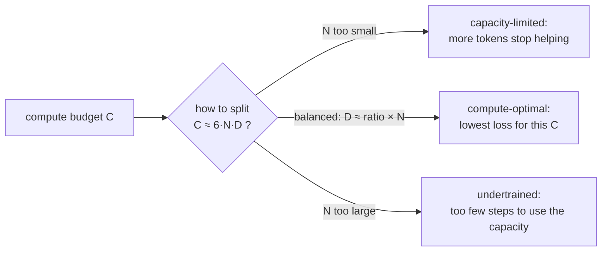

# Module 09 — Model size, scaling laws and compute budgets

**Part II · Training a Modern LLM** | Tier A–C | Study time: 6–7 hours

> How big should the model be, and how long should it train? In the 1990s the answer was
> "as big as fits, until it stops improving". For language models there is a sharper
> answer: for a given amount of compute there is a best trade-off between model size and
> training tokens, it can be measured, and it follows simple power laws. This module
> gives you the accounting (parameters, tokens, FLOPs), the laws, a miniature experiment
> that reproduces their central claim on a CPU, and a close reading of how nanochat
> turns one number, `--depth`, into a complete training plan.

## A. Learning objectives

After this module you can:

1. Count parameters and estimate training FLOPs for a Transformer, and say which parameters cost compute.
2. State what scaling laws claim, what "compute-optimal" means, and what the Kaplan and Chinchilla results are.
3. Recognise undertrained and overtrained (capacity-limited) models from a sweep.
4. Explain every step by which nanochat derives width, heads, token budget, batch size, learning rates and weight decay from `--depth`.
5. Plan a run for your hardware from a measured throughput.
6. Explain why small-model experiments are informative and where they mislead.

## B. Prerequisites

- [Module 06](../06-transformer-block/lesson.md) (parameter counting), [Module 07](../07-optimization/lesson.md) (schedules, learning-rate scaling), [Module 08](../08-data-and-pretraining/lesson.md) (the training script).
- [Mathematics primer](../../docs/mathematics-primer.md) §10 (FLOPs).
- [Hardware and costs](../../docs/hardware-and-costs.md).

## C. Motivation and intuition

You have a fixed budget: a machine and a number of hours. Two ways to spend it:

- a **small model for many tokens**: it sees a lot of data but cannot absorb it (capacity-limited);
- a **large model for few tokens**: it could learn a lot but does not get the chance (undertrained).

Somewhere between lies the best use of the budget. The remarkable empirical fact is that
the location of that optimum, and the loss achieved there, change *smoothly and
predictably* as the budget grows. That predictability is what lets a project like
nanochat tune hyperparameters on a 5-minute model and transfer them to a 2-hour one, and
what lets you decide in advance whether a run is worth starting.

## D. Rigorous technical explanation

### D.1 Three quantities and one identity

| Symbol | Quantity | Unit |
|---|---|---|
| $N$ | model size | parameters (which ones? see D.2) |
| $D$ | training set size actually consumed | tokens |
| $C$ | training compute | floating-point operations (FLOPs) |

For a model built from matrix multiplications, each weight is used once per token in the
forward pass (one multiply, one add: 2 FLOPs) and about twice that in the backward pass
(Module 01 D.4). Hence the workhorse approximation

$$C \approx 6\,N\,D$$

where $N$ counts the parameters that take part in matmuls. Compute is the product of
model size and data: fixing $C$ fixes the product $N D$, and the only freedom is how to
split it.

### D.2 Which parameters, which FLOPs

nanochat's estimate
([`gpt.py` L319–L349](https://github.com/karpathy/nanochat/blob/92d63d4e8bb4df75c3b71618f31ddde2378b2bcd/nanochat/gpt.py#L319-L349)):

$$\text{FLOPs per token} = 6\times(\text{matmul parameters}) + \sum_{\text{layers}} 12\,H\,D_\text{head}\,T_\text{eff}$$

- *Matmul parameters* are the weights of every `Linear` layer: block matrices and the
  output head. Embedding tables are excluded: a lookup is a memory read.
- The second term is attention's score-and-read work, which has no parameters: for each
  token, $H$ heads compute dot products of width $D_\text{head}$ against $T_\text{eff}$
  keys (the window size in sliding-window layers), forward and backward.

Measured on MiniGPT (`python labs/pretraining/09_param_flops.py`, vocabulary 4 096,
context 256):

| layers | width | total params | matmul params | lookup params | FLOPs/token | attention share |
|---:|---:|---:|---:|---:|---:|---:|
| 4 | 128 | 1,835,008 | 1,310,720 | 524,288 | 9.44e+06 | 16.7 % |
| 4 | 256 | 5,242,880 | 4,194,304 | 1,048,576 | 2.83e+07 | 11.1 % |
| 4 | 512 | 16,777,216 | 14,680,064 | 2,097,152 | 9.44e+07 | 6.7 % |
| 8 | 256 | 8,388,608 | 7,340,032 | 1,048,576 | 5.03e+07 | 12.5 % |

- **Doubling the width** quadruples block parameters ($\propto C^2$) but only doubles the
  tables: FLOPs per token grow about 3.3× here and approach 4× for large models.
- **Doubling the depth** doubles block parameters and the attention term.
- **The attention share shrinks as models widen** and grows with context length.

Does the rule predict real cost? The same script times a forward+backward pass and
divides: if time were proportional to estimated FLOPs, "achieved FLOPs per second" would
be constant across sizes. Measured on 4 CPU cores: 1.0e11 for the smallest model, then
2.1–2.7e11 for the others. Small models under-use the hardware (fixed overheads); beyond
that the rule holds to within about 25 %. The same effect on a GPU is the reason small
models show low MFU.

The same accounting for nanochat itself, from its own `num_scaling_params()` and
`estimate_flops()` (with `--nanochat`):

| depth | width | `wte` | value embeddings | `lm_head` | block matrices | total | lookup share | FLOPs/token |
|---:|---:|---:|---:|---:|---:|---:|---:|---:|
| 4 | 256 | 8.4 M | 16.8 M | 8.4 M | 3.1 M | 36.7 M | 68.6 % | 8.02e+07 |
| 12 | 768 | 25.2 M | 151.0 M | 25.2 M | 84.9 M | 286.3 M | 61.5 % | 7.60e+08 |
| 20 | 1280 | 41.9 M | 419.4 M | 41.9 M | 393.2 M | 896.5 M | 51.5 % | 2.89e+09 |
| 26 | 1664 | 54.5 M | 708.8 M | 54.5 M | 863.9 M | 1 681.8 M | 45.4 % | 5.99e+09 |

"A 286 M-parameter model" and "a model with 110 M matmul parameters" are the same model.
When reading any paper or model card, ask which count is meant. nanochat reports all
groups separately for exactly this reason.

### D.3 nanochat's single dial

`--depth` determines everything else
([`base_train.py` L129–L143](https://github.com/karpathy/nanochat/blob/92d63d4e8bb4df75c3b71618f31ddde2378b2bcd/scripts/base_train.py#L129-L143)):

```python
base_dim = depth * args.aspect_ratio                                          # aspect_ratio = 64
model_dim = ((base_dim + args.head_dim - 1) // args.head_dim) * args.head_dim # round up to a multiple of 128
num_heads = model_dim // args.head_dim                                        # head_dim = 128
```

| depth | width = 64·depth (rounded) | heads | block parameters $\approx 12\,L\,C^2$ |
|---:|---:|---:|---:|
| 6 | 384 | 3 | 10.6 M |
| 12 | 768 | 6 | 84.9 M |
| 24 | 1536 | 12 | 679.5 M |

Because width is proportional to depth, block parameters grow as depth³: doubling the
depth gives 8× the parameters, 8× the FLOPs per token, and (D.5) 8× the tokens: 64× the
compute. One step of the dial is a large step in cost. The head dimension stays 128, so
wider models get more heads, not wider ones. (Odd depths whose width is not a multiple of
128 are rounded up; upstream advises against them.)

### D.4 Scaling laws

**Kaplan et al. (2020)** trained many Transformers and found that test loss falls as a
power law in each of $N$, $D$ and $C$ when the other two are not limiting, e.g.
$L(N) \approx (N_c/N)^{\alpha_N}$ with a small exponent ($\alpha_N \approx 0.076$ in their
setting): each *doubling* of model size buys a constant *percentage* reduction of the
reducible loss. Straight lines on log-log plots over many orders of magnitude.

**Hoffmann et al. (2022), "Chinchilla"**, asked the budget question directly: for fixed
$C$, which $(N, D)$ minimises loss? Their answer: $N_\text{opt}\propto C^{0.5}$ and
$D_\text{opt}\propto C^{0.5}$, i.e. **scale model and data together**, at about 20 tokens
per parameter. (Kaplan's earlier analysis had favoured growing the model faster; many
models of that era were, in hindsight, too large for their training data.)

**What the laws are and are not.** They are empirical regularities for a given
architecture, data distribution and training recipe. The exponents and the optimal ratio
are *measured*, and change when any of those change. nanochat's own measurement shows it.

**nanochat's fit** ([`dev/LOG.md`, 2026-01-27](https://github.com/karpathy/nanochat/blob/92d63d4e8bb4df75c3b71618f31ddde2378b2bcd/dev/LOG.md#L497-L543)).
Runs at four budgets from 1e18 to 1e19 FLOPs and several depths; for each budget the
optimum was located by a quadratic fit. With parameters counted "Kaplan-style" (block
matrices + output head, no embeddings):

| FLOPs | optimal parameters | optimal tokens | tokens : params | val bpb |
|---:|---:|---:|---:|---:|
| 1e18 | 110.7 M | 1.24 B | 11.2 | 0.8972 |
| 2e18 | 167.8 M | 1.79 B | 10.7 | 0.8616 |
| 5e18 | 250.7 M | 2.64 B | 10.8 | 0.8293 |
| 1e19 | 381.8 M | 3.81 B | 10.3 | 0.7999 |

giving $N\propto C^{0.54}$, $D\propto C^{0.49}$: Chinchilla's "scale both equally",
reproduced, but at a ratio of about 10.5 rather than 20. Counting *all* parameters
instead gave ratios of 3–4 that drifted with scale; counting only block matrices gave
8.5–17. The way parameters are counted changes the "law"; nanochat chose the counting
that made the ratio constant. (The architecture at that date included a component that
was later removed; at the pin the default ratio in code is 12.)



### D.5 From depth to a training plan

The script turns the model it just built into a horizon
([`base_train.py` L260–L304](https://github.com/karpathy/nanochat/blob/92d63d4e8bb4df75c3b71618f31ddde2378b2bcd/scripts/base_train.py#L260-L304), [L338–L357](https://github.com/karpathy/nanochat/blob/92d63d4e8bb4df75c3b71618f31ddde2378b2bcd/scripts/base_train.py#L338-L357)):

1. **Scaling parameters** $N_s$ = block matrices + `lm_head`.
2. **Token budget** $D = \rho\,N_s$ with $\rho$ = `--target-param-data-ratio`, default **12** at the pin.
   (The README's prose still says 10.5 and the speedrun script passes 8 for depth 24 to
   deliberately undertrain; when documentation and code disagree, the code is what runs.)
3. **Batch size**: $B = B_\text{ref}\,(D/D_\text{ref})^{0.383}$ rounded to a power of two,
   with $B_\text{ref} = 2^{19}$ tokens at depth 12. The exponent comes from the "Power
   Lines" study cited in the source: longer runs prefer larger batches, but only weakly
   (10× more tokens → 2.4× larger batch).
4. **Learning rates** × $\sqrt{B/B_\text{ref}}$ (Module 07 F.3).
5. **Weight decay** $\lambda = \lambda_\text{ref}\sqrt{B/B_\text{ref}}\,(D_\text{ref}/D)$.
6. **Steps** $= D / B$.

Three ways to set the horizon, in order of precedence: `--num-iterations` (explicit),
`--target-flops` (used by `runs/scaling_laws.sh` to compare depths at equal compute),
`--target-param-data-ratio` (the default).

The result for each depth is the table in
[hardware and costs](../../docs/hardware-and-costs.md#how-big-is-a-nanochat-run-exact-arithmetic),
produced by [`scripts/experiments/estimate_run.py`](../../scripts/experiments/estimate_run.py)
from the pinned code. Depth 12: 110.1 M scaling parameters → 1.32 B tokens → 2 520 steps
of 524 288 tokens → 1.0e18 FLOPs.

### D.6 A compute-optimal frontier you can measure in eight minutes

`python labs/pretraining/09_scaling_sweep.py` trains MiniGPTs of four widths at four
compute budgets, giving each model exactly `budget / FLOPs-per-token` training tokens.
Validation loss (and optimizer steps), CPU, seed 0, entropy floor 0.3139:

| budget (FLOPs) | width 8 | width 16 | width 32 | width 64 | best |
|---:|---:|---:|---:|---:|---:|
| 1.0e10 | **1.046** (215) | 1.129 (76) | 1.359 (24) | 1.470 (10) | 8 |
| 4.0e10 | 0.771 (860) | **0.421** (305) | 0.580 (96) | 0.919 (27) | 16 |
| 1.6e11 | 0.654 (3 441) | **0.3625** (1 223) | 0.3631 (387) | 0.393 (111) | 16 ≈ 32 |
| 6.4e11 | 0.570 (13 764) | 0.3489 (4 895) | **0.3483** (1 551) | 0.356 (447) | 32 ≈ 16 |

Read each row left to right, then each column top to bottom:

- **In every row there is an interior optimum**, with losers on both sides. At 4e10,
  width 8 has had 860 steps and is stuck at 0.77 (capacity-limited); width 64 has had 27
  steps and is at 0.92 (undertrained).
- **The optimum moves right as the budget grows:** 8 → 16 → 16/32 → 32. This is the
  central claim of compute-optimal scaling, reproduced on a toy.
- **The smallest model saturates.** Sixty-four times more compute takes width 8 from
  1.05 only to 0.57: no amount of data can buy what it lacks in capacity.
- **The largest model is always catching up:** its distance from the row's best shrinks
  from 0.42 to 0.50, 0.03, 0.007. At a still larger budget it would win.

Honest limits of this experiment: one seed, and at the two largest budgets the top two
entries differ by less than the seed-to-seed spread measured in Module 07 (±0.003), hence
"≈". The qualitative pattern is robust; the exact crossover points are not established.
Also, Pocket has a hard floor that real text does not have at these scales, so losses
converge instead of continuing to fall along a power law.

### D.7 Planning a run on your hardware

1. Choose the depth by what you want to learn, and read its token budget from the table.
2. **Measure** tokens per second and peak memory with the 30-step probe
   ([DGX Spark guide, §6](../../docs/dgx-spark-setup.md#6-measure-first-the-probe)).
3. Hours $=$ tokens $/$ (tokens per second) $/ 3600$.
4. If it does not fit your time: lower the depth (cost falls as depth⁶ at the default
   ratio), or lower `--target-param-data-ratio` and accept an undertrained model, or cap
   `--num-iterations` for a fixed-step comparison.
5. If it does not fit your memory: halve `--device-batch-size`; gradient accumulation
   keeps the optimisation identical (Module 13).

Memory, as rough structure (Module 13 does the accounting): weights + gradients +
optimizer state scale with parameters; activations scale with
`device_batch_size × sequence_len × width × depth`, and usually dominate. One reported
data point: depth 12 at the default batch used about 34 GB on an H100 in January 2026,
with an earlier architecture
([`dev/LOG.md`, 2026-01-12](https://github.com/karpathy/nanochat/blob/92d63d4e8bb4df75c3b71618f31ddde2378b2bcd/dev/LOG.md#L898-L905)).
Your number on a DGX Spark at the pinned revision is *awaiting validation*: run the probe.

### D.8 What small models can and cannot tell you

nanochat's development method is to tune at depth 12 and transfer. Its log is a record of
when that works and when it does not:

| Transfers well | Evidence |
|---|---|
| Relative ranking of clear architectural wins and losses | SwiGLU "worse on all measures" at both d12 and d24; value embeddings helped at every depth tested |
| Scaling exponents | the fit above is stable over a decade of compute |

| Transfers poorly or needs a rule | Evidence |
|---|---|
| Optimal learning rates | best scalar learning rate varied 0.1–0.6 across depths 8–20 (2026-01-11 entry) |
| Optimal batch size | 2¹⁹ at d12 but about 2²⁰ at d26, hence the power-law rule |
| Weight decay | needed an explicit scaling formula |
| Tokens : parameters ratio | moved between about 4 and 12 as the architecture changed |
| Small effects | many "improvements" of order 1e-3 in loss are within noise at one scale and absent at another |

And from this course: on Pocket, a task with a hard floor and 25 symbols, three position
encodings were indistinguishable and value embeddings are not expected to help, while on
real text at scale they differ. **A toy answers the question you ask of it. Whether the
answer transfers is a separate, empirical question.** Small experiments are for
understanding mechanisms, eliminating bad ideas cheaply, and learning method; claims
about large models need evidence at (or scaling towards) large scale.

## E. Minimal implementation

- Accounting: [`labs/pretraining/09_param_flops.py`](../../labs/pretraining/09_param_flops.py). The whole FLOP estimate for MiniGPT is three lines:

  ```python
  matmul = sum(p.numel() for b in model.h for p in b.parameters() if p.ndim == 2) + model.lm_head.weight.numel()
  attn = 12 * c.n_head * (c.n_embd // c.n_head) * c.block_size * c.n_layer
  flops_per_token = 6 * matmul + attn
  ```

- Sweep: [`labs/pretraining/09_scaling_sweep.py`](../../labs/pretraining/09_scaling_sweep.py). The one line that makes it a *compute*-controlled experiment:

  ```python
  steps = max(10, int(budget / fpt / (BATCH * BLOCK)))      # tokens = budget / FLOPs-per-token
  ```

- Planning: [`scripts/experiments/estimate_run.py`](../../scripts/experiments/estimate_run.py) rebuilds nanochat's sizing on the meta device; [`scripts/experiments/parse_train_log.py`](../../scripts/experiments/parse_train_log.py) turns a log into throughput and an hours estimate.

> **Predict before you run** the sweep (`--quick` takes two minutes): at the smallest
> budget, which width wins? Write down your reasoning in terms of "steps taken".

## F. nanochat code walkthrough

| What | Where | Note |
|---|---|---|
| Depth → width, heads | [`base_train.py` L129–L143](https://github.com/karpathy/nanochat/blob/92d63d4e8bb4df75c3b71618f31ddde2378b2bcd/scripts/base_train.py#L129-L143) | built on the meta device: no memory used |
| Parameter groups | [`gpt.py` L390–L417](https://github.com/karpathy/nanochat/blob/92d63d4e8bb4df75c3b71618f31ddde2378b2bcd/nanochat/gpt.py#L390-L417) | `num_scaling_params` returns every group; an assertion checks they sum to the total |
| FLOPs per token | [`gpt.py` L319–L349](https://github.com/karpathy/nanochat/blob/92d63d4e8bb4df75c3b71618f31ddde2378b2bcd/nanochat/gpt.py#L319-L349) | the docstring discusses the differences from the Chinchilla paper's formula (about 1 %) |
| Horizon, batch, LR and WD scaling | [`base_train.py` L260–L304](https://github.com/karpathy/nanochat/blob/92d63d4e8bb4df75c3b71618f31ddde2378b2bcd/scripts/base_train.py#L260-L304) | each rule cites its source in a comment; one is labelled an untested assumption |
| Compute-controlled sweeps | [`runs/scaling_laws.sh`](https://github.com/karpathy/nanochat/blob/92d63d4e8bb4df75c3b71618f31ddde2378b2bcd/runs/scaling_laws.sh) | budgets 1e18–1e19 × depths 10–20, each run with `--target-flops`; results to a CSV with every parameter group |
| A series of compute-optimal models | [`runs/miniseries.sh`](https://github.com/karpathy/nanochat/blob/92d63d4e8bb4df75c3b71618f31ddde2378b2bcd/runs/miniseries.sh) | depths 12–26 at the default ratio |
| Progress metric | README leaderboard | wall-clock "time to GPT-2" (CORE > 0.2565) on 8×H100: from 3.04 h to 1.65 h in six weeks, through data, precision, batch-size and architecture changes |

When the training script starts, it prints its plan. From the miniature CPU run:

```text
Estimated FLOPs per token: 1.720752e+06
Scaling LRs by 0.0625 for batch size 2,048 (reference: 524,288)
Scaling weight decay from 0.280000 to 0.425775 for depth 4
Using user-provided number of iterations: 300
Tokens : Scaling params ratio: 2.78
Total training FLOPs estimate: 1.057230e+12
```

`Tokens : Scaling params ratio: 2.78` is the script telling you this run is far
*undertrained* relative to its own optimum of 12, which is what you asked for with
`--num-iterations=300`. Read these lines before every long run: they are the cheapest
place to catch a mis-sized experiment.

## M. Key takeaways

1. $C \approx 6ND$: compute is model size times data. Count the parameters that do matmuls; lookup tables are (almost) free in compute.
2. For a fixed budget there is an optimal split between model size and tokens, with losers on both sides; as the budget grows the optimum moves to larger models. You reproduced this on a CPU.
3. Scaling laws are measured regularities of a specific recipe. nanochat's own fit gives equal exponents for parameters and tokens at a ratio near 10–12, and shows that the ratio depends on how parameters are counted and on the architecture.
4. nanochat derives width, heads, tokens, batch size, learning rates and weight decay from `--depth`. Cost grows roughly as depth⁶.
5. Plan from a measured throughput. Never from someone else's hardware.
6. Small models transfer mechanisms and clear wins or losses; they do not transfer hyperparameter optima or small effects.

**Where this sits in the full system:** this module decides the *size* of the pretraining
stage. Whether the resulting model is any good is the question of Module 10.

Next: [lab](lab.md) · [quiz](quiz.md) · [references](references.md) · then [Module 10 — Evaluation and generation](../10-evaluation-and-generation/lesson.md)
