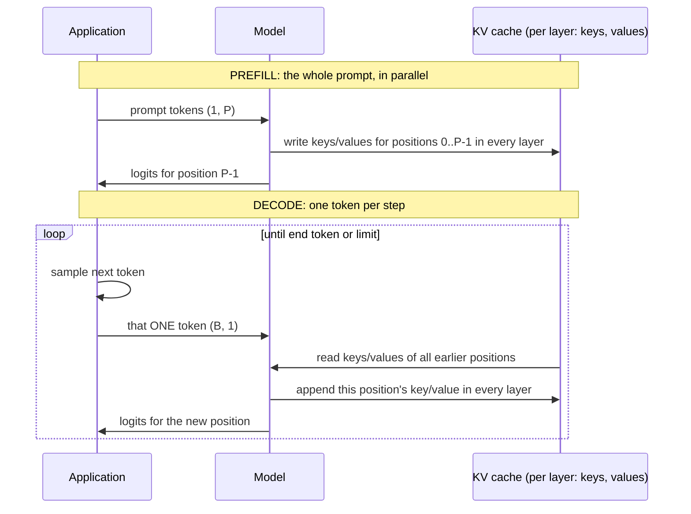

# Module 11 — Efficient autoregressive inference: the KV cache

**Part III · Performance Engineering** | Tier A–B | Study time: 5–6 hours

> Part III keeps the model's mathematics fixed and asks how to compute the same outputs
> with less work. The first and most important answer is specific to autoregressive
> generation: stop recomputing what cannot have changed. This module derives the
> key/value cache from the causal mask, sizes it, implements it, proves by test that it
> changes nothing but speed, and reads nanochat's inference engine, where the same idea
> appears with the layout of a production attention kernel.

## A. Learning objectives

After this module you can:

1. Explain why naive generation costs quadratic work in the sequence length and what exactly is redundant.
2. Derive the KV cache from causality: what is stored, per layer, and why it is valid.
3. Distinguish prefill from decode and say which hardware limit binds each.
4. Compute the memory of a cache from the model configuration.
5. Implement cached generation, including position handling, and test it for exact equivalence.
6. Read nanochat's `KVCache` and `Engine.generate`, including batch replication and streaming.

## B. Prerequisites

- [Module 05](../05-attention/lesson.md) (causal mask; D.4 "earlier positions are unaffected by later tokens"), [Module 06](../06-transformer-block/lesson.md).
- [Module 02](../02-language-modeling/lesson.md) D.5 (the generation loop).

## C. Motivation and intuition

The naive loop of Module 02, as nanochat's own reference implementation writes it:

```python
for _ in range(max_tokens):
    logits = self.forward(ids)          # run the WHOLE sequence
    logits = logits[:, -1, :]           # keep the last position
    ...
    ids = torch.cat((ids, next_ids), dim=1)
```

To produce token 500 it processes 499 positions, of which 498 were processed, identically,
one step earlier. Generating $N$ tokens after a prompt of $P$ processes
$P + (P+1) + \dots + (P+N-1) \approx NP + N^2/2$ positions for an output of $N$.

**The observation that removes the waste.** Because attention is causal, nothing computed
at position $j$ depends on any later token (Module 05 D.4, and the test
`test_causality_future_tokens_do_not_change_past_logits`). So when token $t$ arrives,
every intermediate quantity at positions $< t$, in every layer, is exactly what it was.
Only position $t$ needs computing. What does position $t$ need *from* the earlier
positions? Look at attention:

$$\mathbf{y}_t = \sum_{j\le t} \mathrm{softmax}_j\!\Big(\frac{\mathbf{q}_t\cdot\mathbf{k}_j}{\sqrt D}\Big)\,\mathbf{v}_j$$

Its own query $\mathbf{q}_t$, and the **keys and values** of everything before it.
Nothing else: not the earlier queries, not the earlier MLP activations, not the earlier
logits. So: **store the keys and values of every layer as they are computed; for each
new token, compute one position and attend over the stored ones.**

## D. Rigorous technical explanation

### D.1 Prefill and decode

Generation splits into two phases with different shapes:



| | Prefill | Decode |
|---|---|---|
| Input shape | `(1, P)` | `(B, 1)` per step |
| Work | $P$ positions at once: large matmuls | 1 position: tiny matmuls, repeated $N$ times |
| Parallelism | over positions | none over time (token $t+1$ needs token $t$) |
| Limited by | arithmetic throughput (FLOPs) | **memory bandwidth**: every step re-reads all weights and the cache to do very little arithmetic |
| User-visible metric | time to first token (TTFT) | time per output token (TPOT), tokens/s |

The last two rows explain most of inference engineering and are developed in Module 12.

### D.2 What is stored, and how much

Per layer, per sequence: one key vector and one value vector for each cached position
and each key/value head.

$$\text{bytes per cached token} = L \times 2 \times H_{kv} \times D \times \text{bytes per number}$$

This is nanochat's `kv_bytes_per_token`
([`gpt.py` L374–L378](https://github.com/karpathy/nanochat/blob/92d63d4e8bb4df75c3b71618f31ddde2378b2bcd/nanochat/gpt.py#L374-L378)).
Since $H_{kv}\,D = C$ without grouped-query attention, the cache holds $2LC$ numbers per
token: *twice the residual stream, for every layer*.

| Model | $L$ | $H_{kv}\times D$ | dtype | per token | per 2 048-token sequence |
|---|---:|---:|---|---:|---:|
| Lab model (this module) | 4 | 4 × 32 | fp32 | 4 096 B | 8.4 MB |
| nanochat d12 | 12 | 6 × 128 | bf16 | 36 864 B | 75.5 MB |
| nanochat d20 | 20 | 10 × 128 | bf16 | 102 400 B | 209.7 MB |
| nanochat d26 | 26 | 13 × 128 | bf16 | 173 056 B | 354.4 MB |

(nanochat rows: arithmetic from the configuration, not measurements.) The cache grows
linearly with context length and with batch size. For many concurrent sequences it, not
the weights, is what fills memory; nanochat's benchmark prints "max full-context rows in
VRAM" for this reason. Two ways to shrink it, both in Module 12: fewer key/value heads
(GQA) and sliding windows.

### D.3 The algorithm

For each layer $l$, keep `k[l]`, `v[l]` with a fill pointer `pos`.

```text
forward(new_tokens, cache):               # new_tokens: (B, T_new); T_new = P in prefill, 1 in decode
    x = embed(new_tokens)                 # positions pos .. pos+T_new-1
    for each layer l:
        q, k_new, v_new = projections of norm(x)
        rotate q, k_new by the angles of positions pos .. pos+T_new-1     <- RoPE needs the TRUE positions
        cache.k[l][pos : pos+T_new] = k_new;  cache.v[l][...] = v_new     <- append
        attend: queries (T_new) over keys/values (pos+T_new), causal within the new block
        x = x + attention output;  x = x + mlp(norm(x))
    pos += T_new                          # once, after the last layer
    return logits for the new positions
```

Three details where implementations go wrong:

1. **Positions.** With RoPE (or learned positions) the new token must be encoded as
   position `pos`, not position 0. Forgetting the offset gives plausible-looking but
   wrong output.
2. **The mask for a block of new tokens.** In decode ($T_\text{new}=1$) the single query
   may see every cached key: no mask needed. In prefill, or when several tokens are
   appended at once, query $i$ of the block sits at absolute position `pos + i` and may
   see keys up to that position. `causal_mask(T_new, T_total)` in
   [`mlle/foundations/attention.py`](../../mlle/foundations/attention.py) builds exactly this.
3. **Advance once.** All layers of one forward pass must write at the same `pos`; the
   pointer moves after the last layer.

### D.4 Why it is exact

The cached forward pass computes, for the new position, precisely the terms the full
forward pass computes for that position; and the full pass's results for earlier
positions do not depend on the new token. So the logits are equal **up to floating-point
rounding** (operations are grouped differently). This is a claim to test, not to trust:

| Test (in [`tests/test_minigpt.py`](../../tests/test_minigpt.py)) | What it establishes |
|---|---|
| `test_cached_logits_equal_full_forward` | prefill 7 tokens, then 13 single-token steps, reproduce the full forward's logits to 1e-4, for RoPE, learned and sinusoidal positions, GQA and a sliding window |
| `test_cached_generation_equals_naive_generation` | identical *tokens* under greedy decoding and under seeded sampling |
| `test_kv_cache_memory_formula` | allocated bytes equal the formula |

Measured on the lab model (4 layers, width 128): maximum logit difference 4.6e-06,
greedy tokens identical.

Equal logits do not always mean equal tokens: with sampling, a 1e-6 difference can in
principle flip a draw that lands exactly on a boundary, and in reduced precision (bf16)
differences are larger. Greedy equality on a test prompt is the usual acceptance check;
nanochat's engine self-test uses exactly that.

### D.5 What it buys

Lab measurement (`python labs/optimization/11_kv_cache.py`, CPU, 917 k parameters,
8-token prompt, greedy):

| new tokens | naive | cached | speed-up | positions processed (naive / cached) |
|---:|---:|---:|---:|---:|
| 32 | 0.068 s | 0.054 s | 1.3× | 752 / 39 |
| 128 | 0.522 s | 0.268 s | 1.9× | 9 152 / 135 |
| 512 | 5.497 s | 0.803 s | 6.8× | 134 912 / 519 |

- The cached generator's throughput is roughly constant (≈ 500–640 tokens/s); the naive
  one's falls with length (467 → 93 tokens/s). **The speed-up is not a constant factor:
  it grows with the sequence.**
- The work ratio at 512 tokens is 260×, the time ratio 6.8×. A decode step is dominated
  by fixed per-step overhead (Python, many tiny operations) on this small CPU model,
  while the naive pass enjoys efficient large matmuls: one decode step costs as much as
  about 40 positions inside a batched pass on this machine (and still does for a model
  seven times larger: lab, Exercise 2). Counting operations tells you the trend; only
  measurement tells you the factor.

With nanochat's own code on the miniature checkpoint
(`python labs/optimization/11_nanochat_engine.py`, CPU): 64 tokens in 0.663 s naive
versus 0.110 s through the `Engine`, 6.0×, `Match: True`.

The remaining per-token cost of cached decoding is not zero and not constant: attention
still reads all cached keys and values, so a decode step costs
$O(L\,C^2 + L\,C\,t)$ at position $t$. nanochat's
`estimate_decode_flops(context_len)` is this expression
([`gpt.py` L351–L360](https://github.com/karpathy/nanochat/blob/92d63d4e8bb4df75c3b71618f31ddde2378b2bcd/nanochat/gpt.py#L351-L360)).

### D.6 Batching generation: one prefill, many continuations

To draw $K$ samples for the same prompt (voting in Module 17, rollouts in Module 15), the
prompt needs processing only once: prefill with batch 1, **copy the cache $K$ times**,
then decode with batch $K$. The copies diverge as different tokens are sampled.

Streaming falls out of the structure: the decode loop produces one token (per row) per
step, so the caller can display it immediately. Perceived latency is governed by TTFT
and TPOT, not by total generation time.

### D.7 What the cache does not do

- It does not change the model's output, its quality, or its context limit. It is a
  pure implementation optimisation.
- It does not help training: with teacher forcing all positions are computed once, in
  parallel, already.
- It is state. A cache belongs to one sequence prefix; edit the prefix (regenerate an
  earlier message) and the cache from that point on is invalid. Serving systems spend
  much of their complexity on managing this state: allocation, eviction, sharing common
  prefixes (Module 12 lists the techniques).

## E. Minimal implementation

[`mlle/inference/kvcache.py`](../../mlle/inference/kvcache.py), about 100 lines:

```python
class KVCache:
    def __init__(self, n_layer, batch_size, n_kv_head, head_dim, max_len, device=None, dtype=torch.float32):
        shape = (n_layer, batch_size, n_kv_head, max_len, head_dim)
        self.k = torch.zeros(shape, device=device, dtype=dtype)      # pre-allocated once
        self.v = torch.zeros(shape, device=device, dtype=dtype)
        self.pos = 0

    def append(self, layer_idx, k_new, v_new):
        T = k_new.shape[2]
        self.k[layer_idx, :, :, self.pos : self.pos + T] = k_new
        self.v[layer_idx, :, :, self.pos : self.pos + T] = v_new
        end = self.pos + T
        return self.k[layer_idx, :, :, :end], self.v[layer_idx, :, :, :end]   # views, no copy

    def advance(self, num_tokens):          # once per forward pass, after the last layer
        self.pos += num_tokens
```

The model side is four lines in MiniGPT's attention
([`mlle/foundations/minigpt.py`](../../mlle/foundations/minigpt.py)):

```python
pos0 = 0 if cache is None else cache.pos                    # absolute position of the first new token
cos, sin = rope_cos_sin(T, D, self.config.rope_base, offset=pos0)
...
if cache is not None:
    k, v = cache.append(self.layer_idx, k, v)               # (B, Hkv, pos0 + T, D)
mask = causal_mask(T, k.shape[2], self.config.window, device=x.device)
```

and the generator:

```python
cache = KVCache.for_model(model, B, max_len=T0 + max_new_tokens)
logits = model(idx, cache=cache)[:, -1, :]                  # prefill
for _ in range(max_new_tokens):
    next_id = sample(logits)
    idx = torch.cat([idx, next_id], dim=1)
    logits = model(next_id, cache=cache)[:, -1, :]          # decode: T = 1
```

Pre-allocation matters: growing a tensor by concatenation at every step would copy the
whole cache each time, re-introducing quadratic work in memory traffic.

> **Predict before you run** `python labs/optimization/11_kv_cache.py`: generating 512
> tokens naively processes about 135 000 positions, cached about 520: a factor of 260.
> Will the measured speed-up on a small CPU model be closer to 260×, 50× or 7×? Why?

## F. nanochat code walkthrough

**The cache**
([`nanochat/engine.py` L82–L137](https://github.com/karpathy/nanochat/blob/92d63d4e8bb4df75c3b71618f31ddde2378b2bcd/nanochat/engine.py#L82-L137)):

```python
self.k_cache = torch.zeros(num_layers, batch_size, seq_len, num_heads, head_dim, device=device, dtype=dtype)
self.v_cache = torch.zeros(num_layers, batch_size, seq_len, num_heads, head_dim, device=device, dtype=dtype)
self.cache_seqlens = torch.zeros(batch_size, dtype=torch.int32, device=device)
self.prev_embedding = None
```

| | Course `KVCache` | nanochat `KVCache` |
|---|---|---|
| Layout | `(L, B, Hkv, T, D)` | `(L, B, T, Hkv, D)`: Flash Attention 3's native layout |
| Position | one integer `pos` | `cache_seqlens`, one int32 per row (what FA3's API takes); `get_pos()` reads row 0 and assumes all rows are equal |
| dtype | the model's | `COMPUTE_DTYPE` (bf16 on modern GPUs) |
| Extra state | none | `prev_embedding`: the previous token's normalised embedding, needed by "smear" (Module 06), which mixes token $t-1$ into token $t$ *before* any attention |
| Batch replication | `expand_batch` | `prefill(other)` copies a batch-1 cache into a batch-N cache |

The `prev_embedding` field is a good reminder of the general rule: **a cache must hold
every piece of earlier state that the computation at the new position reads.** For a
plain Transformer that is keys and values. nanochat's smear adds one more dependency on
the previous position, so the cache gained a field
([`gpt.py` L481–L492](https://github.com/karpathy/nanochat/blob/92d63d4e8bb4df75c3b71618f31ddde2378b2bcd/nanochat/gpt.py#L481-L492)).
Anyone adding a mechanism that looks at earlier positions must ask what it needs cached.

**The model side.** Position offset for RoPE
([`gpt.py` L466–L468](https://github.com/karpathy/nanochat/blob/92d63d4e8bb4df75c3b71618f31ddde2378b2bcd/nanochat/gpt.py#L466-L468));
in attention, the cached path hands the per-layer cache tensors to the kernel and
advances after the last layer
([`gpt.py` L111–L123](https://github.com/karpathy/nanochat/blob/92d63d4e8bb4df75c3b71618f31ddde2378b2bcd/nanochat/gpt.py#L111-L123)):

```python
k_cache, v_cache = kv_cache.get_layer_cache(self.layer_idx)
y = flash_attn.flash_attn_with_kvcache(q, k_cache, v_cache, k=k, v=v,
                                       cache_seqlens=kv_cache.cache_seqlens, causal=True, window_size=window_size)
if self.layer_idx == kv_cache.n_layers - 1:
    kv_cache.advance(T)
```

With Flash Attention 3 the kernel itself writes the new keys/values into the cache. In
the fallback, nanochat does it by hand, mirroring our `append`
([`flash_attention.py` L163–L185](https://github.com/karpathy/nanochat/blob/92d63d4e8bb4df75c3b71618f31ddde2378b2bcd/nanochat/flash_attention.py#L163-L185)):

```python
pos = cache_seqlens[0].item()
k_cache[:, pos:pos+T_new, :, :] = k
v_cache[:, pos:pos+T_new, :, :] = v
k_full = k_cache[:, :end_pos, :, :]
```

and `_sdpa_attention` handles the three cases of D.3: same-length causal (training),
single token (no mask; with a window, slice the last `window + 1` keys), and a block of
several tokens against a longer cache (explicit mask)
([L77–L110](https://github.com/karpathy/nanochat/blob/92d63d4e8bb4df75c3b71618f31ddde2378b2bcd/nanochat/flash_attention.py#L77-L110)).

**The engine**
([`engine.py` L176–L275](https://github.com/karpathy/nanochat/blob/92d63d4e8bb4df75c3b71618f31ddde2378b2bcd/nanochat/engine.py#L176-L275)),
in four numbered steps in the source:

1. Prefill the prompt with batch 1 in a cache sized exactly to the prompt.
2. Allocate a decode cache for `num_samples` rows, sized `len(prompt) + max_tokens`, and
   copy the prefill cache into it (D.6).
3. Create a `RowState` per sample (its tokens, a queue of forced tokens, tool-use state).
4. Loop: sample a token per row, update each row's state, **`yield`** the column of
   tokens (streaming), then feed the column back for one decode step.

`generate` is a Python generator: each `next()` is one decode step, which is how the chat
CLI prints tokens as they are produced and how the benchmark times individual steps. The
row states also implement the calculator tool, by forcing result tokens into the stream;
that part is the subject of Module 16.

**Tests.** [`tests/test_engine.py`](https://github.com/karpathy/nanochat/blob/92d63d4e8bb4df75c3b71618f31ddde2378b2bcd/tests/test_engine.py)
checks cache bookkeeping, prefill copying, seed reproducibility and sample diversity
with a mock model; the engine's `__main__` block compares naive and cached generation on
a real checkpoint (GPU only; the course's
[`11_nanochat_engine.py`](../../labs/optimization/11_nanochat_engine.py) does the same on
any device).

**Measuring it properly.** [`scripts/infer_bench.py`](https://github.com/karpathy/nanochat/blob/92d63d4e8bb4df75c3b71618f31ddde2378b2bcd/scripts/infer_bench.py)
reports TTFT, TPOT (median decode-step time), tokens/s and peak memory over a sweep of
decode batch sizes, after warm-up runs, plus the cache accounting of D.2. It requires a
CUDA device. Its two utilisation metrics (MBU and MFU) and what the batch sweep reveals
are the starting point of Module 12.

## M. Key takeaways

1. Naive generation recomputes every earlier position at every step: $O(N^2)$ positions for $N$ tokens.
2. Causality makes earlier computations immutable, and a new position needs only the earlier keys and values: cache those, per layer.
3. Prefill is one large parallel pass (compute-bound); decode is many tiny passes (bandwidth-bound). TTFT and TPOT measure them.
4. Cache size is $L\times2\times H_{kv}\times D$ numbers per token per sequence: linear in context and batch, and often the binding memory constraint in serving.
5. The cache is exact up to rounding, and that is established by tests: logits against a full forward pass, tokens against naive generation.
6. Any mechanism that reads earlier positions adds to what must be cached (nanochat's smear needed one more field).

**Where this sits in the full system:** this is the inference engine underneath every
later module: chat (14), rollouts for RL (15), tool use (16), sampling many candidates
(17). Module 12 looks inside the attention call and at the rest of the inference stack.

Next: [lab](lab.md) · [quiz](quiz.md) · [references](references.md) · then [Module 12 — Attention and inference optimization](../12-inference-optimization/lesson.md)
