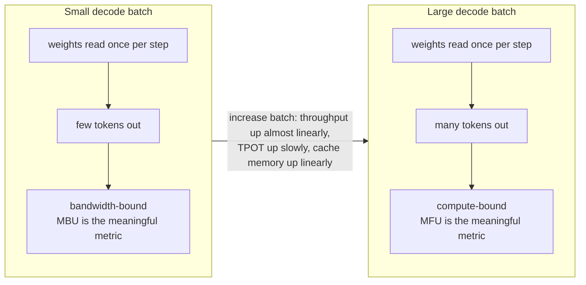

# Module 12 — Attention and inference optimization

**Part III · Performance Engineering** | Tier A–B | Study time: 7–8 hours

> With the KV cache in place, what does a forward pass still cost, and which costs can
> be removed? This module sorts the well-known techniques by the resource each one
> attacks: arithmetic, memory held, or memory moved. For each it states whether the
> output changes, measures the effect on a small model, and locates it in nanochat.

## A. Learning objectives

After this module you can:

1. Explain why naive attention needs $O(T^2)$ memory and how FlashAttention computes the identical result without it (online softmax over tiles).
2. Describe sliding-window attention and grouped-query attention, what each saves, and how to measure what each costs in quality.
3. Explain why decoding is limited by memory bandwidth, compute a throughput ceiling, and interpret TTFT, TPOT, MBU and MFU.
4. Quantize weights to $b$ bits per tensor and per channel, and predict when quality collapses.
5. Classify an optimisation as *exact* (same output) or *approximate* (changed model) and choose the appropriate test for each.
6. Read nanochat's attention dispatch, window pattern and inference benchmark.

## B. Prerequisites

- [Module 05](../05-attention/lesson.md) (attention, masks), [Module 11](../11-kv-cache/lesson.md) (prefill, decode, cache size).
- [Module 10](../10-evaluation-and-generation/lesson.md) D.6 (do not trust a difference without its uncertainty).

## C. Motivation and intuition

A model at inference time consumes three different resources, and they bind in different
situations:

| Resource | Unit | Binds when |
|---|---|---|
| Arithmetic | floating-point operations (FLOPs) | large matmuls: training, prefill, large decode batches |
| Memory **held** | bytes | long contexts, many concurrent sequences (the cache), big intermediates |
| Memory **moved** | bytes per second (bandwidth) | decode at small batch: every step reads all weights and the cache to do little arithmetic |

Every technique in this module is aimed at one of these rows:

| Technique | Attacks | Output changes? | In nanochat |
|---|---|---|---|
| FlashAttention | memory held and moved by attention | **no** (exact) | yes, with a PyTorch fallback |
| Sliding-window attention | arithmetic and cache bytes read | yes (a different model: must be trained that way) | yes, default pattern `SSSL` |
| Grouped-query attention (GQA) | cache bytes held and read | yes (a different model) | supported, off by default |
| Decode batching | bandwidth (shares one pass over the weights) | no | yes (`Engine`, `infer_bench.py`) |
| Weight quantization | weight bytes held and moved | yes (approximation of a trained model) | no (FP8 exists for *training*: Module 13) |

The "output changes?" column decides how you validate. An exact optimisation is
validated like the KV cache: outputs must agree to rounding. An approximate one is
validated like a new model: by its evaluation metrics, with uncertainty (Module 10).
Confusing the two kinds is the commonest methodological error in performance work.

## D. Rigorous technical explanation

### D.1 What naive attention costs

`softmax(Q Kᵀ/√D) V` as written creates the score matrix: $B \times H \times T \times T$
numbers. For nanochat d12 with a device batch of 32 rows of 2 048 tokens in bf16 that is
$32 \times 6 \times 2048^2 \times 2$ bytes = **1.6 GB per layer**, and the softmax output
is a second tensor of the same size; training must also keep them for the backward pass.
The result $Y$, by contrast, is only $B\times T\times C$: 100 MB. The big matrix is an
*intermediate*: it is created, reduced along one axis, and discarded.

Besides the capacity problem there is a traffic problem. A GPU has a small amount of
very fast on-chip memory and a large amount of slower main memory. A tensor of 1.6 GB
does not fit on-chip, so it is written to main memory by one operation and read back by
the next, several times (scores, mask, softmax, product with $V$). Naive attention is
slow largely because it *moves* a huge intermediate, not because of its arithmetic.

### D.2 FlashAttention: the same numbers without the matrix

**Idea.** Process the score matrix in tiles small enough to stay in fast memory, and
never store more than one tile. The obstacle is the softmax: a row's normaliser needs
*all* scores of that row. It is removed by computing the softmax **online**.

For one query, let the scores arrive in chunks. Keep three running quantities:

- $m$: the largest score so far (for numerical stability),
- $\ell$: $\sum \exp(s_j - m)$ over scores seen,
- $\mathbf{o}$: $\sum \exp(s_j - m)\,\mathbf{v}_j$ over scores seen.

When a chunk arrives with new maximum $m' = \max(m, \max_j s_j)$:

$$\ell \leftarrow e^{m-m'}\,\ell + \sum_{j\in\text{chunk}} e^{s_j - m'},\qquad
\mathbf{o} \leftarrow e^{m-m'}\,\mathbf{o} + \sum_{j\in\text{chunk}} e^{s_j - m'}\,\mathbf{v}_j,\qquad m \leftarrow m'$$

At the end the output is $\mathbf{o}/\ell$. This is algebra, not approximation:
$e^{s-m}$ and $e^{s-m'}$ differ by the factor $e^{m-m'}$, applied to everything
accumulated so far.

**Numerical example.** One query, scores $(1, 3, 2, 5)$, scalar values $(10, 20, 30, 40)$,
chunks of two.

| | $m$ | $\ell$ | $o$ |
|---|---:|---:|---:|
| after chunk $(1,3)$ | 3 | $e^{-2} + 1 = 1.1353$ | $0.1353\cdot10 + 1\cdot20 = 21.353$ |
| after chunk $(2,5)$ | 5 | $e^{-2}\cdot1.1353 + (e^{-3} + 1) = 1.2034$ | $e^{-2}\cdot21.353 + 0.0498\cdot30 + 40 = 44.383$ |

Output $44.383 / 1.2034 = 36.88$. Directly: softmax weights
$(0.0152, 0.1125, 0.0414, 0.8310)$ give $0.152 + 2.249 + 1.241 + 33.238 = 36.88$.

**The algorithm.** For each block of queries, loop over blocks of keys/values, compute
one tile of scores, update $(m, \ell, \mathbf{o})$, move on. With a causal mask, tiles
entirely above the diagonal are skipped. The largest intermediate is one tile, whatever
$T$ is. The backward pass does not need the stored matrix either: it recomputes tiles
from $Q$, $K$, $V$ and the saved normalisers.

**Why this is faster, not just smaller.** Implemented as *one* GPU kernel, each tile
lives in on-chip memory from creation to reduction; only $Q$, $K$, $V$ and $Y$ travel to
and from main memory. More arithmetic bookkeeping, far less traffic. The same loop in
Python is slower than the naive version at small $T$, as the lab shows: the benefit comes
from where the data lives, which a Python loop does not control.

Measured (`python labs/optimization/12_flash_sim.py`, CPU, 4 heads, $D=64$, tiles 128 × 128):

| $T$ | max diff naive vs tiled | naive ms | tiled (Python) ms | fused (`F.scaled_dot_product_attention`) ms | score matrix | tile |
|---:|---:|---:|---:|---:|---:|---:|
| 256 | 6.0e-07 | 0.9 | 1.9 | 0.2 | 1 MiB | 0.25 MiB |
| 1 024 | 5.4e-07 | 13.8 | 17.6 | 2.8 | 16 MiB | 0.25 MiB |
| 2 048 | 4.8e-07 | 76.8 | 66.6 | 11.7 | 64 MiB | 0.25 MiB |
| 4 096 | 4.8e-07 | 312.4 | 228.5 | 40.8 | 256 MiB | 0.25 MiB |

Three readings. The outputs agree to rounding: the optimisation is exact. The naive
version's intermediate grows fourfold per doubling of $T$; the tiled one's does not grow.
And even the slow Python tiling overtakes the naive version beyond $T\approx 2000$ on
this CPU, because the naive intermediate no longer fits in the processor's caches: the
same effect FlashAttention exploits on a GPU, in miniature.

**Versions.** FlashAttention (2022) introduced the method; FlashAttention-2 improved the
work partitioning; FlashAttention-3 targets specific GPU generations (Hopper) with
asynchronous execution and low-precision support. The mathematics is the same in all.
nanochat calls FA3 where a compiled kernel exists for the GPU and PyTorch's fused
`scaled_dot_product_attention` (SDPA) elsewhere (section F).

### D.3 Sliding-window attention

**Idea.** Let each position attend only to the previous $w$ positions instead of all
$t$. In the mask: allow $j \le i$ **and** $i - j \le w$.

- Arithmetic per layer falls from $O(T^2)$ to $O(T\,w)$.
- In decode, a windowed layer reads only the last $w$ cached keys/values.
- Information can still travel further than $w$: layer 1 moves it $w$ positions, layer 2
  another $w$. The reach after $L$ windowed layers is about $L\,w$, but each hop must be
  *learned* as a relay, which is harder than a direct look.

nanochat mixes both kinds: `window_pattern="SSSL"` is tiled over the layers, `S` is a
short window of a quarter of the context (512 of 2 048), `L` the full context, and the
final layer is always `L`. Three of four layers do a quarter of the attention work while
one in four keeps direct long-range access.

Measured on Pocket (`python labs/optimization/12_gqa_window.py`; 2 layers, width 64,
1 500 steps, seed 0; the agreement dependency spans 20–30 characters):

| Window | validation loss | agreement accuracy |
|---|---:|---:|
| full (64) | 0.3475 | 1.00 |
| 32 | 0.3474 | 1.00 |
| 16 | 0.3500 | 1.00 |
| 8 | 0.3607 | 0.86 |

A window comfortably longer than the dependencies costs nothing measurable. At 16 the
two layers can still relay across 32 positions and agreement survives with a small loss
increase. At 8 the reach (16) is shorter than the dependency and the long-range test
breaks, while the average loss rises by only 0.013: **an aggregate metric barely notices
the loss of a capability that a targeted test exposes immediately.** (Single seed: the
direction is the finding, not the third decimal.)

Because the windowed model computes a different function, the pattern is fixed at
training time. A model trained with `SSSL` must be served with `SSSL`.

### D.4 Grouped-query attention

**Idea.** Keep $H$ query heads but only $H_{kv} < H$ key/value heads; each key/value
head is shared by a group of $H/H_{kv}$ query heads. Different queries still ask
different questions, of a smaller set of stored answers.

- Cache size and bytes read per decode step scale with $H_{kv}$ (Module 11 D.2).
- The key and value projections shrink ($C \to H_{kv} D$ outputs); attention arithmetic
  is unchanged, since the scores are still $H\times T\times T$.
- $H_{kv}=1$ is called multi-query attention.

Measured (same setup as D.3, 4 query heads):

| Key/value heads | parameters | KV bytes per token | validation loss | agreement |
|---:|---:|---:|---:|---:|
| 4 (standard) | 101 504 | 1 024 | 0.3475 | 1.00 |
| 2 | 93 312 | 512 | 0.3471 | 1.00 |
| 1 | 89 216 | 256 | 0.3472 | 1.00 |

On this easy task there is no measurable cost down to a single key/value head (the
differences are far inside seed noise: Module 10 measured a seed standard deviation of
0.0016 for this kind of run). That shows the mechanism works; it does **not** show GQA
is free for a large model on natural language, which is an empirical question at that
scale. nanochat supports GQA (`n_kv_head`) and trains with `n_kv_head = n_head` by
default.

### D.5 Why decode is bandwidth-bound

One decode step for one sequence must *read* every weight matrix once (each is
multiplied by one vector) and the cached keys and values, and performs about 2 FLOPs per
weight. A GPU that can do $10^{14}$ FLOPs per second is not limited by $5\times10^8$
FLOPs; it is limited by how fast roughly a gigabyte can be streamed from memory:

$$\text{tokens/s at batch 1} \;\lesssim\; \frac{\text{memory bandwidth (bytes/s)}}{\text{weight bytes} + \text{cache bytes read}}$$

**Worked example (arithmetic from the configuration, not a measurement).** nanochat d12
stores 793 MB of parameters (embeddings in bf16, matrices in fp32); at a context of
1 152 tokens with the `SSSL` pattern a decode step reads 24.8 MB of cache. On a device
with 273 GB/s of memory bandwidth (the figure NVIDIA publishes for the DGX Spark's
unified memory) the bound is $273\times10^9 / 818\times10^6 \approx 330$ tokens per
second at batch 1. A real system achieves a fraction of its bound; that fraction is the
**model bandwidth utilisation (MBU)**.

**Batching is nearly free at first.** With $B$ sequences decoded together, the weights
are still read once per step, but $B$ tokens come out. Throughput rises almost linearly
with $B$ until either the arithmetic ($B\times$ FLOPs) or the cache traffic ($B\times$
cache bytes) becomes the limit. The price is latency per step (TPOT rises slowly) and
memory ($B$ caches). This is the central trade-off of serving:



Metrics (nanochat's `infer_bench.py` reports all of them):

| Metric | Definition | Reflects |
|---|---|---|
| TTFT | time from request to first token | prefill (compute-bound) |
| TPOT | median time of one decode step | decode latency |
| tokens/s | batch × steps ÷ time | throughput |
| MBU | (bytes a step must move ÷ TPOT) ÷ peak bandwidth | distance from the bandwidth limit |
| MFU | (FLOPs a step must do ÷ TPOT) ÷ peak FLOPs | distance from the compute limit |

Each of the earlier techniques can now be read as shrinking a term of the bound: GQA and
sliding windows shrink "cache bytes read"; quantization shrinks "weight bytes".

### D.6 Quantization

**Idea.** Store each weight in $b$ bits instead of 32 (or 16): an integer code $q$ and a
shared scale $s$ with $w \approx s\,q$.

$$q = \mathrm{clamp}\big(\mathrm{round}(w/s),\,-q_{\max},\,q_{\max}\big),\qquad q_{\max} = 2^{b-1}-1,\qquad s = \frac{\max|w|}{q_{\max}}$$

The rounding error per weight is at most $s/2$. Since $s$ is set by the largest weight
in the group sharing it, one outlier coarsens the grid for all others. Hence the choice
of group:

- **per tensor:** one scale for the whole matrix;
- **per channel:** one scale per output row, so a row of small weights keeps a fine grid.

**Numerical example.** Row $(0.9, -0.05, 0.02)$ at 4 bits ($q_{\max}=7$):
$s = 0.9/7 = 0.1286$; codes $(7, 0, 0)$; reconstruction $(0.9, 0, 0)$. The two small
weights are erased. If those two sat in a different row with its own scale
$0.05/7 = 0.0071$, they would be stored as $(-7, 3)$ → $(-0.05, 0.0214)$.

Measured (`python labs/optimization/12_quantize.py`; fp32 model: 406 016 bytes of
matrices, validation loss 0.3483, agreement 1.00):

| Bits | bytes | per tensor: weight error | Δ loss | per channel: weight error | Δ loss |
|---:|---:|---:|---:|---:|---:|
| 8 | 101 504 | 1.5 % | +0.0002 | 0.7 % | −0.0000 |
| 6 | 76 128 | 6.0 % | +0.0051 | 2.9 % | +0.0004 |
| 4 | 50 752 | 26 % | +0.154 | 13 % | +0.004 |
| 3 | 38 064 | 56 % | +2.60 (agreement 0.53) | 30 % | +0.050 |
| 2 | 25 376 | 95 % | +3.25 | 75 % | +3.75 |

- 8 bits is free here: a quarter of the bytes for a change in loss smaller than seed
  noise.
- The collapse is a cliff, not a slope, and per-channel scales move the cliff by about
  two bits (4-bit per channel is better than 6-bit per tensor).
- Relative weight error is a poor predictor of loss on its own: 13 % per-channel error
  costs 0.004 nats, 26 % per-tensor error costs 0.154.

What the lab does *not* do: it rounds the weights and keeps computing in fp32 ("fake
quantization"), which measures the quality effect exactly but gives no speed-up. Real
deployments keep the integers and use kernels that consume them; they also quantize
*activations* (which needs calibration data), and for 4 bits and below use methods that
choose the rounding to minimise output error (GPTQ, AWQ) or train with quantization in
the loop (QAT). Those are beyond this course's implementation; the references give entry
points.

### D.7 Serving techniques beyond one model on one sequence (conceptual)

Not implemented in nanochat or in the course code; included so that you can read systems
papers with the right vocabulary.

| Technique | Problem it solves | Idea | Exact? |
|---|---|---|---|
| Continuous batching | requests arrive and finish at different times | admit a new sequence into the decode batch as soon as a row finishes, instead of waiting for the whole batch | yes |
| Paged cache management (PagedAttention) | caches of unknown final length fragment memory | allocate the cache in fixed-size blocks, as an operating system pages memory; share blocks between sequences with a common prefix | yes |
| Prefix (prompt) caching | many requests share a long system prompt | keep the prefix's cache and prefill only the new suffix (Module 11 challenge) | yes |
| Speculative decoding | decode is sequential | a small model proposes several tokens; the large model verifies them in one parallel pass and accepts a prefix under a rule that preserves its distribution | yes, in distribution |
| Distillation | the model is too big | train a smaller model to imitate it (Module 22) | no |

### D.8 Method: how to evaluate an optimisation

1. Decide: exact or approximate? (Table in C.)
2. Exact: test output equality to rounding on inputs that exercise every code path
   (short and long, prefill and decode, with and without windows), then measure speed and
   memory.
3. Approximate: train or convert, then evaluate *quality* with the metrics and
   uncertainty of Module 10, including at least one targeted capability test, not only an
   average loss (D.3 shows why).
4. Report the **pair** (quality, cost). An optimisation is an improvement only if it
   moves that pair in a direction you are willing to trade.
5. Measure on the hardware you will use. Every number in this lesson was measured on a
   small CPU and does not predict a GPU.

## E. Minimal implementation

The online softmax loop, from [`mlle/inference/flash_sim.py`](../../mlle/inference/flash_sim.py):

```python
for qs in range(0, Tq, block_q):                       # one block of queries
    qb = q[..., qs:qe, :]
    m = full(-inf); l = zeros; o = zeros
    for ks in range(0, k_end, block_k):                # causal: k_end = qe, later tiles skipped
        s = (qb @ k[..., ks:ke, :].transpose(-2, -1)) * scale    # ONE tile of scores
        s = s.masked_fill(cols > rows, -inf)
        m_new = torch.maximum(m, s.max(dim=-1).values)
        p = torch.exp(s - m_new[..., None])
        alpha = torch.exp(m - m_new)                   # rescale what was accumulated
        l = alpha * l + p.sum(dim=-1)
        o = alpha[..., None] * o + p @ v[..., ks:ke, :]
        m = m_new
    out[..., qs:qe, :] = o / l[..., None]
```

Quantization, from [`mlle/inference/quantize.py`](../../mlle/inference/quantize.py):

```python
def quantize_tensor(w, bits=8, per_channel=True):
    qmax = 2 ** (bits - 1) - 1
    amax = w.abs().amax(dim=1, keepdim=True) if per_channel and w.ndim == 2 else w.abs().max()
    scale = amax.clamp(min=1e-12) / qmax
    q = torch.clamp(torch.round(w / scale), -qmax, qmax).to(torch.int8)
    return q, scale
```

GQA and the window are two lines each in MiniGPT's attention
([`mlle/foundations/minigpt.py`](../../mlle/foundations/minigpt.py)):
`k.repeat_interleave(H // Hkv, dim=1)` and `causal_mask(T, Tk, window)`.

> **Predict before you run** `python labs/optimization/12_gqa_window.py`: the agreement
> dependency is 20–30 characters long and the model has two layers. Which of the windows
> 32, 16 and 8 will break the agreement test? Will the validation loss show it?

## F. nanochat code walkthrough

**Choosing the attention kernel**
([`flash_attention.py` L23–L72](https://github.com/karpathy/nanochat/blob/92d63d4e8bb4df75c3b71618f31ddde2378b2bcd/nanochat/flash_attention.py#L23-L72)).
At import time nanochat tries to load a compiled Flash Attention 3 kernel through the
`kernels` package: one build for Hopper GPUs (compute capability 9.x), a community build
for others if one exists for the machine. Any failure returns `None`. FA3 is then used
only if the compute dtype is bf16; otherwise, and on CPU, MPS and unsupported GPUs,
everything goes through SDPA. The rest of the model calls one interface and does not
know which is active.

**The fallback and its limitation**
([`_sdpa_attention`, L77–L110](https://github.com/karpathy/nanochat/blob/92d63d4e8bb4df75c3b71618f31ddde2378b2bcd/nanochat/flash_attention.py#L77-L110)).
SDPA's fast path takes `is_causal=True` and nothing else. A sliding window needs an
explicit boolean mask, which is a full $T\times T$ tensor and a slower code path. Hence
the warning in `base_train.py`
([L114–L116](https://github.com/karpathy/nanochat/blob/92d63d4e8bb4df75c3b71618f31ddde2378b2bcd/scripts/base_train.py#L114-L116)):

```python
print0(f"WARNING: SDPA has no support for sliding window attention (window_pattern='{args.window_pattern}'). Your GPU utilization will be terrible.")
print0("WARNING: Recommend using --window-pattern L for full context attention without alternating sliding window patterns.")
```

This is the reason the course recommends `--window-pattern L` on the DGX Spark, where FA3
is not expected to load ([setup guide](../../docs/dgx-spark-setup.md)). Note the
consequence for comparisons: an `L` model does more attention arithmetic per token than
an `SSSL` model of the same depth (8.87e8 versus 7.60e8 FLOPs per token for d12).

**Window sizes**
([`gpt.py` L287–L314](https://github.com/karpathy/nanochat/blob/92d63d4e8bb4df75c3b71618f31ddde2378b2bcd/nanochat/gpt.py#L287-L314)):

```python
long_window = config.sequence_len
short_window = -(-long_window // 4 // 128) * 128  # ceil to FA3 tile size (2048 -> 768)
...
window_sizes[-1] = (long_window, 0)   # final layer always L
```

Evaluate the expression rather than trusting the comment: for 2 048 it gives **512** (a
quarter of the context, rounded up to a multiple of 128), not 768, and the command-line
help calls `S` "half context". Three descriptions, one behaviour; the code is the
authority. This kind of drift between comments and code is normal in a fast-moving
research repository and is why this course pins a revision and verifies by execution.

**GQA.** `n_kv_head` sizes the key and value projections
([`gpt.py` L76–L79](https://github.com/karpathy/nanochat/blob/92d63d4e8bb4df75c3b71618f31ddde2378b2bcd/nanochat/gpt.py#L76-L79));
both attention back ends accept fewer key/value heads than query heads (SDPA via
`enable_gqa`). `base_train.py` sets `n_kv_head=num_heads`, so GQA is available but not
part of the default recipe.

**The inference benchmark**
([`scripts/infer_bench.py`](https://github.com/karpathy/nanochat/blob/92d63d4e8bb4df75c3b71618f31ddde2378b2bcd/scripts/infer_bench.py)).
Its docstring is a compact statement of D.5. The "static card"
([L120–L146](https://github.com/karpathy/nanochat/blob/92d63d4e8bb4df75c3b71618f31ddde2378b2bcd/scripts/infer_bench.py#L120-L146))
derives costs from the architecture before measuring anything:

```python
kv_store = model.kv_bytes_per_token()
kv_read = model.kv_read_bytes(context_mid)
ceiling_bs1 = peak_bw / (w_bytes + kv_read)          # tokens/s bound at batch 1
max_rows = int((total_vram - w_bytes) / (kv_store * config.sequence_len))
```

then the sweep
([L196–L224](https://github.com/karpathy/nanochat/blob/92d63d4e8bb4df75c3b71618f31ddde2378b2bcd/scripts/infer_bench.py#L196-L224))
runs a warm-up generation and a timed one per batch size and computes TPOT as the
*median* step time, MBU and MFU.

Three things to read critically:

1. `weight_bytes` sums **all** parameters "as stored". For d12 that includes 176 M
   embedding and value-embedding parameters (352 MB of the 793 MB), of which a decode
   step reads one row per table. The "ceiling" is therefore computed with more bytes
   than a step strictly needs and is conservative; an MBU derived from it is an
   approximation, useful for comparing configurations on one machine.
2. Peak bandwidth and peak FLOPs come from lookup tables keyed on the GPU's name
   ([`common.py` L281–L328](https://github.com/karpathy/nanochat/blob/92d63d4e8bb4df75c3b71618f31ddde2378b2bcd/nanochat/common.py#L281-L328)).
   An unknown GPU gets infinity, so MBU and MFU print as 0 %. The DGX Spark's GB10 is
   not in the tables at the pinned revision: use TPOT and tokens/s there.
3. The script requires CUDA and prefills with a default prompt of 2 048 tokens (clamped
   so that prompt plus decode fits the context).

**What nanochat does not have:** quantized inference, continuous batching, paged caches,
speculative decoding. Its `Engine` decodes a fixed batch of samples of one prompt.

## M. Key takeaways

1. Name the resource before optimising: arithmetic, memory held, or memory moved.
2. FlashAttention is exact: an online softmax over tiles removes the $T\times T$ intermediate; its speed comes from keeping tiles in fast memory.
3. Sliding windows and GQA change the model. They must be chosen at training time and judged by quality metrics, including a targeted long-range test.
4. Decode at small batch is limited by memory bandwidth: tokens/s ≲ bandwidth ÷ (weight bytes + cache bytes read). Batching amortises the weight read.
5. 8-bit weights are typically nearly free; quality collapses abruptly at low bit-widths, and per-channel scales postpone the collapse.
6. Exact optimisations are tested for equality; approximate ones are evaluated like new models. Report quality and cost together.

**Where this sits in the full system:** these techniques determine what it costs to run
the model you trained in Part II, and therefore how many samples, tool calls and agent
steps the systems of Part V can afford. Module 13 turns to the cost of *training*.

Next: [lab](lab.md) · [quiz](quiz.md) · [references](references.md) · then [Module 13 — Efficient training](../13-efficient-training/lesson.md)
