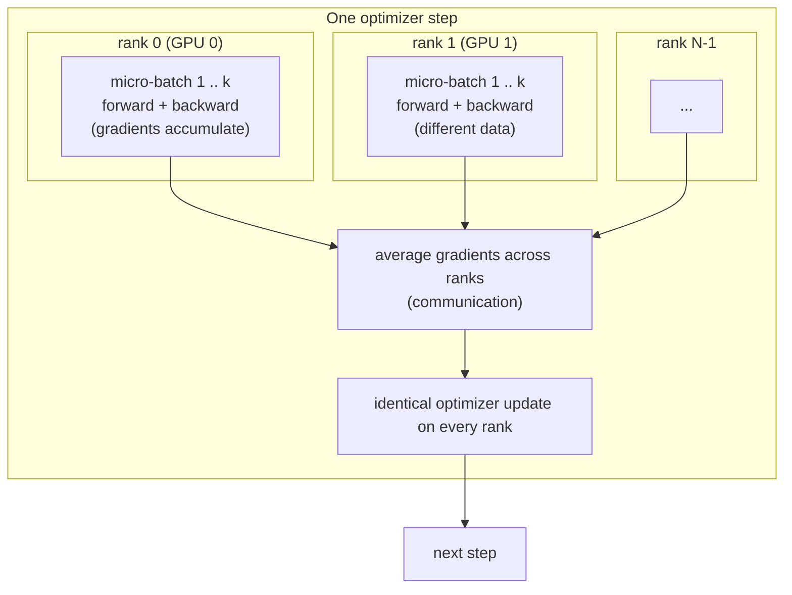

# Module 13 — Efficient training

**Part III · Performance Engineering** | Tier A–C | Study time: 7–9 hours

> Training time is tokens × FLOPs per token ÷ FLOPs per second actually achieved, and it
> must fit in memory while it runs. This module takes the levers one at a time: numeric
> precision, how a batch is assembled, what is kept for the backward pass, the compiler,
> and more devices. For each it states what is traded for what, measures it on a small
> model, and locates it in nanochat's training script. It ends Part III with the
> benchmark suite of Milestone 3.

## A. Learning objectives

After this module you can:

1. Account for the memory of a training step: weights, gradients, optimizer state, activations.
2. Compare fp32, bf16, fp16 and fp8: range, resolution, and the failure each one risks; explain why master weights stay in fp32.
3. Use gradient accumulation and show it is equivalent to a larger batch; say when it does not help.
4. Explain activation checkpointing as a compute-for-memory trade.
5. Compute and interpret tokens/s and MFU, and avoid the common timing errors.
6. Explain what `torch.compile` does, what it costs, and when it pays.
7. Describe data-parallel training and how nanochat synchronises gradients; translate a multi-GPU recipe to a single device.

## B. Prerequisites

- [Module 07](../07-optimization/lesson.md) (optimizers, the training step), [Module 09](../09-scaling-and-compute/lesson.md) (FLOPs per token, batch size, budgets).
- [Module 12](../12-inference-optimization/lesson.md) C (which resource binds).

## C. Motivation and intuition

A run in Module 09 was sized as a number of training tokens. Its duration is

$$\text{time} = \frac{\text{tokens} \times \text{FLOPs per token}}{\text{peak FLOPs/s} \times \text{MFU}}$$

The numerator was fixed by the experiment design. This module is about the denominator
(how much of the hardware's arithmetic you actually use) and about a constraint the
formula hides: the step must fit in memory.

| Lever | Buys | Costs | Changes the result? |
|---|---|---|---|
| Lower precision (bf16, fp8) | speed, memory | numerical resolution | slightly (rounding) |
| Gradient accumulation | memory | nothing in compute; more steps of bookkeeping | no (to rounding) |
| Activation checkpointing | memory | extra forward computation | no |
| `torch.compile` | speed | start-up time, static shapes, toolchain dependence | no (to rounding) |
| More devices (data parallel) | wall-clock time | communication, complexity | no in expectation |

## D. Rigorous technical explanation

### D.1 Where training memory goes

A training step holds four things:

| Component | Size | Depends on batch? |
|---|---|---|
| Weights | $N$ numbers | no |
| Gradients | $N$ | no |
| Optimizer state | AdamW: $2N$ (first and second moment); Muon: $N$ (momentum) plus a small second-moment buffer | no |
| **Activations kept for the backward pass** | roughly (numbers per token per layer) × layers × batch × sequence | **yes, linearly** |

Measured (`python labs/optimization/13_grad_accum.py`; 8 layers, width 256, 6.8 M
parameters, sequence 256, CPU, fp32): weights 26 MiB, gradients 26 MiB, AdamW state
52 MiB, and peak memory of a step above the idle level:

| batch (rows) | tokens | peak step memory | with checkpointing |
|---:|---:|---:|---:|
| 2 | 512 | 106 MiB | 37 MiB |
| 8 | 2 048 | 528 MiB | 173 MiB |
| 32 | 8 192 | 2 080 MiB | 744 MiB |

At batch 32 the activations are twenty times the weights, gradients and optimizer state
together. **Training memory is dominated by activations, and activations are proportional
to tokens per forward pass.** (This lab model materialises its attention matrices, which
inflates the figure; a fused attention kernel stores less. The proportionality holds
either way.) So the first response to "out of memory" is never a smaller model; it is
fewer tokens per forward pass, which D.3 shows can be done without changing the
optimisation.

### D.2 Number formats

A floating-point number has a sign, an exponent (range) and a mantissa (resolution).
Fewer bits mean less memory traffic and faster matmuls on hardware built for them; the
question is which bits can be given up. Measured with `python labs/optimization/13_precision.py`:

| Format | bits (exponent / mantissa) | largest value | spacing near 1.0 | decimal digits |
|---|---|---:|---:|---:|
| fp32 | 8 / 23 | 3.4e38 | 1.2e-07 | ~6–7 |
| fp16 | 5 / 10 | 65 504 | 9.8e-04 | ~3 |
| bf16 | 8 / 7 | 3.4e38 | 7.8e-03 | ~2 |
| fp8 e4m3 | 4 / 3 | 448 | 0.125 | <1 |
| fp8 e5m2 | 5 / 2 | 57 344 | 0.25 | <1 |

fp16 and bf16 spend the same 16 bits differently: fp16 keeps resolution and gives up
range; bf16 keeps fp32's full range and gives up resolution. Two experiments from the
lab show what each choice risks.

**Small updates vanish.** Add 0.001 a thousand times to 1.0 (the true answer is 2.0):

| fp32 | fp16 | bf16 |
|---:|---:|---:|
| 2.000047 | 1.976562 | **1.000000** |

In bf16 the spacing near 1 is 0.0078; adding 0.001 rounds back to 1 every time. A weight
update is exactly this operation: $w \leftarrow w - \eta\,g$ with $\eta g$ typically far
below 1 % of $w$. If weights were *stored* in bf16, most updates would be lost. Hence the
design rule of mixed-precision training:

> **Compute in low precision; keep the master weights and the optimizer state in fp32.**

The effect in an actual training run (`python labs/optimization/13_master_weights.py`:
MiniGPT on Pocket, 400 AdamW steps, all arithmetic in fp32, only the *storage* of the
weight matrices between steps differs; one seed):

| learning rate | stored as | validation loss | weights left unchanged by a step |
|---:|---|---:|---:|
| 1e-3 | fp32 | 0.3960 | 0.1 % |
| 1e-3 | fp16 | 0.3959 | 7.7 % |
| 1e-3 | bf16 | 0.4182 | 39.9 % |
| 1e-2 | fp32 | 0.3619 | 0.1 % |
| 1e-2 | fp16 | 0.3643 | 4.5 % |
| 1e-2 | bf16 | 0.3636 | 26.7 % |

With bf16 storage and a small learning rate, 40 % of all weight updates are rounded away
and training is visibly slower. With a tenfold larger learning rate the updates are
larger than the spacing more often and the damage shrinks to within seed noise. Real
schedules decay the learning rate towards zero, which is exactly where stored-bf16
weights stop moving. (fp16 has finer spacing and suffers less here; its problem is
range, next.)

**Large values overflow.** $300 \times 300$: fp32 gives 90 000, bf16 gives 90 112
(rounded but finite), fp16 gives **inf** (its maximum is 65 504). The mirror image
happens for small values: fp16 underflows to zero where bf16 does not. Gradients span
many orders of magnitude, so fp16 training needs a *gradient scaler* (multiply the loss
by a large factor before the backward pass, divide before the update, and skip steps
that produced infinities). bf16 needs none, because it has fp32's exponent. This is why
bf16 is the default on hardware that supports it.

**How much does the forward pass change?** Same weights, same input, fp32 versus bf16
(lab, CPU): loss 5.70000 versus 5.70024 (2.5e-04 apart), largest logit difference 0.015
on logits of magnitude 2.5. Rounding at the level of the third significant digit in
every operation yields a loss correct to four digits: the errors are small and largely
unbiased, and the loss averages over many of them. Two places need more care and are
kept in fp32 by convention: the softmax/cross-entropy (exponentials amplify error) and
any accumulation (optimizer moments, sums over many terms).

**fp8.** With one significant digit, a raw cast is useless. FP8 training rescales each
operand tensor so that its largest magnitude maps to the format's maximum, multiplies in
fp8, and undoes the scales: the same idea as the quantization of Module 12, applied
dynamically to weights, activations and gradients at every step. Activations and weights
use e4m3 (more resolution); gradients use e5m2 (more range). It needs GPU kernels that
exist on recent data-centre GPUs only.

**TF32** is a related switch for fp32 code on NVIDIA GPUs: matmuls internally round the
mantissa to 10 bits for speed while tensors remain fp32.

### D.3 Gradient accumulation

The gradient of a mean over a batch is the mean of the per-part gradients. Split a batch
of $B$ rows into $k$ micro-batches of $B/k$:

$$\nabla \frac{1}{B}\sum_{i=1}^{B} \ell_i \;=\; \sum_{j=1}^{k} \nabla\Big(\frac{1}{k}\cdot\frac{1}{B/k}\sum_{i\in\text{micro}_j}\ell_i\Big)$$

PyTorch *adds* into `.grad` on every `backward()`. So: run $k$ forward/backward passes,
each on the micro-batch mean loss divided by $k$, then take **one** optimizer step.

Measured: the gradient of one batch of 32 versus four accumulated batches of 8 differs by
at most 9.3e-10 on gradients of magnitude 1e-2: equal to rounding.

What it trades: peak memory is that of the micro-batch; arithmetic is unchanged; the
step takes about as long as the full batch would. It is the free response to an
out-of-memory error. Two limits:

- It cannot go below one sequence per pass. If a single row does not fit, shorten the
  sequence or use checkpointing (D.4).
- It is equivalent only when the loss decomposes over rows and nothing else depends on
  the batch (true for this architecture; false for batch normalisation).

**In nanochat** the *total* batch size (in tokens) is part of the optimisation recipe:
learning rates and weight decay are scaled from it (Module 09). The *device* batch size
is a memory setting. Their ratio is the number of accumulation steps. For d12 the
automatic total batch is 524 288 tokens; with `--device-batch-size 32` at 2 048 tokens
per row a pass holds 65 536 tokens, so one optimizer step is 8 accumulated passes on one
GPU. Halving the device batch size to fit a smaller memory doubles the passes per step
and leaves the training trajectory unchanged up to rounding and data order.

### D.4 Activation checkpointing

**Idea.** Do not store a block's internal activations during the forward pass. Keep only
its input. When the backward pass reaches the block, run its forward pass *again* to
recreate them, use them, discard them.

Measured (table in D.1): memory falls by a factor of about 2.8 (2 080 → 744 MiB at batch
32), and the step takes 36 % longer (2.34 s → 3.19 s): one extra forward pass through
every block.

Unlike accumulation, this costs arithmetic. Use it when accumulation has run out: one
long sequence that does not fit. nanochat does not use it; for its sequence length a
smaller device batch always suffices.

### D.5 Throughput and MFU

- **Tokens per second** = total batch tokens ÷ step time. The practical figure of merit
  for a given model on a given machine.
- **FLOPs per token** ≈ $6\times$ (matmul parameters) + attention terms (Module 09).
- **MFU** (model FLOPs utilisation) = tokens/s × FLOPs/token ÷ the device's peak FLOPs/s
  (in the precision being used).

MFU answers "how far is this implementation from what the hardware could do", and makes
runs on different GPUs comparable. It is below 100 % for good reasons (not every
operation is a matmul; memory-bound operations; the optimizer step; data loading; idle
time between kernels). Its absolute value depends on which "peak" is assumed, so compare
MFU between runs that use the same table, and prefer tokens/s when the device is not in
the table at all (nanochat prints `mfu 0.00` then, as on the DGX Spark at the pinned
revision).

**Timing a training step correctly:**

1. GPU calls are asynchronous: synchronise before reading the clock.
2. Exclude warm-up: compilation, allocator growth, kernel autotuning. nanochat excludes
   the first 10 steps from its total and its ETA.
3. Reading a loss value (`.item()`) forces a synchronisation; doing it every step inside
   the timed region is fine if you know it is there.
4. Report the median over many steps, and the hardware, precision and batch settings.

### D.6 `torch.compile`

A PyTorch model normally runs *eagerly*: the Python interpreter executes one operation at
a time, each a separate kernel launch that reads and writes whole tensors.
`torch.compile` traces the Python function into a graph, then generates code in which
adjacent elementwise operations are fused into single kernels and interpreter overhead
disappears. The result computes the same function up to floating-point rounding
(operations may be reordered).

What it costs:

- **Start-up time**: tracing and code generation, repeated whenever an input has a shape
  or property not seen before.
- **Static shapes**: nanochat compiles with `dynamic=False`, promising that input shapes
  never change. Training batches satisfy that; evaluation and sampling do not, so the
  script keeps the uncompiled model for them.
- **A toolchain**: a C compiler on CPU; on GPU the Triton compiler and NVIDIA's `ptxas`
  for the device's architecture, which is the most frequently reported point of failure
  on new hardware such as the DGX Spark ([setup guide](../../docs/dgx-spark-setup.md#7-troubleshooting)).

Measured with unmodified nanochat on a 4-core CPU (miniature depth-4 model, 2 048 tokens
per step; [`results/reference/nanochat-local-cpu.md`](../../results/reference/nanochat-local-cpu.md)):

| | compiled | `TORCHDYNAMO_DISABLE=1` |
|---|---:|---:|
| steady-state throughput | 40.6 k tokens/s | 31.6 k tokens/s |
| whole command, 300 steps | 80 s | 24 s |
| validation bpb at step 100 / 300 | 0.5652 / 0.4664 | 0.5548 / 0.4649 |

Compilation bought 28 % throughput and cost about 56 seconds. Per step that is
50.4 ms versus 64.8 ms, a saving of 14.4 ms, so the break-even is near
$56 / 0.0144 \approx 3\,900$ steps: irrelevant for a 300-step experiment, decisive for a
multi-day run. Note also that the two runs, same seed, do not produce identical losses:
compiled and eager code round differently, and training amplifies the difference. Both
are valid runs; neither is "the" result (Module 10 D.6).

### D.7 The input pipeline

A GPU that waits for data does no arithmetic. Symptoms: low GPU utilisation, tokens/s
that rises when the model is made *larger* per step, CPU cores pegged. nanochat's loader
tokenises documents on the fly on the CPU and the training loop fetches the next batch
*while* the GPU is still busy with the current backward pass. On a machine with few CPU
cores and a fast GPU the loader can become the limit; measure by timing the loader
alone.

### D.8 More devices: data-parallel training

**Idea.** $N$ processes ("ranks"), one per GPU, each holding a full copy of the model.
In every step each rank computes the gradient on *different* data; the gradients are
averaged across ranks; every rank applies the same update. The effective batch is $N$
times the per-device batch, in the time of one.



Tokens per optimizer step = ranks × accumulation steps × device batch × sequence length.
The three factors on the left are interchangeable as far as the optimisation is
concerned:

| Setup | ranks | accumulation | wall time per step |
|---|---:|---:|---|
| 8 GPUs | 8 | 1 | $t$ |
| 1 GPU of the same kind | 1 | 8 | about $8t$ |

**This is how to read a multi-GPU recipe on a single device.** nanochat's reference run
uses 8 GPUs; on one device the same training (same total batch, same number of steps,
same learning rates) is obtained by accumulation, and takes proportionally longer in
wall-clock time on equal hardware. What does *not* transfer is the hardware speed itself:
a published time on eight data-centre GPUs predicts nothing about a different machine,
which is why the course asks you to measure tokens/s first
([hardware guide](../../docs/hardware-and-costs.md)).

Scaling is less than linear in practice: gradients (as large as the model) must cross
between devices at every step, and all ranks wait for the slowest.

Other forms of parallelism (splitting one model across devices, pipeline and tensor
parallelism) matter for models too large for one device and are outside this course.

### D.9 A decision procedure

**Out of memory:**
1. Halve the device batch size; keep the total batch size (accumulation doubles). No change to the result.
2. If already at one row: shorten the sequence (changes the experiment) or checkpoint (costs time).
3. Only then consider a smaller model.

**Too slow:**
1. Is the measurement right (synchronised, after warm-up)?
2. Is the right precision active? (nanochat prints `COMPUTE_DTYPE` and why.)
3. Is the fast attention path active, and does the window pattern match it? (Module 12 F.)
4. Is compilation working, or silently disabled?
5. Is the loader keeping up?
6. Then compare tokens/s (or MFU) with a known-good reference *for the same hardware*.

## E. Minimal implementation

Accumulation ([`labs/optimization/13_grad_accum.py`](../../labs/optimization/13_grad_accum.py)):

```python
model.zero_grad()
for i in range(4):
    xb = x[i * 8 : (i + 1) * 8]
    (model(xb, xb) / 4).backward()      # gradients ADD across backward() calls; dividing keeps it a mean
optimizer.step()
```

Checkpointing a block:

```python
from torch.utils.checkpoint import checkpoint
x = checkpoint(block, x, use_reentrant=False)   # stores x only; re-runs block during backward
```

Mixed precision in the conventional PyTorch form (nanochat does the same thing
explicitly, see F):

```python
with torch.autocast(device_type="cuda", dtype=torch.bfloat16):
    loss = model(x, y)          # matmuls in bf16, weights remain fp32 parameters
loss.backward()
optimizer.step()                # update applied to the fp32 weights
```

> **Predict before you run** `python labs/optimization/13_precision.py`: adding 0.001 a
> thousand times to 1.0, what do fp16 and bf16 give? Which is closer to 2, and why is the
> *other* one nevertheless the preferred training format?

## F. nanochat code walkthrough

**One global compute dtype**
([`common.py` L13–L32](https://github.com/karpathy/nanochat/blob/92d63d4e8bb4df75c3b71618f31ddde2378b2bcd/nanochat/common.py#L13-L32)):
bf16 on CUDA devices of compute capability 8.0 or higher, fp32 on older GPUs, CPU and
MPS; override with `NANOCHAT_DTYPE`. fp16 is not chosen automatically. The reason is
printed at start-up.

**No autocast: explicit casts.** nanochat's `Linear` keeps an fp32 weight and casts it to
the activation's dtype on every call
([`gpt.py` L45–L50](https://github.com/karpathy/nanochat/blob/92d63d4e8bb4df75c3b71618f31ddde2378b2bcd/nanochat/gpt.py#L45-L50)):

```python
class Linear(nn.Linear):
    """... master weights stay fp32 for optimizer precision,
    but matmuls run in the activation dtype (typically bf16 from embeddings)."""
    def forward(self, x):
        return F.linear(x, self.weight.to(dtype=x.dtype))
```

The activations *become* bf16 because the embedding tables are stored in bf16
([`gpt.py` L262–L268](https://github.com/karpathy/nanochat/blob/92d63d4e8bb4df75c3b71618f31ddde2378b2bcd/nanochat/gpt.py#L262-L268)):
an exception to "master weights in fp32", justified in the source by memory (the tables
are 60 % of the parameters) and by the optimizer tolerating it. Before the loss, logits
are converted back
([`gpt.py` L514](https://github.com/karpathy/nanochat/blob/92d63d4e8bb4df75c3b71618f31ddde2378b2bcd/nanochat/gpt.py#L514)):
`logits = logits.float()  # switch to fp32 for logit softcap and loss computation`.
All three rules of D.2 are visible in about ten lines.

**fp16 path.** A `GradScaler` is created only when the compute dtype is fp16
([`base_train.py` L323–L324](https://github.com/karpathy/nanochat/blob/92d63d4e8bb4df75c3b71618f31ddde2378b2bcd/scripts/base_train.py#L323-L324)),
with the comment "bf16/fp32 don't need it — bf16 has the same exponent range as fp32".

**FP8** ([`nanochat/fp8.py`](https://github.com/karpathy/nanochat/blob/92d63d4e8bb4df75c3b71618f31ddde2378b2bcd/nanochat/fp8.py),
enabled by `--fp8`,
[`base_train.py` L165–L192](https://github.com/karpathy/nanochat/blob/92d63d4e8bb4df75c3b71618f31ddde2378b2bcd/scripts/base_train.py#L165-L192)).
The module's docstring is a self-contained explanation: each of the three matmuls of a
linear layer (forward, gradient with respect to input, gradient with respect to weight)
is wrapped in scale → cast to fp8 → `torch._scaled_mm` → unscale. Layers whose
dimensions are not multiples of 16 or are smaller than 128 are left alone, and FP8 is
switched off during evaluation (`disable_fp8`). The reference speedrun uses it
(`runs/speedrun.sh`: `--depth=24 ... --device-batch-size=16 --fp8`). It requires
recent data-centre GPUs; do not expect it to work on other hardware without checking.

**Accumulation**
([`base_train.py` L407–L413](https://github.com/karpathy/nanochat/blob/92d63d4e8bb4df75c3b71618f31ddde2378b2bcd/scripts/base_train.py#L407-L413)):

```python
tokens_per_fwdbwd = args.device_batch_size * args.max_seq_len
world_tokens_per_fwdbwd = tokens_per_fwdbwd * ddp_world_size
assert total_batch_size % world_tokens_per_fwdbwd == 0
grad_accum_steps = total_batch_size // world_tokens_per_fwdbwd
```

and the step itself
([L505–L544](https://github.com/karpathy/nanochat/blob/92d63d4e8bb4df75c3b71618f31ddde2378b2bcd/scripts/base_train.py#L505-L544)):

```python
synchronize()
t0 = time.time()
for micro_step in range(grad_accum_steps):
    loss = model(x, y)
    loss = loss / grad_accum_steps        # each .backward() is a grad sum => normalize loss here
    loss.backward()
    x, y, dataloader_state_dict = next(train_loader)   # prefetch the next batch while the GPU is busy
...
optimizer.step()
model.zero_grad(set_to_none=True)
train_loss_f = train_loss.item()          # .item() is a CPU-GPU sync point
synchronize()
```

Everything in D.3, D.5 and D.7 is here: normalised micro-batch losses, synchronisation
around the timed region, the prefetch. The metrics follow
([L552–L554](https://github.com/karpathy/nanochat/blob/92d63d4e8bb4df75c3b71618f31ddde2378b2bcd/scripts/base_train.py#L552-L554)):
`tok_per_sec`, `flops_per_sec` and `mfu`, the latter against `get_peak_flops`, a table
keyed on the GPU name.

**Compilation**
([`base_train.py` L245–L246](https://github.com/karpathy/nanochat/blob/92d63d4e8bb4df75c3b71618f31ddde2378b2bcd/scripts/base_train.py#L245-L246)):

```python
orig_model = model # original, uncompiled model, for saving raw model state_dict and for inference/evaluation
model = torch.compile(model, dynamic=False) # the inputs to model will never change shape so dynamic=False is safe
```

The optimizer's update kernels are compiled as well, at import time
(`@torch.compile(dynamic=False, fullgraph=True)` on `adamw_step_fused` and
`muon_step_fused` in `optim.py`), with hyperparameters passed as 0-dimensional tensors so
that changing the learning rate does not trigger recompilation. Consequence: importing
nanochat's optimizer requires a working compiler toolchain, or `TORCHDYNAMO_DISABLE=1`.

**Distributed training without DDP**
([`optim.py` L184–L250](https://github.com/karpathy/nanochat/blob/92d63d4e8bb4df75c3b71618f31ddde2378b2bcd/nanochat/optim.py#L184-L250)).
nanochat does not wrap the model in PyTorch's `DistributedDataParallel`. Launched with
`torchrun`, each rank reads different row groups of the dataset
([`dataloader.py` L52–L68](https://github.com/karpathy/nanochat/blob/92d63d4e8bb4df75c3b71618f31ddde2378b2bcd/nanochat/dataloader.py#L52-L68):
rank $r$ of $N$ takes groups $r, r+N, r+2N, \dots$) and the *optimizer* synchronises:
gradients of large parameters are reduce-scattered so that each rank receives the
average gradient for its slice, updates only that slice, and the slices are gathered
back. Optimizer state is therefore stored once across the ranks rather than once per
rank. The communication calls are asynchronous and overlap with computation. On a single
rank all of this is skipped.

**What nanochat does not use:** activation checkpointing, model parallelism, and a
separate data-loader process pool.

## M. Key takeaways

1. Training memory is dominated by activations, proportional to tokens per forward pass. Weights, gradients and optimizer state are a fixed cost of about four times the weight size with AdamW.
2. Compute in low precision, keep master weights, optimizer state and the loss in fp32. bf16 keeps fp32's range and needs no gradient scaler; fp16 does.
3. Gradient accumulation reduces memory at no cost in arithmetic and does not change the result; it is the first response to an out-of-memory error.
4. Checkpointing buys more memory with extra computation; use it when one sequence does not fit.
5. Tokens/s is the practical metric; MFU normalises by hardware and is only as good as the assumed peak. Time after warm-up, synchronised.
6. `torch.compile` pays for long runs and costs start-up time and a working toolchain.
7. Ranks, accumulation steps and device batch size are interchangeable for the optimisation: a multi-GPU recipe runs on one device with more accumulation and more time.

**Where this sits in the full system:** these settings decide what fits and how long it
takes in every training stage: pretraining (Part II), fine-tuning and reinforcement
learning (Part IV), and the automated experiment loops of Module 20, where the cost of
one trial bounds how many hypotheses can be tested.

**Part III ends here.** Before continuing, complete
[Milestone 3](../../instructor/assessments.md#milestone-3): run `make bench` and write up
a benchmark comparison of baseline and optimised approaches from your own measurements.

Next: [lab](lab.md) · [quiz](quiz.md) · [references](references.md) · then [Module 14 — Instruction tuning and supervised fine-tuning](../14-supervised-finetuning/lesson.md)
