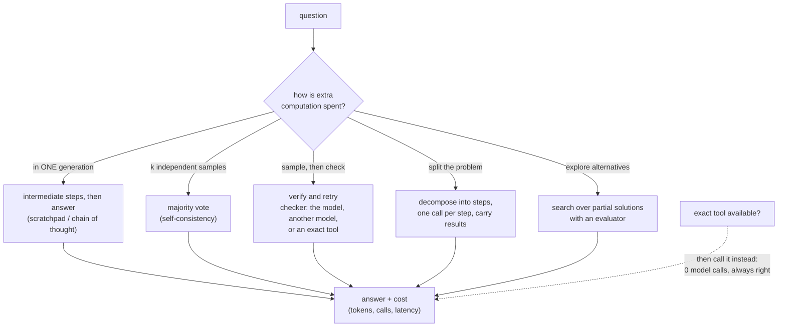

# Module 17 — Reasoning and inference-time computation

**Part V · Reasoning, Tools and Agents** | Tier A–B | Study time: 7–8 hours

> A Transformer does a fixed amount of computation per generated token. "Reasoning", as
> the term is used for language models, is a family of ways to spend *more* computation
> on one question: generating intermediate text, sampling several answers, checking and
> retrying, searching. This module separates four things that the word conflates, trains
> two small models to show the one effect that is architectural, and measures the others
> at equal cost, including the cases in which they do nothing.

## A. Learning objectives

After this module you can:

1. Explain why a fixed-depth model cannot compute some answers in one step and how generated intermediate tokens remove that limit.
2. Distinguish (a) reasoning as generated text, (b) inference-time strategies around a model, (c) search, and (d) training for reasoning.
3. Implement and evaluate a scratchpad model, majority voting, verify-and-retry and decomposition.
4. Compare strategies at equal cost (model calls, tokens), and name the best strategy when an exact tool exists.
5. Predict when voting and re-sampling help (random errors) and when they cannot (systematic errors, no signal).
6. Use agreement among samples as a confidence estimate.
7. State what visible reasoning text does and does not tell you about how an answer was produced.

## B. Prerequisites

- [Module 06](../06-transformer-block/lesson.md) (depth as sequential computation), [Module 10](../10-evaluation-and-generation/lesson.md) (sampling, uncertainty), [Module 15](../15-rl-and-preferences/lesson.md) (rewards), [Module 16](../16-tool-use/lesson.md) (tools).

## C. Motivation and intuition

One forward pass of an $L$-layer Transformer is $L$ rounds of "every position reads from
earlier positions, then computes locally". Whatever the answer token needs must be
worked out in those $L$ rounds. For a task that requires more sequential steps than the
model has layers (each step depending on the result of the previous one), a single pass
cannot succeed, however the weights are set.

But the model can be run more than once. Each generated token is appended to the context
and is available, as *input*, to every later pass. If the model writes an intermediate
result, the next pass starts from that result instead of recomputing it. A chain of $k$
dependent steps becomes $k$ easy passes instead of one impossible one:

```text
direct:      3*4+2-1 = ?                         one pass must do three dependent operations
scratchpad:  3*4+2-1 = 2+2-1 = 4-1 = 3           each "=" starts a pass that does ONE operation
```

That is the whole idea behind "chain of thought", "scratchpads" and "thinking tokens":
**the context window is working memory, and generated tokens are the way a fixed-depth
network gets more serial computation.** Everything else in this module is a way of
organising or spending that extra computation.

Four things are called "reasoning":

| | What it is | Weights change? | This module |
|---|---|---|---|
| (a) Reasoning as text | the model generates intermediate steps before the answer | no (but it must have been *trained* to do so) | D.1–D.2, lab A1 |
| (b) Strategies around the model | sample several answers and vote; check and retry; decompose | no | D.3–D.5, lab A2–A3, B |
| (c) Search | explore a tree of partial solutions with an evaluator | no | D.6 (conceptual) |
| (d) Training for reasoning | fine-tune (SFT, RL) so that (a) is done well | yes | D.7 (conceptual; Module 15's method) |

## D. Rigorous technical explanation

### D.1 Serial depth, and how tokens buy it

Consider chains evaluated left to right modulo 5, mixing `+`, `-` and `*`:
`3*4+2-1` → $((3\cdot4)+2)-1 \bmod 5$. The mixture matters. A sum of terms can be
computed "in parallel" (attention can aggregate all operands at once), but with
multiplication interleaved, the effect of each operand depends on the running value:
the task is inherently sequential.

Two models of identical architecture (2 layers, width 96) are trained from scratch on
the same 40 000 random chains with 1 to 5 operations, differing only in the *format of
the target*:

- **direct**: `3*4+2-1=3`
- **scratchpad**: `3*4+2-1=2+2-1=4-1=3` (replace the first operation by its result,
  copy the rest; repeat)

Measured (`python labs/agents/17_reasoning_benchmark.py`; 2 500 steps each; 200 held-out
chains per cell; chance = 0.20):

| Model | 1 op | 2 ops | 3 ops | 4 ops | 5 ops | 6 ops (unseen length) | tokens generated at 5 ops |
|---|---:|---:|---:|---:|---:|---:|---:|
| direct, trained on 1–5 operations | 0.250 | 0.190 | 0.165 | 0.215 | 0.185 | 0.200 | 1 |
| **scratchpad**, trained on 1–5 operations | 1.000 | 1.000 | 1.000 | 1.000 | 0.995 | 0.115 | 29 |
| direct, trained on 1–2 operations only | 1.000 | 0.665 | 0.185 | 0.230 | 0.205 | 0.195 | 1 |

1. **Same network, same problems, same training budget: chance versus perfect.** The
   scratchpad model solves every length it was trained on; the direct model learned
   nothing at all, not even single operations.
2. **Why the direct model fails even on one operation.** For most of its training
   examples (chains of 3–5 operations) the single target token is not computable by two
   layers, so most of the training signal is, for this model, noise. The third row is
   the control: trained only on chains it can represent, the direct format reaches
   100 % on one operation and 67 % on two, and stays at chance beyond. Its limit is
   depth, not data.
3. **Every target token of the scratchpad model is locally computable**: one table
   look-up and a copy. Training signal is dense and learnable. This is why data with
   worked steps train better than data with bare answers, independent of any effect at
   inference time.
4. **The price is tokens.** 29 generated tokens instead of 1 for a 5-operation chain:
   more decode steps (Module 11), more context consumed. Reasoning is paid for in
   inference compute.
5. **It does not extrapolate.** At six operations, one more than in training, the
   scratchpad model falls to 0.115. It learned a procedure for the lengths it saw, not
   the general algorithm (compare Module 16 D.4, item 5). "Reasoning" generated by a
   model is a learned behaviour with a training distribution like any other.

### D.2 What the intermediate text is, and is not

In the scratchpad model the intermediate text is *functionally necessary*: delete it and
the answer cannot be computed. In such cases the text is a faithful record of the
computation, because it *is* the computation.

That does not hold in general. A model that could have produced the answer directly may
still write plausible steps (it was trained on text in which answers are accompanied by
explanations), and research on large models has shown cases where the stated steps do
not determine the answer: the answer survives when the steps are corrupted, or is
influenced by cues the steps never mention. Two practical rules:

- Treat visible reasoning as **evidence about the computation, not a transcript of it**.
  It is most trustworthy when the task demonstrably cannot be done without it.
- An explanation produced *after* the answer is a new generation conditioned on the
  answer. It can only rationalise.

Some deployed models generate reasoning tokens that are hidden from the user or
summarised, with a configurable budget ("thinking" modes). The mechanism is the one of
D.1; what differs is training (D.7) and product presentation.

### D.3 Strategies around a model

The model is a black box that maps a prompt to a sampled answer. Four ways to spend $k$
calls instead of one:



**Majority voting (self-consistency).** Sample $k$ answers at temperature > 0 and return
the most frequent. If each sample is right with probability $p$ and wrong answers are
scattered over many values, the right answer needs to be only the *most common* one, and
the probability that it is rises with $k$. If errors are *systematic* (the same wrong
answer each time), the samples agree on the wrong answer and voting returns it with
high confidence.

**Verify and retry.** Sample an answer; ask a checker whether it is right; if not, sample
again. The quality of the checker bounds the result: an exact checker (a test suite, a
proof checker, a calculator) accepts only right answers; a model used as checker makes
errors of both kinds, and a checker that shares the solver's weights tends to share its
blind spots.

**Decomposition.** An orchestrator splits the problem into steps and issues one call per
step, carrying the intermediate result in the prompt. This is D.1's scratchpad with the
bookkeeping moved from the model into code: more reliable bookkeeping, one call per
step.

### D.4 Experiment: voting with real models

**Voting cannot create a capability.** On the direct model of D.1 (four operations,
samples at temperature 1.0, 200 chains):

| | k = 1 | k = 5 | k = 15 |
|---|---:|---:|---:|
| majority vote is right | 0.160 | 0.175 | 0.185 |
| the right answer is *among* the samples | 0.160 | 0.610 | 0.965 |

With 15 samples the right answer is almost always present, because there are only five
possible answers; the vote cannot find it, because the model's distribution carries no
information about which one is right. Voting amplifies a signal; here there is none.

**Voting against greedy decoding.** On the under-trained chat model of Part IV (3-digit
addition, 300 held-out questions):

| | greedy | k = 1 | k = 5 | k = 15 | k = 25 |
|---|---:|---:|---:|---:|---:|
| majority vote is right | **0.523** | 0.470 | 0.527 | 0.513 | 0.513 |
| the right answer is among the samples | | 0.470 | 0.630 | 0.753 | 0.810 |

Voting repairs the damage done by sampling (0.47 → 0.52) and then stops: 25 samples
buy nothing over one greedy decode. For a short answer, greedy decoding already returns
(approximately) the most probable answer, which is what the vote estimates. Voting
gains over greedy mainly when answers come at the end of long sampled *reasoning*, where
different chains can reach the same answer by different routes. And the errors here are
largely systematic: where this model is wrong, it is usually consistently wrong.

**Agreement as a confidence estimate.** The same 25 samples per question, grouped by how
many agree with the majority answer:

| Agreement among 25 samples | questions | majority answer right |
|---|---:|---:|
| at least 80 % | 104 | 0.981 |
| 50–80 % | 47 | 0.787 |
| below 50 % | 149 | 0.101 |

This is the more useful result. The samples do not make the model better, but they tell
you *when to trust it*: answering only when 80 % agree gives 98 % accuracy on a third of
the questions, and the low-agreement group, half of all questions, is where the errors
are. A system can abstain, ask a clarifying question, or call a tool for exactly those.
Caveat: agreement measures the model's consistency, not truth; a systematic error
produces high agreement on a wrong answer (2 of the 104 high-agreement questions here;
the simulated study below makes the point in the extreme).

### D.5 Experiment: strategies at equal cost (simulated solver)

To vary error properties at will, the remaining comparisons use a *simulated* solver
(`mlle.agents.llm.NoisySolver`) with stated assumptions: 5 % error on a single
operation; 15 % error per operation when a whole chain is answered at once; 10 % wrong
verdicts when used as a checker. **These numbers are consequences of the assumptions,
not measurements of a model.** They show how the strategies relate, at known cost.

| Strategy | 4 operations: accuracy | calls | 8 operations: accuracy | calls |
|---|---:|---:|---:|---:|
| direct | 0.525 | 1.0 | 0.270 | 1.0 |
| decompose, one call per step | 0.795 | 4.0 | 0.672 | 8.0 |
| vote, k = 5 | 0.787 | 5.0 | 0.398 | 5.0 |
| vote, k = 15 | 0.993 | 15.0 | 0.608 | 15.0 |
| verify and retry, model as checker | 0.865 | 3.9 | 0.593 | 5.0 |
| verify and retry, exact checker | 0.968 | 1.8 | 0.725 | 2.7 |
| **tool only, no model call** | 1.000 | 0.0 | 1.000 | 0.0 |

- No strategy dominates. At four operations voting with 15 calls is best among the
  model-only strategies; at eight operations decomposition is, with half the calls.
  Voting needs the right answer to be the most common single outcome, which fails when
  $p$ is small.
- An exact checker beats a model checker at half the cost. Verification is as good as
  the verifier.
- When an exact tool exists, the best reasoning strategy is not to reason: hand the
  computation to the tool (Module 16). Inference-time strategies are for the part of the
  problem no tool can do.
- Always report the cost column. "Strategy A improves accuracy" without calls or tokens
  is half a result.

What if errors are systematic? Six operations, the share of errors that are identical on
every re-ask varied:

| Share of systematic errors | direct | vote, k = 15 | verify, model checks | verify, exact check |
|---:|---:|---:|---:|---:|
| 0 | 0.407 | 0.868 | 0.738 | 0.845 |
| 0.5 | 0.400 | 0.630 | 0.568 | 0.618 |
| 1 | 0.380 | 0.380 | 0.380 | 0.380 |

With fully systematic errors every strategy that re-asks the same model returns exactly
the direct accuracy, at up to fifteen times the cost: even the exact checker only
*detects* the error; re-sampling cannot produce a different answer. Escaping a
systematic error needs a different source of information: another model, a tool, a
reformulated question, or training.

### D.6 Search (conceptual)

Voting and retrying sample complete answers independently. *Search* organises the
sampling: generate several candidate next steps, score partial solutions with an
evaluator (a heuristic, a model's judgement, a test), expand the promising ones,
backtrack from dead ends (beam search over reasoning steps; tree search). Its
requirements are a problem that decomposes into steps and an evaluator that can judge
partial solutions better than chance. Its cost grows quickly with branching and depth.
For problems with a reliable evaluator (games, formal proofs, code with tests) search is
the strongest known inference-time method; without one it amplifies the evaluator's
errors. Not implemented in this course or in nanochat.

### D.7 Training for reasoning (conceptual)

Strategies (a)–(c) leave the weights alone. Models are also *trained* to reason:

- **Supervised**: fine-tune on data in which answers come with worked steps. D.1 is the
  miniature version; nanochat's use of GSM8K solutions is the same idea at small scale.
- **Reinforcement learning**: let the model generate reasoning freely and reward only
  the final answer's correctness (Module 15's policy gradient with a verifiable
  reward). The reasoning text is then shaped by what leads to right answers, not by
  imitation, and can exceed the demonstrations. This is the method behind current
  "reasoning models"; it needs tasks with checkable answers, a great deal of sampling,
  and carries the risks of Module 15 D.6 (the reward is all the model is asked to
  satisfy).
- **Distillation of search**: run an expensive strategy (search, voting) to produce
  better answers, then fine-tune the model on them so that one pass approximates the
  expensive procedure.

### D.8 How to evaluate a reasoning claim

1. Is the comparison at **equal cost** (tokens or calls), and is the cost reported?
2. Is the baseline the right one: greedy decoding, not a single sample at temperature 1?
3. Are the model's errors on this task random or systematic? (Sample twice and compare.)
4. Is there an exact tool that makes the question moot?
5. Was the evaluation set inside the lengths and formats the reasoning was trained on?
6. Does accuracy come with an uncertainty (Module 10)?

## E. Minimal implementation

The scratchpad data ([`mlle/data/tasks.py`](../../mlle/data/tasks.py)):

```python
def mod_chain(rng, n_ops, mod=5):
    ...
    for i, (o, n) in enumerate(zip(ops, nums[1:])):
        value = {"+": value + n, "-": value - n, "*": value * n}[o] % mod
        steps.append(str(value) + "".join(oo + str(nn) for oo, nn in zip(ops[i + 1:], nums[i + 2:])))
    return expr, steps          # '3*4+2-1', ['2+2-1', '4-1', '3']
```

The strategies ([`mlle/agents/reasoning.py`](../../mlle/agents/reasoning.py)), each
returning `(answer, calls_used)`:

```python
def self_consistency(llm, expr, k=5):
    answers = [llm.complete(f"SOLVE: {expr}", temperature=1.0, seed=i) for i in range(k)]
    return Counter(answers).most_common(1)[0][0], k

def verify_and_retry(llm, expr, checker, max_attempts=4, check_cost=0):
    calls = 0
    for attempt in range(max_attempts):
        answer = llm.complete(f"SOLVE: {expr}", temperature=1.0, seed=attempt)
        calls += 1 + check_cost
        if checker(expr, answer):
            break
    return answer, calls

def decompose(llm, expr):
    value = str(parse_chain(expr)[0])
    for op, operand in split_chain(expr):
        value = llm.complete(f"STEP: {value}{op}{operand}")     # the orchestrator carries the state
    return value, len(split_chain(expr))
```

With a real model, the $k$ samples of one question share one prefill (Module 11 D.6):
voting costs $k$ decodes, not $k$ prompts.

> **Predict before you run** `python labs/agents/17_reasoning_benchmark.py`: two
> identical networks see the same chains; one is trained to answer directly, the other
> to write each reduction. How accurate is each on four-operation chains?

## F. nanochat code walkthrough

nanochat has no reasoning module: no voting, verifier, search or hidden reasoning
budget. What it has are the two ingredients everything above is built from, and one
training set with worked steps.

**Worked steps in the training data.** GSM8K reference solutions are step-by-step
derivations with calculator annotations, ending in `#### <answer>`
([`tasks/gsm8k.py` L1–L15](https://github.com/karpathy/nanochat/blob/92d63d4e8bb4df75c3b71618f31ddde2378b2bcd/tasks/gsm8k.py#L1-L15)):

```text
Weng earns 12/60 = $<<12/60=0.2>>0.2 per minute.
Working 50 minutes, she earned 0.2 x 50 = $<<0.2*50=10>>10.
#### 10
```

Fine-tuning on these (Module 14) trains the model to write intermediate results before
the answer: scratchpad training by imitation, with the arithmetic of each step delegated
to the calculator (Module 16). The evaluation extracts the number after `####` and
ignores the steps
([`extract_answer`, L21–L33](https://github.com/karpathy/nanochat/blob/92d63d4e8bb4df75c3b71618f31ddde2378b2bcd/tasks/gsm8k.py#L21-L33)):
only the outcome is scored.

**Many samples from one prompt.** `Engine.generate_batch(tokens, num_samples=k, ...)`
prefills once and decodes $k$ rows (Module 11). The RL script uses it for rollouts and
for its evaluation metric, pass@k
([`chat_rl.py` L225–L238](https://github.com/karpathy/nanochat/blob/92d63d4e8bb4df75c3b71618f31ddde2378b2bcd/scripts/chat_rl.py#L225-L238)):
"is the right answer among $k$ samples", the second row of the tables in D.4. Majority
voting is ten lines on top of the same call (lab exercise 5).

**Training for reasoning.** `chat_rl.py` is method (d) of D.7 in its simplest form: the
model generates a full solution, steps included, and receives reward 1 if the final
number is right. The gradient flows through every sampled token, so the *reasoning text*
is what gets reinforced.

**On the DGX Spark.** Inference-time strategies multiply decode cost: $k$ samples of a
256-token solution are $256k$ decode steps per question. Decode throughput at batch $k$
(Module 12) determines what is affordable. *No timings: not measured by the author.*

## M. Key takeaways

1. One forward pass has fixed serial depth. Generated tokens are working memory; writing intermediate results turns one impossible pass into several easy ones (chance → 100 % with the same network).
2. Worked steps help training as well as inference: every target becomes locally computable.
3. Reasoning costs tokens and decode time, and it is a learned behaviour that fails outside its training distribution.
4. Voting and re-sampling amplify a signal and repair random errors. They cannot create a capability and do nothing against systematic errors. Compare against greedy decoding, at equal cost.
5. Agreement among samples is a usable confidence estimate (98 % versus 10 % accuracy between high- and low-agreement questions), with the caveat that consistent errors look confident.
6. Verification is as good as the verifier; an exact checker beats a model checker; an exact tool beats every strategy.
7. Visible reasoning is evidence about a computation, not a transcript. It is trustworthy to the degree that the task cannot be solved without it.

**Where this sits in the full system:** Modules 16 and 17 supplied the two ways to
improve an answer without touching weights: act through tools, and compute more. Module
18 combines them in a loop that decides, step by step, which to do next.

Next: [lab](lab.md) · [quiz](quiz.md) · [references](references.md) · then [Module 18 — The agentic loop](../18-agentic-loop/lesson.md)
