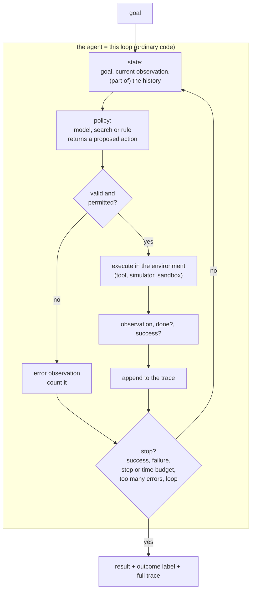

# Module 18 — The agentic loop

**Part V · Reasoning, Tools and Agents** | Tier A | Study time: 6–7 hours

> An "agent" is a program: a loop that repeatedly asks a model for the next action,
> checks it, executes it, records the result, and decides whether to stop. The model is
> one function call inside that loop. This module writes the loop out in full, with
> every control decision in ordinary code, and measures what the loop can and cannot do
> about an unreliable model: it can detect, bound and recover; it cannot make a long
> task succeed when each step fails too often.

## A. Learning objectives

After this module you can:

1. Define an agent as a loop over state, policy, action, environment and observation, and say which parts are code and which are model.
2. Implement the loop with validation, budgets, stop conditions, loop detection and a trace.
3. Classify how episodes end, and use that classification as the primary diagnostic.
4. Explain how per-step error rates compound over a task, and what recovery changes.
5. Manage what the model sees: truncated history, an explicit current state, summaries.
6. Compare planning-first and reactive control, and recognise when code should replace the model.
7. State the safety requirements of a loop that acts: least privilege, bounded autonomy, auditability.

## B. Prerequisites

- [Module 16](../16-tool-use/lesson.md) (tool calls, validation, permissions), [Module 17](../17-reasoning/lesson.md) (strategies and their costs).

## C. Motivation and intuition

A tool-using assistant (Module 16) answers one question with a few tool calls. Many
tasks need more: an unknown number of steps, where each step depends on what earlier
steps revealed. Find the key, then the door it opens. Run the tests, read the failure,
change the code, run them again.

The structure that handles this is old and simple, a control loop:

```text
observe the state
choose an action            <- the model's job (or a search's, or a rule's)
check that the action is allowed
execute it
record what happened
decide whether to stop      <- success? failure? out of budget? going in circles?
```

Everything interesting about agents is in the lines that are *not* the model's job.
A model that is right 95 % of the time per step sounds good and completes a 20-step task
about a third of the time. Whether a system built on it is useful depends on what
happens in the other two thirds: is the failure noticed, is it bounded, is it reported?

## D. Rigorous technical explanation

### D.1 The parts



| Part | What it is | In the course code ([`mlle/agents/loop.py`](../../mlle/agents/loop.py)) |
|---|---|---|
| Environment | whatever the agent acts on, with a defined set of legal actions | `Environment`: `reset`, `actions`, `step`, `state_key` |
| Success test | **code**, not the model's opinion | returned by `env.step` |
| Policy | maps (goal, history, legal actions) to (thought, action) | `Policy`; `react_policy(llm)` wraps a model |
| Validation | is the proposed action legal? | `if action not in env.actions()` |
| Budgets | steps, wall-clock time, invalid actions | `max_steps`, `max_seconds`, `max_invalid` |
| Loop detection | the same state seen too often | `seen[state_key] > loop_window` |
| Trace | every step with thought, action, observation, status | `Episode.steps` |
| Outcome | *why* it ended | `success`, `failed`, `step_budget`, `time_budget`, `loop_detected`, `too_many_invalid` |

Two design rules are built into this list.

**The success test is not the model's.** If the model decides when the task is done, it
will sometimes declare success falsely, and the system will report it. Success must be
checked by something that can be wrong only in ways you understand: a test, a
comparison, a human.

**Every exit has a name.** "It did not work" is useless; "62 % success, 27 % stopped
after three invalid actions, 11 % out of steps" tells you what to fix. The outcome
distribution is the first thing to look at in any agent evaluation.

### D.2 Policies: who chooses?

| Policy | How it chooses | When to prefer it |
|---|---|---|
| Search / planner | explores the action space with a model of the environment | the environment can be simulated and the space is small enough |
| Rule / heuristic | fixed code | the decision is simple and stable |
| Model, reactive (ReAct) | sees the state and history, proposes the next action | the state is open-ended text; no simulator; judgement needed |
| Model plans, code executes | model writes a whole plan, the loop runs and checks it | steps are predictable; re-plan on failure |

The ReAct pattern asks the model for a short *thought* followed by an *action*, appends
the observation, and repeats. The thought is Module 17's scratchpad applied to control:
room for a step of reasoning before committing. The prompt used here:

```text
Goal: turn 5 into 26 using add3, double, sub1
Legal actions: add3, double, sub1
Current state: value=10
Recent history:
  1. action=double -> value=10
Reply in exactly this format:
Thought: <one sentence>
Action: <one legal action>
```

**Use the least intelligent component that solves the problem.** On the number game of
the lab, breadth-first search finds the optimal plan every time, with no model calls.
A model belongs where code cannot do the job, not where it can.

### D.3 Experiment: the same loop, different policies

`python labs/agents/18_agent_loop.py` runs 200 number-game tasks (reach a target with
`add3`, `double`, `sub1`; optimal solutions of 3–9 moves) under a budget of 20 steps and
3 invalid actions. The "model" is a **simulated** stand-in: a simple heuristic that, with
a set probability per step, returns a malformed reply, an illegal action or an arbitrary
legal one. It is not a language model; it lets each failure mode be produced on demand.
The numbers are properties of that stand-in.

| Policy | success | mean steps | model calls | why episodes ended |
|---|---:|---:|---:|---|
| search (optimal plan, no model) | 1.000 | 5.1 | 0 | success 200 |
| heuristic in code (no model) | 0.970 | 10.3 | 0 | success 194, step budget 6 |
| simulated model, 0 % mistakes | 0.970 | 10.3 | 10.3 | success 194, step budget 6 |
| simulated model, 20 % mistakes | 0.610 | 11.4 | 11.4 | success 122, too many invalid 53, step budget 25 |
| simulated model, 50 % mistakes | 0.150 | 8.1 | 8.1 | too many invalid 170, success 30 |

- Search is perfect and twice as efficient as the heuristic (5.1 against 10.3 steps):
  where a simulator exists, planning beats reacting.
- A flawless model behind the same heuristic is exactly as good as the heuristic in
  code, at ten model calls per task. The model adds cost, not capability, here.
- At 20 % mistakes per step, four in ten tasks fail. The outcome column says how: mostly
  the invalid-action budget, not the step budget.

### D.4 Errors compound

Success by length of the optimal plan (same runs):

| Policy | 3 moves | 4 | 5 | 6 | 7 | 8 |
|---|---:|---:|---:|---:|---:|---:|
| simulated model, 0 % mistakes | 1.00 | 1.00 | 1.00 | 0.96 | 0.86 | 0.86 |
| simulated model, 20 % mistakes | 0.80 | 0.64 | 0.69 | 0.58 | 0.32 | 0.29 |
| simulated model, 50 % mistakes | 0.36 | 0.19 | 0.15 | 0.06 | 0.09 | 0.00 |

If every step must be right and steps fail independently with probability $\epsilon$, a
task of $n$ steps succeeds with probability $(1-\epsilon)^n$: for $\epsilon = 0.2$ and
$n = 8$, 17 %; for $n = 6$, 26 %. The measured values (29 % and 58 %) are better
because the loop *recovers* from some mistakes. Two thirds of this stand-in's mistakes
are malformed or illegal replies, which the loop rejects without touching the
environment and merely counts; only the remaining third (an arbitrary legal move,
about 7 % of steps) changes the state, and even that can sometimes be undone by later
moves. Validation turned most errors from fatal into retried. Recovery shifts the curve;
it does not change its shape. Long tasks need either very reliable steps or checkpoints
from which to recover.

This is the central quantitative fact about agents: **task-level reliability is a
product of step-level reliabilities, and the loop's job is to turn "any error is fatal"
into "errors are detected and retried within a budget".**

### D.5 What the guards are worth

The 50 %-mistake model under different loop settings:

| Setting | success | mean steps | why episodes ended |
|---|---:|---:|---|
| default: 20 steps, 3 invalid, loop window 3 | 0.150 | 8.1 | too many invalid 170, success 30 |
| 1 invalid action ends the episode | 0.010 | 2.7 | too many invalid 198, success 2 |
| 10 invalid actions tolerated | 0.455 | 16.0 | step budget 92, success 91, too many invalid 13, failed 4 |
| 8 steps | 0.085 | 6.7 | too many invalid 105, step budget 78, success 17 |
| 60 steps, 20 invalid, loop window 50 | 0.580 | 27.4 | success 116, failed 46, too many invalid 25, step budget 13 |

- Tolerance for invalid actions is recovery: allowing ten instead of three triples
  success (0.15 → 0.46) for the price of twice the steps.
- Budgets trade success against cost, and the right setting depends on what a step
  costs and what a failure costs.
- With the guards relaxed, a new outcome appears: **failed 46**. Those episodes ran out
  of the environment's valid range: the agent did real damage in its world before any
  budget stopped it. Generous budgets do not only waste steps; they give an unreliable
  policy more opportunities to act. Bounds on autonomy are a safety mechanism.

### D.6 What the model sees: context management

The history grows with every step; the context window does not. Standard measures:

- **Truncate**: show the most recent $k$ steps (`history_limit`).
- **Always restate the essentials**: goal, legal actions, *current state*.
- **Summarise** older history into a short note (itself a model call that can lose or
  distort information).
- **External memory**: write facts to a store and retrieve them when relevant (this is
  retrieval, Module 22).

A bug from this course's own development shows why the second point matters. The first
version of `react_policy` showed only the last six history lines. When the model
produced several invalid actions in a row, those six lines were all error messages: the
current state had scrolled out of the prompt, and the policy could no longer act. The
fix is one line (pass the last valid observation as an explicit `Current state:`), and a
regression test now pins it. Agents fail in exactly this way in practice: the
information needed for the next step is no longer in the context, and the model
continues confidently without it.

### D.7 Safety of a loop that acts

Module 16's rules apply to every iteration, and the loop adds its own:

1. **Least privilege**, decided before the loop starts and not changeable from inside it.
2. **Bounded autonomy**: budgets on steps, time, cost and errors; no unbounded loops.
3. **No unrestricted execution**: actions come from an explicit, finite set (or a schema-validated tool set); nothing the model writes is run as a shell command or as code outside a sandbox.
4. **Irreversible actions need approval** by a person who sees the concrete action.
5. **Everything is logged**: the trace is the audit record and the debugging tool.
6. **The loop cannot modify itself**: its code, budgets, permissions and success test are outside the agent's action space (Module 20 returns to this).

The environments of this course are deliberately closed: a number, a four-room world.
The same loop driving a shell or a browser needs all six rules enforced by the
infrastructure, not by the prompt.

### D.8 Evaluating an agent

- Success rate **with the outcome distribution**.
- Cost: steps, model calls, tokens, wall-clock time, per task and per *successful* task.
- Success as a function of task length (D.4).
- Efficiency against a reference (optimal plan length where one can be computed).
- Variance: repeat with different seeds; agent runs are long random processes.
- Read traces. Ten traces explain more than any aggregate.

## E. Minimal implementation

The whole loop ([`mlle/agents/loop.py`](../../mlle/agents/loop.py), abridged):

```python
def run_agent(env, policy, max_steps=20, max_seconds=30.0, max_invalid=3, loop_window=3):
    episode = Episode(goal=env.goal)
    episode.steps.append(Step(0, "", "(start)", env.reset(), "ok"))
    seen, invalid, t0 = {env.state_key(): 1}, 0, time.perf_counter()
    for i in range(1, max_steps + 1):
        if time.perf_counter() - t0 > max_seconds:
            episode.outcome = "time_budget"; break
        thought, action = policy(env.goal, episode.steps, env.actions())     # the only model call
        if action not in env.actions():                                      # validate
            invalid += 1
            episode.steps.append(Step(i, thought, action, "invalid action. Legal actions: ...", "invalid"))
            if invalid >= max_invalid:
                episode.outcome = "too_many_invalid"; break
            continue
        observation, done, success = env.step(action)                        # execute
        episode.steps.append(Step(i, thought, action, observation, ...))     # record
        if success: episode.outcome = "success"; break                       # stop conditions
        if done:    episode.outcome = "failed"; break
        seen[env.state_key()] = seen.get(env.state_key(), 0) + 1
        if seen[env.state_key()] > loop_window:
            episode.outcome = "loop_detected"; break
    else:
        episode.outcome = "step_budget"
    return episode
```

Forty lines, of which one calls a model. To drive it with a real model, pass any object
with a `complete(prompt)` method to `react_policy`, for example
`mlle.agents.llm.OpenAICompatLLM` pointed at a server on your own machine.

> **Predict before you run** `python labs/agents/18_agent_loop.py`: a model makes a
> mistake in 20 % of its steps. What fraction of 6-move tasks does the agent complete?
> Write down your estimate and the formula behind it.

## F. nanochat code walkthrough

nanochat contains no agent framework. It contains two loops that are the degenerate
cases of the one above, and reading them as such is instructive.

**The tool state machine** in `Engine.generate` (Module 16 F) is an agent loop with one
tool, one kind of action and no budgets other than `max_tokens`: sample, detect a
request, execute, force the observation, continue. Its stop conditions are
`<|assistant_end|>`, `<|bos|>` and the token limit.

**The conversation loop**
([`scripts/chat_cli.py` L44–L97](https://github.com/karpathy/nanochat/blob/92d63d4e8bb4df75c3b71618f31ddde2378b2bcd/scripts/chat_cli.py#L44-L97))
is a loop whose environment is the human:

```python
conversation_tokens = [bos]
while True:
    user_input = input("\nUser: ").strip()
    ...
    conversation_tokens.append(user_start)
    conversation_tokens.extend(tokenizer.encode(user_input))
    conversation_tokens.append(user_end)
    conversation_tokens.append(assistant_start)
    for token_column, token_masks in engine.generate(conversation_tokens, **generate_kwargs):
        ...
    if response_tokens[-1] != assistant_end:
        response_tokens.append(assistant_end)      # keep the format valid even if generation was cut off
    conversation_tokens.extend(response_tokens)
```

Three things to notice with this module's vocabulary:

- **State** is the token list, and it only grows. Nothing truncates or summarises it;
  the limit is the model's context (D.6). A long session eventually leaves the range the
  model was trained on.
- **Repair of the state**: if generation stops at the token limit, the loop appends
  `<|assistant_end|>` itself, so that the next turn starts from a well-formed
  conversation. A small instance of "the loop, not the model, guarantees invariants".
- **Cost**: every turn calls `engine.generate` on the whole conversation, which prefills
  it from scratch. The cache of the previous turn is not reused (Module 11 challenge).

**What nanochat does not have:** environments, multi-step policies, budgets, outcome
labels, traces. The loop of this module is a course extension, built so that it can sit
on top of nanochat's `Engine` or any other model server.

## M. Key takeaways

1. An agent is a loop in ordinary code; the model proposes actions and nothing else.
2. Success is decided by code, and every way of stopping has a name. The outcome distribution is the first diagnostic.
3. Step errors compound: roughly $(1-\epsilon)^n$. The loop's validation and retries shift that curve; they do not remove it.
4. Budgets and guards trade success for cost and bound the damage an unreliable policy can do. Relaxing them produced real failures in the environment.
5. The model acts on what is in its context. Always restate goal, legal actions and current state; truncation that drops the state is a classic failure.
6. Use search or rules where they suffice; a model where judgement on open-ended state is needed.
7. Autonomy is bounded from outside: permissions, budgets, success test and the loop's own code are not in the agent's action space.

**Where this sits in the full system:** the loop is the unit from which Modules 19 and
20 build: several loops that exchange messages, and a loop whose actions are
experiments.

Next: [lab](lab.md) · [quiz](quiz.md) · [references](references.md) · then [Module 19 — Multi-agent collaboration](../19-multi-agent/lesson.md)
