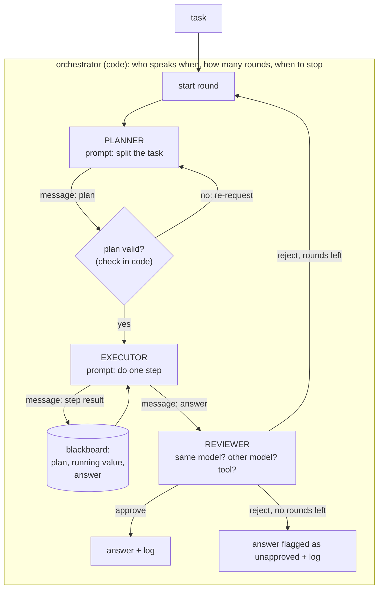

# Module 19 — Multi-agent collaboration

**Part V · Reasoning, Tools and Agents** | Tier A | Study time: 5–6 hours

> Several model instances with different instructions, exchanging messages under the
> control of an orchestrator: planner, executor, reviewer. The arrangement is easy to
> build and easy to overestimate. This module builds it with every message logged,
> compares it with a single agent that is given the same budget, and isolates what
> actually produces the gains when there are any: decomposition, verification, and
> independence. Roles by themselves add no information.

## A. Learning objectives

After this module you can:

1. Describe a multi-agent system as roles, messages, shared state and an orchestration policy, all of them explicit code and data.
2. Implement a planner–executor–reviewer protocol with typed messages, a blackboard, round limits and a log.
3. Compare a team with single-agent baselines at equal cost, and say which baseline is the fair one.
4. Explain why a reviewer that shares the solver's model shares its blind spots, and measure the difference an independent check makes.
5. Identify the failure modes specific to teams: error propagation, false approval, cost growth, loops between agents.
6. Decide when multiple agents are justified and when a single loop or a fixed workflow is better.

## B. Prerequisites

- [Module 17](../17-reasoning/lesson.md) (decomposition, verification, systematic errors, equal-cost comparison), [Module 18](../18-agentic-loop/lesson.md) (the loop, budgets, outcomes).

## C. Motivation and intuition

Human organisations divide work: someone plans, others carry out, someone checks. The
division helps humans for reasons that need examining before they are transferred to
models:

| Why division of labour helps people | Does it transfer to copies of one model? |
|---|---|
| Different people know different things | **No**, unless the agents have different models, tools or information |
| A second person does not share the first one's blind spots | **No** for the same model with a different prompt; yes for a different model or a tool |
| Limited attention: a focused task is done better | **Partly**: a short, focused context can help a model (Module 18 D.6) |
| Parallel work finishes sooner | **Yes** for wall-clock time when sub-tasks are independent; cost in tokens is unchanged or higher |
| Separation of duties limits what one actor can do | **Yes**: roles with different permissions are a real safety tool |

So the questions to ask of any multi-agent design are: *where does new information or
independence enter*, and *what does a single agent with the same budget achieve*?

## D. Rigorous technical explanation

### D.1 The parts



| Part | Definition | In the course code ([`mlle/agents/multi.py`](../../mlle/agents/multi.py)) |
|---|---|---|
| Role | a prompt (and possibly a model, tools and permissions of its own) | `PLAN:`, `STEP:`, `CHECK:` prompts |
| Message | a typed record from one role to another | `Message(sender, recipient, kind, content)` |
| Shared state | data all roles can read: the plan, intermediate results | `TeamRun.blackboard` |
| Orchestration | the control flow connecting roles | `run_team`: plan → execute → review, up to `max_rounds` |
| Log | every message, in order | `TeamRun.messages` |

A role is not an entity with memory or intentions. It is a function call with a
particular prompt. "The planner tells the executor" means: the orchestrator takes the
output of one call and places it in the prompt of the next. Seen this way, **a team of
roles played by one model is a single-agent workflow written with more names.** That is
not a criticism (workflows are useful), but it removes any expectation that the team
"knows more" than the model does.

Common orchestration patterns:

| Pattern | Flow | Typical use |
|---|---|---|
| Pipeline | A → B → C, fixed | decompose, execute, format |
| Planner–executor–reviewer | plan, do steps, check, repeat | multi-step tasks with a checkable result |
| Orchestrator–workers | one agent delegates sub-tasks, possibly in parallel, and merges | independent sub-tasks; large contexts split |
| Debate / critique | two agents argue, a judge decides | subjective quality; weak evidence of benefit when all are one model |
| Blackboard | agents read and write a shared store | loosely coupled contributions |

### D.2 One run, read message by message

From the lab (`python labs/agents/19_multi_agent.py`), with a deliberately unreliable
executor:

```text
problem: 21-25-27*2-26   (truth: -88)
planner   -> executor     [plan       ] 21-25;-27;*2;-26
executor  -> blackboard   [step_result] 21-25 = -4
executor  -> blackboard   [step_result] -4-27 = -30        <- wrong (-31)
executor  -> blackboard   [step_result] -30*2 = -60
executor  -> blackboard   [step_result] -60-26 = -86
executor  -> reviewer     [answer     ] -86
reviewer  -> orchestrator [review     ] approve            <- wrong
answer -86 after 1 round(s), 6 model calls
```

Two things went wrong and the system reported success. An early error **propagated**:
every later step was computed correctly from a wrong value. The reviewer **approved** a
wrong answer. The log is the only reason either is visible. A multi-agent system without
a complete message log cannot be debugged.

### D.3 Experiment: a team against the same budget

All roles are played by the simulated solver of Module 17 (assumed error rates: 5 % per
single step, 15 % per operation when a chain is solved at once, 10 % wrong reviews).
**The numbers follow from those assumptions; they show how organisation and cost relate,
not how any real model behaves.** 400 problems per row.

| System | 4 operations: accuracy | calls | 8 operations: accuracy | calls |
|---|---:|---:|---:|---:|
| single agent, one call | 0.525 | 1.0 | 0.270 | 1.0 |
| team: planner + executor + reviewer (same model) | 0.940 | 8.5 | 0.915 | 15.3 |
| team with an exact tool as reviewer | 0.990 | 6.4 | 0.983 | 13.2 |
| single agent, majority vote with the same number of calls | 0.892 | 8.0 | 0.608 | 15.0 |

- Against one call, the team looks spectacular. That comparison is unfair: the team
  spends 8–15 times as much.
- Against voting at equal cost the team still wins, clearly so on long problems.
  **Why?** Not because there are three roles. The team's workflow *decomposes* the
  problem into single steps (which this solver does more reliably) and *verifies* the
  result. A single agent running "decompose, then check, then retry" performs the
  identical calls. The gain belongs to the workflow.
- Replacing the model reviewer by an exact tool is both more accurate and cheaper.

The fair baselines for any multi-agent claim are therefore (a) a single agent at equal
cost and (b) a single agent running the same workflow. If (b) matches the team, the
"agents" are a naming convention.

### D.4 What a reviewer is worth

Six operations, up to three rounds:

| Reviewer | accuracy | calls |
|---|---:|---:|
| none (accept the first answer) | 0.735 | 7.0 |
| the same model, 10 % wrong reviews | 0.938 | 11.7 |
| the same model, 30 % wrong reviews | 0.825 | 13.6 |
| an exact tool | 0.983 | 9.4 |

Review pays when the reviewer is good, and costs calls either way. A careless reviewer
is more expensive than a careful one (it rejects correct work, causing extra rounds) and
less accurate.

### D.5 Shared blind spots

Now the solver's errors are half *systematic* (Module 17 D.5): for some problems it
gives the same wrong answer whenever asked. One solver answers; a reviewer approves or
sends the problem back, up to three attempts.

| Reviewer | accuracy | calls | wrong answers **approved** |
|---|---:|---:|---:|
| the same model as the solver | 0.545 | 2.9 | 0.370 |
| an independent model | 0.552 | 4.0 | 0.062 |
| an exact tool | 0.595 | 2.1 | 0.000 |

Accuracy hardly differs: re-asking a solver with a systematic error returns the same
error, whoever rejects it. The last column is the point. A reviewer with the same
weights makes the same mistake when it re-derives the answer, so it **approves 37 % of
all problems wrongly**; the system reports them as verified. The independent reviewer
approves 6 %; the tool none. With an independent check, the system at least *knows*
which answers lack approval and can escalate them.

Asking a model to check its own work in a second role is weak verification. It catches
random slips. It does not catch what the model consistently gets wrong, and it adds a
false sense of assurance. Independence comes from a different model, different
information, a tool, or a person.

### D.6 Validate messages in code

A planner that garbles one step in 20 % of its plans, with an exact tool as reviewer:

| | accuracy | calls |
|---|---:|---:|
| plan used as received | 0.943 | 10.7 |
| plan validated by code and re-requested if wrong | 0.990 | 9.5 |

Here a plan is valid if its steps, concatenated, reproduce the problem: a one-line
check. Validation at the boundary is more accurate *and* cheaper, because a bad plan is
caught before a whole round of execution and review is spent on it. Wherever a message
has a checkable structure (a schema, a consistency condition, references that must
exist), check it in code before another agent acts on it.

### D.7 Failure modes specific to teams

| Failure | Mechanism | Mitigation |
|---|---|---|
| Error propagation | downstream roles trust upstream output | validate messages; let the reviewer see the original task, not only the answer |
| False approval | reviewer shares the blind spot, or is persuaded by a confident message | independent reviewer; exact checks; measure the approval error rate |
| Cost explosion | every role and round multiplies calls and context | budgets per task; compare at equal cost |
| Ping-pong | reviewer and executor alternate without progress | round limits; detect repeated states (Module 18) |
| Diffused responsibility | no role owns the success test | the orchestrator owns it, in code |
| Injection between agents | one agent's output is another's input: a compromised or fooled agent can instruct the next | treat inter-agent messages as untrusted data (Module 16); per-role permissions |
| Lost context | each role sees only its slice and lacks a fact another role had | deliberate design of what each message carries; a shared blackboard |

The security row deserves emphasis: in a team, the trust boundary of Module 16 runs
*between the agents* too. A role that reads untrusted content should not be able to
direct a role that holds dangerous permissions.

### D.8 When are several agents justified?

Use the simplest structure that works: a single call, then a fixed workflow, then a
single loop, and several agents only when one of these holds:

- **Independent information or models**: a reviewer on a different model, or with tools
  and data the solver lacks.
- **Parallelism**: independent sub-tasks whose results are merged, where wall-clock
  time matters.
- **Context limits**: the task does not fit one context; sub-agents work on parts and
  return summaries (at the risk of the "lost context" failure).
- **Separation of privileges**: the component that reads untrusted input is not the one
  that can act.

And always report the comparison with a single agent at the same cost.

## E. Minimal implementation

[`mlle/agents/multi.py`](../../mlle/agents/multi.py), the round structure:

```python
for round_no in range(1, max_rounds + 1):
    plan = planner.complete(f"PLAN: {problem}", ...)                       # role 1
    run.messages.append(Message("planner", "executor", "plan", plan))
    value = None
    for step in plan.split(";"):                                           # role 2, step by step
        expr = step if value is None else f"{value}{step}"
        value = executor.complete(f"STEP: {expr}", ...)
        run.messages.append(Message("executor", "blackboard", "step_result", f"{expr} = {value}"))
    if tool_review:   approved = tool_checker(problem, value)              # role 3: a tool ...
    elif reviewer:    approved = reviewer.complete(f"CHECK: {problem}={value}") == "yes"   # ... or a model
    run.messages.append(Message("reviewer", "orchestrator", "review", "approve" if approved else "reject"))
    if approved:
        break
```

and the message check:

```python
def plan_is_valid(problem, plan):
    return "".join(plan.split(";")).replace(" ", "") == problem.replace(" ", "")
```

> **Predict before you run** `python labs/agents/19_multi_agent.py`: the team spends
> about eight calls on a four-operation problem. A single agent spends eight calls on
> majority voting. Which is more accurate, and what is the reason?

## F. nanochat code walkthrough

nanochat has no multi-agent code, and this module does not pretend otherwise. Two
connections are worth making.

**How nanochat itself is developed.** The repository's history records an
"autoresearch" workflow in which an AI coding agent proposed and ran training
experiments on the code base, by the commit message's account autonomously for about two
days (commits `6ed7d1d` and `a825e63`, discussed in Module 20). That is a
planner–executor–reviewer arrangement in which the *reviewer is a measurement*: the
validation loss of a training run. It works to the extent that the check is exact and
independent of the proposer, which is this module's conclusion.

**Where a team would attach.** Every role in this module is a call to
`llm.complete(prompt)`. A nanochat model served through `Engine.generate` can play any
role through that interface (Module 18, Exercise 5 shows the adapter pattern with an
OpenAI-compatible server). Roles that need *independence* would require a second,
different model: two checkpoints of the same nanochat run share their blind spots as
surely as two prompts to one checkpoint.

**What nanochat does not have:** roles, message passing, orchestration. All of it here is
a course extension, and all of the measurements use a simulated solver.

## M. Key takeaways

1. A multi-agent system is roles (prompts), messages, shared state and an orchestrator. A team of roles on one model is a single-agent workflow with more names.
2. Compare with a single agent at equal cost, and with a single agent running the same workflow. Gains usually come from decomposition and verification, not from the number of agents.
3. Roles create no information. Independence does: a different model, a tool, different data, a human.
4. A same-model reviewer shares the solver's blind spots: it approved 37 % of problems wrongly where an independent reviewer approved 6 % and a tool none. Its approval is weak evidence.
5. Validate messages in code at every boundary: more accurate and cheaper than letting errors propagate.
6. Teams add failure modes: propagation, false approval, cost growth, ping-pong, injection between agents. The message log is indispensable.
7. Justifications for several agents: independence, parallelism, context limits, separation of privileges.

**Where this sits in the full system:** Module 20 turns the planner–executor–reviewer
pattern on the model-building process itself: an agent that proposes experiments, with
measurement as the reviewer.

Next: [lab](lab.md) · [quiz](quiz.md) · [references](references.md) · then [Module 20 — Self-improvement and autonomous experimentation](../20-self-improvement/lesson.md)
