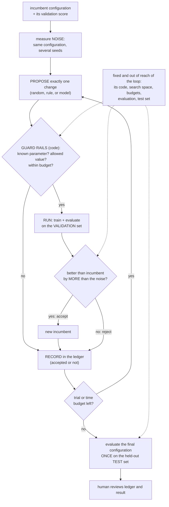

# Module 20 — Self-improvement and autonomous experimentation

**Part V · Reasoning, Tools and Agents** | Tier A–B | Study time: 5–6 hours

> "A system that improves itself" can mean four quite different things, from retrying
> an answer to changing the weights or the code that produced it. This module separates
> them, builds the one that is both useful and controllable today (a bounded loop that
> runs experiments and keeps what measurably helps), and shows with real training runs
> why such a loop needs a noise threshold, a held-out test, a ledger and limits that it
> cannot change itself. The primary source for the practice is nanochat's own
> development history.

## A. Learning objectives

After this module you can:

1. Distinguish improving an answer, a workflow, the weights, and the research process, and say what each needs as its measure of improvement.
2. Implement a bounded experiment loop: propose, guard, run, decide against measured noise, record.
3. Explain and demonstrate how adaptive search overfits a validation metric, and how thresholds and a single-use test set limit it.
4. State which parts of an improvement loop must be outside the loop's own reach, and why.
5. Read an automated-research result critically: what was the metric, who checked it, what was recorded.
6. Give a precise account of what "recursive self-improvement" would require beyond what is shown here.

## B. Prerequisites

- [Module 10](../10-evaluation-and-generation/lesson.md) (seed variance, uncertainty), [Module 15](../15-rl-and-preferences/lesson.md) (an optimiser raises the number it is given), [Module 18](../18-agentic-loop/lesson.md) and [Module 19](../19-multi-agent/lesson.md) (loops, budgets, independent review).

## C. Motivation and intuition

| Level | What changes | Measure of improvement | Covered in |
|---|---|---|---|
| 1. An answer | the output, by retrying, verifying, voting | a check on that answer | Module 17 |
| 2. A workflow | prompts, hyperparameters, configurations, tool choices | a metric on a validation set | **this module's lab** |
| 3. The weights | the model, by training on rewards or on its own filtered outputs | an evaluation the training did not see | Module 15; D.6 here |
| 4. The process | the code and research decisions that produce models | results of experiments, reviewed | D.7 here (nanochat) |

Each level is an optimisation loop, and Module 15's warning applies at every one: the
loop will raise whatever number it is given. The quality of a self-improving system is
therefore the quality of its *measurement* and of the *limits* around it. Stated
negatively: a system that can change its own evaluation, budget or permissions is not
being improved by the loop; it is being steered by whatever the loop happens to favour.

## D. Rigorous technical explanation

### D.1 The bounded experiment loop



The proposer may be random, a rule, or a model: it is the *only* place where
intelligence helps, and the only component that needs no trust, because everything it
proposes passes through code it cannot alter.

### D.2 Why a noise threshold

Module 10 measured that the same configuration trained with different seeds gives
different scores. A loop that accepts every apparent improvement will accept noise, and
because it keeps the best of many noisy draws, its validation score will *climb* without
anything real improving. The loop therefore starts by measuring the spread across seeds
and accepts a change only if the gain exceeds it.

### D.3 Experiment: a recipe improved by a bounded loop

`python labs/agents/20_experiment_loop.py`: every trial trains a small MiniGPT on Pocket
for 150 steps (real training runs, 71 in total, about 90 seconds on CPU). Score = minus
the validation loss.

Noise of the starting configuration over five seeds: **0.0187** nats/char. Ledger of the
loop (random proposer, 14 trials, one change each):

```text
trial  1: warmup: 0 -> 20      | val -2.7127 | reject (no improvement beyond noise)
trial  2: lr: 0.0003 -> 0.01   | val -0.6251 | ACCEPT
trial  3: warmup: 0 -> 20      | val -0.6018 | ACCEPT
trial  4: n_layer: 1 -> 2      | val -0.5060 | ACCEPT
trial  5: n_layer: 2 -> 1      | val -0.6018 | reject
trial  6: n_embd: 32 -> 64     | val -0.4293 | ACCEPT
trial  7..14                   |             | reject (eight proposals, none beyond noise)
final: lr 0.01, n_embd 64, n_layer 2, warmup 20 | val -0.4293 | test (once) -0.4205
test score of the starting configuration: -2.6390
```

Observations:

1. **It works.** Four accepted changes take the loss from 2.64 to 0.42 on the test set,
   which the loop never consulted.
2. **Order and interaction matter.** Warm-up was rejected at trial 1 and accepted at
   trial 3, after the learning rate had changed. And at the *final* configuration,
   trial 11 shows that removing warm-up changes the score by 0.0001: it was worth 0.023
   when accepted and is worth nothing now. One change at a time is a greedy search
   through a space with interactions; the ledger is what lets a human see this.
3. **Most trials are rejections**, several of them repeats (a random proposer does not
   remember). A proposer that reads the history would waste fewer runs. That is where a
   model can help, and it is an efficiency gain, not a change in what is trustworthy.
4. **Rejected trials are results.** "Halving the width from 64 to 32 costs 0.08" is
   knowledge. A loop that logs only successes discards most of what it paid for.

### D.4 Experiment: searching in noise

The same loop is pointed at a parameter that *cannot* matter: `reseed`, which only
changes the random seed of a run. Twenty trials from the configuration found above:

| Acceptance rule | accepted | validation gain | test gain |
|---|---:|---:|---:|
| accept any improvement (threshold 0) | 2 | +0.0053 | −0.0058 |
| accept only gains above the noise (0.0187) | 0 | 0 | 0 |

Without a threshold the loop "found" two improvements and reported a better validation
score. On the test set the chosen configuration is slightly *worse*. Every accepted
change here is noise by construction; the validation gain is the selection effect
("the best of many draws") and nothing else. With the threshold, nothing was accepted.

**The incumbent is itself a selected number.** Re-training the configuration chosen in
D.3 with twenty other seeds gives validation scores from −0.4476 to −0.4240, mean
−0.4374. The score the loop recorded for it, −0.4293, is better than 17 of those 20: the
loop kept this configuration at a moment when it had drawn a favourable seed. Reported
scores of selected configurations are optimistic by construction ("winner's curse");
the unbiased figure is the test score, or a re-run with fresh seeds.

The numbers are small because twenty trials are few. The effect grows with the number of
trials: an automated loop that runs thousands of experiments against one validation set
can accumulate large apparent gains that are partly or wholly selection. This is the
same phenomenon as tuning on the test set (Module 10), reached by a machine instead of a
person. Defences, in order of importance:

- a **held-out test** used once, at the end, by code the loop cannot call;
- a **noise threshold**, re-estimated near the incumbent (here the spread over five
  seeds is 0.0196 at the final configuration, against 0.0187 at the start);
- **replication** of accepted changes with fresh seeds before they are kept;
- **fresh validation data** from time to time, where data are plentiful.

### D.5 Guard rails

A proposer (here a scripted stand-in for a model) asks for things outside its search
space:

```text
trial 1: steps: None -> 100000     | reject (rejected by guard rails)
trial 2: eval_set: None -> train   | reject (rejected by guard rails)
trial 3: lr: 0.0003 -> 0.5         | reject (rejected by guard rails)
trial 4: n_embd: 32 -> 48          | val -2.3296 | ACCEPT
trial 5: max_trials: None -> 1000  | reject (rejected by guard rails)
```

More compute, evaluation on the training set, an extreme value, a larger budget for
itself: each would raise the score or prolong the loop, and none is a legitimate change
to the recipe. The loop validates every proposal against a fixed space (Module 16's
schema check) and the budget and evaluation are not parameters at all. Note that the
proposals are not malicious. An optimiser asked to improve a number will propose
whatever improves the number; "evaluate on the training set" is simply effective. The
constraint has to be structural.

What must be outside the loop's reach:

| Fixed element | If the loop could change it |
|---|---|
| The evaluation code and data | it would learn to pass the evaluation, not to be better (Module 15 D.6) |
| The test set | the final number would be a selected one |
| Budgets (trials, time, compute) | no termination guarantee; unbounded cost |
| The search space and permissions | "improvements" outside what was reviewed |
| The loop's own code and ledger | no audit trail; no guarantee that any of the above still holds |

### D.6 Improving the weights (conceptual)

Training a model on signals derived from its own behaviour is level 3: reinforcement
learning from a reward (Module 15), training on its own outputs filtered by a checker
(self-distillation, synthetic data), or generating problems for itself. The same two
conditions decide whether it helps: an **independent, exact filter** (verified answers,
passing tests, a game result) and an **evaluation outside the loop**. With a weak filter
the model is trained towards its own mistakes and the errors compound over generations;
with an exact one (self-play in games is the classic case) the loop can exceed its
starting point. For language tasks exact filters exist for narrow domains (mathematics
with a checker, code with tests) and that is where this approach is strongest.

### D.7 Improving the process: nanochat's "autoresearch" (primary source)

nanochat's history contains two commits produced by an automated experiment workflow.
Their messages are the primary source; the numbers below are **reported upstream for an
8×H100 node** and say nothing about other hardware.

| Commit | Date | Reported content |
|---|---|---|
| `6ed7d1d` | 2026-03-09 | About two days of autonomous experimentation by an AI coding agent ("I didn't touch anything", per the commit message), tuned on depth 12 and reported to carry over to larger models. Changes: learning rates, betas and weight decay per parameter group, warm-up and warm-down schedules, initialisation scales, RoPE base 10 000 → 100 000, logit soft-cap 20 → 15, a post-QK-norm scale. |
| `a825e63` | 2026-03-14 | "Autoresearch round 2": two architectural additions (smear, backout: Module 06) and further hyperparameter tuning. |

Leaderboard entries in the README at the pinned revision ("time to GPT-2": wall-clock
time to exceed GPT-2's CORE score):

| Entry | time | validation bpb | CORE |
|---|---:|---:|---:|
| before (dataset change, `324e69c`) | 2.02 h | 0.71854 | 0.2571 |
| autoresearch round 1 (`6ed7d1d`) | 1.80 h | 0.71808 | 0.2690 |
| autoresearch round 2 (`a825e63`) | 1.65 h | 0.71800 | 0.2626 |

Read with this module's questions:

- **The metric is exact and external**: a validation loss and a benchmark score computed
  by fixed scripts on held-out data, at fixed compute. That is what makes the search
  meaningful.
- **Most changes are level 2** (hyperparameters), found by many short runs: exactly the
  loop of D.1 at larger scale. Two are small architectural ideas.
- **The search ran on a small proxy** (depth 12) and the result was then checked on the
  target scale: transfer was tested, not assumed.
- **A human merged the result** and published the list of changes: the review step of
  D.1.
- **Selection applies here too.** Many experiments were run against one validation
  metric; the reported gains in validation bpb between entries are in the fourth
  decimal. The headline quantity is training *time* to a threshold, which is less
  sensitive to this, and the CORE column is not monotonic (0.2690, then 0.2626). A
  careful reader treats small differences between adjacent entries as within noise
  until replicated.
- **Negative results are kept.** `dev/LOG.md` records experiments that did not help
  (for example a mixture-of-experts variant, 2026-02-19, and a normalisation
  alternative, 2026-05-05): a ledger in prose.

What this is: automated search over a recipe, with human-defined objective, budget and
review. What it is not: a system rewriting its own objective or acquiring resources. The
distinction is the table in D.5.

### D.8 "Recursive self-improvement", precisely

The phrase suggests a loop in which each improvement makes the system better at
improving. For that, the *proposer* would have to become more capable as a result of the
loop's own output, across generations, without the measurement degrading. Each of the
levels above has a bottleneck that such a loop meets: experiments cost compute and time
that the loop does not create; evaluations saturate or are overfitted (D.4); filters for
self-generated training data are exact only in narrow domains (D.6); and proxies must
transfer (D.7). None of this is a proof of impossibility. It is the list of things to
examine in any claim. The engineering position of this course: build loops whose
measurement, budget and permissions are fixed from outside, and widen them only by
deliberate human decision.

## E. Minimal implementation

[`mlle/agents/experiment.py`](../../mlle/agents/experiment.py), the core of the loop:

```python
noise = estimate_noise(objective, config)                 # spread across seeds
incumbent, incumbent_val = dict(config), objective(config, seed)["val"]
for i in range(1, max_trials + 1):
    if time.perf_counter() - t_start > max_seconds:
        result.stopped = "time_budget"; break
    name, new = proposer(incumbent, result.trials, rng)   # random, rule or model
    if name not in space or new not in space[name] or new == incumbent.get(name):
        record(Trial(..., passed_tests=False, note="rejected by guard rails")); continue
    candidate = {**incumbent, name: new}
    val = objective(candidate, seed)["val"]               # validation only
    accepted = val > incumbent_val + noise
    if accepted:
        incumbent, incumbent_val = candidate, val
    record(Trial(...))                                    # accepted or not, to the ledger
result.test_score = objective(incumbent, seed + 9999)["test"]   # the ONLY use of the test set
```

The objective receives a configuration and returns scores. It has no access to the
loop, and the loop exposes no parameter for its own budget or evaluation.

> **Predict before you run** `python labs/agents/20_experiment_loop.py`: twenty trials
> on a parameter that only changes the random seed, accepting any improvement. How many
> are accepted? What happens to the validation score, and to the test score?

## F. nanochat code walkthrough

There is no experiment-loop code in nanochat at the pinned revision: the autoresearch
tooling is not part of the repository. What the repository contains is its *output* and
the infrastructure that made automated search possible. Reading it for that purpose:

- **A single-number objective computed by fixed code**: `evaluate_bpb`
  ([`nanochat/loss_eval.py`](https://github.com/karpathy/nanochat/blob/92d63d4e8bb4df75c3b71618f31ddde2378b2bcd/nanochat/loss_eval.py))
  on the held-out last shard, and CORE (`scripts/base_eval.py`). Module 10 covered both.
- **Runs sized by a budget, not by steps**: `--target-param-data-ratio`,
  `--target-flops` and `--num-iterations` in `scripts/base_train.py` (Module 09) let two
  recipes be compared at equal compute, which is the equal-cost rule of Modules 17 and
  19 applied to training.
- **Every knob is a command-line argument** with a default, so a proposal is a list of
  flags and a run is reproducible from its command line.
- **Scripted sweeps**:
  [`runs/scaling_laws.sh`](https://github.com/karpathy/nanochat/blob/92d63d4e8bb4df75c3b71618f31ddde2378b2bcd/runs/scaling_laws.sh)
  and
  [`runs/miniseries.sh`](https://github.com/karpathy/nanochat/blob/92d63d4e8bb4df75c3b71618f31ddde2378b2bcd/runs/miniseries.sh)
  loop over depths and budgets and collect results into a table: a non-adaptive
  experiment loop.
- **The record**: the leaderboard table in the README and the dated entries of
  `dev/LOG.md`, including negative ones.

To run this module's loop on nanochat itself, the objective becomes "launch
`scripts.base_train` with these flags for a fixed budget, parse validation bpb from the
log" (`scripts/experiments/parse_train_log.py` does the parsing). On a DGX Spark, size
each trial with `make spark-probe` first: with trials of ten minutes, a twenty-trial
loop is an overnight job, and D.4 applies to it in full. *Not run by the author on GPU
hardware; no results are claimed.*

## M. Key takeaways

1. "Self-improvement" has levels: an answer, a workflow, the weights, the process. Each is an optimisation loop and needs a measure the loop cannot influence.
2. A bounded experiment loop is propose → guard → run → decide against noise → record, with a single-use test at the end and a human reading the ledger.
3. Adaptive search overfits its validation metric: an unguarded loop accepted pure noise and its test score fell. Thresholds, replication and a held-out test are requirements, not refinements.
4. The proposer needs no trust if everything it proposes passes through fixed checks. Evaluation, test set, budgets, search space and the loop's own code must be out of its reach.
5. Rejected trials are results; keep the ledger.
6. nanochat's autoresearch commits are automated search over a recipe with an exact external metric, a small proxy validated at scale, and human review: effective, and bounded in exactly these ways.
7. Claims of recursive self-improvement should be examined at their bottlenecks: compute, evaluation integrity, filters for self-generated data, and transfer.

**Where this sits in the full system:** this closes Part V. Part VI assembles every
stage of the course into one system and looks at what lies beyond the baseline. Before
continuing, complete [Milestone 5](../../instructor/assessments.md#milestone-5).

Next: [lab](lab.md) · [quiz](quiz.md) · [references](references.md) · then [Module 21 — Putting the full system together](../21-full-system/lesson.md)
