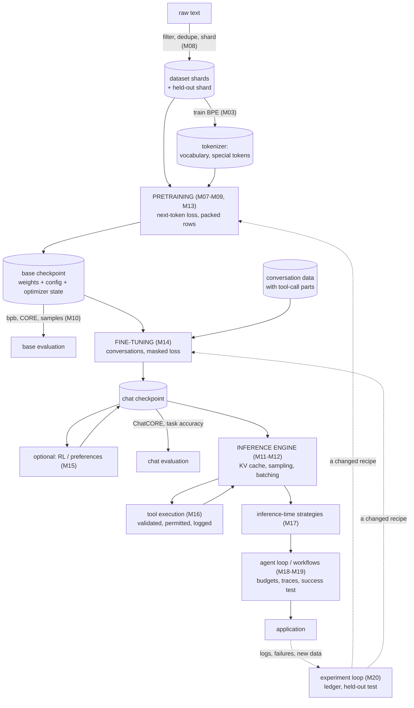

# Module 21 — Putting the full system together

**Part VI · Integration, Limitations and the Research Frontier** | Tier A | Study time: 4–5 hours

> Twenty modules examined one stage each. This one puts them in order, names the
> artefact that passes from each stage to the next, and asks the questions that only
> arise for the whole: where does the time go, what must be recorded for a result to be
> repeatable, how do you see what a running system is doing, and where do errors made in
> one stage surface in another. It then runs the entire chain, in miniature, in under a
> minute, and reads nanochat's own pipeline script as the full-scale version.

## A. Learning objectives

After this module you can:

1. Draw the complete life cycle of a language-model system and name the artefact and the interface between each pair of stages.
2. Locate the bottleneck of a pipeline by measurement, and say which resource limits each stage.
3. Specify what must be recorded for a run to be reproducible, and distinguish reproducible from replicable.
4. Design observability for training, serving and agent loops: what to log, at what granularity.
5. Trace a failure seen at the end of the pipeline back to the stage that caused it.
6. Read nanochat's `runs/speedrun.sh` as a pipeline specification and adapt it to different hardware.

## B. Prerequisites

All earlier parts. This module introduces no new mechanism.

## C. Motivation and intuition

A system is more than its stages, in two ways. **Interfaces**: each stage consumes an
artefact produced by an earlier one, and silently depends on properties of it (a
tokenizer's vocabulary, a chat template, a context length). When stages disagree, the
result is rarely an error message; it is a model that is quietly worse. **Totals**: the
cost and reliability that matter are those of the whole chain, and the stage you
optimised is often not the one that dominates.

## D. Rigorous technical explanation

### D.1 The life cycle, with artefacts



| Artefact | Produced by | Consumed by | Silent failure if mismatched |
|---|---|---|---|
| Dataset shards + held-out shard | data preparation | tokenizer training, pretraining, evaluation | evaluation text leaked into training: optimistic bpb (Module 08) |
| Tokenizer | tokenizer training | *every* later stage | a different vocabulary or special-token id at inference: fluent nonsense, no error |
| Base checkpoint (weights, model config, optimizer state) | pretraining | fine-tuning, base evaluation | wrong config (window pattern, sequence length): degraded quality or slow kernels (Module 12) |
| Conversation data and chat template | data curation | fine-tuning, and the *application's renderer* | template at inference differs from training: the model sees a format it was not trained on (Module 14) |
| Chat checkpoint | fine-tuning | engine, evaluation, RL | evaluating without the tools it was trained with: 0 % (Module 16) |
| Tool definitions and permissions | application | engine, agent loop | a tool that behaves differently from training data: confidently wrong answers |
| Traces, ledgers, manifests | every stage | people, and the experiment loop | missing: failures cannot be attributed |

The tokenizer and the chat template are the two artefacts that every stage must share
exactly. Most "the model got worse after deployment" stories are a mismatch in one of
them.

### D.2 Where the time goes

Measured with `python labs/integration/21_end_to_end.py` on the course's miniature
system (CPU, 4 cores; the base model was already cached, its training takes about 45 s):

| Stage | seconds | key metric |
|---|---:|---|
| data + tokenizer + pretraining (cached) | 0.2 (≈ 45 when not cached) | 439 288 training tokens, 231 744 parameters |
| base evaluation | 1.0 | Pocket loss 0.4034; raw completion accuracy 0.755 |
| fine-tuning with tool format, 600 steps | 40.4 | loss 4.76 → 0.46; 39 % of positions supervised |
| serving + evaluation | 7.7 | accuracy 1.000 with the tool, 0.000 without; 1 149 decode tokens/s; 11 ms per answer |
| agent loop (search policy) | < 0.1 | 5 of 5 episodes succeed, 5.4 steps on average |

Which stage dominates depends entirely on scale, and the miniature inverts the real
proportions: here fine-tuning is the longest stage; in nanochat's reference run
pretraining is nearly all of it and fine-tuning a small fraction. The lesson is not the
ranking but the habit: *time every stage, every run*, and optimise the one that the
measurement names. The resource that binds differs by stage:

| Stage | Bound by | Module |
|---|---|---|
| Tokenizer training, data loading | CPU, disk and network | 03, 08, 13 |
| Pretraining, fine-tuning | arithmetic throughput and training memory | 09, 13 |
| Prefill | arithmetic throughput | 11 |
| Decode | memory bandwidth, cache memory | 11, 12 |
| RL, voting, agents | decode throughput × number of samples or steps | 15, 17, 18 |
| Tools | the tool: network, sandbox start-up, the external system | 16 |
| Experiment loops | everything above × number of trials | 20 |

### D.3 Reproducibility

Two runs of the lab with the same seed agreed on **every** metric except the two
timings (decode tokens per second 1 149 versus 1 272). That is the target: results
identical, timings merely similar. What it took:

| Recorded | Why |
|---|---|
| Seeds for data generation, initialisation, batch order, sampling | the stochastic choices |
| A hash of the training tokens (`data_sha256_16`) | "the same data" is otherwise an assumption |
| Model and training configuration, in full | defaults change between versions |
| Code revision (course commit, pinned nanochat SHA) | the recipe is code |
| Software and hardware environment | kernels and precision differ |
| Every metric with its stage and settings | so that two manifests can be diffed |

Terms: a result is **reproducible** if the same code, data and seed give the same
numbers; **replicable** if a new seed (or new data from the same source) gives numbers
that agree within the measured noise. The first is an engineering property and can be
tested automatically, as above. The second is the scientific one and needs several seeds
(Module 10). On GPUs, bitwise reproducibility is often not attainable (non-deterministic
kernels, compiled versus eager code: Module 13 measured a different loss trajectory from
the same seed), so the practical standard is: reproducible within a stated tolerance,
replicable across seeds.

### D.4 Observability

What to record while a system runs, by layer:

| Layer | Record | Granularity | Answers the question |
|---|---|---|---|
| Training | loss (train, validation), learning rates, tokens/s, memory, gradient norm | per step or every $n$ steps | is it learning, is it healthy, when will it finish? |
| Evaluation | every metric with its sample size and seed | per checkpoint | did it get better, beyond noise? |
| Serving | TTFT, TPOT, tokens/s, cache memory, queue length, errors | per request and aggregated | is it fast enough, where is the time? |
| Generation | prompt as rendered (token ids), sampled versus forced tokens, stop reason | per request (sampled) | what did the model actually see and produce? |
| Tools | call, arguments, validation result, permission decision, result, duration | per call | what was done on whose authority? |
| Agent | the trace: state, proposal, validation, action, observation, outcome label | per step | why did the episode end as it did? |
| Experiments | the ledger: proposal, guard result, score, decision | per trial | what was tried, and how many times? |

Two rules. **Log the rendered prompt, not the request**: the string a user typed is not
what the model saw; the token sequence is (template, special tokens, truncation). And
**every stop has a reason**: `max_tokens`, end token, budget, error. Aggregates tell you
*that* something is wrong; traces tell you *what*.

### D.5 Errors travel

A symptom at the end, and the stages worth checking, in the order of the course:

| Symptom at the application | Candidate causes upstream |
|---|---|
| Fluent, off-topic or garbled answers | tokenizer or template mismatch (D.1); wrong checkpoint/config pairing |
| Never stops, or stops at once | end token not supervised in fine-tuning (Module 14); stop condition in the engine |
| Right format, wrong facts | knowledge absent from pretraining; no retrieval or tool; decoding too random (Module 10) |
| Good in evaluation, poor in use | evaluation data too close to training data; prompts in use differ from evaluation prompts |
| Calls the tool, wrong answers | request miscopied outside the trained range (Module 16); tool behaves differently from training |
| Good first turns, then degradation | context beyond the trained length; state lost by truncation (Module 18) |
| Agent "succeeds" but the task is not done | success judged by the model, not by code (Module 18) |
| Slow | measure first (D.2): prefill of an ever-growing conversation, cache traffic, a tool, or the wrong attention kernel |
| Improvement that vanishes on new data | selection on the validation set (Module 20); reward hacking (Module 15) |

The discipline is the one used throughout: reproduce the symptom on the smallest input,
then test one stage at a time against its own invariant (does the tokenizer round-trip;
does cached equal uncached; does the rendered prompt match the training format; does the
tool return what it returned in training).

### D.6 What changes at scale

The miniature has every stage and none of the difficulties of size. A production system
adds: data pipelines that are themselves large software; distributed training and its
failure recovery (checkpoint/resume); evaluation suites with many tasks and
contamination control; serving with batching, caching, autoscaling and admission
control; safety layers (input and output filtering, permissioning, human review);
monitoring and incident response; and governance of data, models and changes. None of
these alters the mechanisms of Parts I–V. They are what it costs to run those mechanisms
reliably for many users, and each is an engineering discipline of its own.

## E. Minimal implementation

The lab's structure is the smallest useful pipeline harness: a function per stage, a
wrapper that times it, catches failure, and appends to a manifest.

```python
def stage(name, fn, **settings):
    t0 = time.perf_counter()
    try:
        metrics, status = fn(), "ok"
    except Exception as e:                       # a failed stage is recorded, and the run stops
        metrics, status = {"error": f"{type(e).__name__}: {e}"}, "failed"
    manifest["stages"].append({"stage": name, "status": status, "seconds": ..., "settings": settings, "metrics": metrics})
    if status != "ok":
        raise SystemExit(f"stage {name} failed; see manifest")
```

with `manifest = {"seed": ..., "environment": environment_report(), "stages": []}`
written as one JSON file. Comparing two runs is then a diff of two files.

> **Predict before you run** `python labs/integration/21_end_to_end.py` twice: which
> numbers in the two manifests will be identical, and which will differ?

## F. nanochat code walkthrough

**The pipeline is a shell script.**
[`runs/speedrun.sh`](https://github.com/karpathy/nanochat/blob/92d63d4e8bb4df75c3b71618f31ddde2378b2bcd/runs/speedrun.sh)
is the complete specification of the reference system. Its stages, in order, map onto
D.1:

```bash
python -m nanochat.dataset -n 8                 # data: first shards (more download in the background)
python -m scripts.tok_train                     # tokenizer: vocabulary 32 768
python -m scripts.tok_eval
torchrun ... -m scripts.base_train -- --depth=24 --target-param-data-ratio=8 --device-batch-size=16 --fp8 --run=$WANDB_RUN
torchrun ... -m scripts.base_eval  -- --device-batch-size=16      # CORE, bpb, samples
torchrun ... -m scripts.chat_sft   -- --run=$WANDB_RUN            # conversations, tool use, multiple choice
torchrun ... -m scripts.chat_eval  -- -i sft                      # ChatCORE
# python -m scripts.chat_cli -p "Why is the sky blue?"            # use it
```

Its header states the hardware it was written for ("a blank 8XH100 GPU node …
approximately 1.5 hours"). Every flag in the `base_train` line is a decision this course
has examined: depth (Module 09), the data-to-parameter ratio (09), device batch size
(13), FP8 (13). `runs/runcpu.sh` is the same pipeline shrunk for a CPU, and the course's
`scripts/experiments/nanochat_local.sh` is a further reduction that needs no network.

**Artefacts and where they live.** Everything is written under `NANOCHAT_BASE_DIR`
(default `~/.cache/nanochat`): data shards, the tokenizer, and one directory of
checkpoints per stage and model tag. A checkpoint is three kinds of file
([`checkpoint_manager.py` L41–L58](https://github.com/karpathy/nanochat/blob/92d63d4e8bb4df75c3b71618f31ddde2378b2bcd/nanochat/checkpoint_manager.py#L41-L58)):

```python
model_path = os.path.join(checkpoint_dir, f"model_{step:06d}.pt")        # weights
meta_path  = os.path.join(checkpoint_dir, f"meta_{step:06d}.json")       # metadata as JSON
optimizer_path = os.path.join(checkpoint_dir, f"optim_{step:06d}_rank{rank:d}.pt")   # per rank
```

The metadata file is nanochat's manifest: it carries the model configuration and the
user configuration of the run, which is how `chat_sft.py` can "inherit" sequence length,
batch sizes and learning rates from the pretraining run (Module 14 F), and how
`load_model` rebuilds the right architecture without being told. The interface between
stages is this file; reading one from your own run is the fastest way to see what a
later stage assumes.

**Observability.** Training scripts print one line per step (loss, learning-rate
multiplier, step time, tokens per second, MFU, epoch, ETA) and optionally mirror the
same quantities to an external experiment tracker (`--run`; the default `dummy` disables
it). The course's `scripts/experiments/parse_train_log.py` turns the printed log into a
table. Inference has its own benchmark with a machine-readable last line (Module 12).

**Reproducibility.** The global seed is fixed in `compute_init`; data order is
deterministic given the shard list and the number of ranks; the dependency versions are
locked in `uv.lock`. What is *not* fixed is the hardware and its kernels, which is why
results are stated per hardware configuration upstream and why this course pins the
revision and labels every number with where it came from.

**On the DGX Spark.** The pipeline runs unchanged in structure; what changes is every
number: one rank instead of eight (so eight times the accumulation steps per optimizer
step, Module 13 D.8), no FP8, `--window-pattern L`, and a depth chosen from a *measured*
tokens-per-second figure ([setup guide](../../docs/dgx-spark-setup.md),
[hardware and costs](../../docs/hardware-and-costs.md)). *The full pipeline was not run
on a DGX Spark by the author; the guide's validation checklist states what remains to be
confirmed.*

## M. Key takeaways

1. A system is stages plus interfaces. The tokenizer and the chat template must be shared exactly by every stage; mismatches fail silently.
2. Time every stage of every run. The bottleneck is found by measurement and moves with scale.
3. Record seeds, data hashes, configurations, code revisions and environment. Same seed should give the same metrics; different seeds should agree within noise.
4. Log what the model actually saw (rendered tokens), what was done on whose authority (tool calls), and why each generation, episode and trial ended.
5. Symptoms appear downstream of their causes. Debug by checking one stage's invariant at a time.
6. nanochat's whole system is one short script and one metadata file per checkpoint. Read both before changing either.

**Where this sits in the full system:** this *is* the full system. Module 22 looks at
what lies outside it.

Next: [lab](lab.md) · [quiz](quiz.md) · [references](references.md) · then [Module 22 — Beyond the baseline Transformer](../22-beyond-the-baseline/lesson.md)
