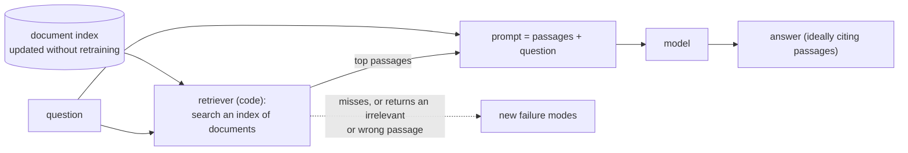

# Module 22 — Beyond the baseline Transformer

**Part VI · Integration, Limitations and the Research Frontier** | Tier A | Study time: 4–5 hours

> The system built in this course is a baseline: one dense Transformer, text only,
> knowledge in its weights and a calculator beside it. Around that baseline lies a large
> and fast-moving set of extensions. This module does not survey them exhaustively,
> which would be out of date on publication. It gives a method for judging any of them,
> applies the method to the most important families, measures one (retrieval) with small
> trained models, and reads two experiments that nanochat's author ran and *rejected*:
> the most instructive kind of evidence there is.

## A. Learning objectives

After this module you can:

1. Apply a fixed set of questions to any proposed improvement: what limit it addresses, what it costs, what the evidence is, at what scale.
2. Explain retrieval-augmented generation, measure what it fixes, and name the failure modes it introduces.
3. Describe mixture-of-experts layers and why a FLOP saving is not a wall-clock saving.
4. Place long-context methods, alternatives to attention, multimodal inputs and distillation relative to the baseline: what changes in the architecture of Part I and what does not.
5. Read a negative result and say what it does and does not establish.
6. Keep learning from primary sources after this course, with a reading method.

## B. Prerequisites

The whole course; in particular [Module 10](../10-evaluation-and-generation/lesson.md) (evidence), [Module 12](../12-inference-optimization/lesson.md) (resources), [Module 16](../16-tool-use/lesson.md) (context as untrusted input).

## C. Motivation and intuition

Every extension answers a limitation of the baseline. Naming the limitation first makes
most of the field legible:

| Limitation of the baseline | Families of answers |
|---|---|
| Knowledge is frozen at training time and cannot be inspected or cited | retrieval-augmented generation; tools; larger contexts |
| Every token passes through every parameter | mixture of experts; early exit; smaller distilled models |
| Attention costs grow with context length | sliding windows and sparse attention (Module 12); state-space and recurrent alternatives; compression of context |
| Only text | multimodal encoders and tokenizers |
| Quality needs size; size costs inference | distillation; quantization (Module 12) |
| One pass per token | inference-time computation and trained reasoning (Module 17) |

## D. Rigorous technical explanation

### D.1 Seven questions for any new development

1. **Which limitation does it address?** (If none can be named, be suspicious.)
2. **What exactly changes**: data, architecture, objective, inference procedure, or the system around the model?
3. **What is the claimed gain, on what metric, against which baseline, at equal what?** Equal parameters, equal FLOPs, equal wall-clock time and equal cost are four different comparisons.
4. **At what scale was it shown?** Results at one scale often reverse at another, in both directions.
5. **What does it cost** in code complexity, kernels, hardware dependence, and interaction with everything else in the pipeline (precision, compilation, caching)?
6. **How strong is the evidence**: seeds, variance, held-out evaluation, independent replication, negative results reported?
7. **What new failure modes does it introduce?**

The rest of the module applies these.

### D.2 Retrieval-augmented generation (measured)

**Limitation addressed.** Weights hold what was in the training data when it was
collected. They cannot be updated cheaply, cannot cite, and cannot contain private or
recent information.

**What changes.** The system around the model, not the model: before generation, a
*retriever* (search over a document collection: keyword matching, or nearest neighbours
of learned embeddings) selects passages and the application places them in the context.
The model must have been trained, or be able, to *use* context in preference to its
weights.



**Measured** (`python labs/integration/22_retrieval.py`; three 2-layer models trained
from scratch; a world of 26 facts whose values are all changed after training; top-1
retrieval by exact key match; 208 questions per row):

| Model | Condition | right | abstains | repeats the context |
|---|---|---:|---:|---:|
| closed-book (facts in weights) | table as trained | 1.00 | 0.00 | — |
| closed-book | table **changed** | 0.00 | 0.00 | 1.00 (answers with the *old* value) |
| open-book (reads one retrieved fact) | retriever correct, old table | 1.00 | 0.00 | 1.00 |
| open-book | retriever correct, **changed** table, no retraining | 1.00 | 0.00 | 1.00 |
| open-book | retriever returns a fact about **another key** | 0.02 | 0.00 | **1.00** |
| open-book | retriever returns a **wrong value** | 0.00 | 0.00 | **1.00** |
| open-book, trained to check relevance | retriever correct, changed table | 1.00 | 0.00 | 1.00 |
| open-book, trained to check relevance | fact about another key | 0.00 | **1.00** | 0.00 |
| open-book, trained to check relevance | wrong value for the right key | 0.00 | 0.00 | 1.00 |

1. **Weights go stale, silently.** After the world changed, the closed-book model
   answered with the old value every time, exactly as confidently as before.
2. **Retrieval moves knowledge out of the weights.** The open-book model is right on a
   table it never saw, with no retraining: updating the index updates the system.
3. **The model believes its context.** Given a passage about a different key, the plain
   open-book model returned that passage's value 100 % of the time. Retrieval quality
   bounds answer quality, and an irrelevant passage is worse than none.
4. **Relevance checking can be trained.** With examples of irrelevant passages and the
   target "abstain", the model abstained on every irrelevant passage and lost nothing on
   relevant ones.
5. **A wrong passage that looks right cannot be detected by reading it.** With a wrong
   value for the correct key, both open-book models repeated it. Nothing in the context
   distinguishes a false statement from a true one. This is Module 16's result again
   (the lying tool; prompt injection): **retrieved text is untrusted input.**

**What it costs.** An index to build, keep fresh and secure; a retriever whose errors
are now the system's errors and must be evaluated separately (does the right passage
appear in the top $k$?); longer prompts (prefill cost, Module 11); and the injection
surface of every indexed document.

**Evidence standard.** Evaluate retrieval and generation separately and together:
retrieval recall, answer accuracy given correct passages, answer behaviour given missing
and misleading passages. A single end-to-end accuracy hides which half failed.

nanochat has no retrieval. The lab is a course extension, deliberately tiny: its three
conditions (stale, irrelevant, wrong) are the ones any real system must be tested under.

### D.3 Mixture of experts (a negative result from nanochat)

**Limitation addressed.** In a dense model every token uses every MLP parameter.
**Idea.** Replace each MLP by several "expert" MLPs and a small *router* that sends each
token to a few of them (top-$k$). Parameters grow without growing the arithmetic per
token: more capacity at equal FLOPs. Used in several large production models.

**What it costs.** Routing is discrete and data-dependent: tokens must be sorted by
expert, processed in groups, and scattered back; experts must be load-balanced; kernels,
precision modes and optimizers all have to support the grouped layout.

**nanochat's experiment** (`dev/LOG.md`, entry of 2026-02-19, titled "Mixture of Experts
(negative)"; all figures reported upstream). A DeepSeek-V3-style layer with 8 routed
experts (top-2), one shared expert, iso-FLOP sizing and load balancing was implemented
as a replacement for the dense MLP. Reported outcome:

- per-step validation loss **improved**;
- at depth 18, MFU **dropped from about 46 % to about 35 %** because of dispatch and
  sorting overhead;
- net **negative on wall-clock time**, with substantial added code, and FP8 unsupported
  for the grouped matmul;
- verdict in the log: "MoE is not worth the trouble for nanochat right now", with the
  remark that a fused kernel "like FlashAttention did for attention" would be needed.

Apply D.1: the gain was real *per step* and *per FLOP*, and negative *per second* on that
hardware at that scale. Question 3 ("at equal what?") decided the matter. This does not
show that MoE is a bad idea; it shows that an architecture's value depends on kernels
and scale, and that the comparison that counts is the one in the units you pay in.

A second entry (2026-05-05, "DyT for d12 pretraining (negative)") reports that replacing
normalisation layers by a learned element-wise function "did not outperform the baseline
d12 model … even with steps on the x-axis", with about 10 % lower throughput: an idea
that had drawn attention, tested and set aside in a paragraph. Module 12 noted a third
kind of record in the same repository: a comment describing a window size that the code
no longer implements.

**How to read a negative result.** It establishes: this implementation, at this scale,
on this hardware, with this much tuning, did not beat this baseline. It does not
establish that no implementation could. Its value is high anyway: it saves you the same
experiment, tells you where the cost was, and calibrates how much to trust positive
reports that omit the same comparison.

### D.4 Long context and alternatives to attention (conceptual)

The baseline's attention reads every earlier token at every layer: $O(T)$ per token in
compute and cache. Three families respond:

- **Cheaper attention**: sliding windows, sparse and local-global patterns (nanochat's
  `SSSL`, Module 12); grouped-query attention for the cache. The architecture is still a
  Transformer.
- **Fixed-size state**: recurrent and *state-space* models carry a state of constant
  size from token to token instead of attending to all of them: $O(1)$ per token and no
  growing cache. What is given up is exact, random access to any earlier token (the
  copying that made tools and retrieval work in this course); hybrids interleave such
  layers with attention.
- **Not putting everything in the context**: retrieval (D.2), summarisation and external
  memory (Module 18 D.6).

Questions to bring: can the model still copy a specific token from far back (test it:
Module 05's lookup task at long range)? Is the comparison at equal wall-clock time on
real hardware, with mature kernels on both sides (D.3's lesson)? A very long context
window is also not the same as using it well: models attend unevenly across long inputs,
and prefill cost grows with every token included.

### D.5 Multimodal models (conceptual)

A Transformer processes a sequence of vectors. Text becomes vectors through a tokenizer
and an embedding table (Modules 03–04). Other modalities need only their own way into
the same sequence:

- **Images**: cut into patches; each patch is mapped to a vector by a linear layer or by
  a pretrained vision encoder, then projected to the model's width. A picture becomes a
  few hundred "tokens" that the same blocks process alongside text.
- **Audio**: frames of a spectrogram, or discrete codes from a learned audio tokenizer.
- **Output** in other modalities: predict discrete codes of that modality with the same
  next-token objective, or attach a separate generator.

What does not change: the blocks of Module 06, the training objective for the text
part, the KV cache, the cost model. What does: data (paired image–text at scale), the
encoder and its training, positional information for two-dimensional inputs, evaluation,
and the security surface (instructions can be hidden in an image as easily as in a web
page: Module 16).

### D.6 Distillation (conceptual)

**Limitation addressed.** Large models are expensive to run. **Idea.** Train a small
*student* to reproduce a large *teacher*: on the teacher's full output distribution over
next tokens (which carries more information per example than the one correct token), or
on text the teacher generates. The student can reach quality that training it directly
on the original data would not, at a fraction of the inference cost.

In this course's terms it is supervised fine-tuning (Module 14) with the teacher as the
source of targets, and it inherits Module 20 D.6's condition: what the student learns is
bounded by what the teacher produces, errors included. It combines naturally with
quantization (Module 12) and with distilling an expensive inference-time procedure into
one pass (Module 17 D.7).

### D.7 What stays the same

Across everything in this module, and everything published since this course was
written, the following have not changed:

- The model predicts the next token from a context, trained by cross-entropy.
- Its knowledge is either in the weights (fixed at training) or in the context (supplied
  by the application), and it treats what is in the context as true.
- Cost is governed by arithmetic, memory held and memory moved.
- Capability lives in systems: model, tools, retrieval, loops, checks.
- An optimiser raises the number it is given; evaluation must be independent of what was
  optimised; differences smaller than the noise are not findings.

A reader who holds these can place a new paper in a few minutes with D.1's questions.

### D.8 How to keep learning

1. **Prefer primary sources**: the paper and, above all, the code. Read the evaluation
   section before the method.
2. **Reimplement the smallest version.** Every mechanism in this course fits in a file;
   most new ones do too. A day spent on a toy reproduction teaches more than a week of
   summaries, and it is the only way to find the assumptions that prose omits.
3. **Measure against a baseline you understand**, at equal cost, with seeds.
4. **Keep a ledger** of what you tried, including what did not work (`dev/LOG.md` is a
   model).
5. **Re-read old results sceptically and new claims more so**; the half-life of a
   benchmark number is short and that of a method is long.

## E. Minimal implementation

Retrieval, reduced to its interface ([`labs/integration/22_retrieval.py`](../../labs/integration/22_retrieval.py)):

```python
def retrieve(key, table):                       # ordinary code; in practice: a search index
    return f"{key}={table[key]}"

prompt = retrieve(key, current_table) + "." + f"{key}="     # passage, then the question
answer = generate(open_book_model, prompt)                  # the model reads; it does not recall
```

The two training formats differ only in whether the answer is derivable from the prompt:

```text
closed-book   q.k=41              the value must come from the weights
open-book     k=41.k=41           the value is in the context; training values never repeat
checking      m=93.k=--           irrelevant passage: the trained reply is to abstain
```

> **Predict before you run** `python labs/integration/22_retrieval.py`: every fact
> changes after training. What does the closed-book model answer? And what does the
> open-book model answer when the retriever hands it a fact about a different key?

## F. nanochat code walkthrough

For this module the relevant upstream source is mostly not code but the record of
decisions:

- **[`dev/LOG.md`](https://github.com/karpathy/nanochat/blob/92d63d4e8bb4df75c3b71618f31ddde2378b2bcd/dev/LOG.md)**:
  dated entries for experiments, several marked "(negative)": mixture of experts
  (2026-02-19), two pretraining-data experiments (2026-02-17), a sweep of
  parameter-efficiency ideas (2026-03-24), DyT (2026-05-05). Each states what was tried,
  what was measured and why it was not adopted. Read the MoE entry in full as a worked
  example of D.1.
- **What made it into the model instead** (Module 06 and `docs/upstream-version.md`):
  small, cheap changes that survived the same test: RoPE, QK-norm, value embeddings,
  the logit soft-cap, smear and backout, sliding windows. Every one is a few lines.
- **What is deliberately absent**: retrieval, multimodal inputs, MoE, alternatives to
  attention, distillation. The README describes the project as "the simplest
  experimental harness for training LLMs" with code that is "minimal/hackable", and
  names low cognitive complexity as part of its goal; extensions of this kind are
  outside that scope.

The practical consequence for a learner: nanochat is a good *substrate* for trying one
of this module's ideas, precisely because the baseline is small, the metric is fixed
(validation bpb and CORE at equal compute) and the comparison discipline is already
there. Any such experiment belongs in your own fork or in this course repository, never
in a pull request to the upstream project unless its maintainers ask for it.

**On the DGX Spark.** The machine's distinguishing resource is memory (128 GB unified),
not arithmetic speed. Among this module's topics that favours *running* larger or
several models (a retriever's embedding model beside a generator; a teacher for
distillation) over *training* them quickly. *These are considerations from the published
specification, not measurements by the author.*

## M. Key takeaways

1. Judge any extension with the same questions: which limit, what changes, gain at equal what, at what scale, at what cost, how strong the evidence, which new failures.
2. Retrieval moves knowledge from weights to context: it fixed staleness completely in the lab, and made answer quality depend on the retriever. The model repeats what it is given; retrieved text is untrusted input.
3. A saving in FLOPs is not a saving in time. nanochat's MoE experiment improved loss per step and lost on the clock.
4. Negative results are evidence of high value and narrow scope. Keep them; read them.
5. Long-context methods, state-space models, multimodal inputs and distillation change one component each; the objective, the cost model and the system view of this course carry over.
6. After this course: primary sources, the smallest reimplementation, a baseline you understand, and a ledger.

**Where this sits in the full system:** outside it, by design. The course ends with a
[capstone](../../projects/README.md); the final checklist of abilities is in
[`instructor/assessments.md`](../../instructor/assessments.md).

Next: [lab](lab.md) · [quiz](quiz.md) · [references](references.md) · then a [capstone project](../../projects/README.md)
